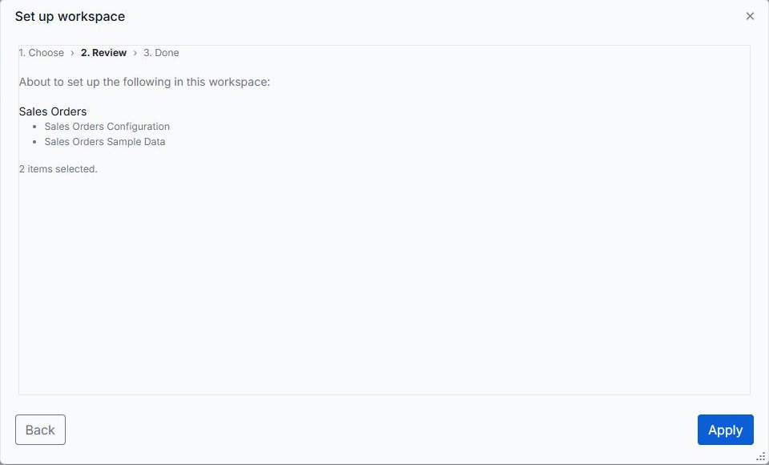
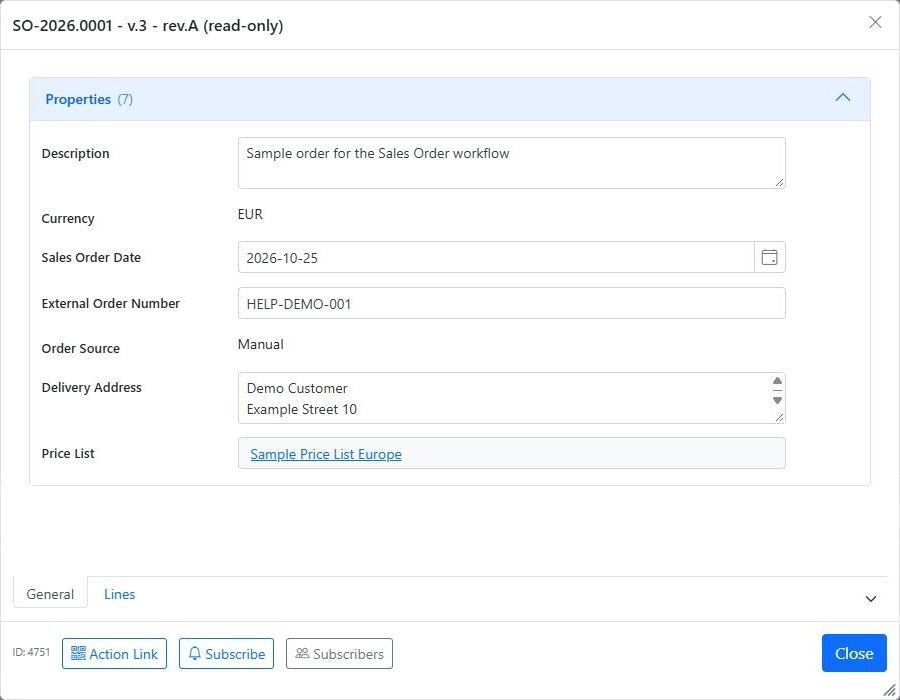
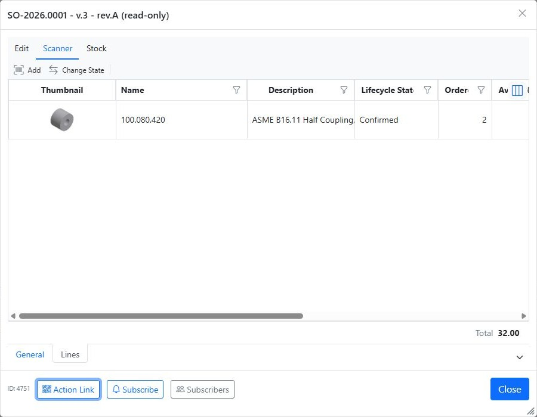
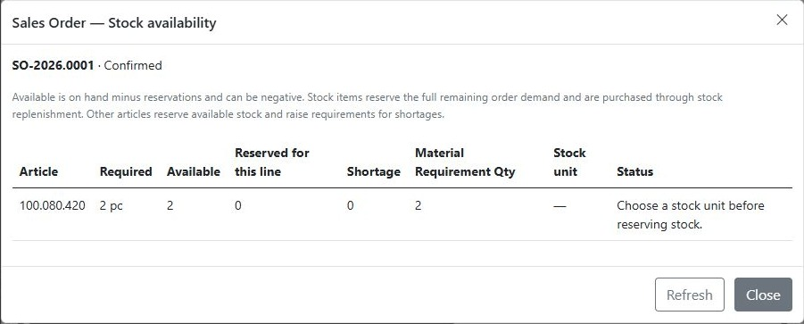
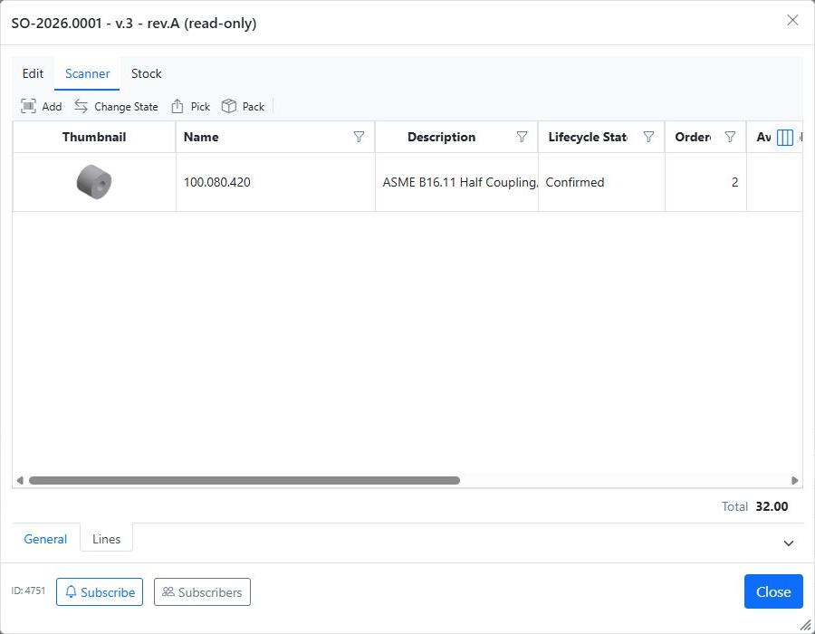
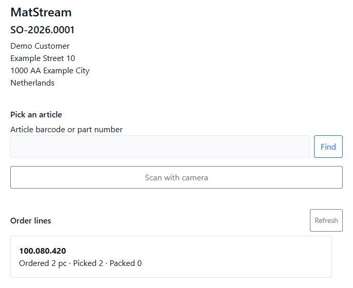
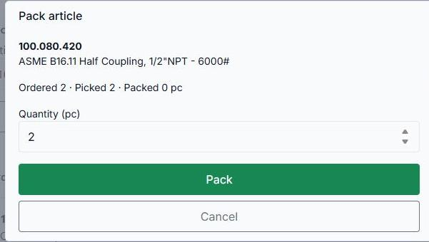
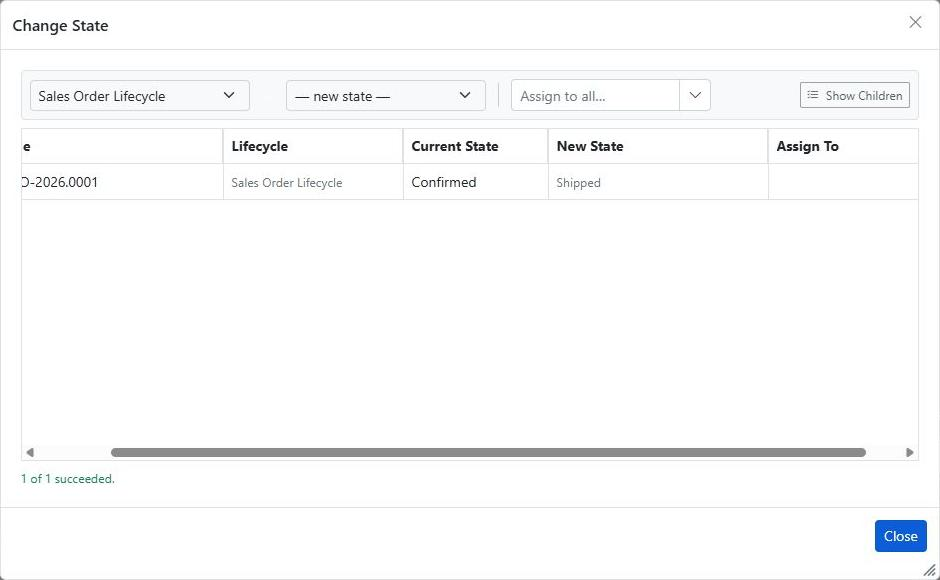
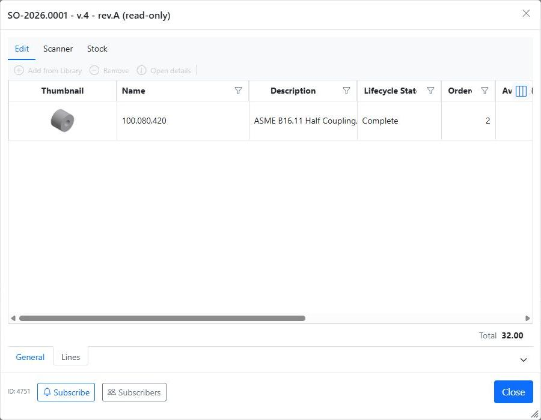

# Sales Order flow

This guide follows the standard **Sales Orders** setup created by the workspace wizard, from a new customer order to shipment. Your administrator may have changed the available fields, buttons, or permissions.

**Flow:** Draft → Confirmed → Pick → Pack → Shipped. If only part of the order can be delivered, use **Shipped Incomplete** and finish the remaining delivery later.

## Before you start

In **manage.matstream.com**, create or select your workspace and open **Setup Wizard**:

1. Select **Sales Orders Configuration**. For a practice workspace, also select **Sales Orders Sample Data**.
2. Clear the other templates if you only want the Sales Orders setup.
3. Click **Next**, check the selected items, and click **Apply**.
4. Wait for **Setup complete**, then click **Open MatStream**.

The setup provides the order categories, lifecycle, pricing, stock locations, and purchasing configuration. Sample data includes articles, suppliers, and a sample EUR price list.

Your user needs the appropriate permissions for sales, warehouse, or purchasing work. Articles should have the correct stock unit, stock settings, and prices before you use them on an order. The sample article used here needs its **Stock Unit** set to **Piece (pc)** before stock reservation can work. Selecting pc on the order line alone does not configure the article's stock unit.

## 1. Create a Sales Order

In **Explorer**, open **Sales → Sales Orders** and create a **Sales Order**. It starts in **Draft** and receives an order number automatically.

Enter the order date, external order number, order source, delivery address, and currency. Select the appropriate **Price List** if you use price-list pricing. The seeded order sources are **BOL.COM**, **Website**, and **Manual**; choosing a source records where the order came from.

## 2. Add the order lines

Open the order's **Lines** tab and add articles from the Library. For each line, review the quantity, unit, and unit price. MatStream calculates the line total and shows the order total at the bottom of the list.

Check the prices and delivery address while the order is still in Draft. Save the order with **Save and Close** before confirming it.

For example, the sample article **100.080.420** has a unit price of **EUR 16**. Ordering **2 pc** gives a line total of **EUR 32**.

## 3. Review stock availability

On the **Lines** tab, open **Stock → Stock availability**. Review the required quantity, available stock, reservations, and shortages for each article.

Available stock means stock on hand minus existing reservations. Correct any unit or configuration errors before confirming the order. Reviewing this window does not itself reserve stock.

## 4. Confirm the order

Close the order details, select the Sales Order in Explorer, and choose **Change State**. Set its **New State** to **Confirmed**, click **Apply**, and check the result.

MatStream confirms the lines and handles their stock demand:

- **Stock items:** reserves the remaining order demand. Shortages are handled through stock replenishment; available stock can become negative.
- **Other articles:** reserves available stock and creates Material Requirements for the shortages, beneath the relevant order lines.

Confirmation records demand; it does not mean that every article is physically ready to ship.

## 5. Arrange missing stock

For stock items, purchasing uses stock replenishment. For other articles, process the Material Requirement created by confirmation:

1. Open **Purchasing → Pending Material Requirements (MR)** and select the requirement.
2. Choose **Procurement → Create Purchase Order**, review the selection, and create the order. The configured supply source determines the supplier.
3. Open **Purchasing → Open Purchase Orders**. With the vendor-portal Word template, complete **Supplier Email** and [prepare the vendor share](../workflows/vendor-purchase-order.md) before changing the new order to **Issued**. The issue automation attaches the PO PDF with its portal QR code and URL.
4. Expand the purchase order and select its **Purchase Order Line**, then choose **Procurement → Receive**.
5. Choose a receiving location, check the quantity, and click **Receive**. In this example, receive **2** into **01-A**.

Check the receipt result, then reopen the Sales Order's **Stock availability** to review the latest situation. If it reports **Choose a stock unit before reserving stock**, correct the article's Stock Unit before continuing.

## 6. Pick the articles

### Print a warehouse list (optional)

The Sales Orders setup includes two A4 Word templates: **Sales Order - Pick List - A4 Portrait** and **Sales Order - Packing List - A4 Portrait**. They produce printable PDFs with no prices.

In Explorer, select the **Sales Order**, open **Export**, choose the required template under **Print Templates**, and click **PDF**. Print the downloaded document. If the templates are missing in an existing workspace, an administrator can rerun **Sales Orders Configuration** in the setup wizard after the updated Manage application has been published.

The pick list shows ordered quantities and the quantities already picked. The packing list shows ordered quantities and quantities already packed, with room for checks, names, and parcel count. Both show cumulative totals for the whole order; they do not allocate articles to individual parcels or partial deliveries. Printing a list does not record picking, packing, or shipment in MatStream.

### Record picking

Open the saved Sales Order's **Lines** tab and choose **Scanner → Pick**. The picking workflow opens in the scanner dialog. You can also scan its QR code on a phone, or choose **Open on this device**, and sign in with an authorized workspace account.

Enter or scan the article's barcode or part number and click **Find**. Check the matched article, enter the quantity collected, and confirm **Pick**.

You can pick in several batches. The picked quantity cannot exceed the ordered quantity.

After picking, check the **Order lines** summary. In this example it shows **Ordered 2 pc · Picked 2 · Packed 0**.

## 7. Pack the delivery

Return to the order's **Lines** tab and choose **Scanner → Pack**. Find the article, enter the quantity being packed, and confirm **Pack** to record the articles placed in the delivery. Check the delivery address and the physical contents before proceeding.

Packing can also happen in batches, but you cannot pack more than has been picked. Picking and packing record progress; shipment is confirmed separately on the order.

When all pieces have been packed, the scanner may show **This order is complete or closed**. This ends the scanner work; you must still confirm shipment on the Sales Order.

## 8. Confirm shipment

Change the Sales Order state to:

- **Shipped** when every ordered quantity has been packed for shipment.
- **Shipped Incomplete** when you are shipping the packed portion and quantities remain outstanding.

Close the scanner and order details, select the Sales Order in Explorer, and choose **Change State**. Select **Shipped** in the order row's **New State** field, click **Apply**, and check the success result.

MatStream records the newly shipped quantities and calculates the **Back Order Quantity**. For configured stock items, shipment also updates stock and releases the shipped reservation. Fully delivered lines become **Complete**; lines with outstanding quantities become **Incomplete**.

Reopen **Lines** to check the result. The example order has two pieces picked and packed, and its line is now **Complete**.

## 9. Finish any remaining delivery

For an order marked **Shipped Incomplete**, arrange the missing articles and return the order to **Confirmed** to continue fulfilment. Pick and pack the outstanding quantities, then confirm the next shipment.

Once all quantities are delivered, move the order to **Shipped**.

## Cancel an unshipped order

If an order will not proceed, change it from **Draft** or **Confirmed** to **Cancelled**. Cancellation releases its stock reservations. Do not use cancellation to undo goods that have already been shipped.

## Print a draft invoice

The setup also provides **Sales Order - Draft Invoice - A4 Portrait**. Select the Sales Order in Explorer, open **Export**, choose this template, and generate a **PDF** or editable **Word** document.

It fills the order reference, delivery address, article descriptions, ordered quantities, unit prices, line amounts, currency, and net order total. It uses the full ordered quantities, not the quantities in one partial shipment.

The document is marked **DRAFT INVOICE**. Complete and verify the seller and customer billing details, invoice number and date, tax/VAT, total payable, and payment details before issuing. These details are not calculated by the template. Generating it does not create an accounting invoice or mark the order as paid.
