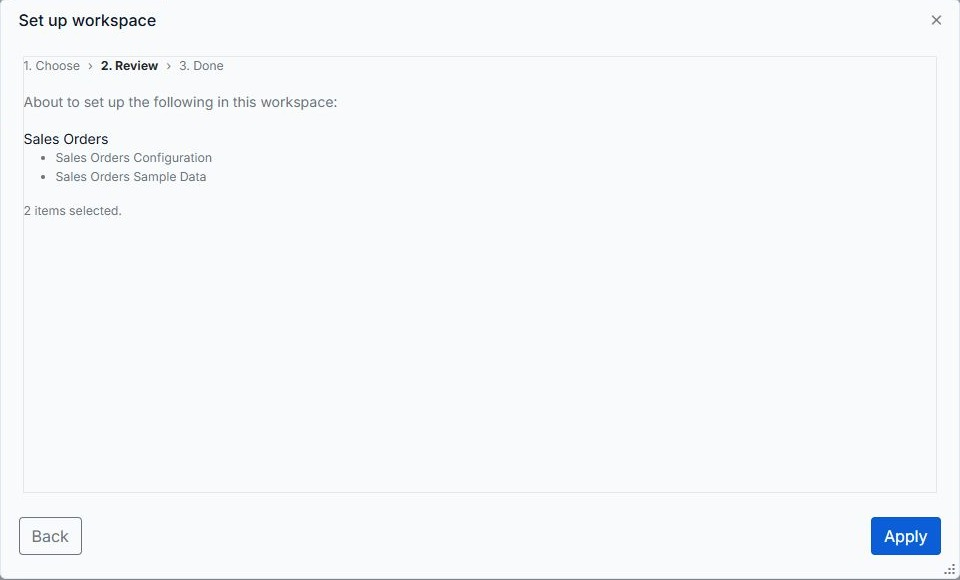
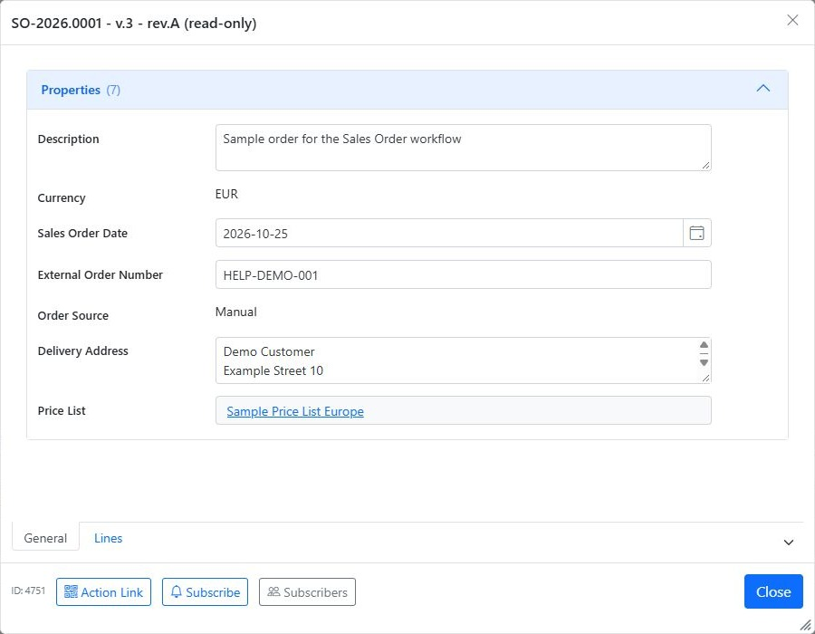
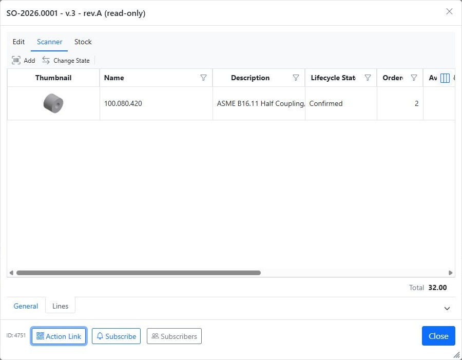

# Create and confirm a Sales Order

**Department: Sales.** Create a customer order, check its prices and stock demand, confirm it, and prepare its invoice document. This workflow ends with the handoff to Procurement and Warehouse.

A Sales Order is the customer's demand. Its lines connect the ordered articles, quantities and prices to the same entity structure used throughout MatStream. Categories, lifecycle states and permissions determine who can change each part of the order.

!!! tip "Confirmation is a handoff"
    Confirmed means the order and its demand have been recorded. It does not mean the goods have arrived, been picked, or been shipped.

## Before you start

In **manage.matstream.com**, create or select your workspace and open **Setup Wizard**:

1. Select **Sales Orders Configuration**. For a practice workspace, also select **Sales Orders Sample Data**.
2. Clear the other templates if you only want the Sales Orders setup.
3. Click **Next**, check the selected items, and click **Apply**.
4. Wait for **Setup complete**, then click **Open MatStream**.

The setup provides the order categories, lifecycle, pricing, stock locations, and purchasing configuration. Sample data includes articles, suppliers, and a sample EUR price list.

Your user needs the appropriate permissions for sales, warehouse, or purchasing work. Articles should have the correct stock unit, stock settings, and prices before you use them on an order. The sample article used here needs its **Stock Unit** set to **Piece (pc)** before stock reservation can work. Selecting pc on the order line alone does not configure the article's stock unit.

## 1. Create a Sales Order

In **Explorer**, open **Sales → Sales Orders** and create a **Sales Order**. It starts in **Draft** and receives an order number automatically.

Enter the order date, external order number, order source, delivery address, and currency. Select the appropriate **Price List** if you use price-list pricing. The seeded order sources are **Website** and **Manual**; choosing a source records where the order came from.

## 2. Add the order lines

Open the order's **Lines** tab and add articles from the Library. For each line, review the quantity, unit, and unit price. MatStream calculates the line total and shows the order total at the bottom of the list.

Check the prices and delivery address while the order is still in Draft. Save the order with **Save and Close** before confirming it.

For example, the sample article **100.080.420** has a unit price of **EUR 16**. Ordering **2 pc** gives a line total of **EUR 32**.

## 3. Review stock availability

On the **Lines** tab, open **Stock → Stock availability**. Review the required quantity, available stock, reservations, and shortages for each article.

Available stock means stock on hand minus existing reservations. Correct any unit or configuration errors before confirming the order. Reviewing this window does not itself reserve stock.

## 4. Confirm the order

Close the order details, select the Sales Order in Explorer, and choose **Change State**. Set its **New State** to **Confirmed**, click **Apply**, and check the result.

MatStream confirms the lines and handles their stock demand:

- **Stock items:** reserves the remaining order demand. Shortages are handled through stock replenishment; available stock can become negative.
- **Other articles:** reserves available stock and creates Material Requirements for the shortages, beneath the relevant order lines.

Confirmation records demand; it does not mean that every article is physically ready to ship.

## 5. Create the Sales Order invoice document

The setup also provides **Sales Order - Draft Invoice - A4 Portrait**. Select the Sales Order in Explorer, open **Export**, choose this template, and generate a **PDF** or editable **Word** document.

It fills the order reference, delivery address, article descriptions, ordered quantities, unit prices, line amounts, currency, and net order total. It uses the full ordered quantities, not the quantities in one partial shipment.

The document is marked **DRAFT INVOICE**. Complete and verify the seller and customer billing details, invoice number and date, tax/VAT, total payable, and payment details before issuing. These details are not calculated by the template. Generating it does not create an accounting invoice or mark the order as paid.

!!! note "Invoice document and accounting invoice"
    The standard template creates a **draft full-order invoice**. Generating it does not post an invoice, calculate VAT, record payment, or ship goods. Your invoicing process must complete and approve the billing details before issue.

## Result and next department

The Sales Order is **Confirmed**, its lines and prices have been reviewed, and the draft invoice document can be prepared. Keep the Sales Order number available when following up with other departments.

| Department | Next workflow |
|---|---|
| Procurement | [Arrange missing stock](../workflows/arrange-missing-stock.md) |
| Warehouse receiving | [Receive goods into the warehouse](../workflows/receive-warehouse-goods.md) |
| Warehouse dispatch | [Open orders, picking, packing and sending](../workflows/pick-pack-send.md) |

If an unshipped order will not proceed, Sales can change it from **Draft** or **Confirmed** to **Cancelled**. Cancellation releases its reservations; it does not undo a previous shipment or automatically cancel a supplier's PO. Coordinate purchased goods with Procurement.
