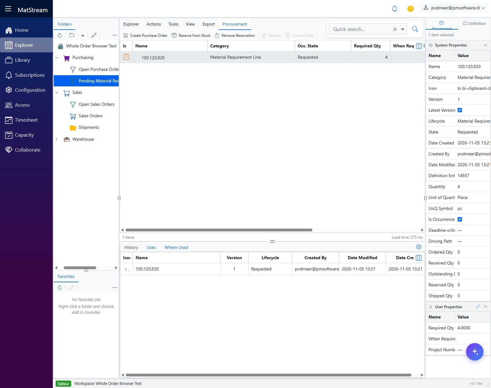
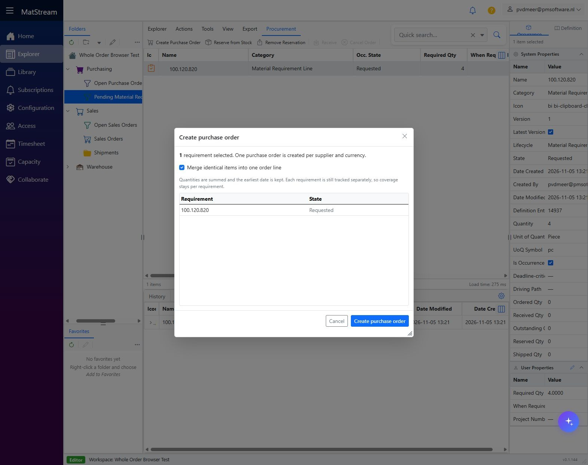
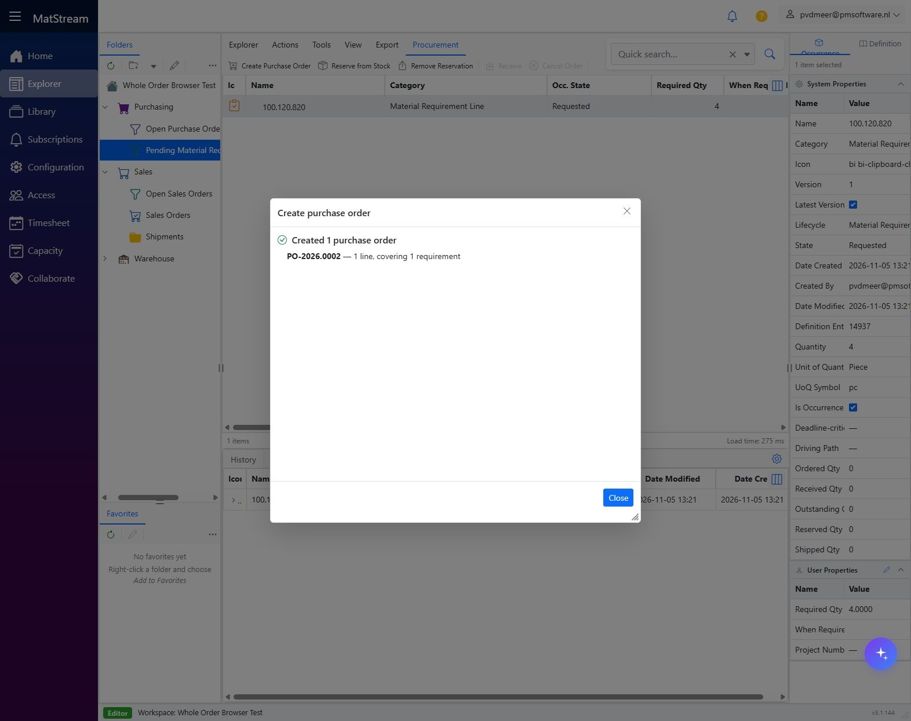
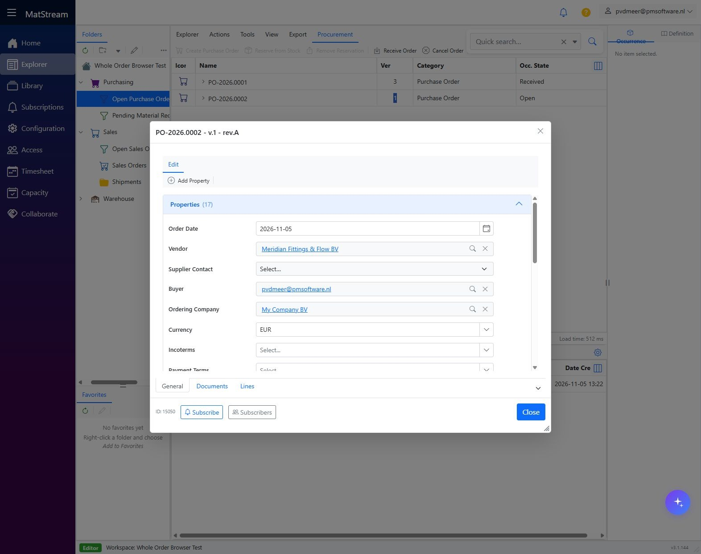
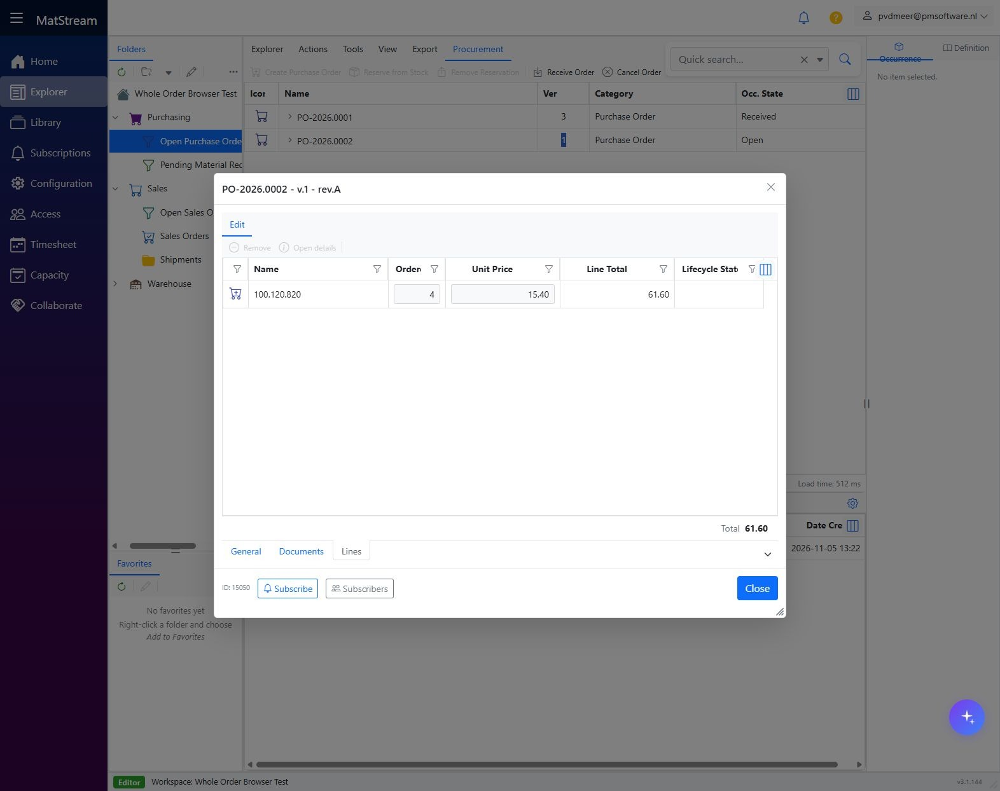
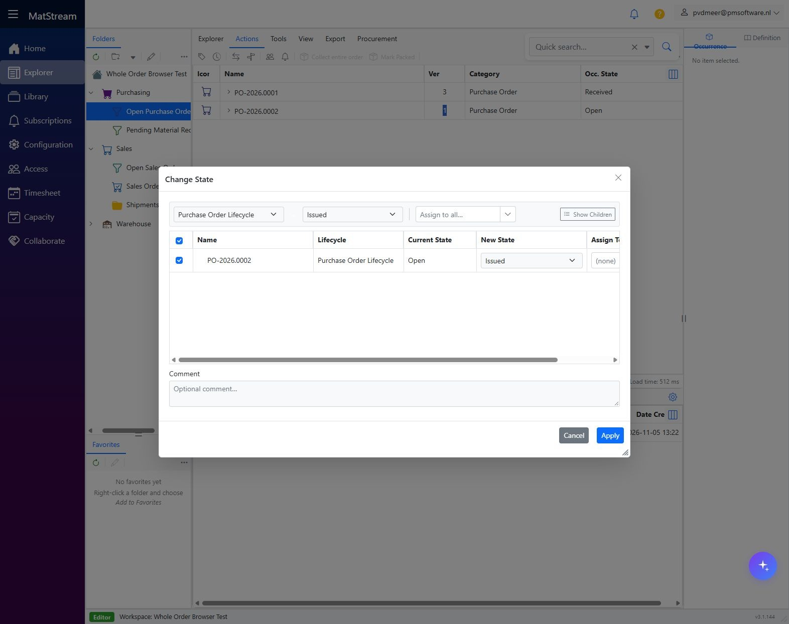

# Create a Purchase Order from Material Requirements

**Department: Procurement.** Turn confirmed demand into a linked supplier PO, review it, and issue it for Incoming Goods. Creating or issuing a PO does not receive stock.

<video controls preload="metadata" poster="../../images/department-workflows/procurement-03-review.jpg" style="width:100%;max-height:75vh" aria-label="Create a PO from Material Requirements walkthrough">
  <source src="../../media/department-workflows/MatStream-Procurement-Workflow.mp4" type="video/mp4">
  Your browser does not support embedded video. Use the download link below.
</video>

[Download movie](../media/department-workflows/MatStream-Procurement-Workflow.mp4) · [Download subtitles](../media/department-workflows/MatStream-Procurement-Workflow.srt)

## Before you start

Sales has [confirmed the customer order](create-sales-order.md), or stock replenishment has raised an MR. You need purchasing permissions and access to the requirements, articles and suppliers. Review source, supplier price, currency, unit and ordering text.

For stock items, **Stock Unit**, **Is Stock Item**, **Minimum Stock Qty** and **Maximum Stock Qty** govern replenishment. Both limits are needed: minimum is nonnegative and maximum exceeds minimum. The background job considers **On Hand − Reserved + On Order** and can buy more than one customer order's shortage to restore the maximum. See [automatic stock replenishment](../features/stock.md#automatic-stock-replenishment) if a requirement is missing.

## 1. Review the Material Requirements

Open **Purchasing → Pending Material Requirements (MR)**. Select the requirements to buy and check their quantities, state, source and originating Sales Order or replenishment demand. The example MR requests **4 pc** for **SO-2026.0002**.

## 2. Create the Purchase Order

Choose **Procurement → Create Purchase Order**. Review the selection and **Merge identical items into one order line** option. When enabled, quantities are summed and the earliest date is retained; each requirement remains tracked separately.

Click **Create purchase order**, then inspect created orders, skipped rows and warnings. MatStream creates one PO per **supplier and currency**. Resolve missing source information for skipped requirements rather than assuming everything was ordered.

## 3. Review the supplier order

Open the new order under **Purchasing → Open Purchase Orders**. Check vendor, ordering company, supplier contact/email, delivery and invoice addresses, currency and commercial terms. On **Lines**, review quantity, unit, supplier price and ordering text.

The example buys **4 pc × EUR 15.40 = EUR 61.60**. Supplier cost is separate from the customer's selling price.

## 4. Issue the Purchase Order

Close details, select the **PO header**, and choose **Change State → Issued → Apply**. Check the transition result.

Issuing and sending are separate actions. When using the vendor-portal Word template, follow [Share a PO with a vendor](vendor-purchase-order.md) to prepare the share before generating that document. Review the issued PDF and send it through your purchasing process. The demonstration does not create a vendor share or send an invitation.

## Result and handoff

The supplier PO is **Issued** and its outstanding quantities are visible. Give Incoming Goods the PO reference and delivery information, then follow [Receive a complete supplier delivery](receive-warehouse-goods.md).

A customer cancellation does not automatically cancel the supplier order. Coordinate commitment changes with Sales.
