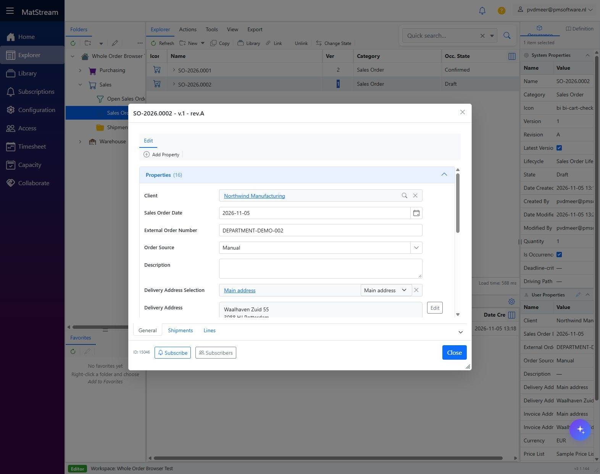
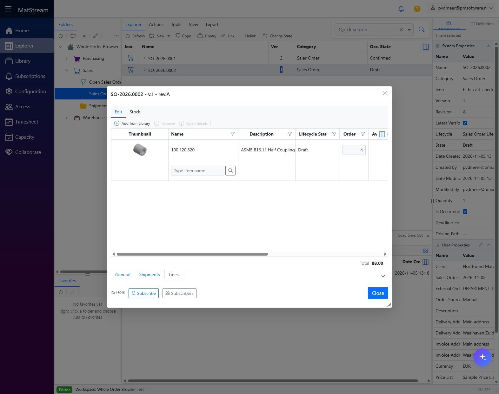
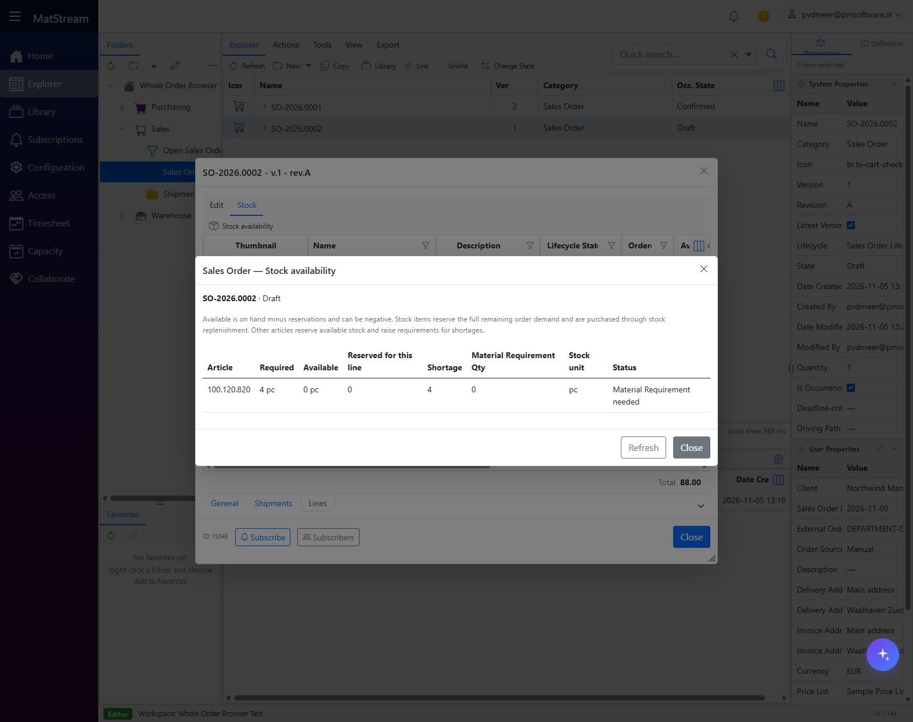
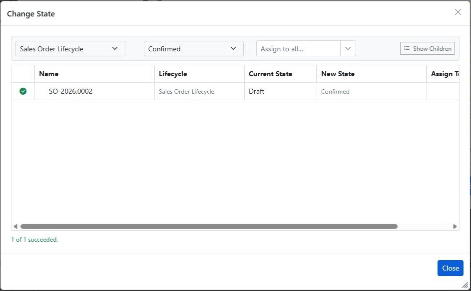

# Create and confirm a Sales Order

**Department: Sales.** Record the customer order, review its articles and prices, check availability, then confirm demand for Procurement and Warehouse.

<video controls preload="metadata" poster="../../images/department-workflows/sales-03-header.jpg" style="width:100%;max-height:75vh" aria-label="Create a Sales Order walkthrough">
  <source src="../../media/department-workflows/MatStream-Sales-Workflow.mp4" type="video/mp4">
  Your browser does not support embedded video. Use the download link below.
</video>

[Download movie](../media/department-workflows/MatStream-Sales-Workflow.mp4) · [Download subtitles](../media/department-workflows/MatStream-Sales-Workflow.srt)

## Before you start

An administrator has run **Sales Orders Configuration** in Manage; a practice workspace can also include **Sales Orders Sample Data**. You need access to the customer, articles and order actions. Check article units, supplier sources and pricing. A Library article needs its **Stock Unit** configured before reservation; selecting pc on the order line alone does not configure it.

The connected example orders **4 pc** of **100.120.820** at **EUR 22.00**, total **EUR 88.00**. Its shortage becomes the MR used in Procurement. Your generated numbers and prices may differ.

## 1. Create a Sales Order

Open **Explorer → Sales → Sales Orders**, choose **New → Sales Order**, and accept the generated number. The order starts in **Draft**.

Choose the **Client**, date, external customer reference and order source. Select delivery and invoice addresses explicitly and verify their text. Review currency and price list.

## 2. Add the order lines

Open **Lines → Add from Library**, select an article and add it. Review quantity, unit and unit price. MatStream calculates line and order totals. The example is **4 × EUR 22.00 = EUR 88.00**.

Choose **Save and Close** before confirming. Reopen the saved order to check its values if necessary.

## 3. Review stock availability

On **Lines**, choose **Stock → Stock availability**. Review required, available, reserved and shortage quantities. Reviewing this window does not reserve goods.

For articles sourced against the order, confirmation creates MRs for uncovered quantities. For **Is Stock Item** articles, confirmation reserves demand and shortages follow [stock replenishment](../features/stock.md#automatic-stock-replenishment). A reservation does not prove goods have arrived.

## 4. Confirm the order

Close details, select the saved **Sales Order header**, and choose **Change State**. Set **New State → Confirmed**, click **Apply**, and inspect the result. Do not continue after a failed transition.

## Result and handoff

The order is **Confirmed**. In this example, the missing four pieces produce a Material Requirement for Procurement.

- **Procurement:** [Create a PO from MRs](arrange-missing-stock.md).
- **Incoming Goods:** [Receive a complete supplier delivery](receive-warehouse-goods.md).
- **Dispatch:** [Pick, pack and send a full order](pick-pack-send.md).

Invoice-document preparation is a separate [Sales task](../features/sales-orders.md#5-create-the-sales-order-invoice-document).
