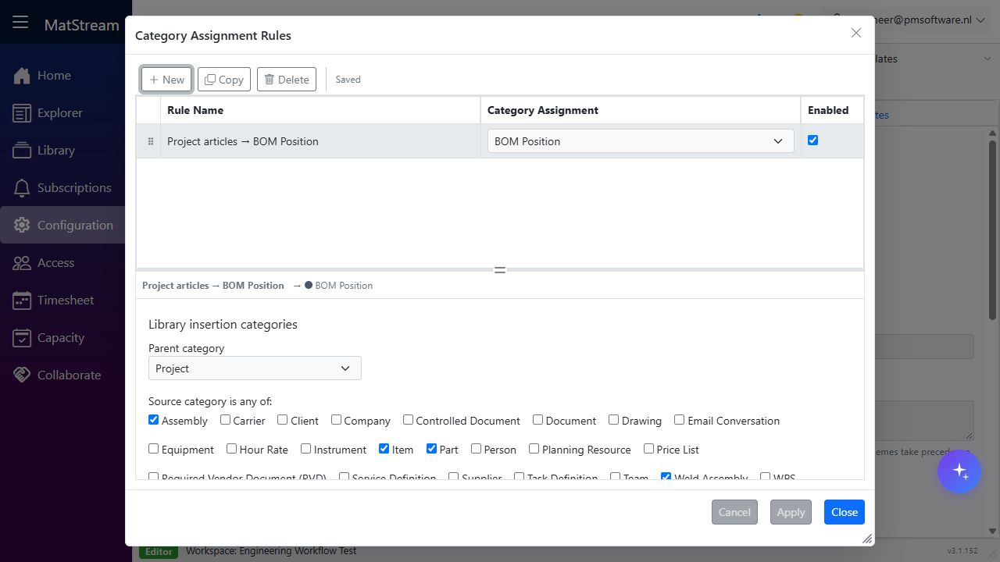
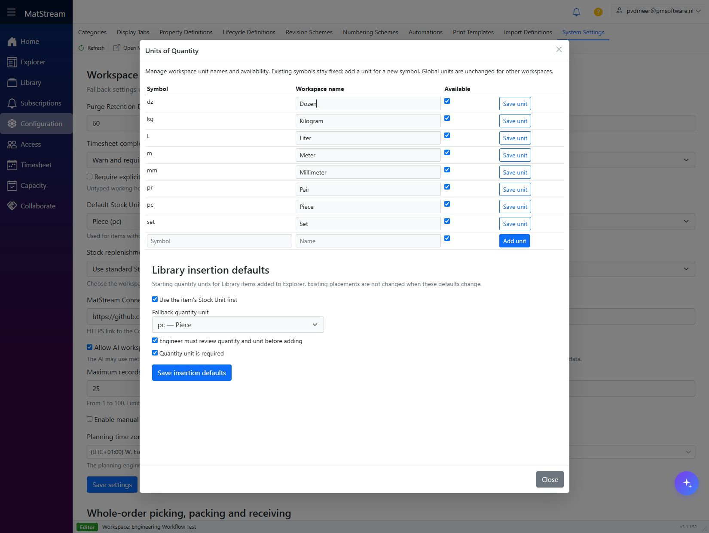
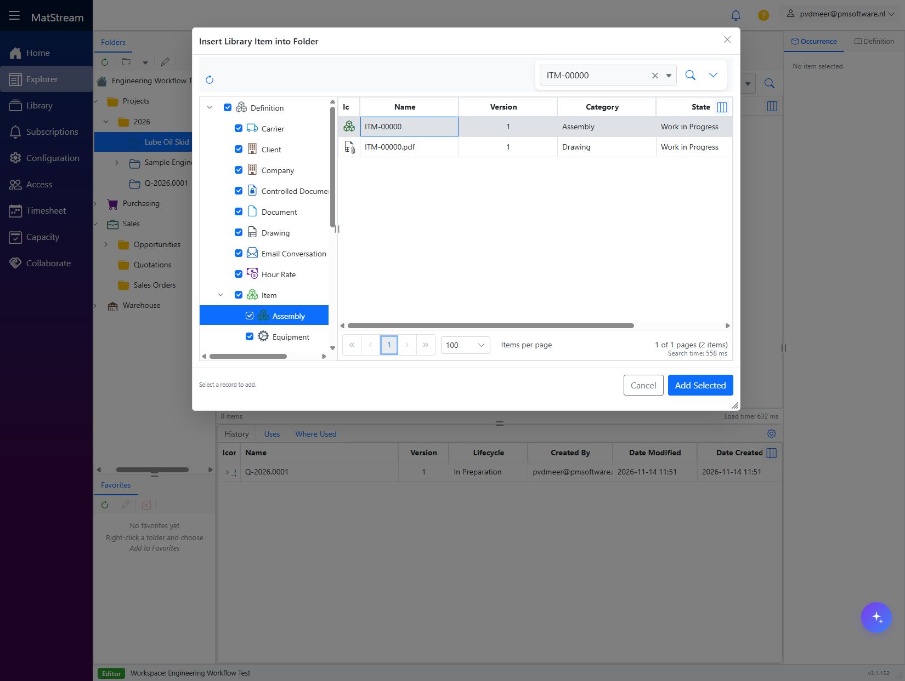
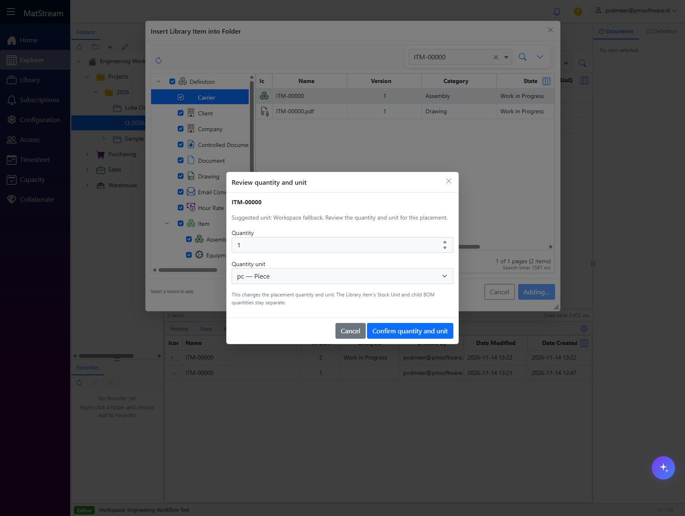
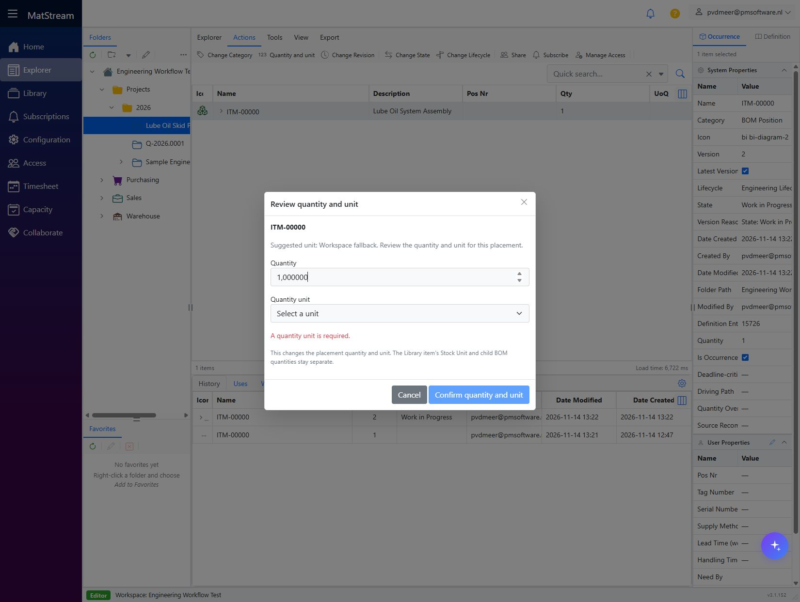
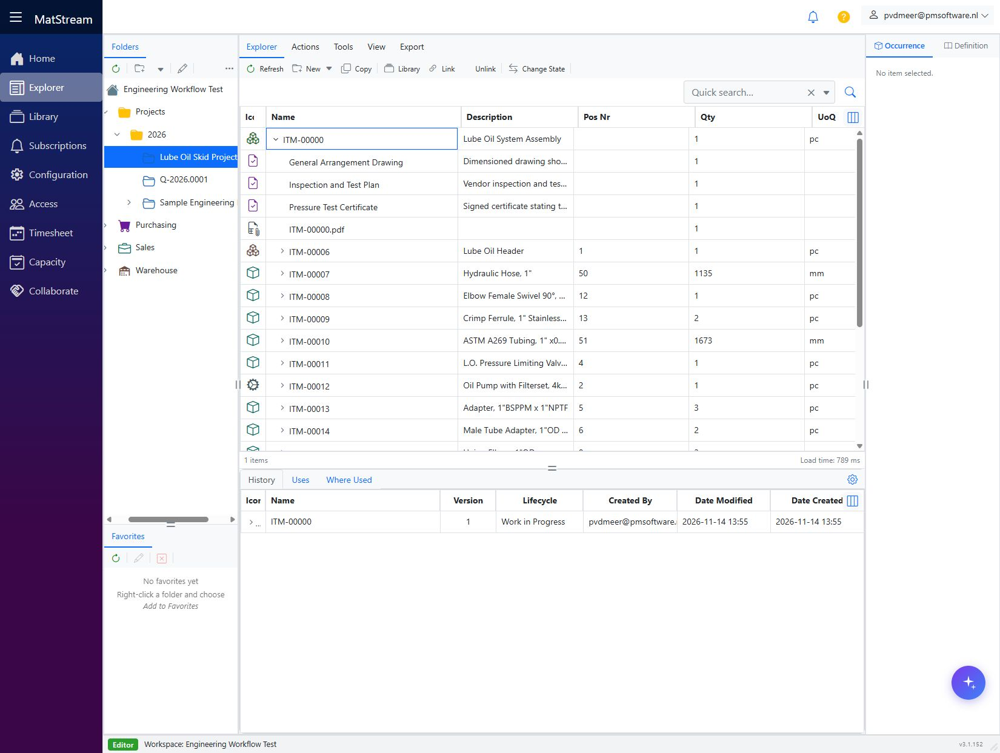
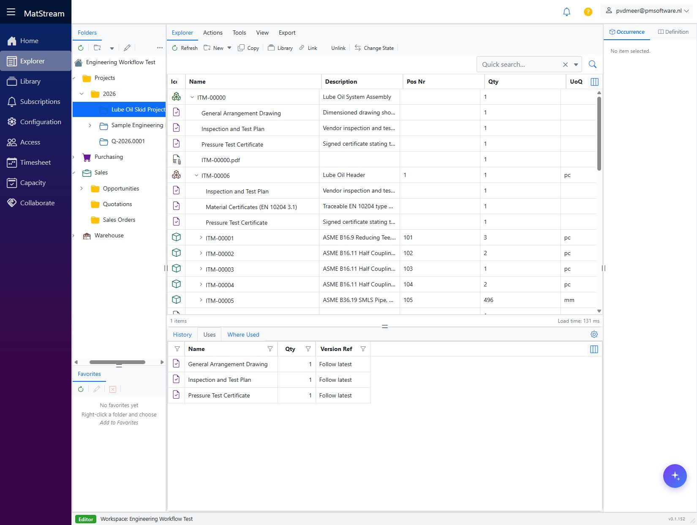
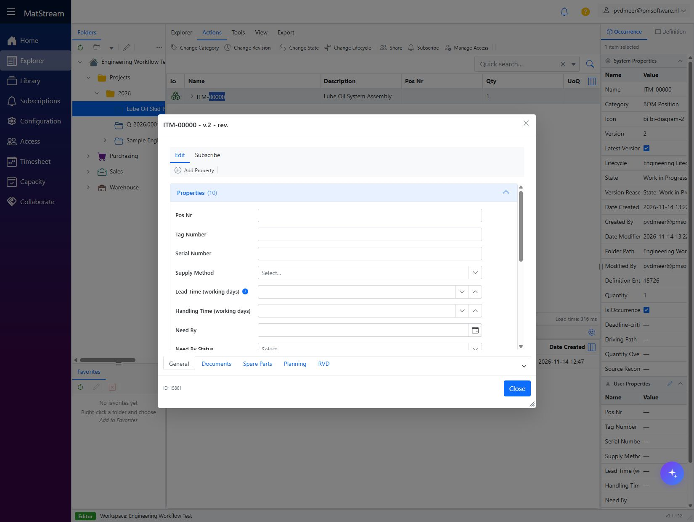
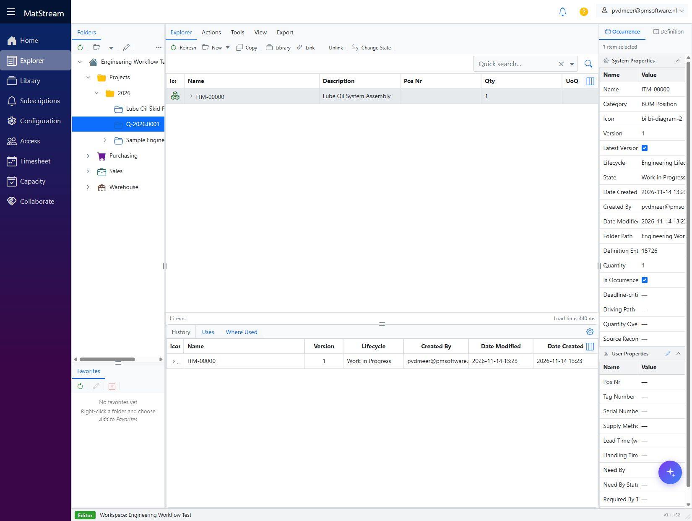

# Engineering — Add the assembly to the project

Continue from [Sales — Quotation and project](engineering-quotation-project.md). Add the existing **ITM-00000** assembly to the Lube Oil Skid project (**PRJ-2026.0001**), then inspect its BOM and header subassembly.

## Before you start

Use the project created from the accepted quotation. In this local example it is under **Explorer → Projects → 2026 → PRJ-2026.0001** (Title: Lube Oil Skid). If you created any other test project, do not use it for this build.

Engineering Project Sample Data must already be installed. ITM-00000 should exist in Library as an **Assembly**, with its drawing and BOM. You need permission to read that catalogue item and add an occurrence to the project.

!!! note "Category rule added after the first test"
    Engineering configuration seeds **Project articles → BOM Position**. Assembly, Weld Assembly, Item and Part definitions inserted directly under a Project become BOM Positions and start in that category's configured default lifecycle. A separate insertion policy now uses **Stock Unit first, fallback pc, engineer review and unit required**. Both policies are administrator-editable. The original test occurrence was repaired without replacing it and now shows **1 pc**.

## Administrator setup

Open **Configuration → Categories → Assignment Rules**. Select **Project articles → BOM Position** and review:

- **Category Assignment:** BOM Position.
- **Parent category:** Project.
- **Source category is any of:** Assembly, Weld Assembly, Item and Part.
- **Enabled:** checked.

The administrator can change the target, parent and selected sources, rename or disable the rule, and reorder rules. Matching uses category IDs, so renaming a category does not break it. Matches are exact: selecting Item does not automatically include Equipment or Instrument. A Project nested under a year folder still matches when the new item's immediate parent is the Project; inserting into a separate folder inside that Project does not match this rule.

For a new rule, choose **New**, select its target category and click **Use Library insertion categories** to configure the parent and source categories. Ordinary property/file-based rules retain their existing criteria editor.

The rule is added by **Engineering Project Configuration**, without needing sample data. Subsequent setup runs preserve its edits, disabled state, rename or deletion. Existing earlier rules retain their priority; review their order if a different rule matches first. Configure the BOM Position category's lifecycle and fields through the existing category editor.

In **Configuration → System Settings**, click **Units of Quantity** on the ribbon. In the dialog's **Library insertion defaults**, check **Use the item's Stock Unit first**, select **pc — Piece** as fallback, and enable engineer review and required unit. Click **Save insertion defaults**. These are the defaults supplied by engineering setup; later administrator changes are preserved.

An assigned, available Stock Unit takes precedence over the fallback. A unit merely offered as a default by the stock editor is not an assigned Stock Unit. ITM-00000 had no assigned Stock Unit, so this test suggested **pc** from the workspace fallback. See [Library insertion defaults](../admin/system-settings.md#library-insertion-defaults) for all options.

## 1. Select the project

Select **PRJ-2026.0001** in the Explorer folder tree. Check the project name before adding anything. The main grid was empty before this test; after adding the assembly it should contain one top-level ITM-00000 occurrence.

## 2. Insert the existing assembly

1. Click **Library** on the Explorer ribbon.
2. In **Insert Library Item into Folder**, search for **ITM-00000**.
3. Select the row named **ITM-00000**, category **Assembly**. The separate **ITM-00000.pdf** row is a Drawing; it is not the assembly to insert.
4. Click **Add Selected** once. The **Review quantity and unit** dialog opens before creation.
5. Check the suggested unit and its source. For this system, confirm quantity **1** and **pc — Piece**, then click **Confirm quantity and unit**. You may override the suggestion for this placement; a pipe placement might instead need **496 mm**.
6. Wait for insertion to finish, then close the Library picker with **Cancel**. In this test the picker stayed open after adding; Cancel closed it without removing the added occurrence. Cancel in the review dialog does not create that occurrence.

With **Quantity unit is required** enabled, clearing the unit shows a message and disables confirmation. Server validation also rejects missing or unavailable units. Review does not perform unit conversion: enter the quantity in the unit you actually select.

This creates a project occurrence linked to the existing Library assembly. Do not create another Library assembly with the same number, or separately add ITM-00006 at project level: the header is already beneath the system.

## 3. Expand and inspect the system BOM

Expand the arrow beside **ITM-00000** in the main Explorer grid. Use **Columns** to show **Description**, **Pos Nr**, **Quantity** and **UoQ Symbol**. Quantity and UoQ Symbol appear as **Qty** and **UoQ** in the grid. Hide other columns if needed to keep the quantities visible.

The expanded tree includes the drawing, material positions, required vendor documents and a supply source. These are different kinds of record: a document row is not another material demand.

Check these key rows:

| Item | Description | Position | Quantity |
|---|---|---|---|
| ITM-00006 | Lube Oil Header | 1 | 1 pc |
| ITM-00012 | Oil Pump with Filterset, 4kW | 2 | 1 pc |
| ITM-00017 | Oil Cooler | 3 | 1 pc |
| ITM-00021 | Electric Motor, 4kW | 14 | 1 pc |
| ITM-00007 | Hydraulic hose | 50 | 1135 mm |
| ITM-00010 | Tubing | 51 | 1673 mm |

The system also shows **ITM-00000.pdf**, plus **General Arrangement Drawing**, **Inspection and Test Plan** and **Pressure Test Certificate** requirements. Those requirement rows do not prove that supplier documentation has been uploaded or accepted.

The repaired top assembly now shows **1 pc**. A blank unit on an older occurrence remains unassigned until explicitly corrected; changing defaults does not backfill existing placements.

To correct an existing ordinary occurrence, select it and choose **Actions → Quantity and unit**. Review the quantity and unit, then confirm. This updates the placement while preserving the occurrence, linked definition and child BOM.

## 4. Inspect the header

Expand **ITM-00006** beneath the system. The test showed the following BOM:

| Item | Component | Position | Quantity |
|---|---|---|---|
| ITM-00001 | Reducing tee | 101 | 3 pc |
| ITM-00002 | One-inch half coupling | 102 | 2 pc |
| ITM-00003 | Half-inch half coupling | 103 | 1 pc |
| ITM-00004 | Three-quarter-inch half coupling | 104 | 2 pc |
| ITM-00005 | Pipe | 105 | 496 mm |

The expanded header also showed **ITM-00006.pdf**, its three RVD requirements, a supply source, and welds W-01 through W-08. Check that these belong beneath the header; adding a second header directly under the project would duplicate the intended assembly structure.

## 5. Record the result and remaining checks

The local test on **14 November 2026** added exactly one top-level ITM-00000 to the Lube Oil Skid project (PRJ-2026.0001). Its property browser showed it was an occurrence linked to the existing definition, with quantity 1 and the correct project folder path. The definition revision displayed **0**. The expanded system and header quantities above were inspected through the application.

These checks remain before production release:

- Review the placement quantity and unit for each inserted item. Defaults provide a starting value, not confirmation that the intended quantity is correct.
- The original Base-category issue was fixed locally: **Actions → Change Category → BOM Position** changed the existing occurrence; **Change State** assigned Engineering Lifecycle at Work in Progress. **Actions → Quantity and unit** subsequently corrected its placement to **1 pc**. The same occurrence and linked definition were retained.
- Confirm how each displayed BOM child becomes project-specific demand before procurement. Seeing a child in the expanded tree alone does not prove it has an independently editable project occurrence.
- Verify the required drawing versions, document access and revision controls during the transmittal step. This test saw the drawing rows but did not download or approve their PDFs.
- Test ordinary Engineering-role permissions separately. This walkthrough used the local workspace owner account.

No purchase demand, production release or client transmittal was created by this step. Continue with the [Engineering Project Workflow plan](engineering-project/index.md#4-document-control-client-approval-transmittal) for the approval transmittal.

### Category and unit retests

After the fix, the original ITM-00000 retained its occurrence identity, linked Library definition and quantity 1. Its editor now displays BOM Position fields, inherited Library properties and the configured Documents, Spare Parts, Planning and RVD tabs.

A fresh ITM-00000 inserted into a separate test project automatically received **BOM Position → Engineering Lifecycle → Work in Progress**. No manual category or lifecycle assignment was needed for that new occurrence. This separate project is only for rule testing; the main project still contains one top assembly.

Fresh insertions of ITM-00006 (Weld Assembly) and ITM-00001 (Part) also received that category and starting lifecycle. Item is covered by the automated rule test; the seeded Item category is a heading without a sample definition of its own. The rule was saved, reopened and retained through an Engineering Project Configuration setup run.

The subsequent unit test seeded and saved the four insertion settings, repaired the main project's original ITM-00000 to **1 pc**, and verified it after Explorer Refresh. Clearing the unit prevented confirmation. An additional fresh ITM-00000 in the separate test project opened review with **1 pc** from **Workspace fallback**; after confirmation it was a BOM Position in Engineering Lifecycle / Work in Progress with **1 pc** stored. Earlier test occurrences were not automatically changed. The main project still contains one top system assembly, with its header, hose and tubing quantities unchanged.
