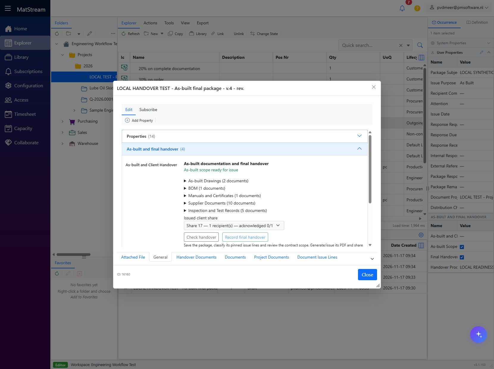
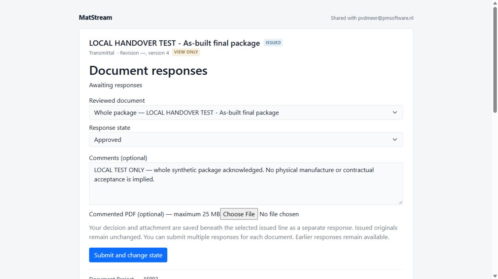
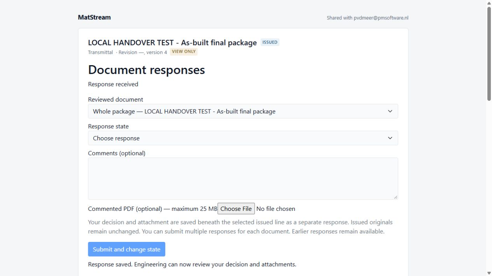
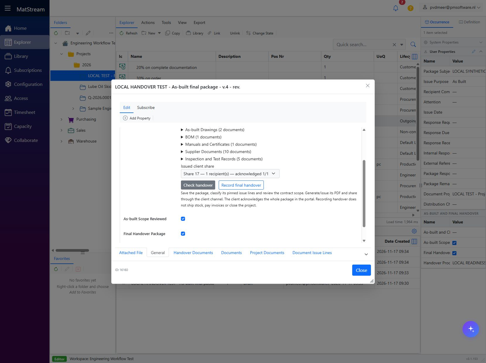
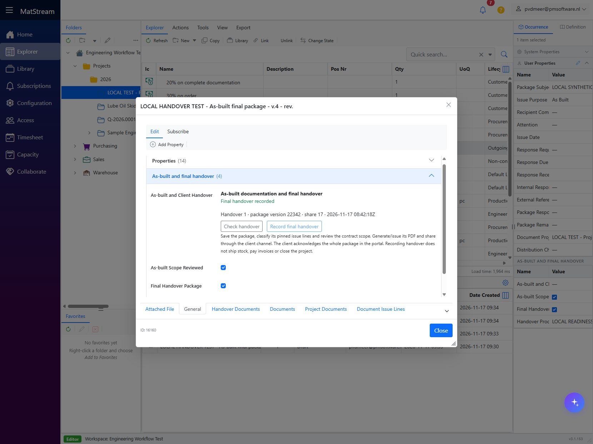
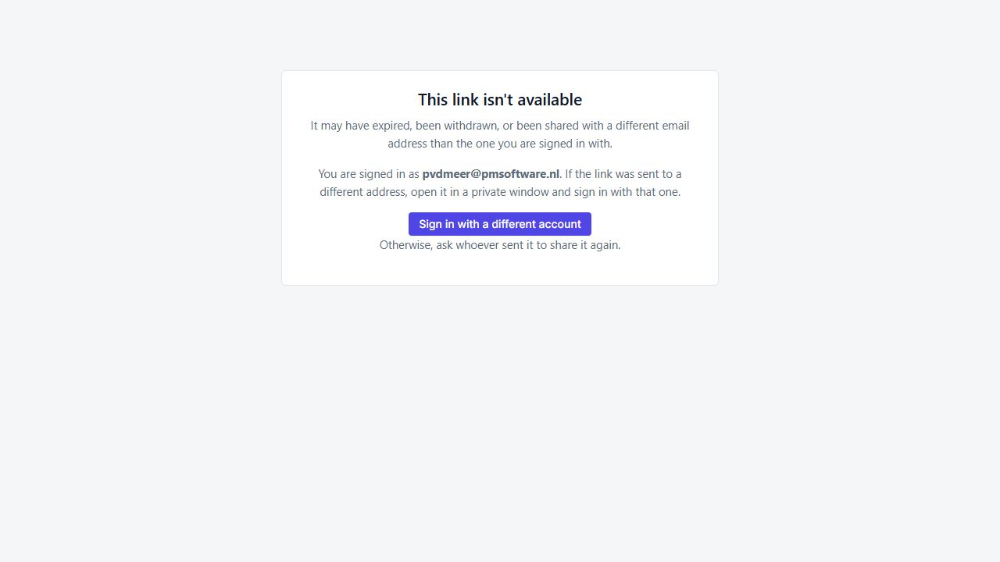

# As-built documentation package and final client handover

Use an ordinary **Transmittal** for the final as-built dossier. It retains the existing project reference, selected document versions, PDF template, distribution channels and client portal. The **Final Handover Package** flag enables the additional checklist and handover action.

For this example, ITM-00000 is the final manufactured skid and ITM-00006 is its header. The client receives the as-built drawings, BOM, supplier documents, inspection/test records and manuals/certificates as one fixed issued package.

!!! info "Local verification — 17 November 2026"
    The local test package contained **19 pinned entries**: two drawings, one BOM, one manuals/certificates index, ten supplier documents and five inspection/test records. Its PDF register was generated and issued. The browser verified acknowledgement **0/1 → 1/1**, the client's whole-package **Approved** response and **Final handover recorded**. This was clearly labelled synthetic test data, including placeholder BOM/manual and supplier/test evidence; it is not a real as-built dossier or contractual acceptance. Original current production/evidence/stock/settings were restored, and the test share was revoked. The synthetic package and handover audit remain for traceability.

## 1. Prepare the actual deliverables

Engineering, Quality and the project manager review the contract before selecting files. Typical contents are:

| Section | ITM-00000 / ITM-00006 example | Seeded minimum |
|---|---|---|
| As-built Drawings | Final Vault-released skid and header drawings, including agreed tag numbers and actual changes | 2 |
| BOM | Reviewed as-built BOM export matching what was manufactured | 1 |
| Supplier Documents | Accepted motor/pump documentation and other contractual RVDs | 1 |
| Inspection and Test Records | Accepted header fabrication/test and final assembly inspection/test reports | 1 |
| Manuals and Certificates | Operating/maintenance manuals, certificates and other required handover information | 1 |

The administrator can change these sections, descriptions, categories, counts and allowed states. A minimum is a completeness aid, not proof that the contract requires only that many documents. The responsible team must include **all** applicable RVDs, reports and deliverables, and confirm the actual manufacturing changes. MatStream does not generate an as-built Inventor model, invent missing certificates or automatically export the CAD BOM.

Upload/revise the controlled drawings, BOM and manuals in their normal project document locations. The seeded rules use **Released** controlled documents/drawings and **Accepted** RVD/inspection records. Use the real approved file, revision and evidence. A filename or checked review box cannot replace the engineering/Quality review.

The default handover policy also requires the selected **final production order** to be Completed, to pass its current completion/inspection checks and to have a finished-output warehouse receipt. Follow [production completion](engineering-production-completion.md) and [warehouse receipt](engineering-production-receipt.md) first. Production/material issue and physical delivery remain separate operations.

## 2. Create the handover transmittal

1. Create a Transmittal beneath the project and set **Document Project** to that same project.
2. Set the subject, **Issue Purpose = As Built**, issue date and the **Client** Distribution Channel (or named client recipients when sharing directly).
3. Check **Final Handover Package** and select **Handover Production Order**, for example the ITM-00000 final assembly order.
4. Leave **As-built Scope Reviewed** unchecked until the actual contents and contractual scope have been reviewed.
5. Save the transmittal.

The project manager, engineer and document controller prepare the records through their normal permissions. Administrators define the categories, fields, lifecycle and policy; they do not have to maintain each project's dossier themselves.

## 3. Select and classify the documents

Open **Handover Documents**. This is a Project Documents tab with an **engineer-editable filter**, checkboxes and **Choose columns**. Its defaults include file-backed supplier and inspection records as well as drawings and controlled documents.

Select the required records and choose **Add selected documents**. The existing Document Issue Lines hold the exact selected versions. For each line, set **Handover Section** through its details, or add that property to the issue-line grid with Choose columns. Check the pinned revision and file before signing off.

The selection options reuse existing files rather than uploading their bytes again:

- **Include file-backed occurrence records** makes RVDs and inspection records selectable.
- **Include evidence on PO lines fulfilling this project's material requirements** follows a project MR to its fulfilling PO line, then finds documents under that line. It does not include unrelated lines on the same global PO.
- The server still enforces project scope, document categories, read access, preparation states and version checks. The ordinary Project Documents tab retains its existing defaults.

After reviewing the completed register, set **As-built Scope Reviewed**, save and choose **Check handover**. Missing sections, unsuitable states, unpinned/unavailable files, wrong project and unmet configured production conditions block readiness.

The local example showed five sections with 19 selected files and no client acknowledgement yet:



## 4. Generate, issue and share the fixed package

Use **Generate Transmittal PDF** from the existing document register. It generates the cover/register directly on the Transmittal using the administrator's template and mappings. Regeneration during preparation creates a history version. If you change the selection, classification, header or template, regenerate before issue.

Move through **Ready to Issue → Issued**. The seeded transition checks both current PDF consistency and the as-built checklist. Ordinary transmittals without the final-handover flag do not need the as-built sections.

Share the issued package through the Client channel or the normal sharing dialog. Enable package review for the named client reviewer(s), allow download and use the intended expiry. The portal receives the generated register and the **pinned document versions**; subsequent Library uploads do not replace those issued files. New evidence can be included only through a reviewed replacement issue.

Before using RVD/inspection categories externally, the workspace administrator must explicitly enable them in **Document package portal settings → Document categories**. Existing portal visibility selections are preserved by Setup. Also allow **As Built** in **Document review settings → Review purposes**, permit whole-package responses and configure client response transitions. New review setups include As Built; existing customised purpose lists are preserved. The local test temporarily enabled these settings and restored them afterwards.

## 5. Client acknowledgement in the portal

The client opens their named share, downloads/reviews the register and files, and selects **Whole package** in the response form. They choose an allowed response state, such as **Approved**, add comments if needed and submit.



The response is an ordinary **Document Review Response** with a direct lifecycle state and protected submission context identifying the exact share, package version and file. It is separate from the issued originals. Normal configured lifecycle subscriptions apply; enable **Notify package subscribers** in review settings if the project manager/document controller subscribes to package responses.



The administrator chooses which response-state IDs count as handover acknowledgement (seed: Approved), and whether all assigned reviewers or at least one must acknowledge. Document-line approvals do not acknowledge the entire dossier. A response for another share, package version or file does not qualify. Reopening/changing a response before recording is evaluated using its current lifecycle state.

## 6. Record final handover

The project manager/document controller opens the transmittal and chooses **Check handover**. Select the actual client share; its label shows the acknowledgement count. The local browser test changed from **0/1** to **1/1**, enabling the recording action:



Choose **Record final handover**. The stored script checks the current scope, issue state, generated PDF, live complete client share, configured responsible group and required whole-package acknowledgement. A share that hides required document categories or blocks downloads does not qualify under the default policy.



The handover journal retains the exact package/share, document pins, section register, production-order reference, acknowledgement response versions/states, recipient identities, responsible user, UTC time and policy used. Repeating the action reuses the same record. Independent concurrent requests cannot create two records for the same package.

The example recorded **handover 1**, package version **22342**, share **17**. It remains a historical fact if a share later expires or is revoked; it does not assert that the portal link is still live. Amendments need a new/replacement transmittal and acknowledgement. Do not overwrite the previous handover or reinterpret an old share as a new delivery.

Recording handover **does not** ship inventory, execute payment/invoicing, close MRs/POs or close the project. The team must still complete any physical dispatch, contractual/commercial actions and project closure separately.

## Administrator configuration

New Engineering Project setups include **As-built Package and Client Handover**. Existing workspaces can install it after Document Control/direct client responses, Production Orders, Production Readiness, Production Completion and Warehouse Receipt. Apply the repeatable API handover migration. Setup markers preserve installed administrator changes on reruns.

| Application UI | Configurable settings |
|---|---|
| Automations → Project: Evaluate as-built handover | `AsBuiltHandover` section names/descriptions/counts, document categories/states, property/category mappings, definition-link owners, procurement/occurrence scope, production/receipt requirements, completed/issued state IDs, acknowledgement/download policy, responsible groups, labels and recording automation ID; editable evaluation script |
| Automations → Project: Record final client handover | Recording script; it must keep the native handover action as its only write action |
| Categories / Property Definitions | Final flag, scope review, final production-order picker, Handover Section options/labels, field visibility/defaults and permissions; Memo editor **As-built and final handover** |
| Display Tabs → As-built Project Documents | Engineer filter editing, default columns, checkboxes, document/owner categories, file-occurrence and procurement-evidence options, pinning and preparation states |
| Lifecycle Definitions | Issue transition and **As-built package scope is ready** criterion, alongside PDF consistency; client response states and permissions |
| Document package portal / Document review settings | Allowed file categories/properties, expiry/download defaults, As Built purpose, whole-package response permission, attachment rules and subscriber notifications |
| Print Templates and category PDF settings | Cover/register layout, default template, mappings, output policy and regeneration states; map Handover Section if you want it printed as a register column |
| Distribution Channels / workspace groups | Client contacts/address/recipients, team record access, permitted final-handover recorders and external sharing ceiling |

Keep Handover Section option values and policy section names aligned when changing them. Lifecycle decisions use configured IDs, so renaming a state does not change its meaning. Review submission identity comes from the existing configured response category and protected context property; no parallel client-outcome property is introduced.

Default recording action:

```javascript
matstream.actions.recordFinalHandover(Number(matstream.params.get("ShareId")));
```

The evaluator receives `Facts` and `AsBuiltHandover` JSON and returns `HandoverDecision`. Administrators can add company-specific conditions; a script cannot approve missing native evidence. API callers and scripts use the same native recording checks.

## Local test cleanup and remaining rehearsal

The synthetic package and its audit were retained, but the local client share was revoked and the browser confirmed that it is unavailable:



The two production fixtures returned to Draft; temporary finished stock, receipt journals and synthetic current evidence/settings were restored. These test results prove the software mechanism. A fresh Setup UI installation, separate project-team/client identities and the complete real physical/contractual dossier remain part of the wider workflow rehearsal.
