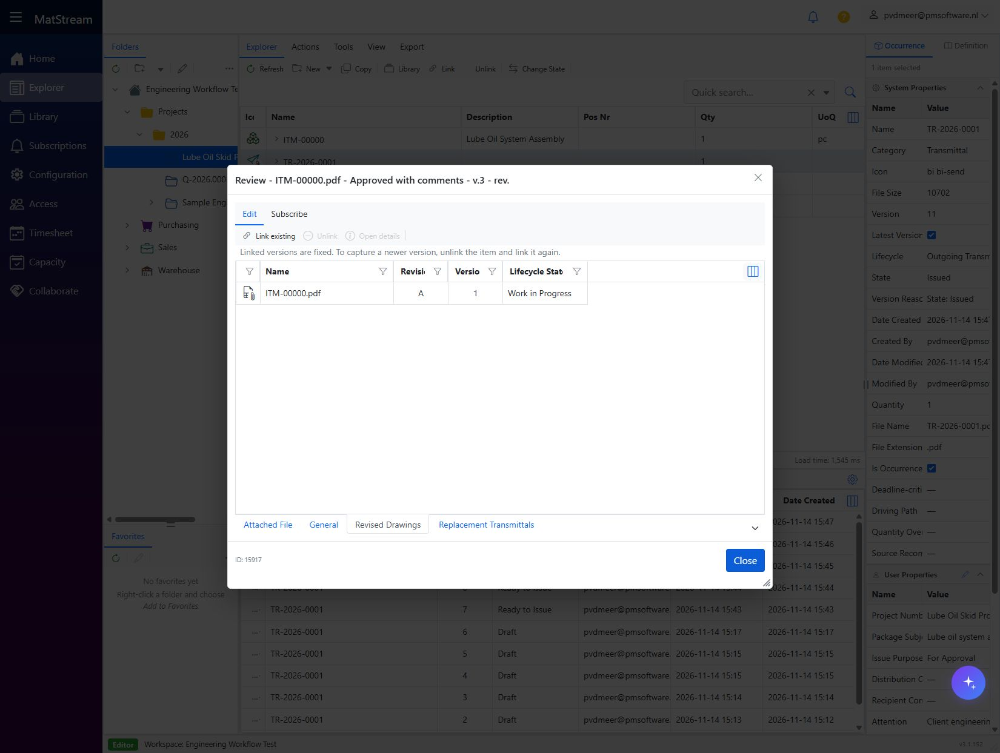
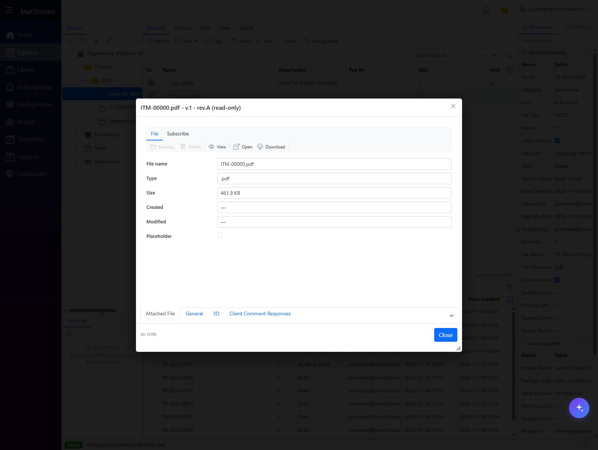
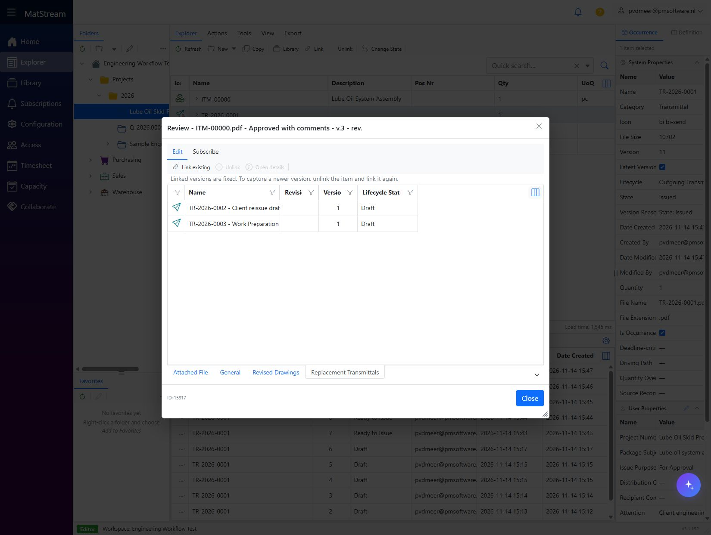
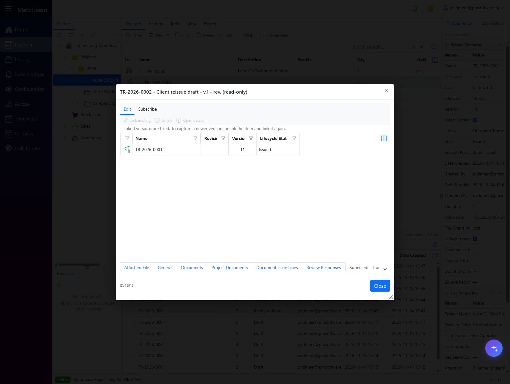
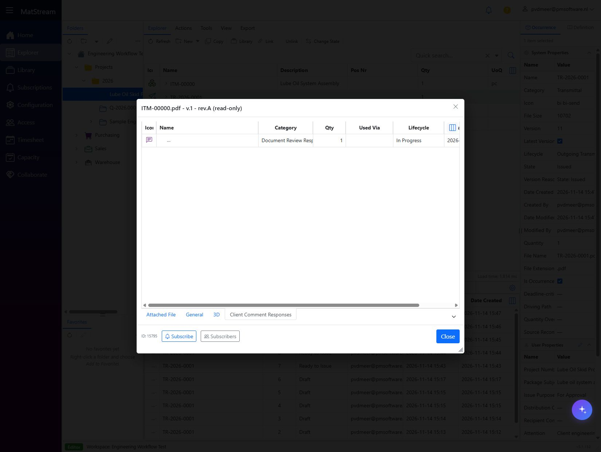
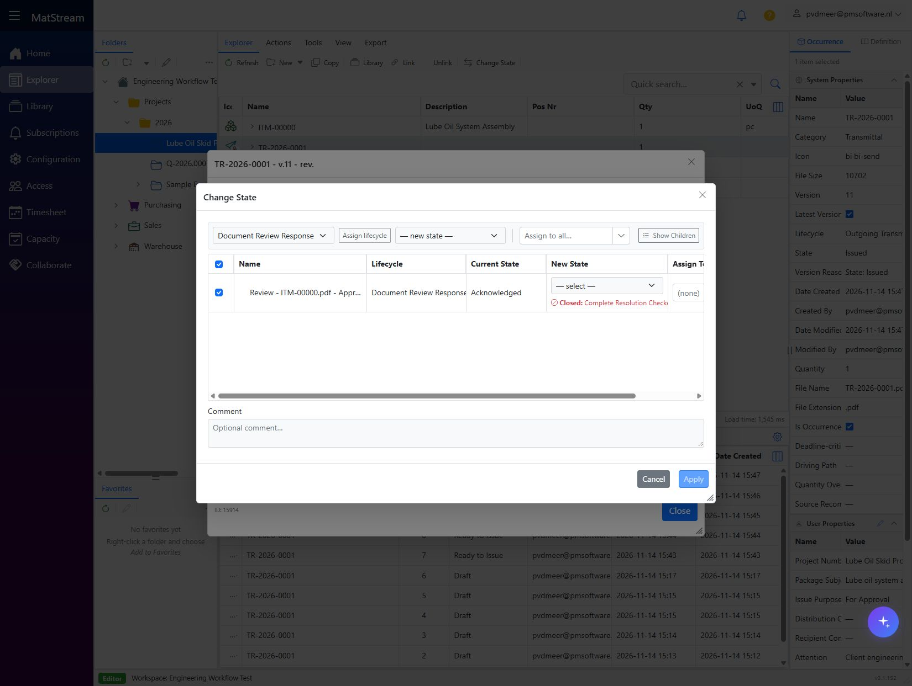
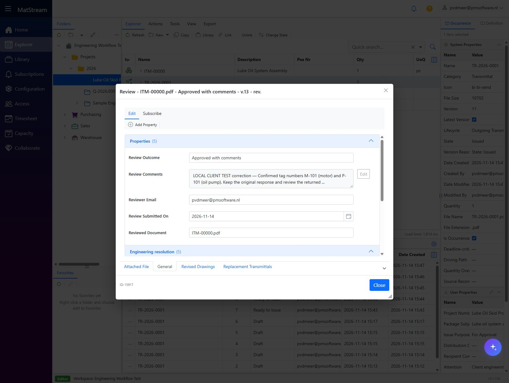

# Engineering — Resolve client comments and link the reissue

Use the **Document Review Response** to record who handles the comments, what was changed, who checked the result and which drawing versions and replacement transmittals address it. The client's decision, comments and returned PDF remain separate, read-only evidence.

For ITM-00000.pdf, the client requested motor tag **M-101** and oil-pump tag **P-101**. Engineering owns applying the changes and explaining the result. Acknowledging receipt does not mean that work is complete.

!!! note "Vault-led engineering workflow"
    Client responses now use [direct response lifecycle states and subscriptions](engineering-transmittal-review.md). The handling fields below remain available for traceability. Technical review, approval and release happen in Inventor/Vault; MatStream does not require this checking sequence as an additional release gate. A newly returned response can be acknowledged from its configured client-result state.

## Assign and investigate

1. Open the original Transmittal's **Review Responses** tab. Select the response and choose **Open details**.
2. Read its comments and returned PDF. For a corrected client submission, check the latest applicable response and retain earlier evidence.
3. Under **General → Engineering resolution**, choose the **Resolution Owner**.
4. Acknowledge receipt, then use **Change State** to move the response to **In Progress**.
5. Record the intended changes and later the completed work in **Engineering Disposition**. Explain any comments that need clarification or do not require a change.

The owner is an enabled workspace user selected with the existing user picker. Opening the response does not automatically assign it to you.

## Link the drawing version

1. Apply the engineering changes in the authoring application. Upload the updated PDF through the existing document version/history process.
2. Open the response's **Revised Drawings** tab and choose **Link existing**.
3. Search for the intended drawing and select it. Check the displayed **Revision** and **Version**; adjust the register with **Choose columns**.
4. Open details to inspect the captured version. Pinned links open that version read-only, even after the Library item advances.

The seeded setting captures the current version when the link is added. It does not create a drawing, duplicate a PDF or change the project BOM. To deliberately capture a newer version, unlink the old reference and link the drawing again. Unlinking removes the relationship, not the drawing.

For example, link the updated version containing M-101 and P-101. A later upload must not silently change the evidence the checker inspected. Align the title-block revision with MatStream's revision metadata before a formal reissue.

## Link replacement transmittals

1. Prepare separate client and Work Preparation Transmittals with the existing [document selection](engineering-project-documents.md) and [PDF generation](engineering-transmittal-pdf.md) steps.
2. On each replacement, open **Supersedes Transmittals** and link the original issue it replaces.
3. On the response, open **Replacement Transmittals** and link both replacement records.
4. On a replacement Transmittal, **Client Responses** shows the reverse link to the response being addressed. On the original, **Replacement Issues** shows its replacements.
5. On a drawing, **Client Comment Responses** shows responses linked to that drawing.

These are traceability links. They do not populate issue lines, generate PDFs, issue or share a Transmittal. Continue using the existing consistency checks and sharing process.

Replacement links capture the version current when added. A draft reference stays a draft reference after the Transmittal is issued. Deliberately update it to the issued version before confirming final evidence. The old portal link continues serving its original issued package.

## Request a check

1. Save the disposition and linked evidence, then move **In Progress → Ready for Check**.
2. The seeded **Client comments ready for check** automation notifies **Engineering Approvers**. Its Group and Message parameters are administrator-editable.
3. The checker inspects the comments, disposition, captured drawings and correct client/Work Preparation issues.
4. Complete **Resolution Checked By**, **Resolution Checked On** and **Resolution Evidence Checked**.
5. Move to **Verified**, then **Closed** when the handoff is complete.

Verification and closure require a saved owner, disposition, checker, check date and affirmative evidence confirmation. These are ordinary editable lifecycle Property Check criteria. The evidence confirmation is a human check: it does not automatically prove that every required link exists or that replacement packages have been issued. Explain any justified no-change/no-reissue decision in the disposition.

Engineering Authors can read checking fields. Engineering Approvers and Administrators can edit them. Group membership and permissions remain workspace configuration. Owner and checker are not required by the system to be different people; configure responsibilities accordingly.

## Return work for correction

A checker can move **Ready for Check → In Progress**, or reopen verified/closed work through the configured routes.

The **Reopen client comment resolution** script clears the old checker/date and resets the evidence confirmation. Disposition notes and links remain available. Repeat verification before closure. ClearPropertyIds and EvidencePropertyId are editable Automation parameters; update them when remapping checking fields.

If Change State reports an automation warning, inspect the current state and the automation run history. A follow-up script can fail after the state has changed. Correct its configuration and confirm that the checker/date are blank and evidence confirmation is cleared before repeating the check.

Client approval, engineering verification, replacement issuance and production release are separate decisions. Closing the response does not automatically release ITM-00000 or ITM-00006 for manufacture.

## Workspace administrator — configuration

| Configuration screen | Available choices |
| --- | --- |
| Categories → Document Review Response → Properties | Resolution fields, labels, grouping, editors and property permissions |
| Lifecycle Definitions → response lifecycle | State names, transitions, permissions, verification and closure criteria |
| Display Tabs → relationship tabs | Allowed categories, Link existing/Unlink actions and columns |
| Display Tabs → Settings → Associations | **Pin the current version when linking existing items**; existing links retain their current mode/version |
| Reverse relationship tabs | Parent categories and Association relationship filter |
| Automations | Checking notification group/message; fields cleared on reopening |
| Access | Enabled group members and relevant entity, lifecycle and file permissions |

Document Control Setup installs the resolution configuration once, using a separate installation marker so existing review installations acquire the feature. Later administrator edits and deliberate removals survive reruns. No new identifier tables or file copies are introduced.

## Local test scope

Browser testing on **14 November 2026** verified field editing, drawing and replacement links, reverse links, blocked closure, checking and reopening. The response was left **In Progress**, with its previous checker/date cleared and evidence confirmation reset. Verification and closure were exercised only as local control tests.

The local test uses the existing ITM-00000.pdf and two clearly named draft replacement records to exercise resolution and traceability. A later-version pinning check runs in a transaction and is rolled back. This describes the initial traceability test. The subsequent [drawing update and local reissue](engineering-reissue-drawings.md) uploaded B/v3, issued both replacements, refreshed the evidence pins and moved the response to Ready for Check. Inventor changes, formal engineering verification and production release remain pending. The test links do not prove that tags were applied or drafts issued.

Continue with [Engineering — Update and reissue drawings](engineering-reissue-drawings.md).
