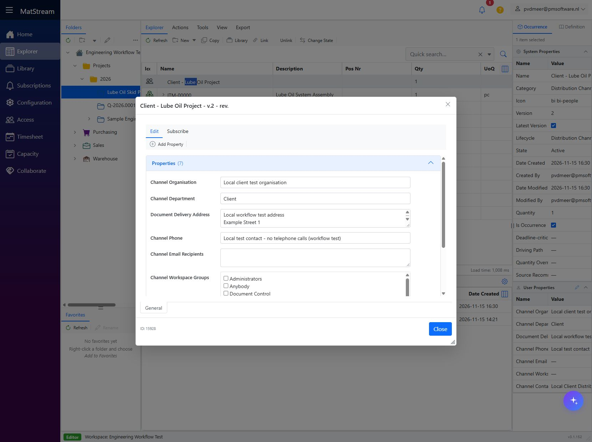
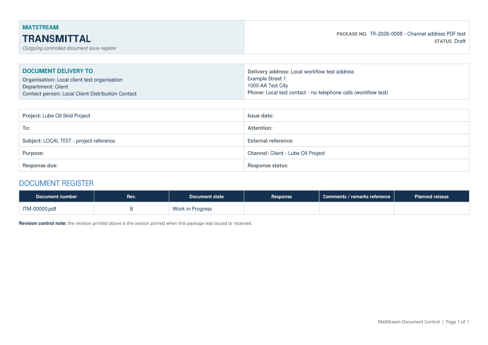
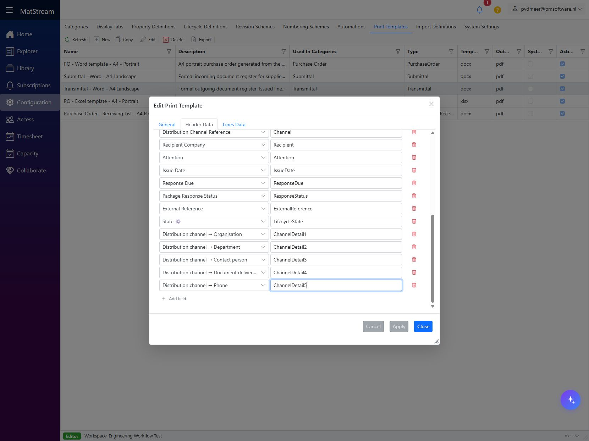
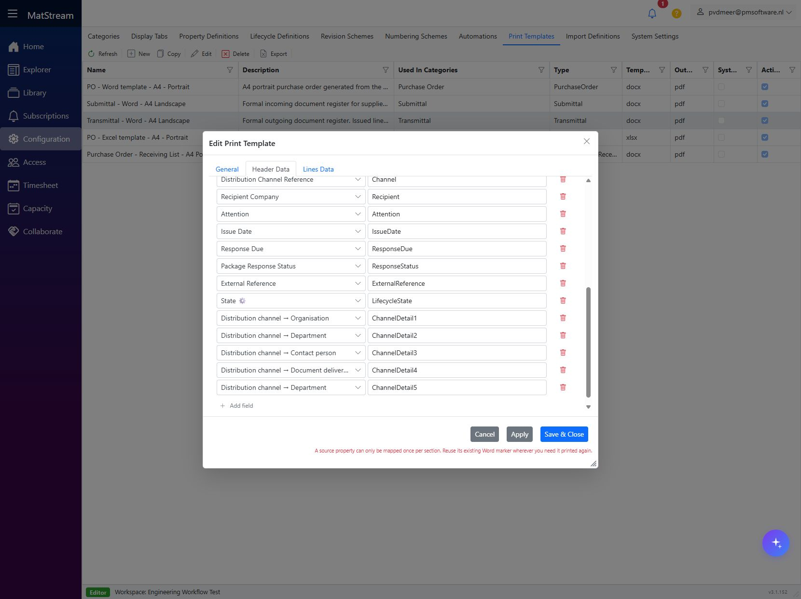
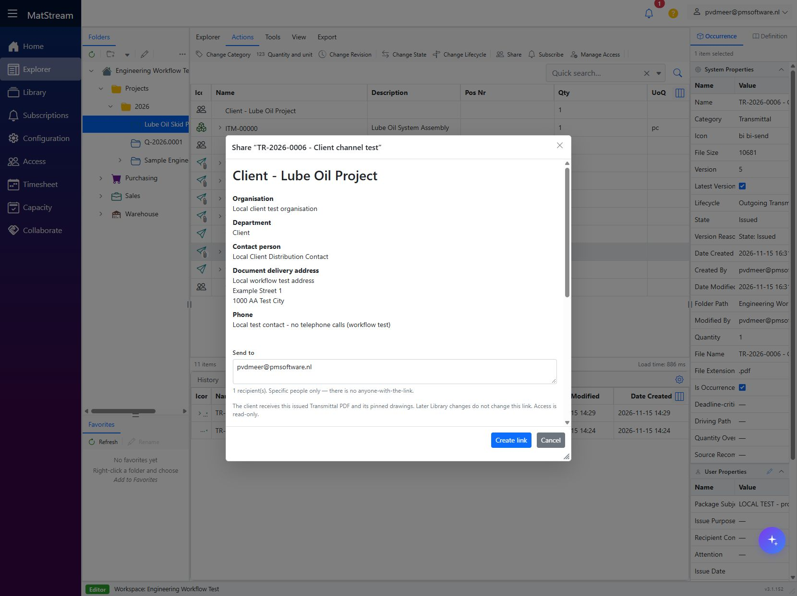
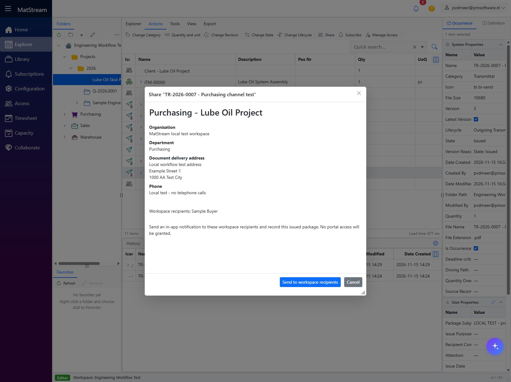
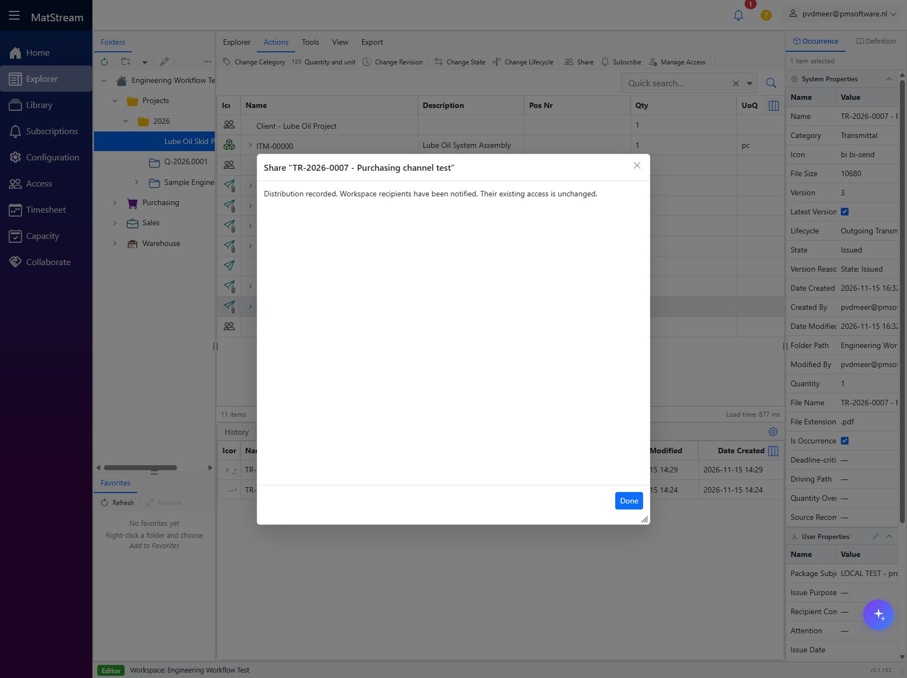
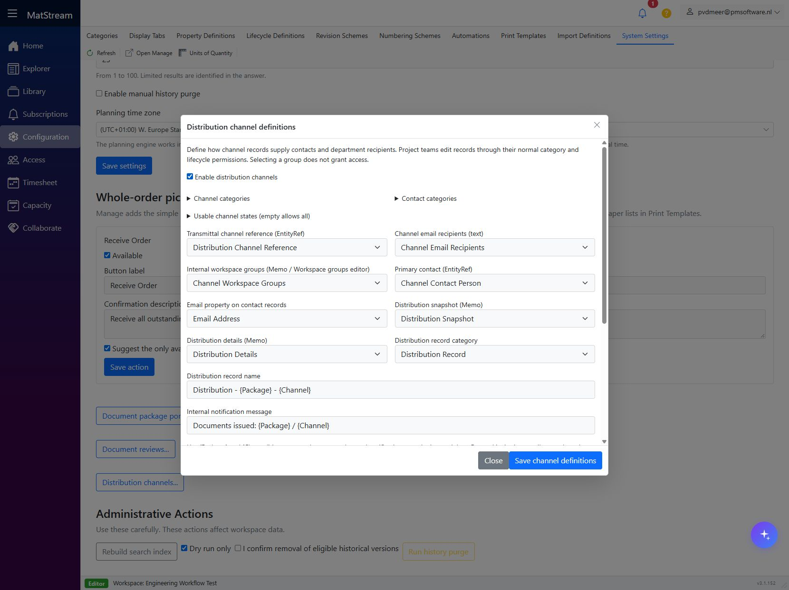
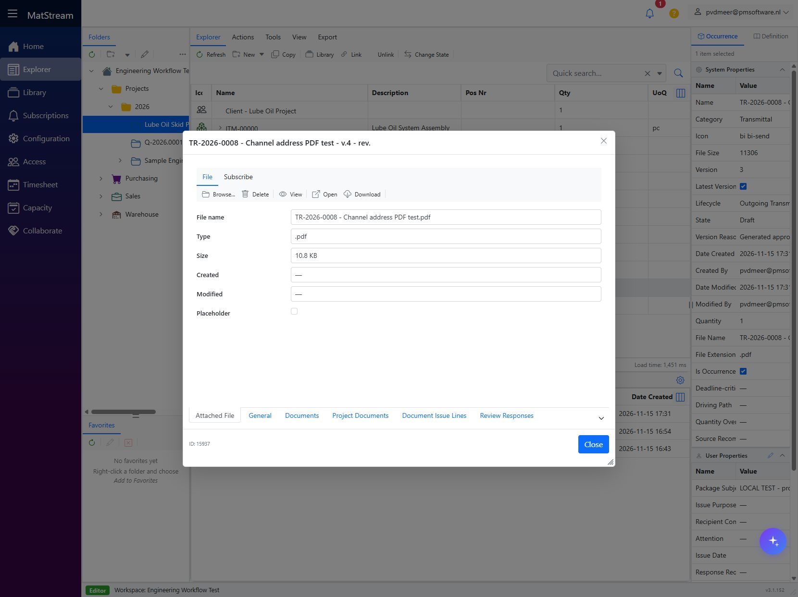

# Engineering — Maintain distribution channels

A **Distribution Channel** is a project-maintained record containing the people, address and departments that receive a document package. The engineer selects it through **Distribution Channel Reference** on the Transmittal. Several transmittals can use the same channel.

The recipient block in a traditional letter of transmittal is a useful model: organisation, department, contact person, document delivery address and phone. These are editable category properties. Email contacts and internal workspace groups supply the actual recipients.

## Project team — maintain the channel records

1. In the project, create a new **Distribution Channel** occurrence, for example **Client — Lube Oil Project**, **Work Preparation** or **Purchasing**.
2. Open **General** and enter the organisation, department, postal/document delivery address and phone.
3. Select the primary contact. Its configured email property supplies the email address. Contact occurrences may inherit their email from their linked Person; an email on the Contact itself takes precedence.
4. Add other email addresses to **Channel Email Recipients**, separated by semicolons or lines. **Additional Contacts** can link further contact/person records.
5. For an internal department, select **Channel Workspace Groups** with the group checkboxes. Select more than one group where needed.
6. Save and review the record. Leave external email recipients empty for an internal-only distribution.

Project Management, Engineering Authors/Approvers, Work Preparation, Purchasing and Document Control receive useful default record permissions. These are ordinary lifecycle/group permissions maintained by the administrator. Editing a channel is not an administrator-only action. Selecting an existing group does not change its membership or grant document access.

The local workflow test saved a contact-detail change, reopened it and confirmed a new channel version. Department group selections were saved, reopened and restored to Purchasing only.

## Engineer — select a channel before generating the PDF

1. Open the draft Transmittal's **General** tab.
2. At **Distribution Channel Reference**, open the picker and choose the required channel record.
3. Save the Transmittal, select its drawings and review their captured revisions.
4. Generate and inspect the PDF, then issue the Transmittal using the [existing process](engineering-transmittal-pdf.md).

Changing the saved channel reference after generating the cover makes the PDF stale. Generate it again before issuing or sending. The old text Distribution Channel field is retained in historical data; it is not the source of recipients for the new record-based flow.

The seeded covering PDF prints a **Document delivery to** block containing the channel's organisation, department, contact person, delivery address and phone. Addresses retain their line breaks. The send preview and Distribution Record also retain these details. Administrators maintain the covering-letter layout and field mappings in **Print Templates**; the sample uses MatStream styling rather than the supplied historical company's branding.

### Administrator — map the channel details onto the covering PDF

1. In **System Settings → Distribution channels**, maintain **Contact and address details to display and retain**. These mappings decide which channel properties are available to the print template.
2. Open **Print Templates → Transmittal - Word - A4 Landscape → Header Data**.
3. Add or edit a field and choose a source such as **Distribution channel → Contact person** or **Distribution channel → Document delivery address**. These are values from the selected channel, not duplicate Transmittal properties.
4. Set the marker name to match the Word template. The seeded delivery block uses the following mappings. Change the sources and markers to suit your workspace.

| Seeded marker | Selected source |
| --- | --- |
| `ChannelDetail1` | Distribution channel → Organisation |
| `ChannelDetail2` | Distribution channel → Department |
| `ChannelDetail3` | Distribution channel → Contact person |
| `ChannelDetail4` | Distribution channel → Document delivery address |
| `ChannelDetail5` | Distribution channel → Phone |

Each source can be mapped once in a section. To print the same source in several places, repeat its existing Word marker in the template. A duplicate source produces a readable validation message and leaves the saved mappings intact.

5. In the downloaded Word template, use `%%ChannelDetail1%%` through `%%ChannelDetail5%%` where those values belong. Labels, layout and logo are ordinary Word template content. Upload the edited template, save its mappings, and generate a draft PDF to review it.

New Document Control setups seed this template and its mappings. Existing workspaces retain their template customisations; adopt the delivery block by uploading the updated Word template and adding the mappings above. Reordering detail labels in System Settings does not silently remap saved template fields: each print source retains its selected property identity. Removing a mapped detail requires updating the affected print mapping before generation succeeds.

[Download the updated Word template](../files/MatStream_Document_Transmittal.docx). Copy your existing template first if you want to keep its layout for comparison.

Generating the cover requires read access to the channel, mapped properties and referenced contact. A changed mapped address/contact value makes a previously generated cover stale: regenerate before issuing or distributing. Already issued PDFs and fixed portal packages retain their captured bytes.

## Send to a client

1. Select the issued Transmittal and choose **Actions → Share**.
2. Review the channel's organisation, contact, delivery address and phone. **Send to** is populated from its email contacts; duplicates are removed.
3. Review or adjust the named email recipients, the configured external permission group, expiry, download and review options.
4. If the channel also contains internal groups, choose whether to notify their resolved members.
5. Choose **Create link**. Sending invitation emails is a separate checkbox. For local tests, clear it and use only the current test account.

Changing a channel/contact or its group membership while the dialog is open requires reopening the dialog and reviewing recipients again. Selecting the channel alone does not send messages or grant access.

The link continues to use named email recipients and the administrator-configured external permission group. Channel records do not choose or expand that permission group. A separate external sharing grant is still required to create a client link.

## Send to Work Preparation or Purchasing

For a channel with internal groups and no external emails, **Share** offers **Send to workspace recipients**. Review the resolved names and confirm. MatStream records the distribution and sends an in-app notification; it creates no portal share and grants no additional permissions.

Recipients must already be able to read the Transmittal and every selected drawing. Disabled users and expired group memberships are excluded. Missing document access produces a message to review access/membership before sending. The administrator controls group membership and access as usual.

Workspace users with the entity-update grant can open this internal distribution path without being given permission to create external links. The notification wording is administrator-configurable.

## Inspect what was sent

Open **Transmittal → Distribution Records**. Each record retains:

- Actual external recipients and internal workspace users notified.
- The channel version and contact/address details used.
- The Transmittal and selected document versions/files.
- Sender, submission time and the external share identity where applicable.

The readable **Distribution Details** field lists recipients, contact details and drawing revisions. **Issued Versions** opens the captured Transmittal version. Associations also pin the source drawing/channel versions, preserving history. Later changes to a channel supply defaults for future distributions; they do not rewrite earlier distribution records. Retrying the same send request does not create another distribution or duplicate notifications.

## Workspace administrator — define the category and mappings

Use **Categories**, **Property Definitions**, **Display Tabs** and **Lifecycle Definitions** to maintain labels, additional address/contact properties, pickers, register columns and team permissions. The group editor is **Workspace groups** on a Memo property; it selects existing internal groups, not membership or permission changes.

Under **Configuration → System Settings → Distribution channels**, configure:

| Definition | Purpose |
| --- | --- |
| Channel categories and usable states | Which records may supply a distribution |
| Transmittal channel reference | EntityRef property holding the selected channel |
| Email and group properties | Channel email text and internal group selections |
| Contact mapping and categories | Primary/additional contacts and their email property |
| Contact/address details | Properties, labels and ordering shown in the preview and retained in the distribution |
| Distribution record mappings | Category, readable details and protected snapshot storage |
| Name and notification patterns | Wording using `{Package}` and `{Channel}` |

Configure read permissions on both channel and distribution records, including their properties. Users need permission to read any source fields used to resolve the distribution. Internal recipient access is checked separately; a channel is not a shortcut around document permissions.

Document Control Setup seeds the definitions and sample project channels. Installed configuration is guarded so administrator edits/removals survive reruns. Existing explicit settings and print templates are preserved. When adopting the feature in an existing workspace, map the template's **Channel** marker to **Distribution Channel Reference** through Print Templates. Historical covers and existing portal packages are unchanged.

## Local workflow verification

In the Lube Oil Skid project (**PRJ-2026.0001**), TR-2026-0006 was issued and shared with the current local test account, with email invitations and review requests switched off for this recipient-selection test. Its portal showed ITM-00000.pdf at captured **revision B, version 5**. The [client review workflow](engineering-transmittal-review.md) covers approval responses separately.

TR-2026-0007 used the **Purchasing** channel. Sending created a Distribution Record containing **Sample Buyer** and the same captured drawing version. The internal path created an in-app notification and no portal share. Both distributions retained their channel/contact details and pinned versions. These tests distribute the existing sample drawing; its visible Work in Progress state does not represent a new Vault technical release.

TR-2026-0008 tested the added covering-letter block on 15 November 2026. The application services generated and attached the PDF, and regeneration created a new version while retaining the preceding PDF. The preview above uses the local test channel; blank issue-purpose/date fields were outside this focused layout test. A rollback-only address edit verified that the generated-content check detects a stale cover. The browser walkthrough is also complete: the administrator saved and reopened the five mappings, temporarily swapped Department and Phone to confirm the PDF follows the saved sources, then restored them. Browser generation created versions 3 and 4; the final version has the intended contact/address block and the preceding PDFs remain in history. The local runtime loading issue is resolved. No invitation emails or new shares were created during this test.

The next [three-channel reissue walkthrough](engineering-reissue-drawings.md#6-reissue-through-distribution-channels) tests Client, Work Preparation and Purchasing with separate issued packages and screenshots.

Continue with [sharing the issued transmittal](engineering-transmittal-portal.md).
