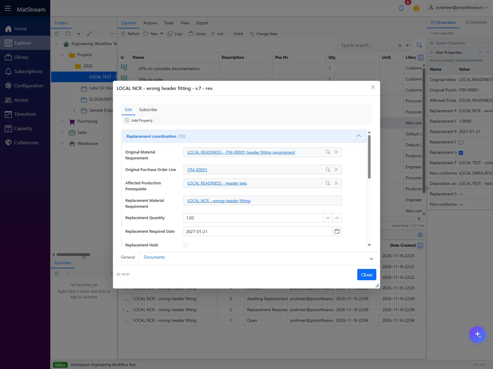
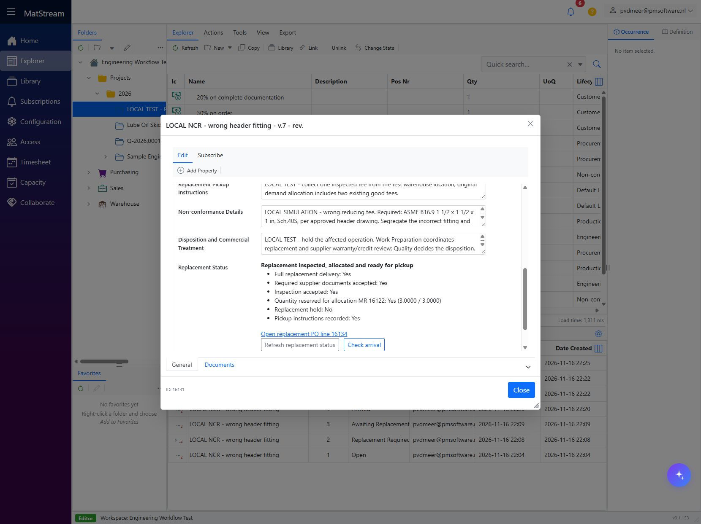
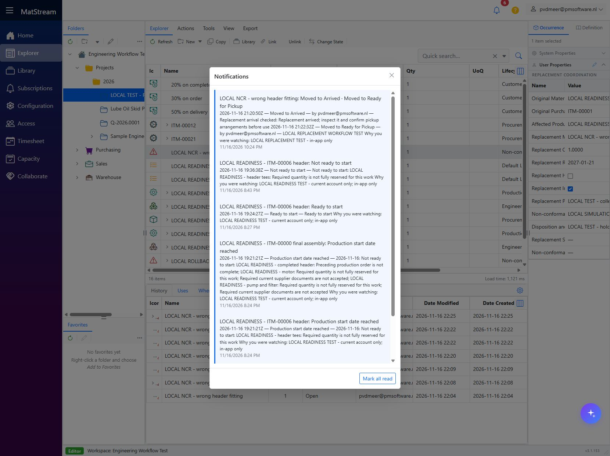
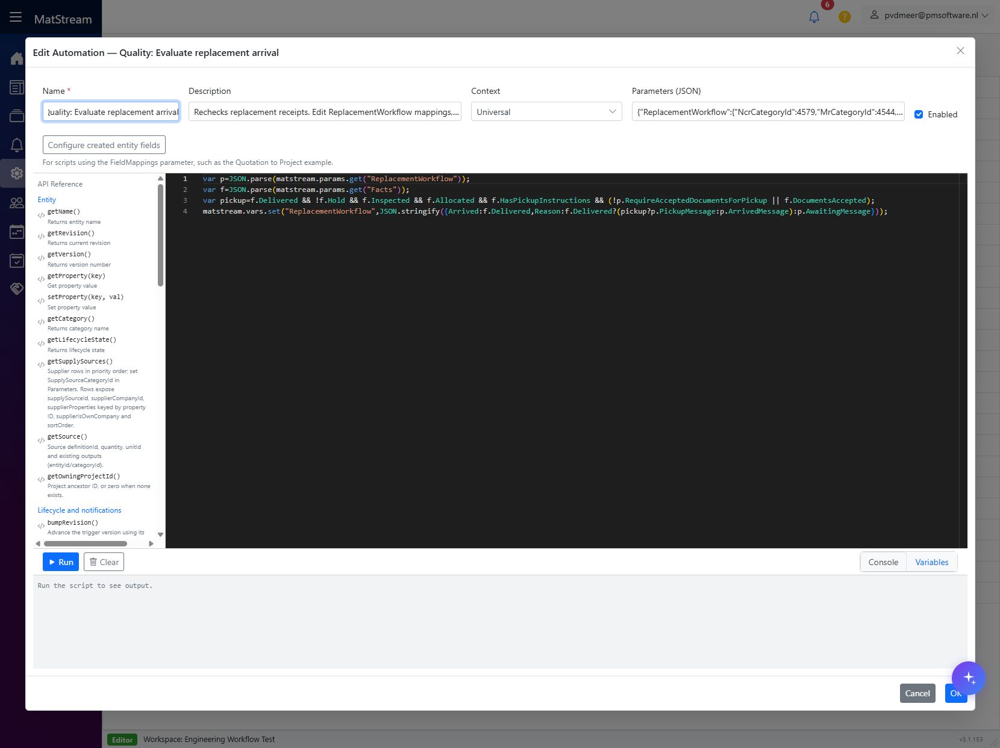

# Production — replace a wrong fitting

Use a **Non-conformance** to record the problem, coordinate replacement purchasing and tell Production when the correct fitting arrives. The replacement MR is additional purchasing caused by the defect; it does not increase the design BOM quantity.

## 1. Stop use and record the problem

Hold the affected row on the Production Order's **Prerequisites** tab. Identify and segregate the wrong fitting. Correct its stock/reservation records through the normal authorised warehouse process so it cannot be mistaken for good stock. A production prerequisite hold blocks that operation; it is not a workspace-wide quarantine of every stock position.

Open the Project's **Non-conformances** tab, choose **New → Non-conformance**, and record:

- **Non-conformance Details:** required fitting, what arrived, tag/traceability information and impact. Attach photographs or supplier paperwork on Documents.
- **Original Material Requirement** and **Original Purchase Order Line**. The PO line must fulfil that MR.
- **Affected Production Prerequisite:** the held row that refers to the original MR.
- **Replacement Quantity** and **Replacement Required Date**. The quantity must be positive and no greater than the original MR quantity.
- **Non-conformance Owner** and **Disposition and Commercial Treatment:** who coordinates it, and whether the wrong item is returned, reworked, scrapped or retained by authorised concession. Record whether the replacement is chargeable, warranty or subject to credit.

The non-conformance, original MR and affected prerequisite must belong to the same project. Review the original MR's unit of quantity first; its item revision, unit and frozen project RVD requirements are carried into the replacement demand.

## 2. Request replacement

Change **Open → Replacement Required**. The seeded creation script creates one replacement MR and fills **Replacement Material Requirement**. Repeating the action reuses that MR; it never resizes an already created order or creates another MR for the same non-conformance.

The replacement MR has a pinned item revision, quantity and required date, a source link to this non-conformance and an original-MR reference. Its frozen checklist retains project additions/exclusions and document provenance. The original BOM position and MR quantities stay unchanged.

A separate editable script creates the normal coordination assignment task for Work Preparation. Subscription proposals ask eligible Work Preparation and Production members whether they want arrival/pickup updates. They can answer Yes/No, remember the choice and change it later in User Settings. Existing records are not automatically subscribed retrospectively.

## 3. Purchase the replacement

Open **Replacement Material Requirement**. Review/select the supplier and agreed terms through the existing MR controls. Do not assume the original price or quotation applies to a warranty replacement. Use **Create Purchase Order** in the requirements view; then review and issue/share that PO through the normal purchasing workflow.

Change the non-conformance to **Awaiting Replacement**. Its live **Replacement Status** shows the replacement PO line(s) and current delivery, inspection, allocation, hold and pickup evidence. **Check arrival** runs the evaluator immediately; the scheduled worker also checks saved active records.

The MR's Ordered/Delivered source-handover automation has an administrator-editable **Skip sources without the target lifecycle (true/false)** parameter. The seeded value true leaves a non-conformance in its own lifecycle when its category has no procurement lifecycle assignment. Normal BOM source handover continues to work.

## 4. Receive and inspect

Warehouse receives against the replacement PO line at the correct location. Partial receipt does not qualify as full arrival. After full receipt, the worker changes **Awaiting Replacement → Arrived** through the normal lifecycle service. State subscribers get the arrival message. **Arrived means inspect it; it does not mean approved for use.**

Quality checks specification/traceability and required current supplier documents. Record **Replacement Inspection Accepted** only after the check. Use **Replacement Hold** while anything remains unresolved. Enter **Replacement Pickup Instructions**, including actual warehouse/rack location and who should collect it.

Allocate the usable material to the configured production requirement. The seed uses the **Original Material Requirement** for pickup allocation: for example, a requirement for three tees can be satisfied by two existing good tees plus one inspected replacement. The replacement MR tracks the extra purchase; reserving the same fitting against both MRs would double count it. An administrator can map allocation to the replacement MR instead when that matches the workspace's process.

## 5. Notify pickup and finish

Change **Arrived → Ready for Pickup**. The live transition criterion rechecks:

- Full current replacement delivery.
- Inspection accepted and no Replacement Hold.
- Required quantity reserved for the configured allocation MR, against physical stock of the same item.
- Pickup instructions recorded.
- Accepted required supplier documents, when the administrator enables that pickup requirement.

Production and Work Preparation subscribers receive the lifecycle update. Repeated checks do not keep sending the same transition. A corrected receipt moves an uncollected case back to Awaiting Replacement; loss of pickup evidence moves Ready for Pickup back to Arrived.

At collection, record **Collected**, choose **Replacement Collection Location** and let the configured collection script post the replacement stock issue and MR reservation release, and confirm the correct part is used. Clear the affected production prerequisite hold only when the responsible team authorises resuming work. Review the [production readiness](engineering-production-readiness.md) result. Quality/Work Preparation can then close the non-conformance, retaining the original supply, replacement and disposition history.

Cancelling the non-conformance does not cancel a committed PO, reverse stock or settle a credit. Perform those separate authorised warehouse/purchasing steps and record them in the disposition. The worker does not reopen Collected/Closed records automatically; later discoveries need a reviewed follow-up.

## Administrator configuration

Install **Non-conformance and Replacements** through Manage Setup after procurement, project RVDs and Production Readiness. New Engineering Project setups include it. Installed administrator customizations are preserved.

| Configuration area | Editable choices |
|---|---|
| Categories, Property Definitions, Display Tabs | Fields, defaults, labels, permissions, project Non-conformances and Documents tabs, columns and record layout |
| Non-conformance Lifecycle | State names, transitions, role permissions and the pickup evidence criterion |
| Work Preparation: Create replacement requirement | Stored creation script attached to the request transition |
| Quality: Evaluate replacement arrival | `ReplacementWorkflow` category/property/state mappings, allocation reference, unit/document rules, script, messages, executor, interval and batch size |
| Quality: Assign replacement coordination | Work Preparation group and task category parameters |
| Production: Propose replacement arrival updates | Trigger transitions, recipient groups, watched states, consent wording and channels |
| MR lifecycle handover parameters | Whether sources without an assigned target lifecycle are skipped |

The worker defaults to a 60-second workspace interval and a batch of 100 active cases. The executor must be an enabled internal Editor with access and transition permission. Scheduler startup and ordinary subscription bundling add latency. The script can add restrictions, but cannot claim arrival without current full-receipt evidence or bypass the native pickup checks.

Local tests used the fitting ITM-00001 under the separate readiness/RVD test project: original MR 16122 / PO-2026.0005, non-conformance 16131 and replacement MR 16132 / PO-2026.0006. Normal receipt and lifecycle services, the scheduled worker and an actual in-app notification were exercised. Partial receipt and a missing RVD blocked the appropriate progress. Temporary stock/reservation/receipt and inspection/document acceptance were reversed or restored afterwards. The test case was left awaiting replacement and the affected production prerequisite held. No real supplier delivery, Quality decision, collection, production or payment is implied. Screenshots of successful pickup evidence show the temporary simulation before restoration. Separate team identities and real quarantine/return handling still require a practical rehearsal.

Continue with [collecting the replacement, clearing its hold and resuming production](engineering-resume-production.md). The local walkthrough now covers these existing record/lifecycle actions; replacement stock consumption and MR reservation release are now implemented and tested. A general whole-BOM issue/return process remains separate.
