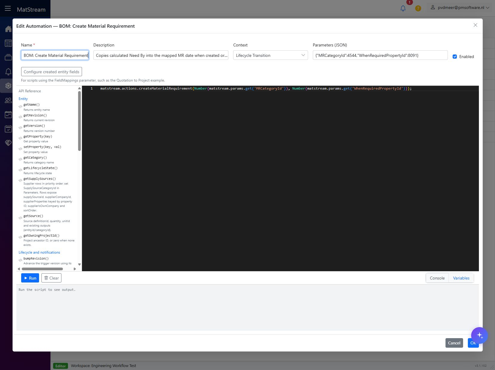
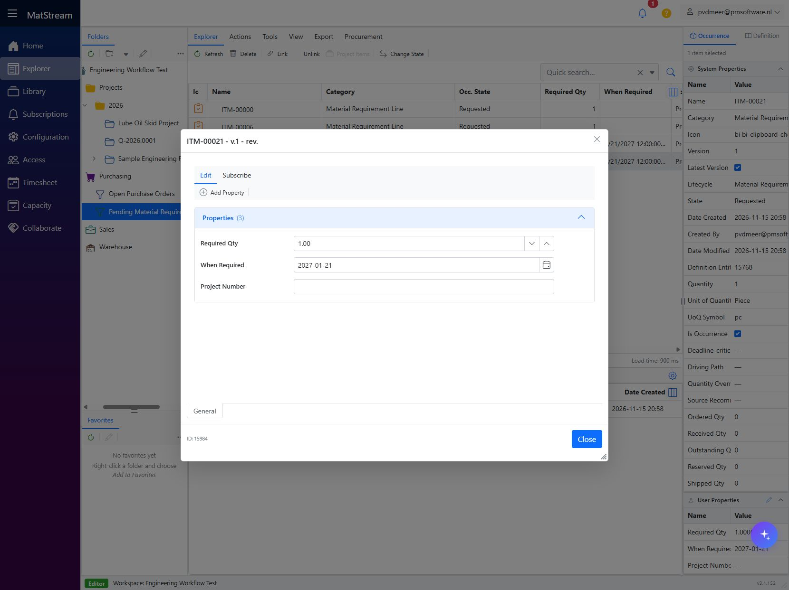

# Work Preparation — Copy planning dates to Material Requirements

The motor and pump need to be ready for assembly on **22 January 2027**. Their calculated **Need By** is **21 January**. When the release automation creates their Material Requirements (MRs), it copies that date into **When Required**.

This is a snapshot when the requirement is raised. Recalculating the project does not silently replace a date the buyer has already entered.

## What must be filled in before release

A Need By date can only be calculated for a BOM position that has a **Supply Method** and a **Required By Task** (a milestone or task with a date). In the seeded configuration, **Engineering Ready → Release to Procurement** therefore carries two criteria, **Supply Method is required** and **Required By Task is required**. If one is empty, the Change State dialog explains what to fill in and the position stays in **Engineering Ready**; nothing is released half way. They are ordinary criteria under **Configuration → Lifecycle Definitions**, so an administrator can edit their messages or severity, disable or delete them.

## Configure the automation

The Engineering Project seed installs **BOM: Create Material Requirement** in **Configuration → Automations** and assigns it to the procurement release transition. Its parameters are editable by the workspace administrator:

| Parameter | Meaning |
| --- | --- |
| MRCategoryId | The category to create, normally Material Requirement Line |
| WhenRequiredPropertyId | The date property on that MR category to receive calculated Need By, normally When Required |
| DemandMode | `Full` records the complete BOM quantity, including materials already in stock. `Shortage` retains the former purchasing-only behavior. New Engineering setups use `Full`. |
| ReserveAvailableStock | `true` allocates compatible free stock to a full-demand MR in the same transaction. New Engineering setups use `true`. Requires Stock Reserve permission on the requirement and item. |

IDs vary between workspaces. Choose an enabled DateTime property assigned to the selected MR category. Renaming that property does not break the ID mapping. An invalid mapping is rejected before creating an MR.

The administrator can edit the script, mappings and lifecycle assignment, or disable the automation. The supplier-routing script **BOM: Route Released Item** also accepts WhenRequiredPropertyId for its Purchase route. Existing production routing remains the same.



The scripting helper is:

```javascript
matstream.actions.createMaterialRequirement(
    Number(matstream.params.get("MRCategoryId")),
    Number(matstream.params.get("WhenRequiredPropertyId"))
);
```

The second argument selects the date field. Older one-argument scripts retain the existing default WhenRequired mapping. Use the two-argument form for an explicit administrator-managed mapping and missing-planning-date validation.

## Prepare and raise the requirements

1. Follow [Plan against project milestones](engineering-milestone-planning.md). Check Supply Method, Required By Task, quantity and unit on each project BOM position.
2. Recalculate the project and review the **Procurement** view. Confirm the motor and pump each have Need By **21 January 2027**.
3. Use the configured procurement release action. The MR action recalculates or verifies the current project plan before reading the source position's result. With `DemandMode: "Full"`, it records the entire BOM quantity and reserves available stock when configured. If the configured date cannot be calculated, fix the planning inputs before retrying.
4. Open **Purchasing → Pending Material Requirements (MR)**. Check quantity, project/source and **When Required**.


| Local example | Required quantity | When Required |
| --- | --- | --- |
| Motor ITM-00021 | 1 pc | 21 January 2027 |
| Pump ITM-00012 | 1 pc | 21 January 2027 |




## What happens on a retry or date change?

- **No MR yet:** create the full requirement and copy the calculated date; reserve compatible available stock when enabled.
- **An open MR has a blank date:** reuse that MR and fill its mapped date.
- **An open MR already has a date:** preserve it, including a buyer's deliberate change.
- **An open MR already has a quantity:** preserve its saved Required Qty. Planning's remaining shortage can be zero because the MR itself covers the demand; a retry must not turn that saved requirement into zero. Amend demand explicitly through the MR editor. A missing or non-positive quantity requires review before retrying release.
- **An MR has already entered an order:** Full mode reuses it; outstanding ordered quantities are not allocated again from free stock. Shortage mode retains the existing additional-shortage behavior.
- **The component is fully covered:** Full mode still creates its demand MR, allowing production prerequisites and material issue to track its full quantity. Retrying reuses that MR.

Full mode refuses a retry if the saved MR quantity differs from the source BOM quantity. Review commitments and explicitly amend the MR before retrying; enabling this option does not resize historical shortage-only MRs or rewrite their orders, receipts or issues. Existing workspace setup and administrator customizations remain intact: add `"DemandMode":"Full","ReserveAvailableStock":true` to the existing automation's Parameters (JSON), retaining its other mappings. Apply the same choices to **BOM: Route Released Item** when its Purchase route is used. Missing options keep the old `Shortage`/`false` behavior, including Sales Order workflows.

For example, demand **3 pc** with **2 pc** compatible free stock becomes Required **3**, Reserved **2**, purchase shortage **1**. Demand **2 pc** with **2 pc** free stock becomes Required **2**, Reserved **2**, purchase shortage **0**. Create PO buys only the remaining shortage. After receiving purchased goods, **Reserve from Stock** can allocate the unreserved/unissued demand even though the purchasing shortage is already zero. Production then issues the full required quantity through the existing stock ledger.

Automatic allocation accepts located stock matching the MR's pinned item version and unit; it does not assume unidentified stock or convert units. Identify opening stock's revision in [Adjust Stock](engineering-production-readiness.md#opening-stock-and-pinned-item-versions). Other reservations, including Sales Orders, reduce availability. Retrying cannot reserve the same demand twice.

For example, if the buyer changes When Required from 21 to **25 January**, rerunning the action preserves 25 January. Clearing the field and rerunning allows the automation to fill the current calculated date. Simply recalculating the project does not update the MR.

A late supplier promise belongs to the PO line and affects the achievable forecast. It does not automatically move an MR's required date later: the required date continues to express when the material is needed.

## Local workflow test

The local test executed the configured script through the normal scripting service for the motor and pump. It verified creation, retries without duplicates, preservation of a buyer-entered date, filling a cleared date, and rejection of an invalid field mapping. Both MRs finish this test with When Required **21 January**.

The prior motor-delay simulation had one synthetic on-order motor. That simulated quantity was reversed with a labelled compensating entry before testing uncovered MR demand. No real order, supplier message or warehouse receipt was created. The two older assembly test MRs remain separate and were not backfilled.

Setup preserves installed administrator mappings, script changes and removed transition assignments on testing reruns. Installing the new rule can adopt an unchanged legacy seeded MR release action; a customized legacy action requires review instead of being overwritten.
