# Engineering — Plan the motor and pump against a milestone

The project completion date is not necessarily the date every component is needed. In this example, the project is required on **29 January 2027**, but assembly starts on **22 January**. The motor and pump must be available for that assembly milestone.

## Configure the starting defaults

The Engineering Project setup includes these editable settings:

| Setting | Seeded value | Where the workspace administrator changes it |
| --- | --- | --- |
| Fixed Milestone Date | Checked | Configuration → Property Definitions → Fixed Milestone Date → Initial Value; category defaults can override it |
| Milestone date editor | Planning tab | Configuration → Categories → Milestone → Display Tabs |
| Required By Task picker | Occurrences, categories Task and Milestone | Configuration → Property Definitions → Required By Task → entity picker filter |

The checkbox is an ordinary property on the Milestone category. An engineer with permission to edit the record can override it on **General**. Checked means the entered Due Date is the agreed **target**. The achievable date can be later when required components are delayed. Unchecked keeps the normal calculated checkpoint behavior and any separately configured planning constraints. A fixed milestone needs a Due Date before the plan can calculate.

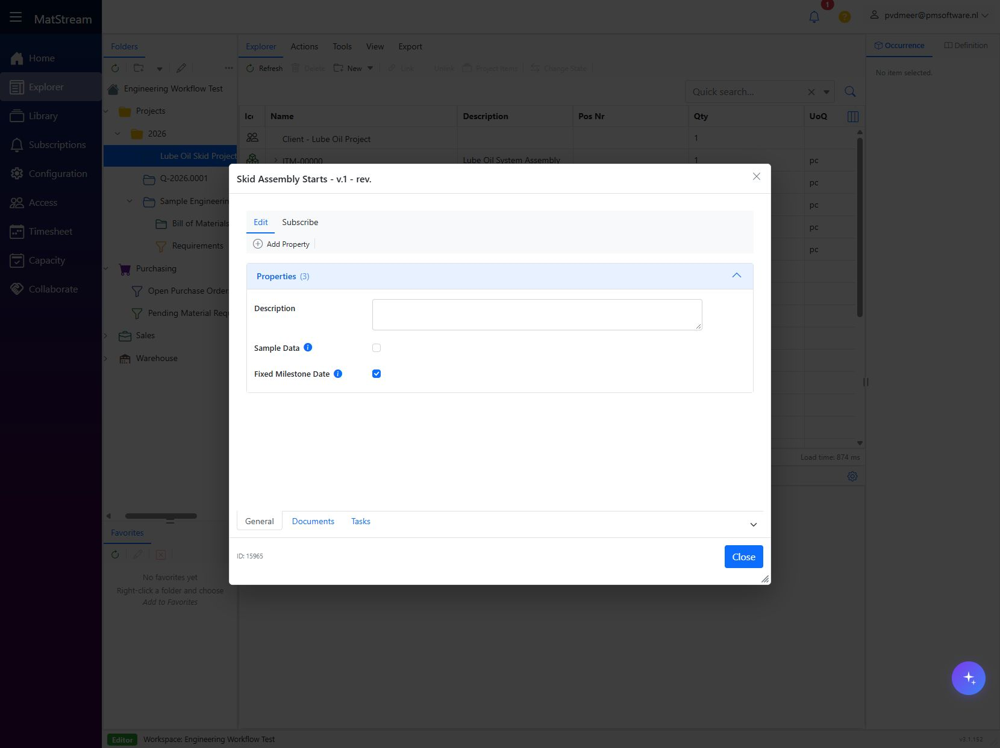

## Set the project milestone

1. Open the project details and select **Milestones**. Create or open the assembly-start milestone.
2. On the milestone's **General** tab, check **Fixed Milestone Date**.
3. On **Planning**, set **Due Date** to `2027-01-22` and save. Use the calendar to select the day.
4. If moving an existing milestone earlier than its saved Planned Start, also move Planned Start to the same date. The existing task editor rejects a Due Date before Planned Start.

The local example is named **Skid Assembly Starts**. Recalculating preserves its entered Due Date instead of replacing it with a date calculated backwards from project completion.

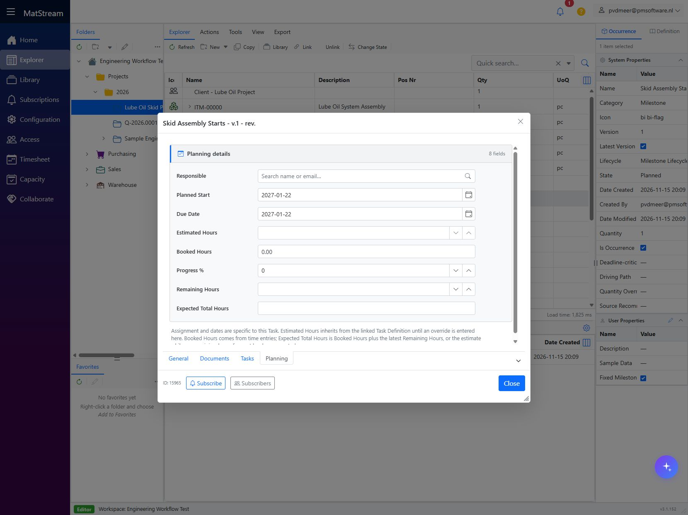

## Connect the components

Open the project BOM positions, rather than changing the shared Library definitions. Review quantity and unit, then set:

| Field | Motor ITM-00021 | Pump ITM-00012 |
| --- | --- | --- |
| Supply Method | Buy | Buy |
| Lead Time (working days) | 20 | 15 |
| Handling Time (working days) | 2 | 1 |
| Required By Task | Skid Assembly Starts | Skid Assembly Starts |

Use the search button next to **Required By Task**. The picker accepts both tasks and milestones. Select the milestone belonging to this project, then save the position. The current picker searches workspace occurrences; it does not enforce that the selected milestone belongs to the same project.

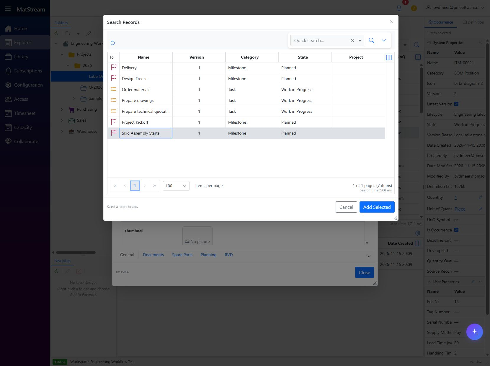

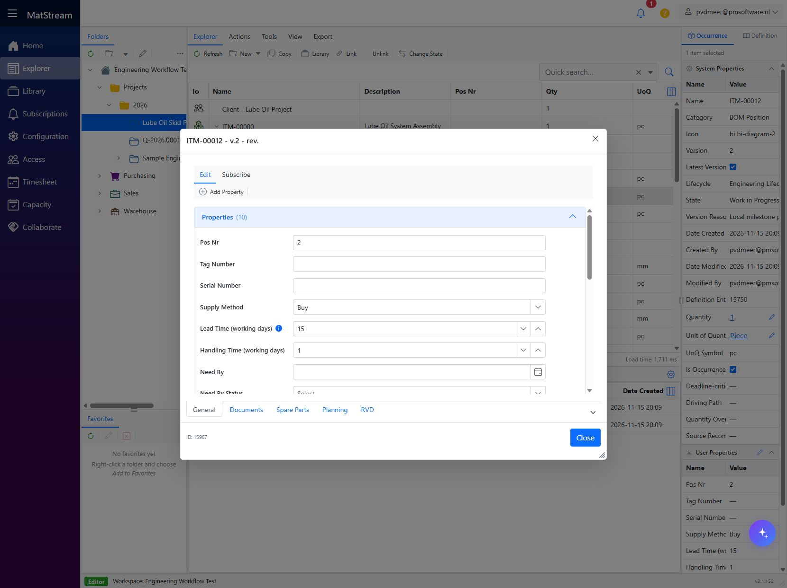

## Calculate and review

Open the project's **Planning** tab, choose **Recalculate plan**, then **Procurement**.

| Component | Need by | Order before |
| --- | --- | --- |
| Motor ITM-00021 | 21 January 2027 | 22 December 2026 |
| Pump ITM-00012 | 21 January 2027 | 30 December 2026 |

These results use the local test calendar and the lead/handling values above. The existing planner places materials one working day before the selected task or milestone. Changing calendars or lead times can change the order dates.

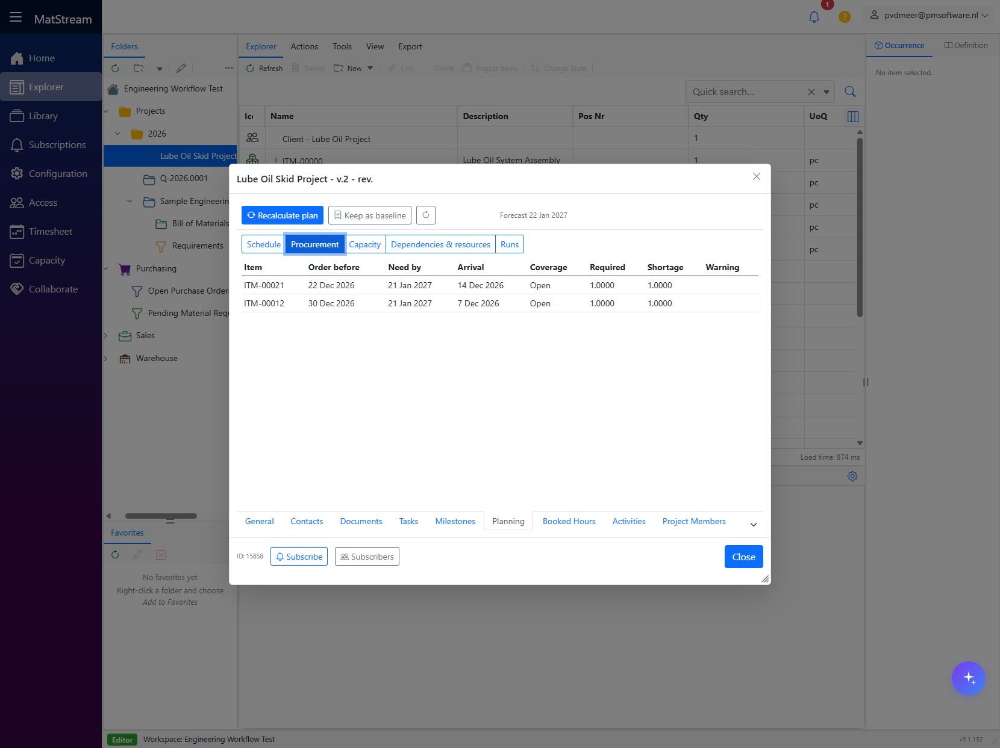

As a workflow test, we moved the milestone to Monday **25 January** and recalculated. Both need-by dates moved to Friday **22 January**. We then restored the milestone to **22 January** and recalculated again.

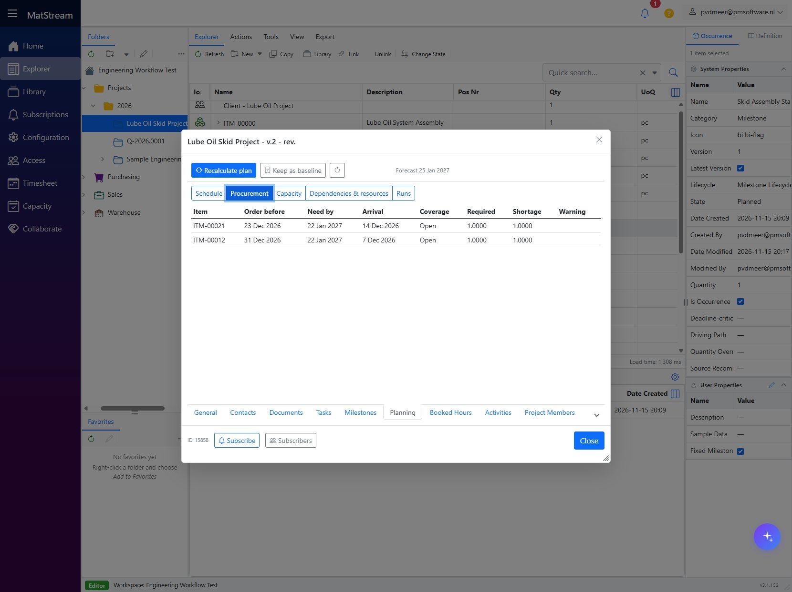

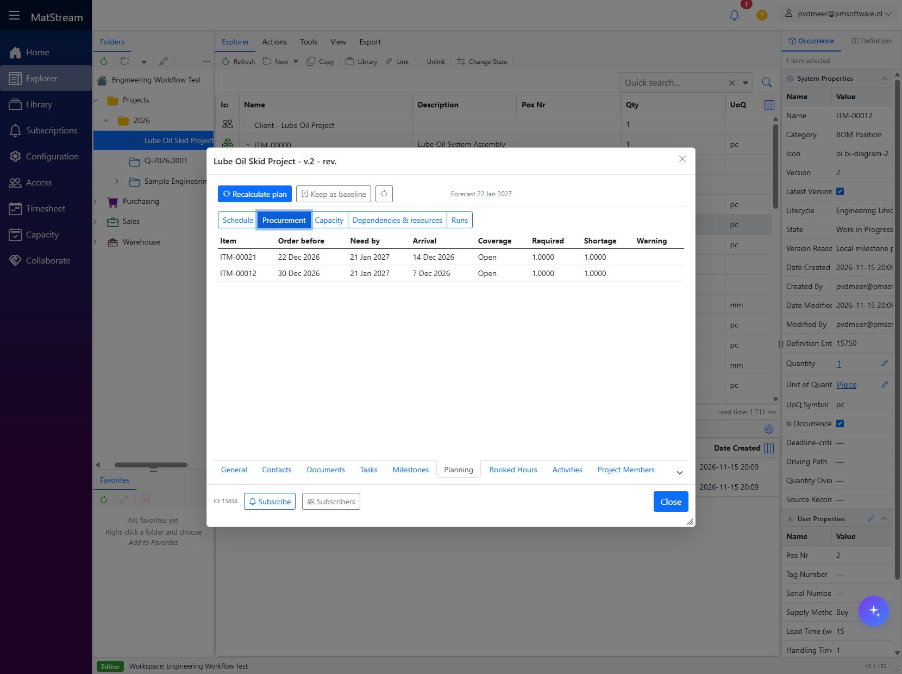

## Automation and scope

Automation scripts can populate the ordinary milestone property and Required By Task reference. The date connection itself belongs to the planning calculation so it works whenever a permitted user recalculates; no duplicate date-copy script is needed.

This step calculates the project plan. The next [Material Requirement dates step](engineering-material-requirement-dates.md) copies Need By into When Required through the configurable MR creation script and can fill a blank date when an open MR is reused. It does not bulk-backfill previously created MRs. The earlier assembly-release test MRs remain separate from this motor/pump planning test.

Setup installs these defaults once and preserves administrator changes on subsequent testing reruns, including removed assignments and changed picker settings.

## What if the motor arrives one week late?

Keep the milestone target at **22 January 2027**. Update the motor PO line's **Promised Delivery** when the supplier gives a new date, then recalculate the project plan.

The local test used one simulated motor on order. It changed delivery from **19 January** to **26 January**, exactly one calendar week later. With the motor's configured **two working days** of handling, it is ready on **28 January**. Assembly can start on **29 January**.

| What to review | Before delay | After delay |
| --- | --- | --- |
| Motor delivery | 19 January | 26 January |
| Motor ready after handling | 21 January | 28 January |
| Milestone target | 22 January | 22 January — unchanged |
| Achievable milestone date | 22 January | 29 January |
| Milestone delay | 0 | 5 working days |
| Pump need-by date | 21 January | 21 January — unchanged |

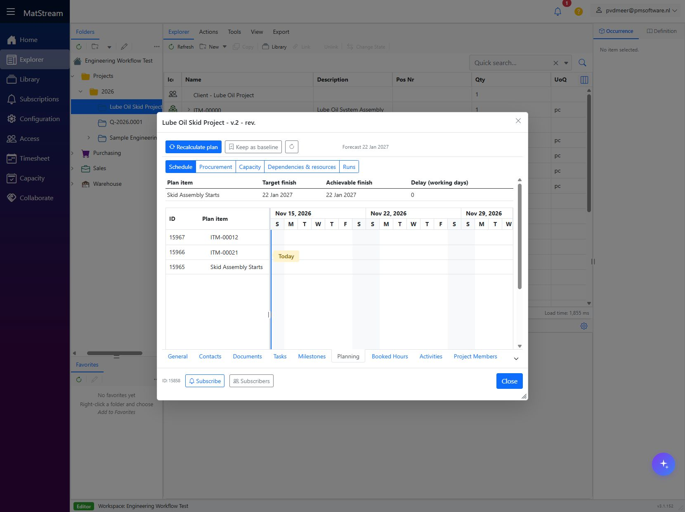

1. Open the motor PO line and change **Promised Delivery** to the supplier's revised date. Save the record. This test order is clearly marked LOCAL TEST; no order or email was sent to a supplier.

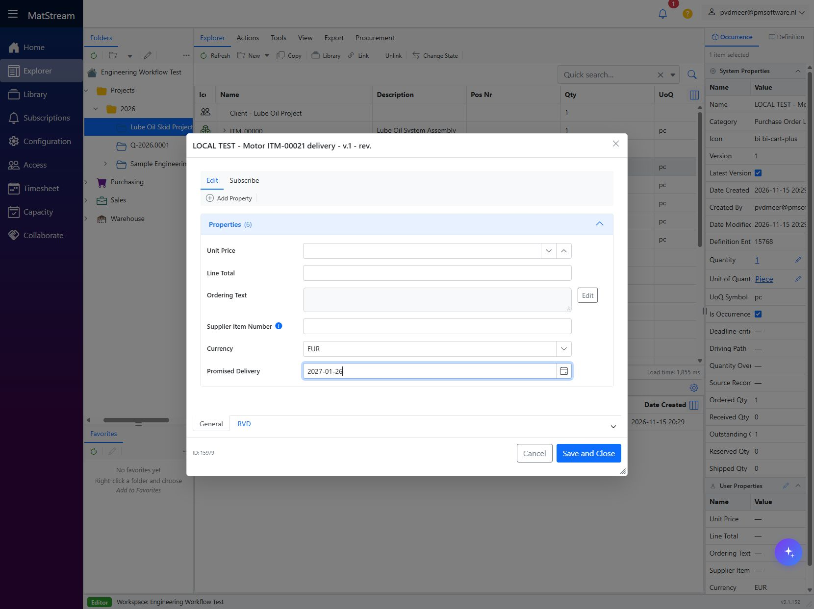

2. Open **Project → Planning**, select **Recalculate plan**, then **Schedule**. The comparison above the Gantt shows **Target finish**, **Achievable finish** and **Delay (working days)**. A delayed target row is highlighted. Reopening the project retains this published comparison.

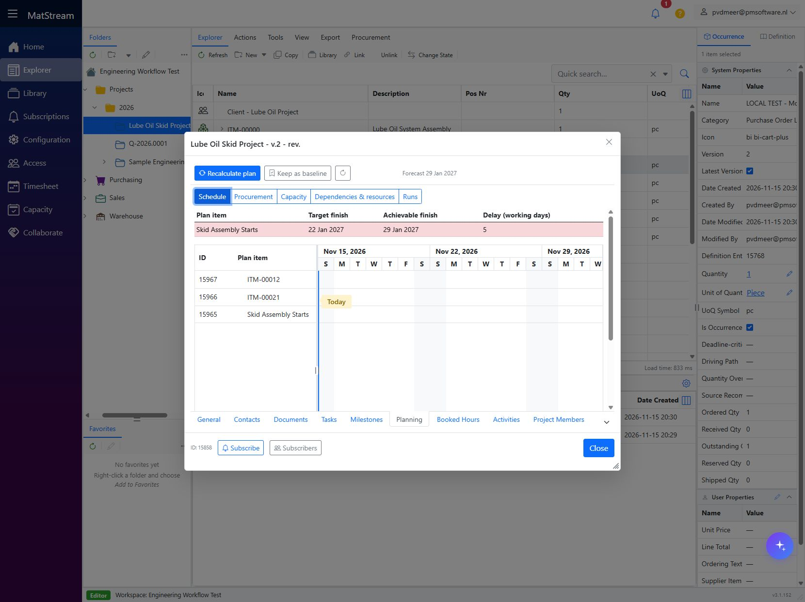

3. Select **Procurement** to see the motor's revised arrival and supplier-late warning. The pump's own dates stay unchanged. Need-by dates continue to express the requirement; they are not moved later just to hide a late supplier delivery.

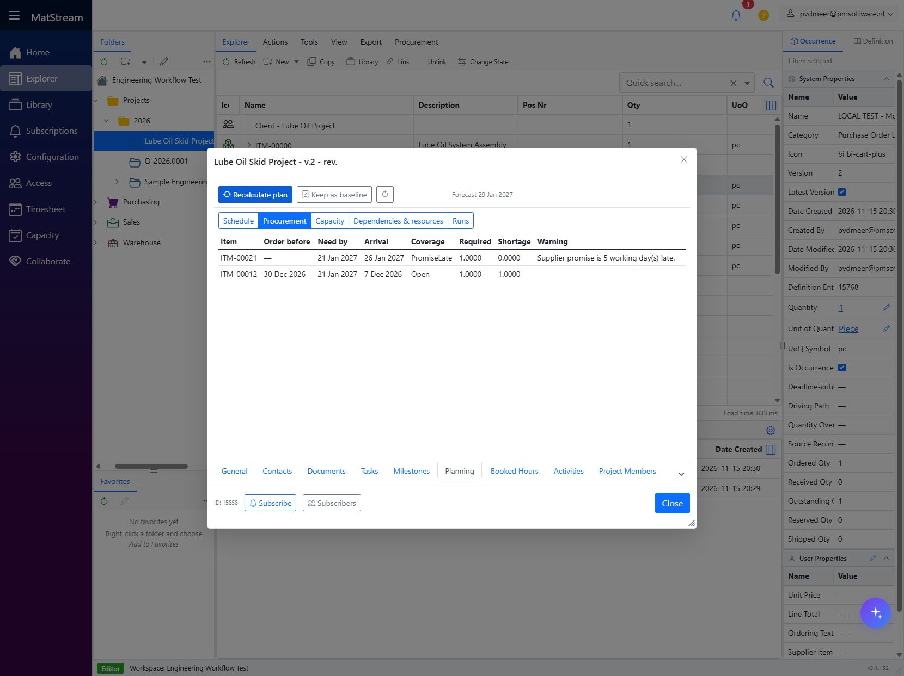

The milestone delay and overall project delay are separate. This example's assembly-start milestone slips five working days, but its new date is still 29 January, the current project deadline. Downstream production work must be included as planning tasks/dependencies before the plan can show the impact on manufacturing completion.

The administrator still controls the fixed-date default, category assignment, lead and handling time definitions, calendar and permissions through the existing configuration screens. No separate hidden delay tolerance or automatic target-changing rule was added. The result uses the configured working calendar. Published runs retain the target and delay used in that calculation, so later edits do not rewrite earlier comparisons. Recalculate older plans once to populate the new comparison.
