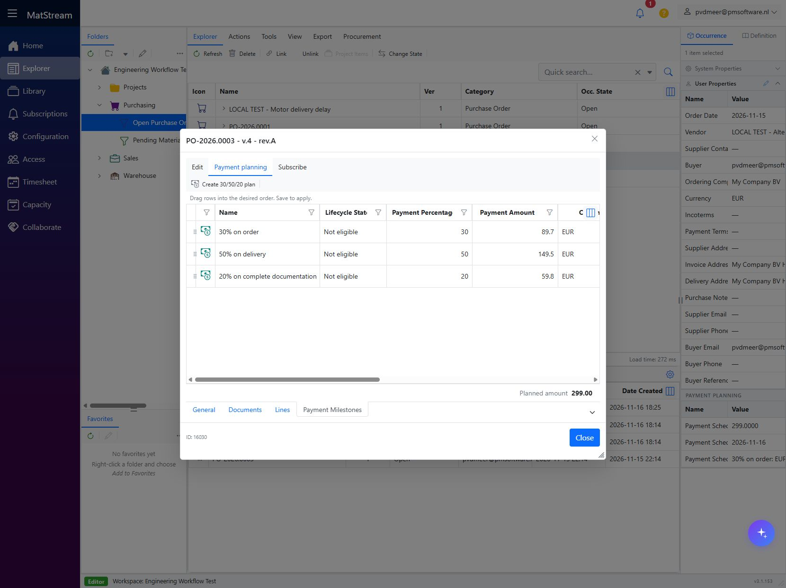
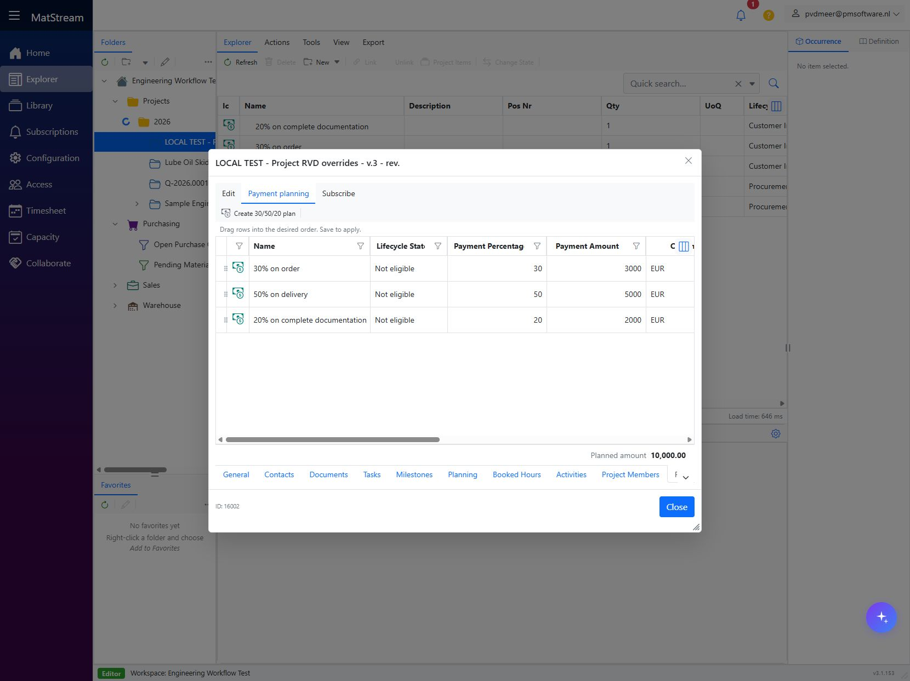
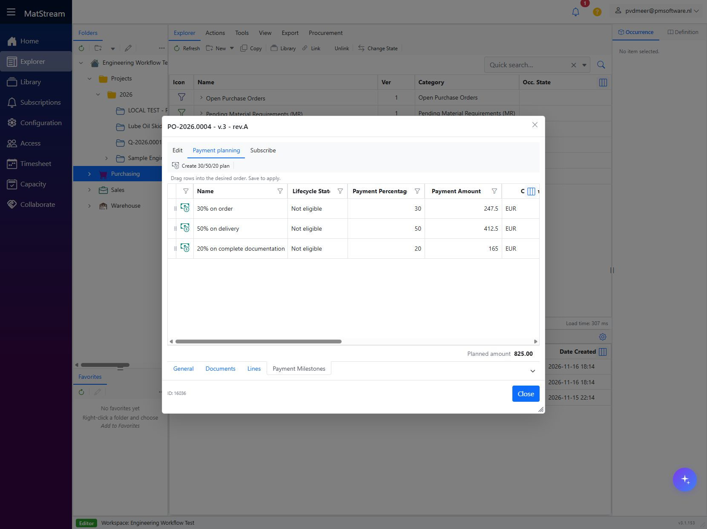
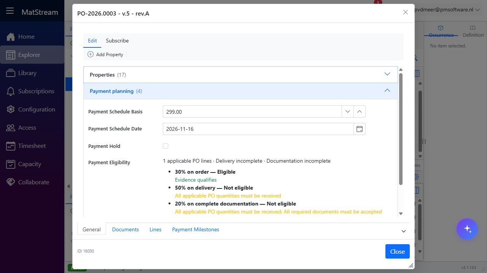
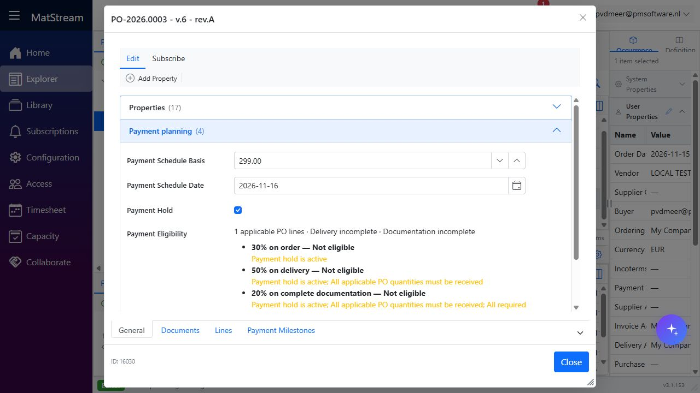
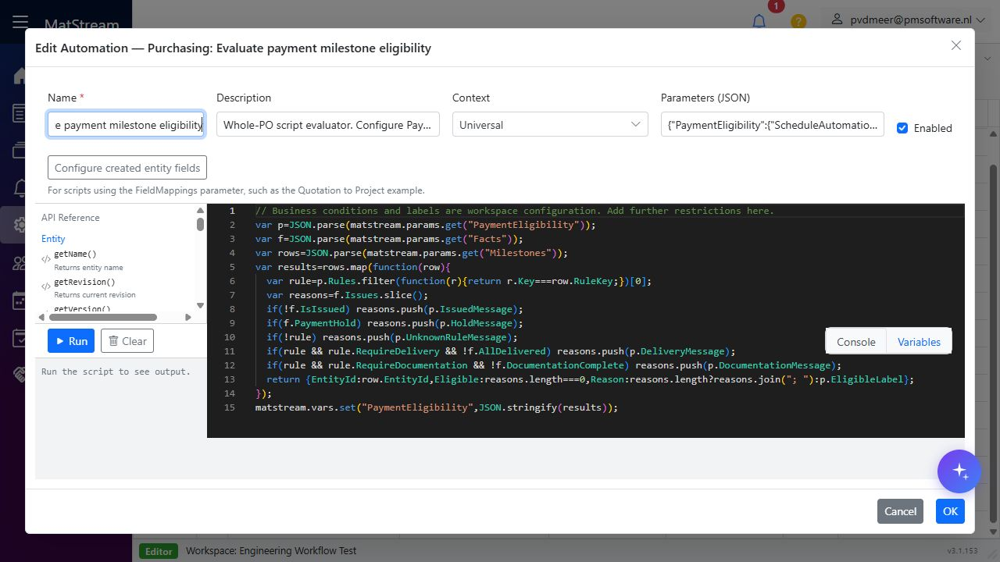

# Project Management and Purchasing — Plan payment milestones

Use **Payment Milestones** on a Project to plan customer invoicing, or on a Purchase Order to plan supplier payments. Both tabs contain owned records of the same **Payment Milestone** category. Each parent has its own amounts, dates, references, documents and history.

## Create the plan

1. Open the current Project or Purchase Order.
2. In **General → Payment planning**, enter **Payment Schedule Basis**: the agreed amount the percentages apply to. For this example, use the agreed net amount. Enter the **Currency** and **Payment Schedule Date**, then save.
3. Open **Payment Milestones** and choose **Payment planning → Create 30/50/20 plan**.
4. Review the three records and the **Planned amount** total. Use **Columns…** to choose the fields you need.
5. Open a milestone to enter its planned/due dates, responsible workspace user and invoice reference. Add supporting evidence under its **Documents** tab. Save the changes.



The currency displayed from a configured category default can be used when no currency is stored yet; initialization freezes it on the saved parent version and its milestones. Stored overrides win, and an explicitly saved blank remains invalid.

The agreed basis is entered explicitly; this action does not calculate a sales contract value from BOM purchase costs or automatically sum PO lines. An administrator can map an existing agreed-total property instead. Verify that the basis, currency and tax treatment match the agreement before creating the plan.

| Default installment | Percentage | Recorded condition |
|---|---:|---|
| On order | 30% | Order agreed |
| On delivery | 50% | All applicable order quantities delivered |
| On complete documentation | 20% | All applicable quantities delivered and all required documentation accepted |

Only the first planned date defaults to the schedule date. Delivery and documentation dates remain blank until the team schedules them. Administrators can configure a date offset for each installment, or leave it blank for an event-dependent date.

The calculation uses decimal arithmetic. For EUR 10,000, the plan is EUR 3,000 / 5,000 / 2,000. The last installment receives any rounding remainder, so the amounts reconcile exactly with the agreed basis. A schedule must total 100%, and every resulting amount must be positive.



On a Project with many tabs, use **All tabs… → Payment Milestones** if the tab is in the overflow menu.

## Invoicing and paying are different

Project milestones use **Customer Invoice Milestone Lifecycle**, ending in **Invoice Issued**. PO milestones use **Supplier Payment Milestone Lifecycle**, ending in **Paid**. Issuing a customer invoice does not record that the customer has paid it.

All generated milestones start **Not eligible**. Creating a plan does not establish that delivery or documentation is complete, request approval, send an invoice, or execute a payment. PO eligibility is evaluated separately from plan creation, using the whole order as described below. One delivered line does not release the entire order's payment. Project invoicing eligibility is still a manual review.

An administrator configures lifecycle state and transition permissions in **Configuration → Lifecycle Definitions**. The seed keeps transitions with Administrators until they assign the appropriate requester, approver and finance groups. Final states are seeded read-only. Record evidence before an authorized user changes the milestone state.

## Reruns and changes to the agreement

The action creates a saved plan once. Running it again leaves the existing records, states, evidence and edited dates unchanged. It also preserves the absence of a deliberately removed milestone. It does not silently refill gaps around approved or paid records.

Amounts, percentages, direction and currency are seeded read-only on generated milestones. Planned/due dates, responsibility, condition and invoice reference are editable within normal permissions. Changing the parent basis or automation defaults does not resize an existing plan. Review amendments separately; automatic amendment, credit and settlement reconciliation are not provided by this initialization action. Administrators should keep the generated financial fields read-only unless they establish an appropriate correction procedure.

## Administrator setup

Fresh **Engineering Project Configuration** includes the category and both tabs. For an existing engineering workspace, **Manage → Setup → Payment Milestones** installs this part without rerunning the full engineering setup. The Project and Purchase Order categories must already exist. Subsequent setup runs preserve the installed configuration.

In **Configuration → Automations**, edit **Create payment milestone plan**. Its **PaymentSchedule** Parameters contain:

| Settings | What administrators can change |
|---|---|
| `MilestoneCategoryId` | Ordinary category used for the generated records |
| `Parents` | Supported parent category IDs, initial lifecycle state IDs and direction labels |
| `BasisPropertyId`, `CurrencyPropertyId`, `AnchorDatePropertyId` | Parent input mappings |
| `PercentagePropertyId`, `AmountPropertyId`, `ConditionPropertyId`, `PlannedDatePropertyId`, `DirectionPropertyId` | Milestone output mappings; basis and currency also appear on each milestone |
| `RulePropertyId`, installment `Key` | Stable eligibility rule mapping; independent of names and percentages |
| `ReceiptPropertyId` | Read-only saved plan record on the parent, used to prevent recreation |
| `Installments` | Names, percentages, condition descriptions and nullable `OffsetDays` |
| `DecimalPlaces`, `Rounding` | Supported precision 0–4; `AwayFromZero` or `ToEven`; final-row remainder |
| `VersionComment` | Parent history description when the plan is created |

The stored script calls the supported action:

```javascript
var plan = JSON.parse(matstream.params.get("PaymentSchedule") || "{}");
matstream.actions.createPaymentSchedule(plan);
```

Keep it the only write action in that run. It runs from a saved current parent, outside an atomic lifecycle script, using the authenticated Editor's create/update and record modification permissions. Unknown properties, incompatible types, unsupported categories, invalid percentages, missing inputs and an initial state outside the assigned workspace lifecycle are refused before creating records. All rows and the parent plan record commit together.

Fresh **Engineering Project** configuration installs the definitions. Existing workspaces with Project and Purchase Order categories can install just **Payment Milestones** in the Manage setup wizard. An installed setup is left unchanged on rerun, including renamed definitions, modified scripts and deliberately removed assignments.

Use **Categories** to configure properties, read-only defaults, groups and Documents; **Display Tabs** to configure filters, columns, the sum field and ribbon labels/actions; and **Lifecycle Definitions** for state names, permissions and transitions. The same category can be assigned elsewhere, but add the parent mapping and its input properties before using the action there. Category and property IDs remain stable when labels are renamed.

## Local workflow check

The separate local RVD test project and its two test POs were used; no supplier invitation, email, invoice or payment was sent.

| Parent | Agreed basis | 30% | 50% | 20% |
|---|---:|---:|---:|---:|
| Test project: customer invoicing | EUR 10,000.00 | 3,000.00 | 5,000.00 | 2,000.00 |
| Motor PO | EUR 299.00 | 89.70 | 149.50 | 59.80 |
| Pump PO | EUR 825.00 | 247.50 | 412.50 | 165.00 |

The script created three independent children per parent with the correct lifecycle and preserved them on repeat runs. SQL integration checks also cover rollback on a failure during child creation, unchanged earlier parent history, a foreign lifecycle state being refused, and paid/removed milestones being left untouched. These initialization checks are supplemented by the eligibility checks below. No payment processing is performed.

The browser check also saved the motor delivery milestone's planned date as **15 December 2026**, reopened the PO, and reran its plan action. The date and invoice-reference note remained saved, with exactly three installments. A generic PO save issue found during this check was fixed: ordinary children no longer require a stock commitment. Actual purchase stock lines retain quantity/receipt guards and ledger reconciliation.




## Automatic PO payment eligibility

For an issued PO, MatStream now checks the saved whole-order evidence and updates its **Not eligible / Eligible** milestones automatically:

| Seeded rule | What must be true | Motor | Pump |
|---|---|---:|---:|
| `order` — 30% | PO is in a configured issued state, no Payment Hold, valid complete plan | EUR 89.70 | EUR 247.50 |
| `delivery` — 50% | The above, plus every applicable PO line fully received | EUR 149.50 | EUR 412.50 |
| `documentation` — 20% | The above, plus every line's required RVDs accepted with current stored files | EUR 59.80 | EUR 165.00 |

Open **General → Payment planning** to see each recorded state and the reason the current evidence qualifies or is blocked. **Refresh status** reads the latest evidence; **Recheck eligibility** also applies permitted state changes immediately. Both use saved data: save edited fields first.



For example, receiving half the motor quantity leaves the 50% installment blocked. Receiving all ordered quantities allows the 50%, while the 20% remains blocked until Quality accepts all required current documents. A supplier upload alone is insufficient. Replacing an accepted file invalidates the previous evidence until the replacement satisfies the configured acceptance rules. Cancelling an outstanding stock commitment is not a goods receipt.

Set **Payment Hold** and save to prevent eligibility, for example while reviewing changed commercial terms. Removing the hold allows a fresh evaluation.



The evaluator manages only its two configured eligibility states. It leaves **Requested**, **Approved** and **Paid** records unchanged. If their evidence stops qualifying, the status panel shows **Review required**; it does not erase an approval or recorded payment. The seeded lifecycle criterion **Payment milestone evidence is eligible** also checks live evidence before a user moves into Eligible, Requested, Approved or Paid, so a stale Eligible label cannot bypass the check. Normal transition permissions and other criteria still apply. Eligibility itself does not approve, invoice, notify a supplier or pay money.


### Administrator configuration

In **Configuration → Automations**, edit **Purchasing: Evaluate payment milestone eligibility**. Its stored script evaluates supplied `Facts` and `Milestones`, and returns one decision with a reason per milestone. Administrators can add stricter checks in the script. The service verifies decisions against the configured evidence requirements and applies ordinary lifecycle transitions with history and events.



All new workflow choices are editable through the application:

| UI | Configuration |
|---|---|
| Automations → evaluator → Parameters → `PaymentEligibility` | Schedule automation, PO/line categories, issued-state IDs, rule property, hold property, Not eligible/Eligible state IDs, rule conditions and displayed reasons |
| Automations → evaluator → Script | Workspace's eligibility decision example and any additional restrictions |
| Automations → evaluator → Parameters | `ExecutorWorkspaceUserId` (0 uses the automation author), `Events`, `ReconcileEnabled`, `RecheckIntervalSeconds` (60–86,400), `BatchSize` (1–1,000), history comment and labels |
| Automations → Create payment milestone plan | `RulePropertyId` and each installment's stable `Key`, alongside the existing percentages/mappings |
| Property Definitions → Payment Eligibility Rule | Editable option values, labels and descriptions; keep values aligned with evaluator rule keys |
| Categories | Assignment, grouping, editability and visibility of Payment Hold, Payment Eligibility and the milestone rule |
| Lifecycle Definitions | State names, transition permissions and the live eligibility criterion |

The background executor must be an enabled internal user with an active Editor membership and the required read/transition permissions. Supplier uploads do not give the supplier internal permissions. Events trigger a fresh whole-order evaluation; periodic reconciliation catches changed configuration, removed links and missed events. The default interval is one minute after the scheduler's normal startup delay. Check background-job failures if eligibility stops updating. Disabling the automation stops future updates; it does not rewrite saved states.

Eligibility uses stable IDs and rule values, so renaming states or installment labels does not break it. An existing customized plan is not guessed from percentages or names: an administrator must review its **Payment Eligibility Rule** on each record and `Key` on the creation script's installments. The focused **Manage → Setup → Payment Milestones** upgrade adds the new definitions without rewriting an existing plan. Subsequent setup reruns preserve installed customizations.

Changing the agreed basis or currency, removing part of the 100% plan, or leaving an unknown PO-line category blocks eligibility for review. This feature does not recalculate an amended agreement, reconcile credits/cancellations, validate supplier invoices or prove actual settlement. Keep financial fields protected and use a reviewed amendment procedure.

### Local eligibility test results

The separate local motor and pump POs were prepared as issued fixtures without dispatching to suppliers. The running worker then moved both order installments to **Eligible** through the normal lifecycle service. The delivery and documentation installments stayed **Not eligible**. A browser test saved a motor Payment Hold, observed automatic withdrawal, then removed the hold and restored eligibility. The pump browser view was checked separately.

Transactional tests against both local POs covered partial/full receipts, all required documents accepted, loss of an accepted file, a hold, repeated evaluation and an already-paid milestone needing review. Those simulated receipt/document/payment changes were rolled back; they were not left as real warehouse or financial evidence. Integration tests additionally cover multiple PO lines, released commitments without receipts, inaccessible evidence, portal actors, changed amounts/currency, stale versions and an atomic rollback when a lifecycle transition fails. The motor's planned delivery milestone date remains **15 December 2026**.


### Fresh connected rehearsal — 19 November 2026

The wizard-seeded Project and its three actual workflow POs created independent plans through the application UI:

| Parent | Basis | 30% | 50% | 20% |
|---|---:|---:|---:|---:|
| PRJ-2026.0001 | EUR 125,000.00 | 37,500.00 | 62,500.00 | 25,000.00 |
| PO-2026.0001 — original tees | EUR 178.50 | 53.55 | 89.25 | 35.70 |
| PO-2026.0002 — pump and motor together | EUR 1,124.00 | 337.20 | 562.00 | 224.80 |
| PO-2026.0003 — replacement tee | EUR 59.50 | 17.85 | 29.75 | 11.90 |

Repeating Project plan creation retained exactly three installments. Whole-PO eligibility passed for all three received/documented POs, including both Acme lines together. A temporary replacement Payment Hold changed all three installments to Not eligible; clearing it restored Eligible. Project invoice milestones remained Not eligible for manual review. These are software planning checks, not actual invoices, approvals, payments or a warranty settlement.
