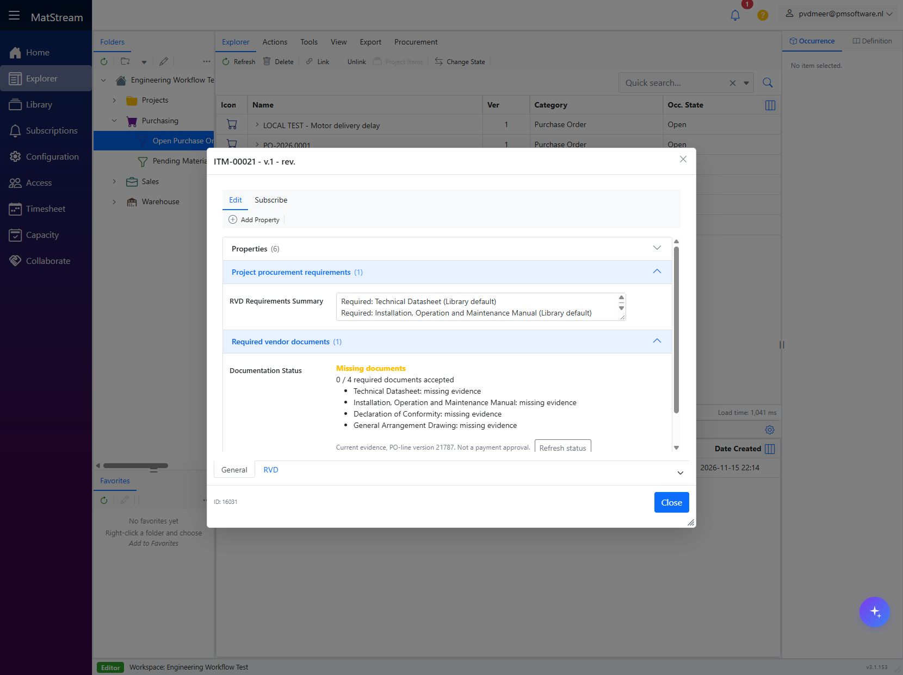
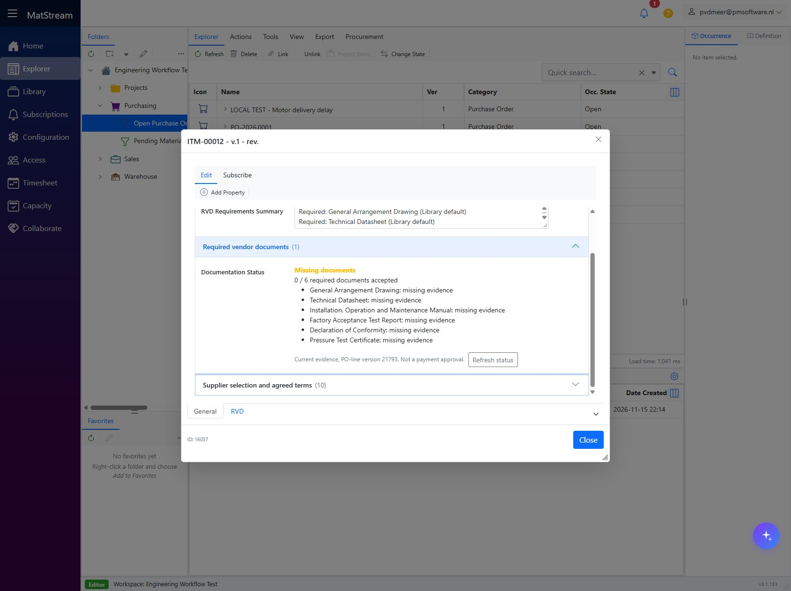

# Quality — Check PO-line documentation status

Open a motor or pump **Purchase Order Line**, then its **General** tab. Under **Required vendor documents**, **Documentation Status** shows the acceptance count and the requirements still blocking completion. Open the **RVD** tab to inspect the actual evidence and use the configured acceptance/rejection transitions.

The status is calculated when the panel opens and whenever you click **Refresh status**. Refresh it after a supplier upload, a Quality decision, reopening or file removal. A panel already open on another computer does not receive live push updates.

## What the result means

| Default result | Example |
|---|---|
| Missing documents | The motor has four required documents, but one or more has no evidence file |
| Awaiting acceptance | Files exist, but at least one is still Submitted rather than Accepted |
| Rejected documents | No files are missing, but Quality has rejected a requirement |
| Complete | Every frozen required RVD has its own current file and an administrator-mapped accepted state |
| Review checklist | The frozen checklist is missing/invalid or a required row has been removed, duplicated or no longer matches its pinned provenance |

Missing evidence takes priority over awaiting/rejected evidence. The blocker list gives the detail. **Accepted** without a file is still incomplete. A replacement uploaded through the document workflow returns to the configured submission state, so the replacement needs acceptance again. Removing an accepted file also makes the result incomplete, even if its state label still says Accepted.

The result compares the [frozen project requirements](engineering-project-rvd-requirements.md) with the PO line's current owned RVD rows. Project additions count; reasoned exclusions recorded before MR creation do not count. Deleting a required PO row does not waive it. A changed definition pin, source association or ordered item pin requires checklist review.

An explicitly frozen checklist with no included requirements is different from a missing checklist. The default allows an explicit empty checklist to be Complete; an administrator can change that policy. Legacy PO lines without a valid project RVD snapshot show Review checklist rather than silently using today's Library defaults.

## Administrator configuration

In **Configuration → Automations**, edit **Purchasing: Evaluate RVD documentation**. Its **Parameters** contain a **DocumentationStatus** object:

- **PoLineCategoryId**, **RvdCategoryId** and **SnapshotPropertyId** map the PO line, its evidence rows and the frozen RVD snapshot property. Keep these aligned with the project RVD configuration.
- **AcceptedStateIds** and **RejectedStateIds** define acceptance and rejection by state identity. Renaming Accepted does not break the result. The states must belong to a lifecycle assigned to the RVD category; the accepted and rejected lists cannot overlap.
- **EmptyChecklistComplete** controls explicitly empty frozen checklists.
- **CompleteLabel**, **MissingLabel**, **ReviewLabel**, **RejectedLabel** and **UnknownLabel** supply the default script's displayed labels.

The **Script** is an editable read-only example. It reads **Requirements**, **Issues** and **DocumentationStatus** from `matstream.params`, then returns its result as JSON through `matstream.vars.set("DocumentationStatus", ...)`. It may adjust prioritisation, wording and blocker presentation. The host refuses a Complete result when current accepted evidence does not satisfy the frozen checklist. The evaluator cannot write entities, notify people or change lifecycles during a status read. A disabled/invalid script shows an error rather than retaining a previous Complete result.

The seed adds a read-only **Documentation Status** Memo property with the **PO documentation status** editor. Administrators can rename it, change its group/order/visibility or select the editor in **Property Definitions**, and assign it through category properties. The live result is displayed in General; it is not stored as a property value for ordinary grid filtering/export. That avoids an out-of-date Complete flag being mistaken for current evidence.

Setup seeds the evaluator and display field and preserves installed administrator changes. Users must be able to read the PO line and its RVDs; an inaccessible document is not silently ignored. Historical PO-line versions are not presented as a current acceptance result.

## Local workflow test

The local motor order **PO-2026.0003** requires four documents; the pump order **PO-2026.0004** requires six. Both initially show zero accepted. Transactional tests temporarily supplied/accepted all four or six and verified Complete, then verified missing files, Submitted, Rejected, real replacement uploads and removed requirement rows block it. Those evidence changes were rolled back. The screenshots show the genuine current, still-missing evidence.

This result describes documentation only. It does not mark goods Received, the PO technically Complete, an invoice ready, or a payment approved. Those later scripts must use a fresh evaluation together with their delivery and hold rules; this step introduces no payment or completion automation and no implicit waiver.
