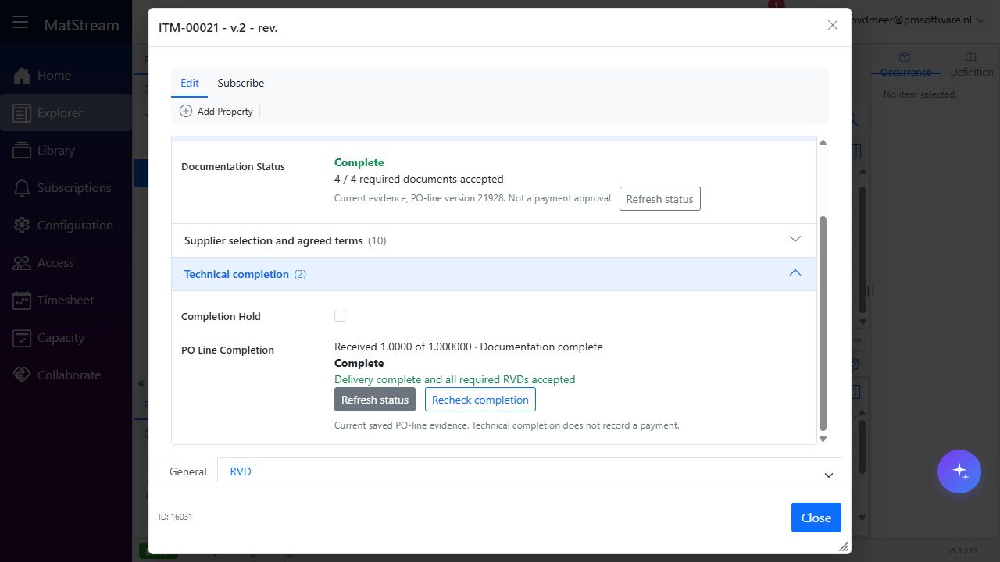
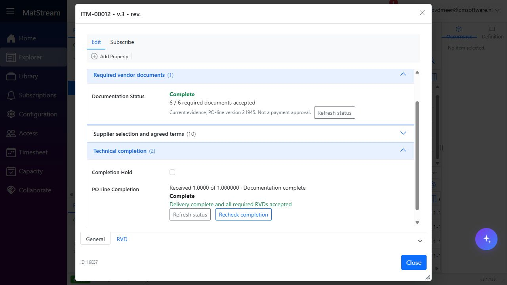
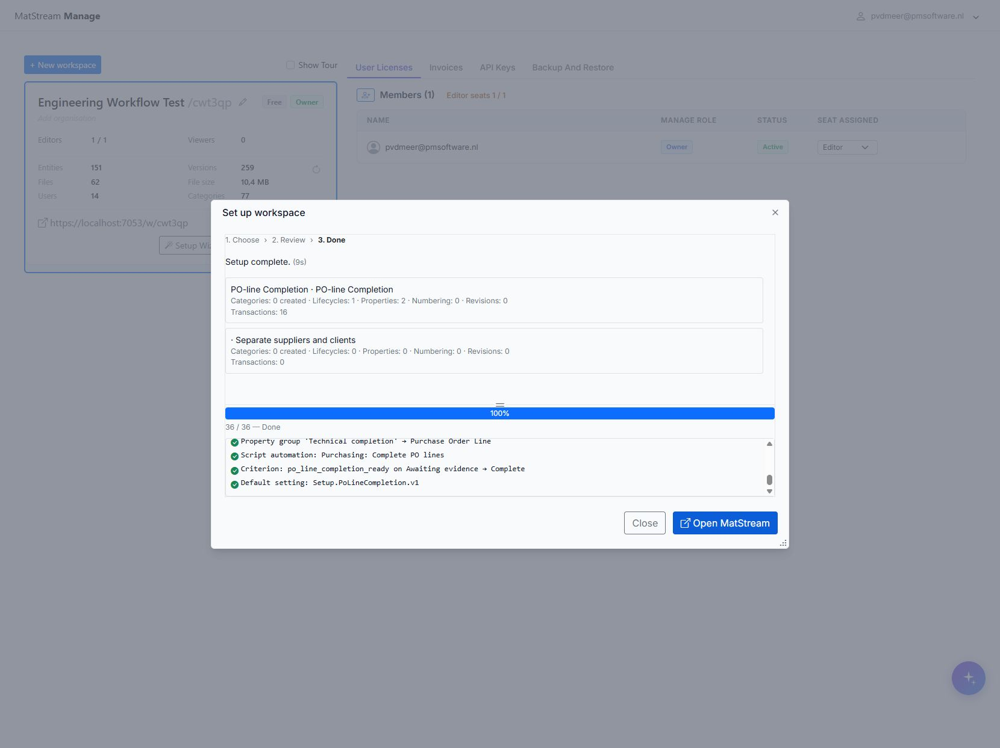
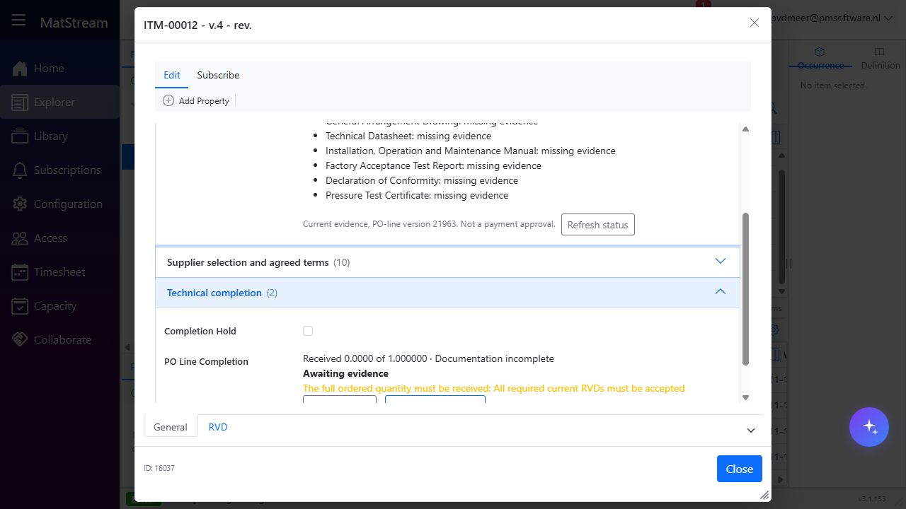

# Purchasing and Quality — Complete a PO line automatically

A PO line becomes **Complete** when its full ordered quantity has arrived, all required current vendor documents are accepted, and **Completion Hold** is clear. This is technical completion of the line. Payment approval and actual payment remain separate.

## Follow the workflow

1. Issue the PO and receive the goods through the normal warehouse receipt workflow. A partial receipt leaves the line waiting.
2. The supplier uploads the required documents. Quality reviews them and moves each accepted document to the configured acceptance state. Uploading alone does not qualify.
3. Open the PO's **Lines** tab and open the motor or pump line. In **General → Technical completion**, inspect **PO Line Completion**. It shows the received quantity, documentation status, recorded lifecycle state and the reason it qualifies or remains blocked.
4. Save any edits before choosing **Refresh status** (read current evidence) or **Recheck completion** (also apply a permitted transition immediately). The automatic worker uses the same check when evidence events arrive, with periodic reconciliation as a fallback.
5. The line moves from **Awaiting evidence** to **Complete**. Its history records the change and reason; ordinary lifecycle subscriptions can follow this transition. The existing payment milestone evaluator independently rechecks the owning PO from those events.

For example, the motor requires four documents and the pump requires six in this local project's frozen RVD requirements. Receiving the motor without its accepted certificate does not complete its PO line. Accepting the certificate before the motor arrives does not complete it either. Other projects can have different requirements.

## If evidence changes

A new unaccepted document version, missing file, receipt correction, increased ordered quantity or saved **Completion Hold** returns a managed Complete line to Awaiting evidence on the next evaluation. The status display explains the current blocker. Set Completion Hold for an unresolved quality issue or other technical restriction. Clearing the hold allows a new evaluation.

Cancelled lines and records using another lifecycle are left untouched. A cancelled outstanding commitment is not a goods receipt. Missing/invalid frozen RVD requirements block completion rather than assuming that no documents are required. Empty valid checklists follow the existing administrator-configured Documentation Status policy.

The seeded **PO-line delivery and RVDs complete** criterion checks live evidence before a normal transition into Complete. This also protects a manual completion attempt while the automatic worker is catching up. Changes use the normal lifecycle service, permissions, criteria, version history and events. The worker does not impersonate suppliers or bypass transition permissions.

## Administrator setup

Fresh Engineering Project configuration includes this feature. For an existing workspace with Purchase Order, Purchase Order Line and RVD documentation configuration, use **Manage → Setup Wizard → PO-line Completion**.

The setup assigns **PO Line Completion Lifecycle**, with Awaiting evidence, Complete and Cancelled. Complete is deliberately non-final so that invalidated evidence can reopen the line. It preserves an existing category default lifecycle; administrators must map their own lifecycle states or select the new lifecycle for appropriate records. Existing records are not silently migrated. In this test, only the two known motor/pump test lines were explicitly assigned the new lifecycle.

Configure the feature through the application:

| Where | What can be changed |
|---|---|
| **Automations → Purchasing: Complete PO lines → Parameters**, root `PoLineCompletion` | `PoCategoryId`, `PoLineCategoryId`, `ActivePoStateIds`, `AwaitingStateId`, `CompleteStateId`, `HoldPropertyId` |
| Same automation → Script | Administrator's stored completion decision example; additional restrictions and reasons |
| Same Parameters | `ExecutorWorkspaceUserId` (0 uses the author), `Events`, `ReconcileEnabled`, `RecheckIntervalSeconds` (60–86,400), `BatchSize` (1–1,000), `VersionComment` and all script reason labels |
| **Categories → Purchase Order Line** | Completion Hold and PO Line Completion assignments, visibility, grouping, editability and default lifecycle |
| **Lifecycle Definitions** | State names, transition permissions, reopening routes and the live completion criterion |
| **Automations → Purchasing: Evaluate RVD documentation** | Existing required-document mappings, acceptance states and empty-checklist policy |

The script receives read-only `Facts` with scope validity, managed lifecycle, hold, delivery and documentation results, quantity and received quantity. It returns `PoLineCompletion` JSON with `Complete` and `Reason`. The platform verifies the result against current evidence and applies the configured ordinary transition; it rejects script write actions or a decision that bypasses missing evidence. Renaming states does not break the stored ID mappings.

The background executor must be an enabled internal Editor with access to the PO, line and required documents and permission to perform the configured transitions. Default transition authority is Administrators until workspace administrators delegate it. The events include receipt, document upload, lifecycle and entity changes. Reconciliation defaults to one minute after the scheduler's normal startup delay; inspect failed jobs if updates stop. Disabling the automation stops future updates and does not rewrite saved states. Setup reruns preserve installed administrator settings and removed assignments.

Completion Hold is independent of Payment Hold. A commercial payment dispute does not by itself mean the technical work is incomplete. The evaluator uses actual receipt-ledger quantities; it does not independently inspect goods or infer quality clearance from a warehouse location. Use Completion Hold for quarantined/unacceptable goods until the team resolves them. Automatic quality-disposition integration is outside this slice.

## Local test evidence

The tests use the separate local motor and pump POs, not supplier-facing production records. Transactional simulations verified partial/full delivery, pending/accepted RVDs, replacement or missing accepted files, a completion hold and repeated evaluation, and were rolled back.

For the running-worker/browser check, synthetic receipt entries and acceptance/file versions were temporarily staged on these same two explicitly local test lines. They are test evidence, not real delivery or Quality decisions. The worker used normal lifecycle transitions; the original evidence was restored afterwards and the lines returned to Awaiting evidence. Test history remains traceable. No supplier message, invoice or payment was sent.

SQL integration tests additionally cover documents-first/goods-first order, cancelled lines, inactive PO state, changed quantities, stale versions, portal/update refusal, read denial and rollback when a lifecycle transition fails. The payment milestone workflow remains separate and preserves requested/approved/paid records when evidence changes.

