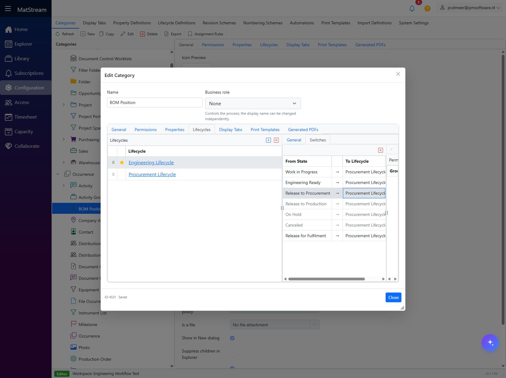
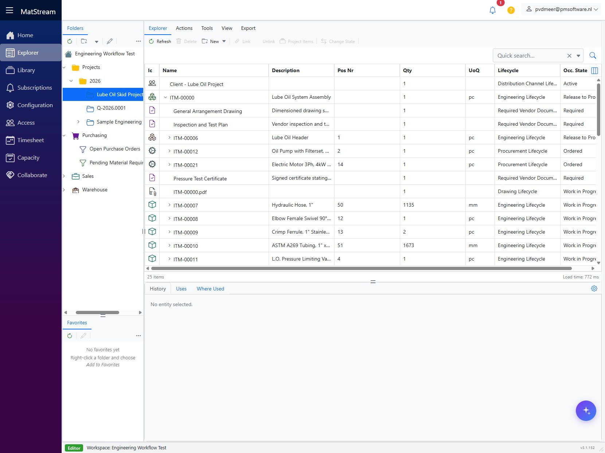

# Purchasing — Hand ordered requirements to project procurement

When the motor or pump MR becomes **Ordered**, its linked project BOM position should show **Procurement Lifecycle → Ordered**. The existing MR transition automation performs this handover; creating a PO is one way to trigger the MR transition.

## Prepare the project position

1. Review and release the exact Library item version used by the project. The procurement release criterion checks that linked version, including an explicitly pinned version.
2. Set the project BOM position to **Engineering Ready**, then **Release to Procurement**. The configured release transition materializes and pins the position and raises an MR for uncovered demand.
3. Select the project supplier and review the agreed terms as described in [Select a project supplier and agree terms](engineering-supplier-selection.md).
4. Create the PO. The MR becomes **Ordered** and its Requirement Source link identifies the project BOM position to update. Check the project occurrence's lifecycle and state, rather than changing the Library item's lifecycle to Procurement.

## Administrator configuration

Use **Configuration → Categories → BOM Position → Lifecycles**. Select **Engineering Lifecycle**, then **Switches**. The saved switch from **Release to Procurement** to **Procurement Lifecycle** must allow direct change. Here, direct change means a lifecycle change without an intermediate switch automation; the ordinary switch permissions and criteria still apply.

The seed includes the release-state switch and the existing Engineering Ready switch. If a seeded lifecycle uses **Ready for Procurement** instead, that release state is included. Work in Progress and unrelated states do not gain a direct switch from this fix. Existing administrator switch settings and permission rows are preserved, including a deliberately disabled switch. Installed setup configuration is not recreated on subsequent runs.

The other half is configured under **Lifecycle Definitions → Material Requirement Lifecycle**. Select a transition into **Ordered**, then its **Automations**. The existing **Switch Source Lifecycle** automation uses:

| Parameter | Seeded meaning |
| --- | --- |
| TargetLifecycle | The workspace's Procurement Lifecycle ID |
| TargetState | Ordered |

Lifecycle IDs differ between workspaces. The administrator controls the MR transitions carrying this automation, its target lifecycle/state, the BOM category switches, and their group permissions and criteria. Existing handover into Delivered remains separate configuration. No new script or hard-coded department rule is needed.

If a retry finds the position already in the requested lifecycle and state, the automation completes without trying an Ordered-to-Ordered transition. It still uses the configured switch and transition when a change is actually needed.

## Local motor and pump test

The earlier supplier test had raised MRs by calling the MR script directly, leaving its project positions in Work in Progress. The handover retest prepared those local records through the lifecycle service first. It also demonstrated that procurement release is blocked while the exact linked Library version is not final; the test reviewed and released those item versions before retrying.

The existing MRs were moved from Ordered back to Requested and then to Ordered **only to retest the configured transition locally**. Existing POs were retained; no replacement orders were created or sent.

| Item | Project BOM position | MR | Final project lifecycle/state |
| --- | --- | --- | --- |
| Motor ITM-00021 | 15966 | 15984 | Procurement Lifecycle / Ordered |
| Pump ITM-00012 | 15967 | 15985 | Procurement Lifecycle / Ordered |

Both first handovers completed without automation errors. Repeating the MR transitions after the positions were already Ordered also completed without errors. Each source position still has one MR; the original PO prices, supplier-offer pins and ordered item-version pins were preserved.

This resolves the lifecycle-switch warning recorded in the supplier-selection test. Project-specific RVD propagation, MR-to-PO required dates and payment milestones remain separate workflow steps.
