# Production completion and inspection/test records

Finish the **ITM-00006 header** first, then the **ITM-00000 final assembly**. Each production order has its own inspection records. Completing the header does not complete the final assembly.

!!! info "Local validation — 17 November 2026"
    The browser walkthrough completed the ITM-00006 header and then ITM-00000 using clearly labelled synthetic evidence. It tested checklist preparation, Choose columns, inspector/result editing, file upload, review/acceptance, Accepted read-only access, blockers and both production completions. The final assembly waited for the header. All current approvals, completed states, files and stock were restored afterwards; five unapproved Draft records remain. Separate-user permissions and fresh Setup installation still need rehearsal. No physical test or manufacture is implied.

## 1. Prepare the header records

1. Open the production order for **ITM-00006**.
2. Select **Production Inspection Plan → Header fabrication** and save.
3. In **Production Completion**, choose **Prepare inspection records**. The same preparation script runs when the order moves from Draft to Released. Because that script needs the plan, the seeded **Draft → Released** transition carries a **Production Inspection Plan is required** criterion: if no plan is selected and saved, the Change State dialog says so and the order stays in Draft. An administrator can edit, disable or delete this criterion under **Configuration → Lifecycle Definitions**.
4. Open **Inspection and Test Records**. The example plan creates:

| Record | What the team records |
|---|---|
| Header visual and dimensional inspection | The released drawing/revision, relevant dimensions, observations and acceptance criteria |
| Header weld inspection record | The applicable approved weld instructions, traceability, inspection method and actual results |
| Header test report | The approved test procedure/revision, test conditions, applicable limits, actual results and exceptions |

The sample instructions are prompts. They are not approved manufacturing instructions and contain no pressure, duration or other invented test limits. Work Preparation and Quality must review the plan against the actual released engineering package before selecting **Inspection Plan Reviewed**.

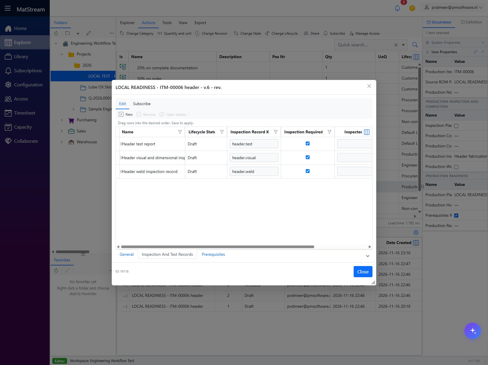

Use the columns button to choose the fields shown in the list.

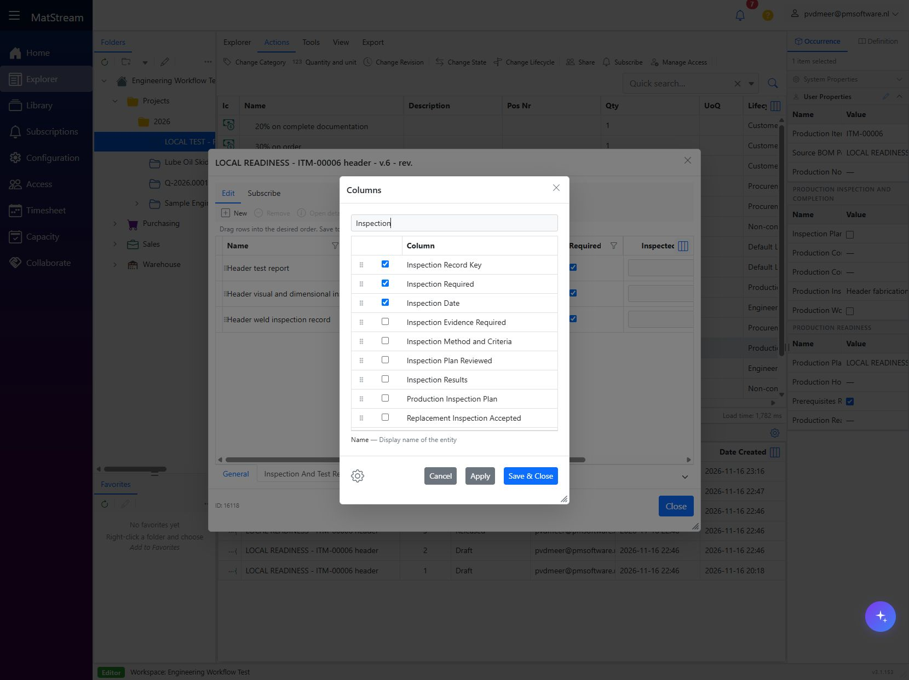

Preparing again creates only missing keys. It preserves existing results, files and accepted records. If a plan was not selected before release, save the plan and run preparation from the panel; the completion check continues to block until the requirements are met. Existing orders can use the panel without repeating release.

## 2. Record the actual inspections

For each record:

1. Replace the sample **Inspection Method and Criteria** text with the approved procedure/drawing revision and actual acceptance criteria.
2. Enter the observations and measured results in **Inspection Results**. Record exceptions and their disposition; do not merely treat a sample instruction as evidence of a passed test.
3. Select **Inspected By** and enter **Inspection Date**.
4. Open **Attached File → Browse…**, select the inspection report or other required evidence file, then **Save and Close**. Attach it directly to the inspection record; a related document in Documents or a placeholder does not satisfy this check.
5. Return to **Inspection and Test Records**, right-click the record and choose **Change State**. Select **In Review**, enter a comment and Apply. An authorised Quality user uses the same menu to choose **Accepted** or **Rejected**. Close the result dialog after it reports success.

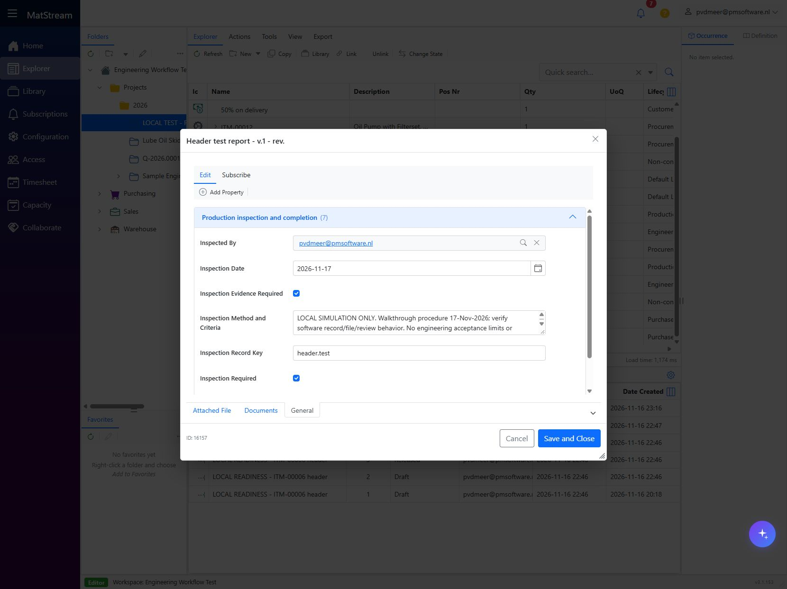

The screenshot uses a synthetic text report solely to test upload and review. Real inspections require the actual approved report and results.

Accepted records are read-only in the seeded permissions. To correct one, an authorised reviewer uses **Accepted → Draft**, makes the correction, and reviews it again. User identities, record versions and lifecycle history provide traceability. There is no rule requiring the reviewer to be a different person: the workspace administrator controls who may perform each transition.

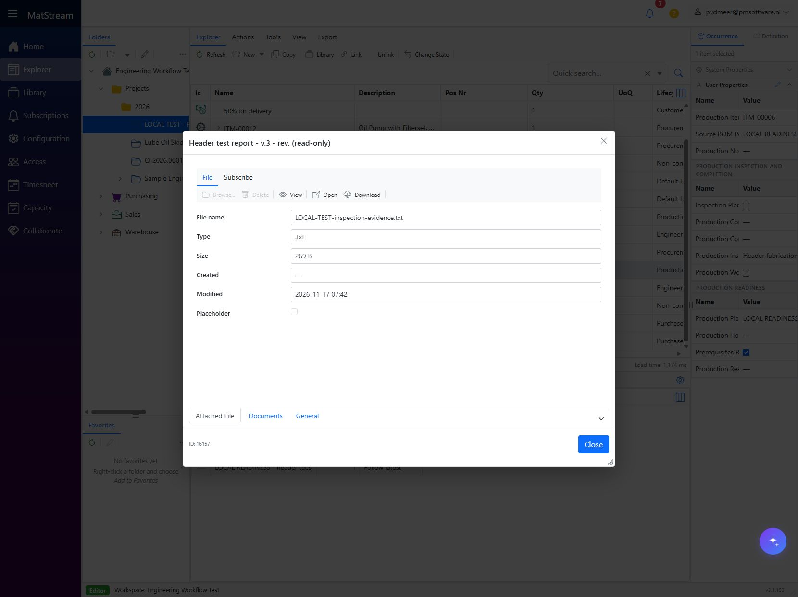

Acceptance alone does not satisfy production completion. The live check also requires the criteria, results, inspector, date and required file. A missing field or reopened/rejected record is shown as a blocker.

## 3. Complete the header

1. Confirm that production work is actually finished. Set **Production Work Complete**.
2. Enter **Production Completed Quantity** — **1** for this example's planned **1 pc**.
3. Save and choose **Check production completion**.
4. Resolve the displayed blockers: required inspection records, quantity, plan review, active holds and operation prerequisites.
5. When the check passes, an authorised user chooses **In Progress → Completed**.

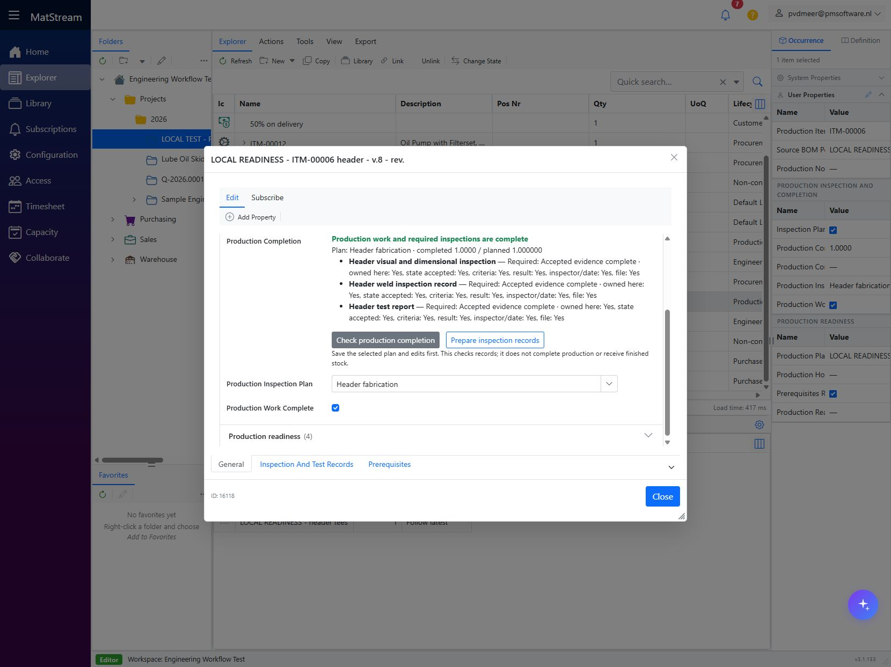

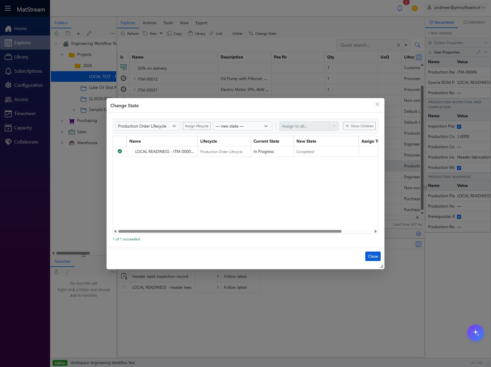

The transition rechecks current evidence; a previously green panel is not sufficient. Under the default policy, held or insufficient material, missing accepted supplier documents and an incomplete preceding production order still block completion. The check uses the existing readiness mappings, including material already issued to this operation by the replacement-collection flow.

All configured routes into Completed need the same criterion. The updated seed attaches it to every existing incoming completion transition, including direct Draft/Released routes. The browser test confirmed that Draft → Completed fails while blockers remain. Administrators can edit these criteria and permissions in the lifecycle definition.

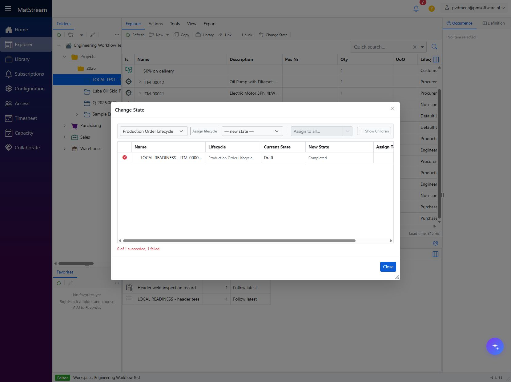

A script reports eligibility; it does not automatically complete the order. The existing lifecycle transition records who completed it. This action does not post finished goods to warehouse stock or consume the entire BOM.

## 4. Complete the final assembly

Open the production order for **ITM-00000**, select **Final assembly**, save and prepare its records:

| Record | What the team records |
|---|---|
| Final assembly inspection | Assembly/configuration, approved drawing revision, identification and installation checks |
| Final assembly functional test report | Approved functional test procedure, applicable criteria, actual observations/results and exceptions |

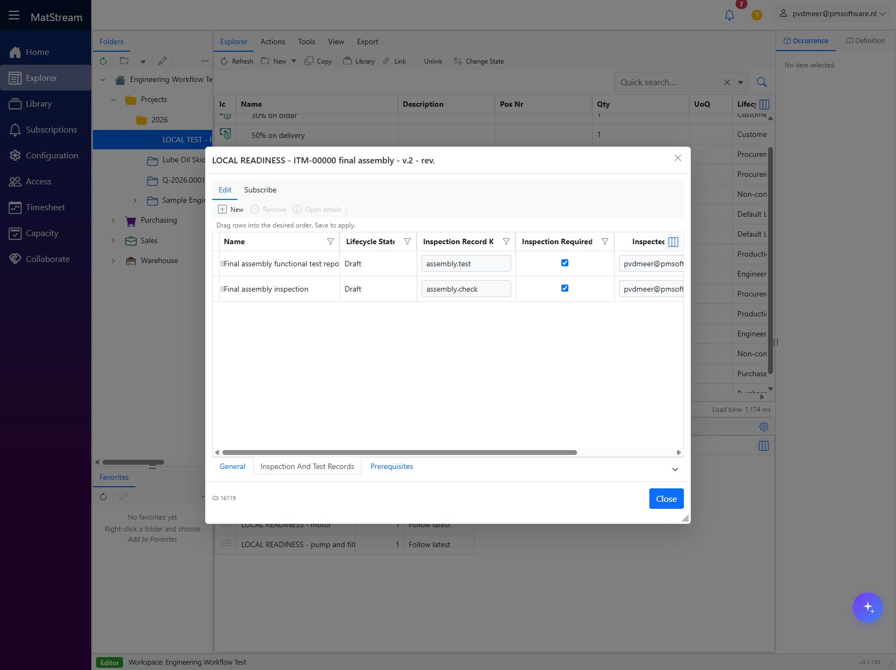

Review and accept these records using the same steps. The header must be complete; the motor, pump/filter and their configured supplier-document prerequisites must also qualify. Then confirm the actual work and completed quantity, recheck, and complete the final assembly through its own lifecycle.

Even with its own inspections accepted and the motor/pump prerequisites qualifying, the final assembly waits for the header:

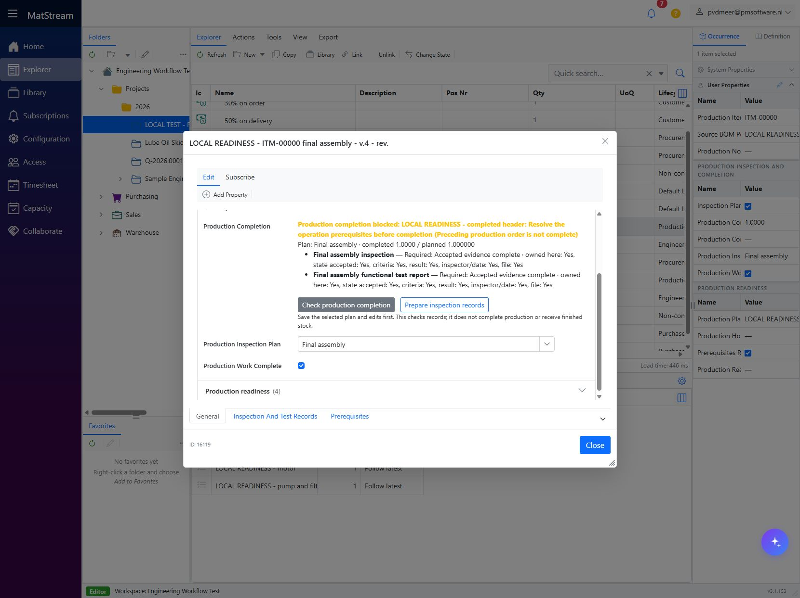

After the header completes, recheck the final assembly:

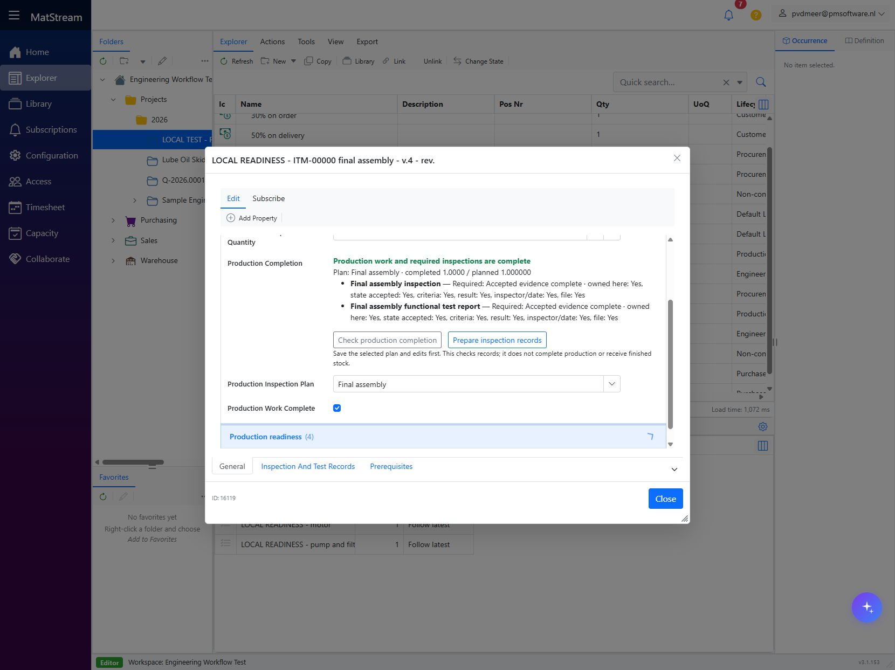

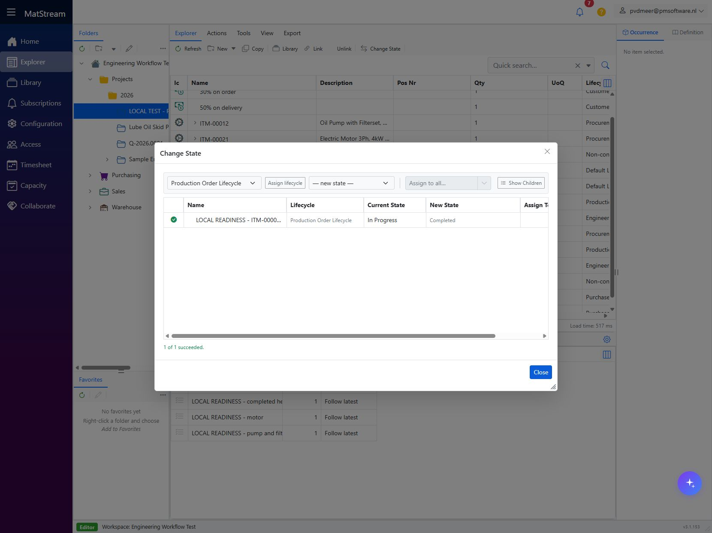

A record belongs to one current production order. Linking an accepted header record under a second order does not make it valid evidence for both. Use separate records for each order's requirements.

## Administrator configuration

New **Engineering Project** setups include this feature. Existing workspaces can install **Production Completion and Inspections** in Manage Setup after Production Orders and Production Readiness. Installed definitions are preserved on rerun. If an earlier setup installed only the In Progress → Completed criterion, add the same criterion to the other permitted completion transitions in Lifecycle Definitions; rerunning Setup deliberately preserves existing administrator choices.

| Application UI | What the administrator changes |
|---|---|
| Configuration → Categories / Property Definitions | Assigned fields, labels, defaults, validation, file capability and the inspection-plan dropdown options |
| Configuration → Display Tabs | Inspection and Test Records filter, New behavior, columns, permissions and layout; teams can use Choose columns |
| Automations → Production: Prepare inspection records | Editable preparation script; its ID is selected in the evaluator parameters |
| Automations → Quality: Evaluate production completion | Editable decision script and the `ProductionCompletion` parameters below |
| Lifecycle Definitions → Production Inspection Lifecycle | State names, review/reopen transitions and group permissions; seeded Accepted is read-only |
| Lifecycle Definitions → Production Order lifecycle | Attach preparation to the desired release transition and **Production inspections and work complete** to every permitted transition into a completed state |
| Automations → Production: Evaluate readiness | Existing material, predecessor, document, hold and reviewed-prerequisite mappings |

In the completion automation's Parameters editor, `Plans` defines each plan's stable `Key` and its `Records`. Each record has a stable `Key`, editable `Name`, `Instructions`, `Required` and `RequireEvidence`. Keep the plan keys aligned with the dropdown's saved values. Keep record keys stable when changing labels so reruns recognise existing records. Changing requirements does not erase old results or accepted records; review the existing checklist explicitly.

The same parameters expose category/property mappings, `AcceptedStateIds`, `PrepareAutomationId`, `RequireCompletedQuantity`, `AllowOverCompletion`, `RequireReadyPrerequisites` and all business messages. Requiring the planned quantity and ready prerequisites is enabled by default; over-completion is disabled. Required files can be relaxed by the administrator in the plan and the record's evidence flag. A required plan entry cannot be waived simply by clearing its record's Required checkbox.

The evaluator receives `Facts` and `ProductionCompletion` JSON. The default script returns eligibility and an administrator-editable message:

```javascript
var p = JSON.parse(matstream.params.get("ProductionCompletion"));
var f = JSON.parse(matstream.params.get("Facts"));
var complete = f.Blockers.length === 0;
matstream.vars.set("ProductionCompletion", JSON.stringify({
  Complete: complete,
  Message: (complete ? p.ReadyLabel : p.BlockedLabel + ": " + f.Blockers.join("; ")).slice(0, 1800)
}));
```

The preparation script is `matstream.actions.prepareProductionInspections();`. It must be its script's only write action. The evaluator is read-only: scripts may add restrictions, but cannot claim completion while the configured evidence checks report blockers.

## What remains after completion

Complete the actual as-built package, client handover and project closure. [Finished-goods receipt](engineering-production-receipt.md) is now implemented and tested locally. General whole-BOM stock consumption and returns remain separate work. There is no new automatic reopening of an already Completed production order if an inspection is later withdrawn: the panel shows the new blocker, and the authorised team follows its administrator-configured correction process.

Next: use the [warehouse receipt step](engineering-production-receipt.md), then address general component/header consumption and final documentation/handover before a fresh-workspace rehearsal with separate team identities.

## Restored after the browser test

Both test orders and all five inspection records were returned to Draft. Synthetic current results, accepted files and supplier-document approvals were removed, and temporary fitting/motor/pump stock and reservations were reversed. The original material blockers and fitting hold remain. Synthetic test history and comments remain traceable; this cleanup does not demonstrate a normal production return or reopening process.

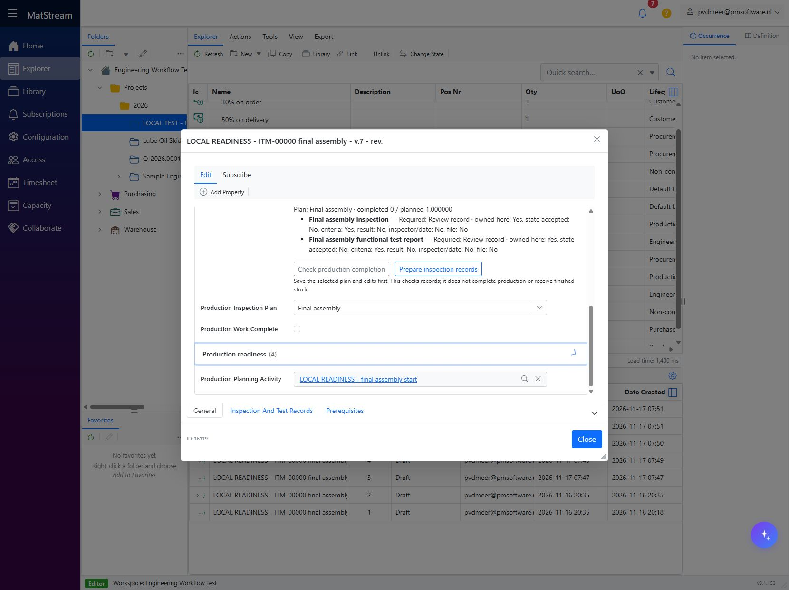
