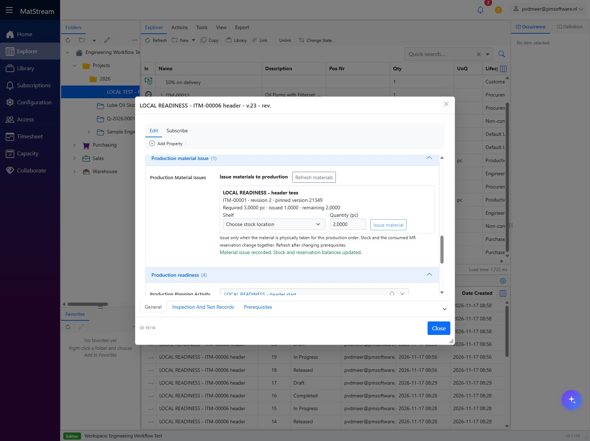
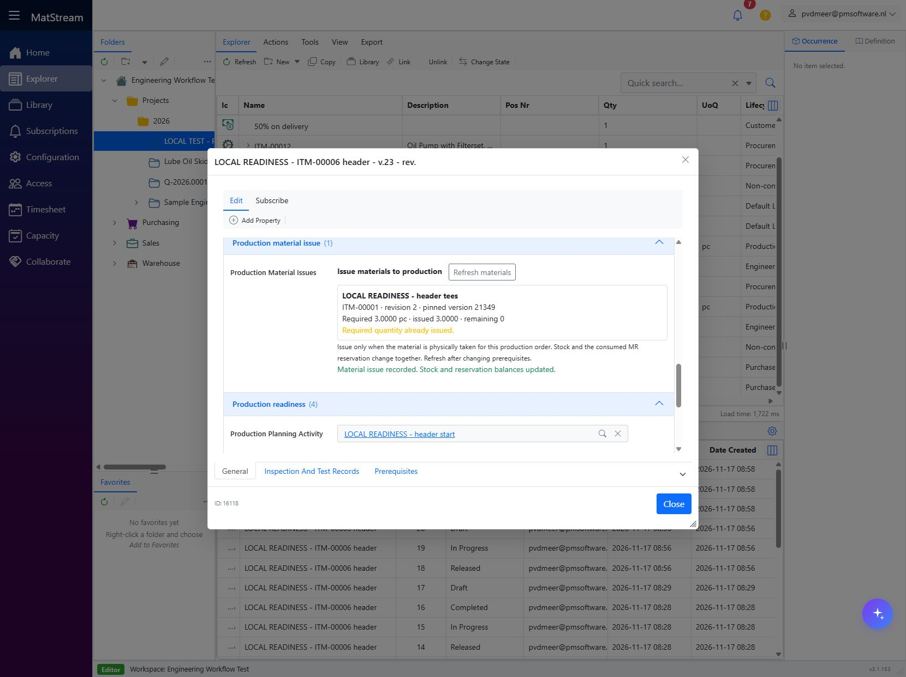
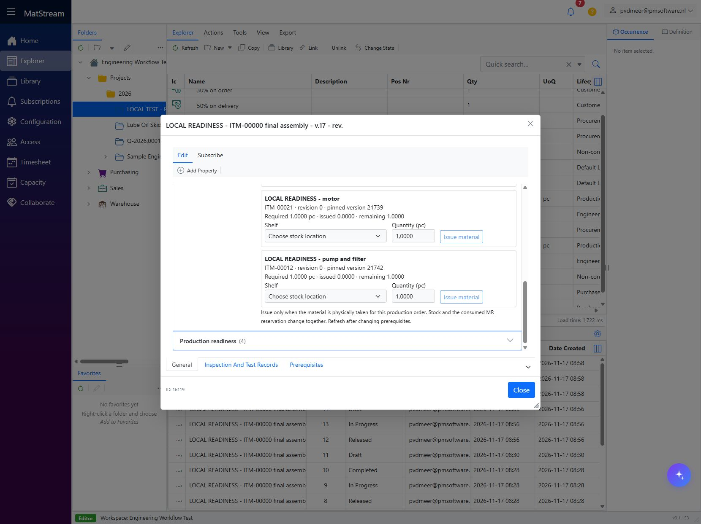
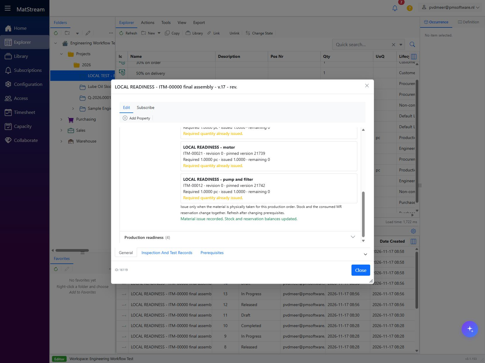

# Issue BOM materials and the manufactured header to production

Use **Production Material Issues** on the production order when warehouse goods are physically taken for that work. This is separate from receiving purchased goods, reserving an MR, completing production and receiving the finished output.

For example, reserve 3 tees for ITM-00006. Taking 1 tee reduces shelf stock by 1 and the MR reservation by 1. The order then shows **issued 1, remaining 2**. Taking the other 2 clears the reservation. For ITM-00000, taking the received ITM-00006 header removes the loose header from warehouse availability; it must not remain available after incorporation into the skid.

!!! info "Local verification — 17 November 2026"
    Native script and browser tests issued the header's 3 tees in two quantities (1 then 2), followed by the manufactured header, motor and pump/filter set into final assembly. All three MR reservations reached zero and the four pinned shelf positions reached zero. Synthetic inspection/document/material prerequisites were prepared locally; original current evidence, stock, reservations, settings and Draft fixture states were restored after the tests. No real manufacture or physical collection is implied.

## 1. Review what this order consumes

Open **Prerequisites** on the production order. Work Preparation must review this list against the manufacturing BOM:

- For a purchased or stocked BOM material, choose its **Material Requirement**. That MR supplies the required quantity, unit and pinned item revision.
- For a manufactured subassembly such as ITM-00006, choose the **Preceding Production Order** and enter **Preceding Output Required Quantity** (default 1). Complete and receive that order into warehouse stock first. Its receipt supplies the exact manufactured item revision.
- Use one source per row. Keep the material demand in the same project and clear applicable holds. Where supplier-document acceptance is required, resolve it before issuing.

Every material to consume needs a reviewed prerequisite. This action does not recursively explode the latest Library BOM, create missing MRs or infer unlisted workshop consumables. Use the released project's material requirements and review BOM coverage explicitly. The seeded local example exercises tees, motor, pump/filter and the manufactured header; it is not proof that every physical pipe, weld consumable or fitting was counted.

MR demand must be fully reserved under the current readiness policy before its first issue. Partial consumption then leaves the unused reservation in place. Existing replacement-fitting collections count as issued against their own order/prerequisite/MR, so the ordinary action does not issue that quantity again.

## 2. Issue the header fittings

1. Put the order in an administrator-configured issue state (seeded **Released** or **In Progress**).
2. Save any prerequisite or planning edits, reopen the current order and find **Production material issue** on **General**.
3. Check the item, pinned revision, required quantity, already issued quantity and remaining quantity.
4. Choose the actual shelf, for example **01-A**. Enter the quantity physically taken.
5. Choose **Issue material**.

For the local header, entering **1 pc** produced **issued 1, remaining 2**. The database audit also confirmed that **2 pc remained reserved**:



Select the shelf again and issue the remaining **2 pc**. The row then shows zero remaining and no further issue control:



The quantity input updates while typing. The browser test caught and corrected a case where the displayed partial quantity could differ from the submitted value.

## 3. Issue the header, motor and pump to final assembly

On the ITM-00000 production order, inspect the three independent rows. In this example the manufactured header uses pinned version 21644, the motor version 21739 and the pump/filter set version 21742. A newer Library version does not replace any of these pins. Once an MR has issued material, changing that demand to a different pin blocks further issue for review. A manufactured header also retains its recorded receipt unit; no implicit unit conversion is applied.



Choose the shelf and issue each quantity as it is physically incorporated into the assembly. After the three issues, all rows show **issued 1, remaining 0**:



The MR paths release the motor/pump reservations as their shelf quantities are consumed. The preceding-header path consumes unreserved physical stock from its recorded manufactured revision, bounded by that predecessor's receipt quantity across all consuming orders. It does not release somebody else's reservation. If your process reserves the header through an MR, represent its stock consumption through that MR instead, and keep a separate predecessor dependency only where needed; do not create two consuming rows for the same demand.

Use **Refresh materials** to reread saved facts. **Refresh readiness** shows reserved plus issued coverage for MR prerequisites. Start-readiness uses its own configured active states: an In Progress order may be outside that start-notification scope while material issue remains allowed. Consumed materials continue to cover the operation when **CountIssuedMaterial** is enabled (the seeded default).

## 4. Inventory and traceability

One issue transaction:

1. Rechecks the current production order, reviewed prerequisite, project, holds, document policy, demand, unit, item pin, shelf and actor permissions.
2. Releases only the consumed amount from that MR's reservation ledger positions.
3. Deducts the same quantity from the selected pinned physical shelf position.
4. Writes a **Production Issue** stock movement linked to an ordinary stock transaction entity. Its protected context records order/prerequisite versions, MR or predecessor and unit; the ledger records the pinned item, shelf, quantity, actor and UTC time.

Open the item's **Stock → Ledger** to inspect stock movements. The ledger note includes the consuming production order; MR issues retain the MR as their stock-ledger source so reservation/readiness totals stay connected. The manufactured-header movement uses the consuming production order as its source. A protected Memo property on the stock transaction entity retains both source and destination provenance, with pinned Generated From links. Quantities come from the linked ledger movement; the dedicated production-issue table is no longer used.

If stock or the journal write fails, reservation release and physical consumption both roll back. A repeated request reuses the original journal. Concurrent requests cannot issue beyond remaining demand; a conflicting request can require a refresh/retry. A new partial issue receives a new request identity.

Issue does not automatically change an MR, PO or production lifecycle state, complete inspection records or receive final output. It also does not silently return goods if an order is reopened. Returns, scrap, substitution and corrections need a separate authorised process; increasing demand or rerunning an old request is not a return.

## Administrator configuration

New **Engineering Project** setups include this feature. Existing workspaces can install **Production Material Issue** after Production Orders, Production Readiness, Stock Locations and Production Warehouse Receipt. Apply the API's repeatable production-issue migration. Installed markers preserve administrator modifications on Setup reruns.

| Application UI | What the workspace administrator controls |
|---|---|
| Automations → Warehouse: Issue production materials | Script, `ProductionIssue` settings, allowed order-state IDs, partial-issue choice, predecessor-quantity and Stock Unit mappings, panel/button labels and ledger note |
| Automations → Production readiness policy | Order/prerequisite/MR categories, material/predecessor/quantity/hold/review/document mappings, inactive MR states, issued-material coverage and start-notification states |
| Categories → Production Prerequisite | Preceding Output Required Quantity default (seed 1), visibility, label and permissions; engineers edit actual required quantity |
| Property Definitions → Production Material Issues | Memo editor **Production material issue**, label and category placement |
| Workspace Defaults → Stock transaction records | Transaction category, assigned read-only Memo property and issue/receipt/collection name prefixes. Categories and Property Definitions control their labels and descriptions. Changes affect new records and preserve existing evidence. |
| Units of Quantity / item properties | Enabled units and pinned item's Stock Unit; demand units must match without implicit conversion |
| Users / Groups, category/state/record permissions | Internal Editor access, Stock View for reading, Stock Manage and Stock Reserve for issuing, plus read access to all evidence/items/locations |

Default script:

```javascript
matstream.actions.issueProduction(matstream.params.get("IssueRequest"));
```

`IssueRequest` contains the selected prerequisite, shelf, quantity, expected order version and request identity. Administrators can add company-specific checks before this action. Keep it as the script's only write action; native permission, pin, quantity, reservation, stock and duplicate checks always remain in force. Each HTTP attempt has its own automation audit while retries retain the same stock-issue request identity.

Next: rehearse the complete physical BOM with separate Warehouse/Production users, then complete production, receive the finished skid and [prepare the as-built package and record client handover](engineering-as-built-handover.md). General stock returns and project closure remain separate work.

### Storage and configuration

This existing Engineering workflow stores evidence in ordinary entities/properties and uses the shared stock ledger or durable scheduler checkpoints. Its dedicated table, view and writer procedure are unnecessary. Its existing scripts and business safeguards remain active; there is no separate category action engine. See [workflow record storage settings](../admin/automations-admin.md#workflow-record-storage). Sales Order-only workspaces do not need to install this Engineering workflow.


### Fresh full-BOM rehearsal — 19 November 2026

The new wizard-seeded project consumed all 21 purchased BOM requirements and the manufactured header through the application. All production issues used explicitly pinned item versions; MR reservations were released only as their quantities were consumed. The tee requirement combined a partial ordinary issue, one collected replacement and the remaining ordinary issue, totaling exactly its original 3 pc demand. The header was received once, then consumed once by final assembly. Final Inventory held one ITM-00000 and no component stock, reservations or on-order quantity.

Stock-covered BOM materials need demand MRs before they can be used as MR prerequisites. The earlier synthetic rehearsal prepared them with temporary opening-balance reversals/restorations. That workaround is superseded by [full-demand MR release](engineering-material-requirement-dates.md): record the complete quantity, reserve compatible stock, and purchase only shortages. New Engineering setups enable this policy; existing workspaces configure it through Automations. Production consumes the full demand through the existing issue action. Identify manual opening stock's actual revision through [Adjust Stock](engineering-production-readiness.md#opening-stock-and-pinned-item-versions); unidentified stock is deliberately refused against a pinned production issue. Real physical picking, returns and distinct Warehouse/Production identities remain separate checks.
