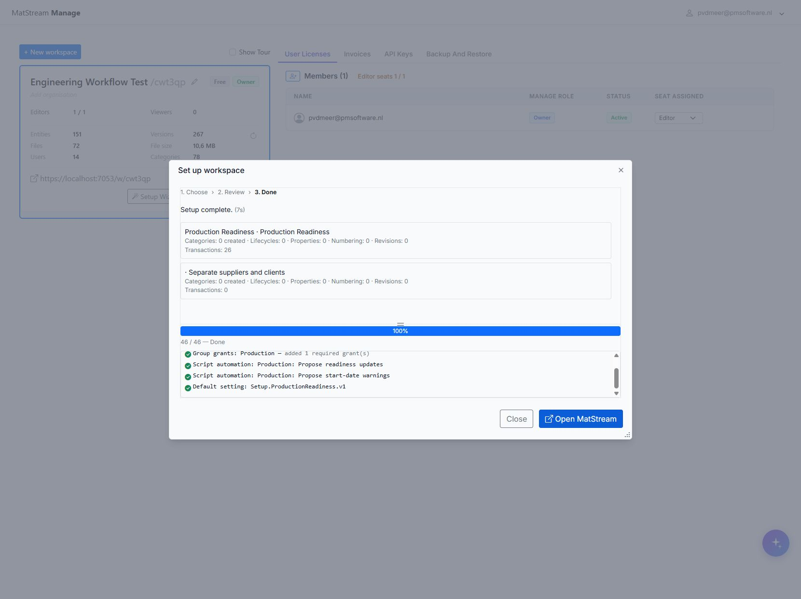
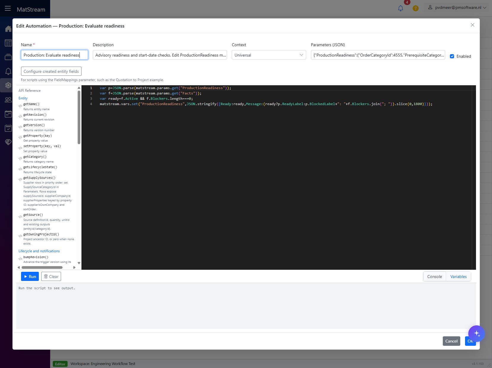
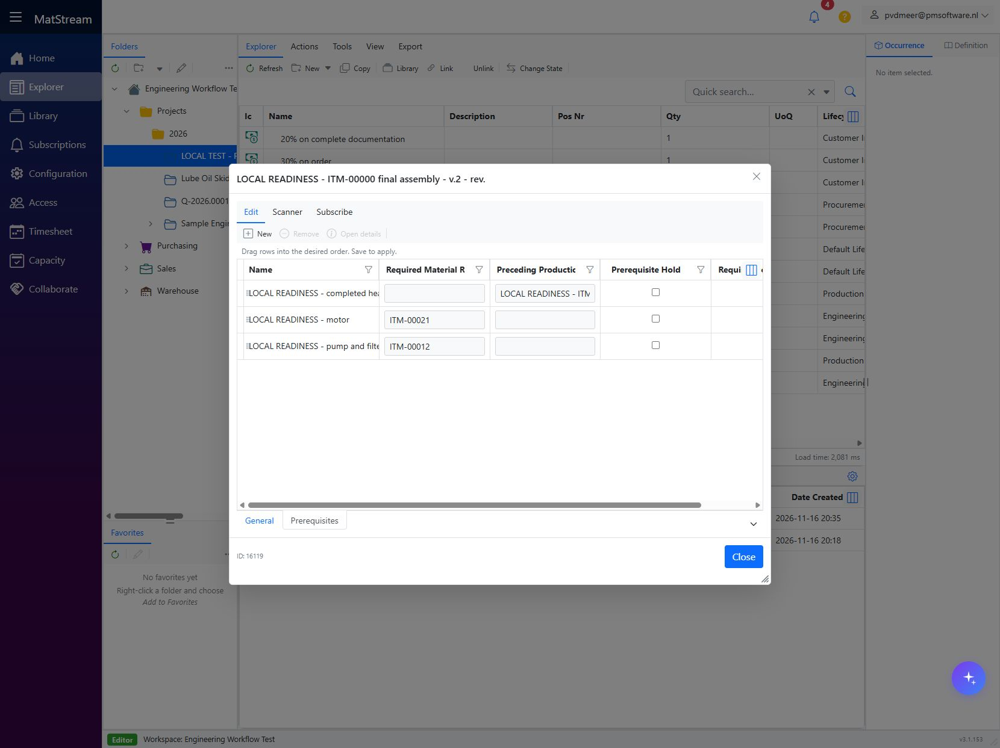
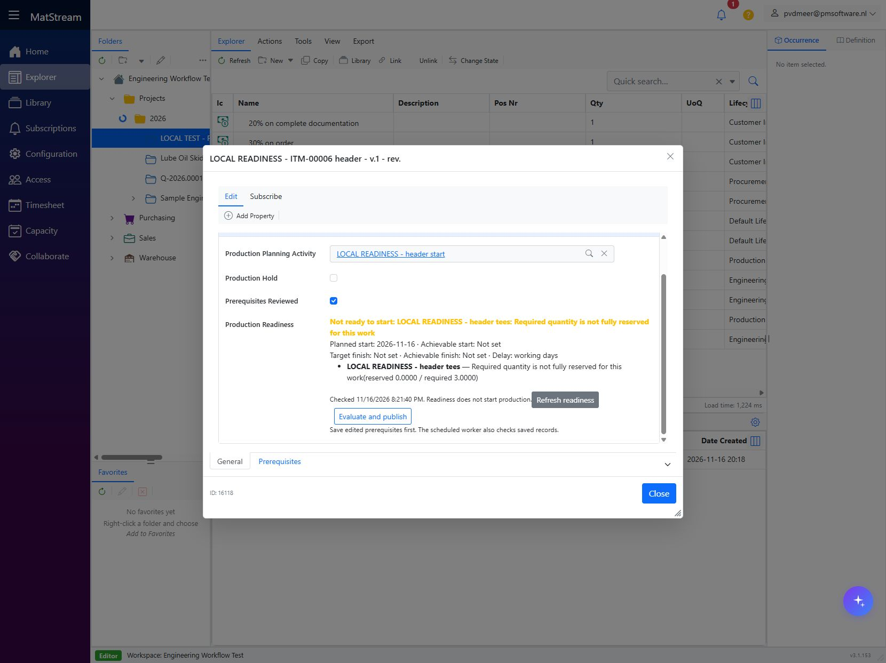
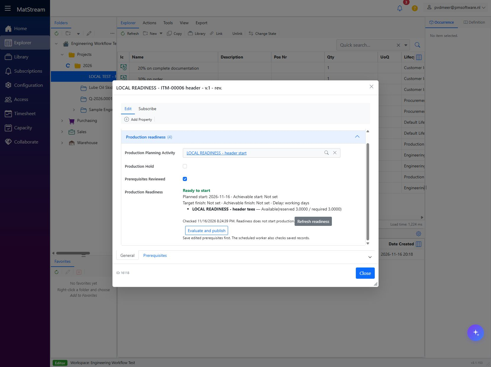
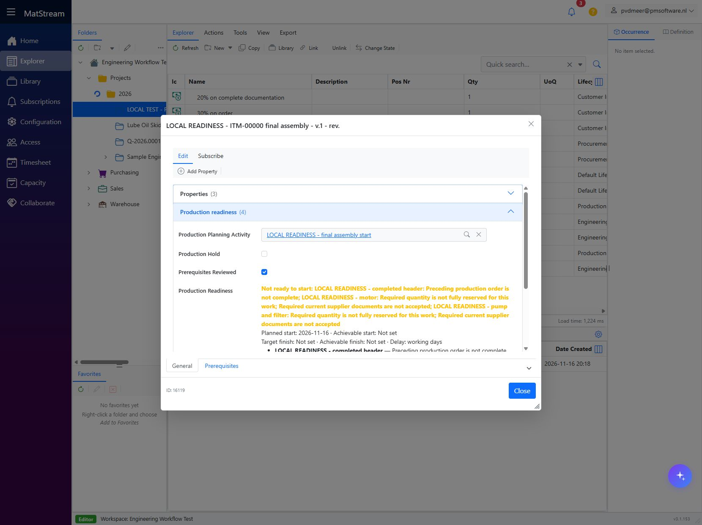
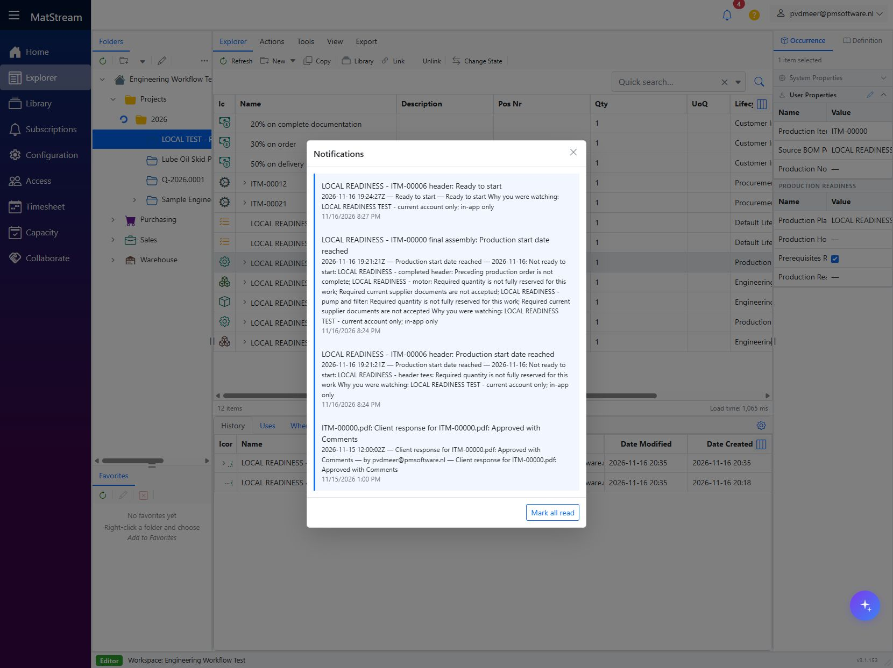
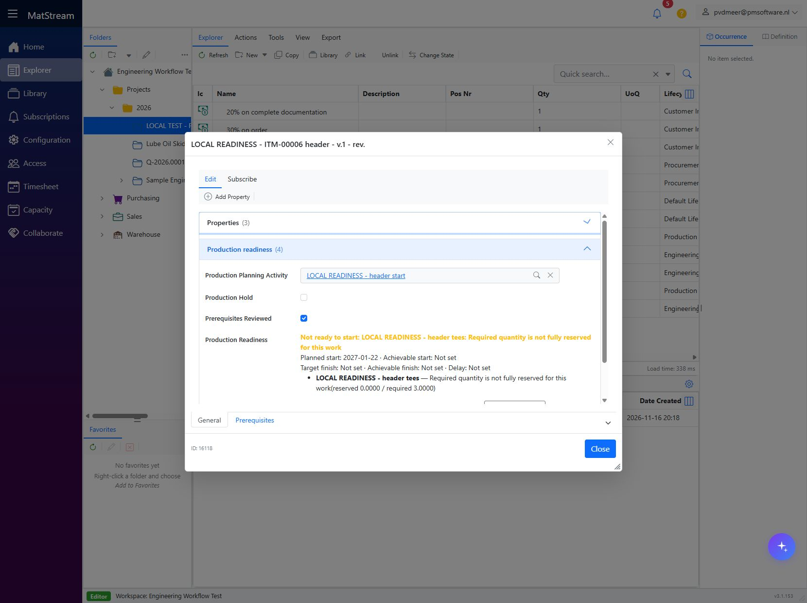

# Production — check readiness and the start date

A production order has two different messages. **Ready to start** means its saved prerequisites currently qualify. **Production start date reached** means its configured date has arrived, even if it is still blocked. Neither message starts production or changes the order's lifecycle.

## 1. Install and configure

In local Manage, install **Production Readiness** after BOM fulfilment and planning. The Engineering Project setup includes it for new workspaces. Installing it again preserves the installed definitions and automation customizations.

The administrator can edit the following through Configuration:

| Where | What can be changed |
|---|---|
| Categories / Property Definitions | Production Prerequisite fields, category defaults, property names, editors, permissions and layout |
| Display Tabs | Prerequisites Uses tab, allowed category, columns and editing controls |
| Automations → Production: Evaluate readiness | Editable script and `ProductionReadiness` parameter mappings, active/completed/cancelled states, messages, reconciliation and warning settings |
| Automations → Production: Propose readiness updates / Propose start-date warnings | Trigger transitions, recipient groups, consent question, channels and event filters |
| User Settings | Each user's remembered subscription choices for each rule/transition |

The readiness parameters identify the categories and properties by ID. They are workspace configuration, not fixed names in the evaluator. `ExecutorWorkspaceUserId = 0` uses the automation author; alternatively choose an enabled internal workspace user with an Editor seat and access to all relevant evidence. The worker grants no extra access. A configuration/access failure is an error, not proof that an order is ready.

## 2. Build this operation's prerequisite list

1. Open the Production Order and select its **Production Planning Activity** from the same project.
2. Open **Prerequisites → New → Production Prerequisite**. Give the row a useful name.
3. Select either **Required Material Requirement** or **Preceding Production Order**, never both. References must belong to the same project.
4. For a material row, choose whether **Require Accepted Supplier Documents** applies. Set **Prerequisite Hold** for stock or work that must not be used.
5. Save the rows, review the whole list and set **Prerequisites Reviewed** on the order. Set **Production Hold** to block the whole operation when necessary.

The grid supports Choose columns, row editing, Open details, removal and ordering. Category defaults are editable by the administrator; the seed starts the boolean choices as false. Do not mark the list reviewed until it represents all prerequisites for that operation.

For example, header fabrication can require its fitting MR. Final assembly can require the completed header plus the motor and pump MRs. A material row checks the **whole MR quantity**, covered by stock reserved for that MR against physical on-hand stock plus material already issued to this operation when `CountIssuedMaterial` is enabled. Free stock and outstanding purchase orders alone do not qualify. Split demand into separate MRs when different operations need separate quantities; one MR cannot make two active production orders ready.

The prerequisite list is the engineer's explicit review; it is not automatically generated proof that every BOM component, instruction or resource has been checked. Document checks use current required files on the applicable PO lines; removing/replacing a file or withdrawing acceptance can withdraw readiness.

## 3. Read the result

On General, the **Production Readiness** panel shows blockers, required/reserved quantities and the linked planning dates. **Refresh readiness** reads saved evidence. **Evaluate and publish** also records the result and produces any newly due subscription events; it requires update permission and an internal Editor seat. Save edits first.

The final assembly remains independent:

These screenshots use deliberately limited local test prerequisites. The fittings shown as reserved were synthetic test stock, subsequently reversed. They do not certify the complete real assembly's BOM or authorise manufacture.

## 4. Keep targets and forecasts separate

`StartDateSource` selects **PlanningStart** (the linked activity's planned start) or **MilestoneDue** (its fixed due date). Use MilestoneDue when warnings must follow a fixed target rather than a start date updated by planning.

The panel separately reads achievable start/finish, target finish and working-day delay from the latest published project plan. It does not move a milestone target or recalculate the plan itself. Recalculate/publish the project plan after changing delivery forecasts. An unpublished plan shows **Not set**; it must not be read as zero delay. See [milestone planning](engineering-milestone-planning.md).

## 5. Subscribe and receive warnings

The seeded Production group gets the ordinary personal subscription proposal when an order enters a configured active state. The user chooses Yes/No and can remember that answer or change it later in User Settings. Existing orders are not retrospectively subscribed; use the normal Subscribe command for them. Subscription permission never gives access to the underlying order or evidence.

The real background worker checks saved active orders. Defaults are a 60-second workspace interval and 100 orders per batch; larger workspaces rotate through batches. Scheduler startup and ordinary subscription bundling add latency. Changes to stock, holds, predecessors or documents are picked up by reconciliation; use Evaluate and publish for an immediate check.

- A transition to ready produces one readiness event. Rechecking an unchanged result does not repeat it.
- Loss of readiness can produce another message (`NotifyReadinessLost`).
- At the configured local hour/minute on or after the linked start date, a start warning includes current blockers. It also runs when nobody changes a record that day.
- `RepeatWarningDays = 0` means once per order/activity/start date. A positive number repeats warnings at that interval while blocked. Changing the activity/start date creates a new warning occasion.
- Cancelled, started and completed orders are excluded unless the administrator deliberately includes their states in the active mapping.

Only the current local test account received these in-app messages. Email and task transports were not exercised. Access to the prerequisite evidence is checked when routing and delivering the message.

## Local test result

The local test used separate orders for ITM-00006 and ITM-00000 in the existing RVD test project, with the motor and pump MRs/PO lines already used there. Missing fittings, partial/full reservation, holds, header completion, accepted/missing RVD files, independent assembly blockers, repeated checks and scheduled warnings were exercised. Temporary stock, document acceptance and order-state simulations were rolled back or reversed; original planning dates were restored. Both test orders were left Draft and blocked. No production, real receipt, Quality decision or payment was performed.

Automated tests also cover fixed target versus five working days' forecast delay, local-time warning boundaries, repeated-warning rules, cross-project/access rejection, script failure, and subscription routing/delivery permissions. The late-motor scenario has not yet been repeated end to end on the original workflow project's actual POs. Separate team identities, quarantine disposition, full work instructions/resources and the complete BOM still need their practical workflow rehearsal.

Continue with the [wrong-fitting replacement](engineering-fitting-replacement.md) and [collection, hold clearance and production restart](engineering-resume-production.md) walkthroughs. Holds remain explicit team decisions; the replacement collection script posts the replacement stock issue and MR reservation release. Issued quantities remain operation-specific.

## Readiness evidence and start-warning history

Every check still calculates readiness from current saved facts. **Evaluate and publish** and the background worker save the last published report in a configured read-only Memo on the production order. New publications record the checked version and time; it does not authorize production or replace the live prerequisite checks. Later order versions do not silently reset the previous published decision.

Configure the Memo under **Configuration → System Settings → Workspace Defaults → Workflow evidence**. The seeded property is assigned automatically to the order category. A custom Memo must be enabled and assigned read-only to that category. Property Definitions and Categories control its name, description and placement. Changing the mapping preserves older snapshots.

Start warnings now use shared automation checkpoints and persistent event execution claims. Existing warning dates, first publication and latest warning times survive migration. Rechecking the same schedule does not resend its initial warning, including after event-history cleanup. Changing the planning activity/start time creates a new occasion; configured local time, repeat interval, subscription consent and evidence-access checks remain unchanged. There are no separate readiness or production-start-notice tables. Legacy readiness reports retain their original decisions, report text and timestamps; their original checked version was not stored, so migration leaves that version unknown.

### Storage and configuration

This existing Engineering workflow stores evidence in ordinary entities/properties and uses the shared stock ledger or durable scheduler checkpoints. Its dedicated table, view and writer procedure are unnecessary. Its existing scripts and business safeguards remain active; there is no separate category action engine. See [workflow record storage settings](../admin/automations-admin.md#workflow-record-storage). Sales Order-only workspaces do not need to install this Engineering workflow.

### Opening stock and pinned item versions

Before reserving manually entered opening stock for Engineering production, identify the actual item revision. **Inventory → Stock → Adjust → Item version** offers automatic count correction or the displayed current item version. Select the displayed version only when the physical stock matches it. Existing purchase receipts retain their pinned revision automatically. An unidentified opening balance does not satisfy a production issue pinned to a particular version.

When all on-hand stock at that location is unidentified, correct its attribution by reversing that balance with a documented automatic adjustment, then adding the same quantity against the confirmed version. Review mixed-version locations individually; an automatic correction may span their existing balances. Keep both ledger entries and reconcile the overall quantity and reservations. This is an explicit warehouse correction; production does not silently reinterpret unidentified stock. The server rejects versions belonging to a different item or workspace.
