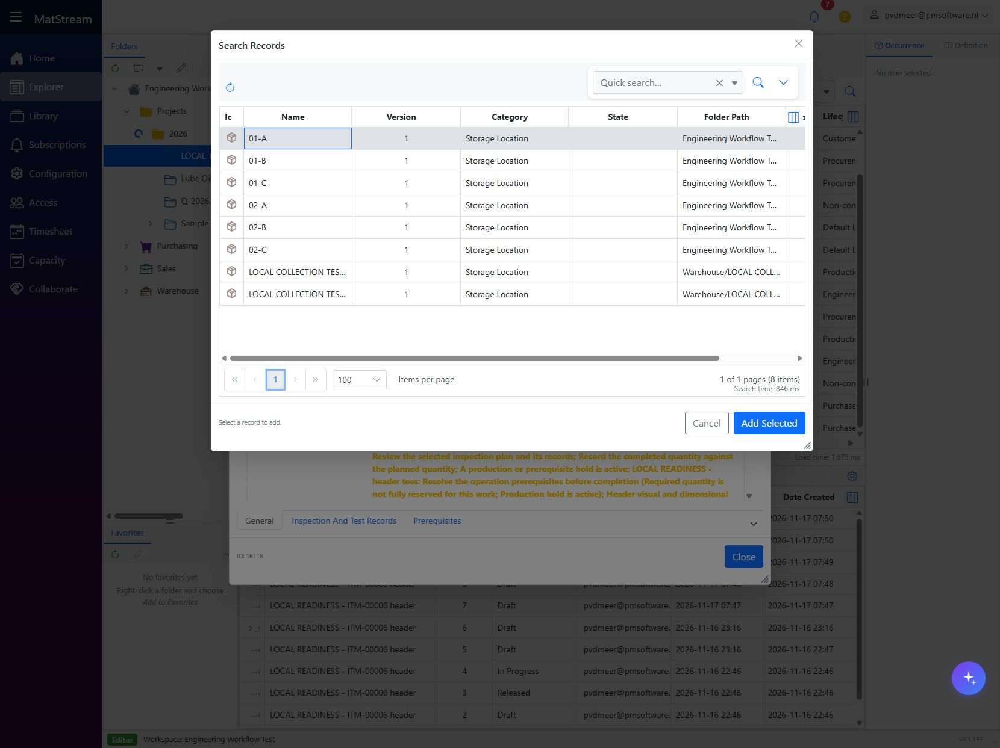
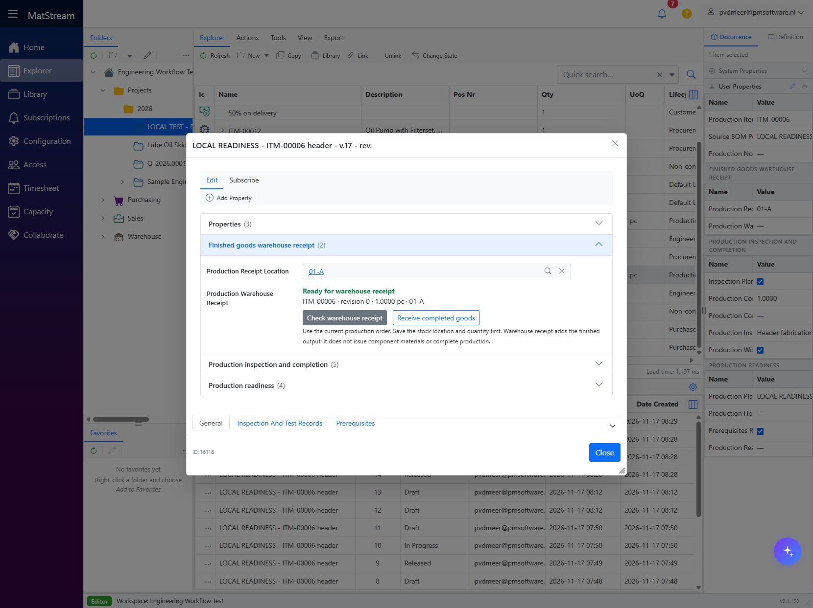
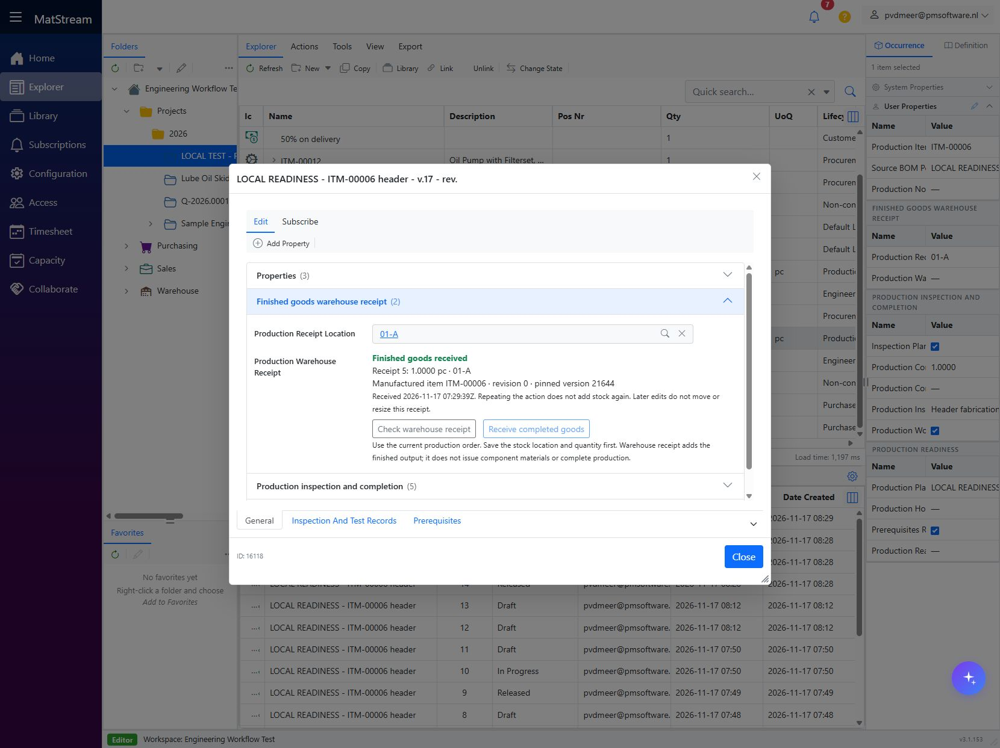
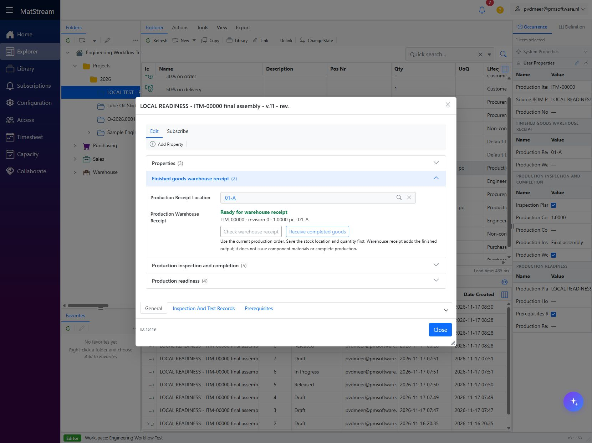
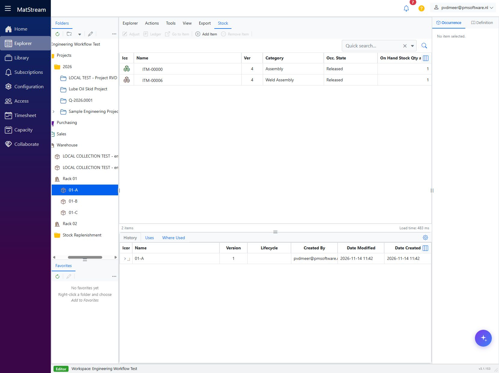
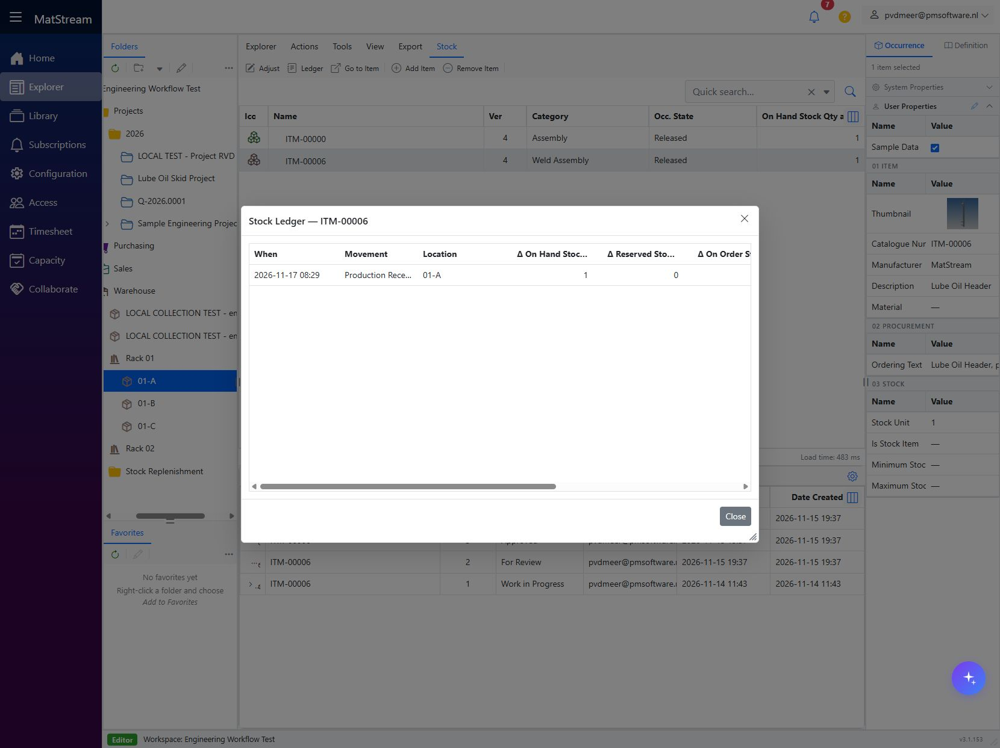
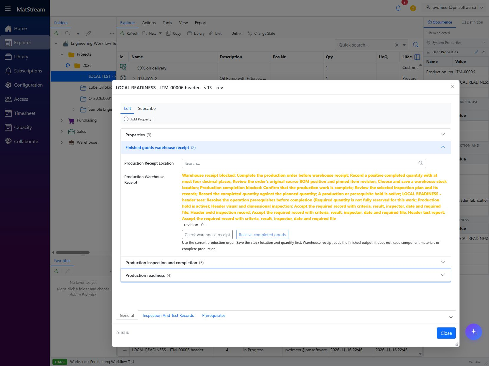

# Receive completed production into warehouse stock

Receive the manufactured **ITM-00006 header** and **ITM-00000 final assembly** through their own production orders. Technical completion and physical warehouse receipt are separate actions. Moving an order to Completed does not itself create stock.

!!! info "Local verification — 17 November 2026"
    Both dedicated local test orders received **1 pc at shelf 01-A through the browser**, using the stored receipt script and real inventory repositories. Each receipt retained its original manufactured revision and disabled another receipt. Screenshots below show readiness, receipt and warehouse stock. Synthetic completion evidence was prepared locally; temporary stock, evidence and settings were restored afterwards. A separate Warehouse-user rehearsal remains. No real manufacture, inspection or goods receipt is implied.

## 1. Confirm production completion

Follow [Production completion and inspection/test records](engineering-production-completion.md) first. The header and final assembly each need their own accepted records and completed quantity. The final assembly also needs its configured preceding-header, motor, pump/filter and supplier-document prerequisites.

The receipt defaults require:

- The production order is in an administrator-selected completed state.
- Current production-completion checks pass, including the required accepted inspection evidence and holds.
- The order retains its **Generated From** reference to the exact source BOM-position version. That source contains the pinned manufactured item version matching **Production Item**.
- The completed quantity is positive and the production order's unit matches that pinned item's **Stock Unit**.
- A real warehouse stock location in this workspace is selected and saved.

For example, if the order manufactured ITM-00006 revision A, uploading a newer Library revision later does not change what enters stock. Missing provenance is a blocker; the script never guesses the latest revision. If an older record uses a shared, unversioned BOM link and the source has since advanced, receipt also blocks until the original historical pin can be established.

The normal BOM production-order script creates this source reference and copies quantity/unit. Older manually created test orders may lack them. Review and correct their known manufacturing provenance and unit explicitly before receiving; do not assume today's source revision was the one manufactured.

## 2. Choose the destination

1. Open the production order's **General** tab.
2. In **Finished goods warehouse receipt**, set **Production Receipt Location**.
3. Use the search button and select the actual shelf, for example **Warehouse / Rack 01 / 01-A**.
4. Choose **Save and Close**, reopen the current order and choose **Check warehouse receipt**.

The picker includes Storage Location folders. A Warehouse or Rack container is not a receiving shelf. Administrators can change the picker categories, field label/default and permissions through Property Definitions and Categories.



Choose the location while the record is editable, or have an authorised team member save it before completion if the completed state is read-only. Posting the receipt uses Stock Manage permission and does not modify the technical production record. The action is disabled when viewing a historical production-order version.

## 3. Receive the completed output

When the panel says **Ready for warehouse receipt**:

1. Check the item, manufactured revision, full completed quantity, unit and shelf.
2. Confirm the goods have actually arrived at that location.
3. Choose **Receive completed goods**.

The button runs **Warehouse: Receive completed production**:

```javascript
matstream.actions.receiveProduction();
```

The native action rechecks the saved current order, permission and evidence inside the stock transaction. It adds the full completed quantity to the chosen shelf, using a **pinned item version**. It writes a Production Receipt stock-ledger movement and a receipt journal containing the order/source/item versions, quantity, unit, location, receiving user and UTC timestamp.

The panel then shows **Finished goods received**, the receipt number and its original details. The production order stays Completed. This receipt does not change purchase-order delivery, payment milestones or supplier receipt quantities.

For this example the two independent receipt tests produced:

| Production output | Quantity | Location | Inventory effect |
|---|---|---|---|
| ITM-00006, pinned header revision | 1 pc | 01-A | On-hand +1; Reserved and On Order unchanged |
| ITM-00000, pinned assembly revision | 1 pc | 01-A | On-hand +1; Reserved and On Order unchanged |

Open the warehouse shelf or the item's stock view to inspect its position. Stock is recorded against the manufactured revision, even when another revision is now latest in the Library.

### Local browser walkthrough

For **ITM-00006**, the completed header order showed its pinned revision A, quantity **1 pc** and shelf **01-A** before receiving:



After choosing **Receive completed goods**, receipt **5** showed the posted details and the receipt button was disabled:



The independent **ITM-00000** order followed the same steps:




Open **Warehouse → Rack 01 → 01-A**. Use **Choose columns** to show **On Hand Stock Qty at Location** if needed. Both independent test outputs showed quantity **1**:



Select an item and choose **Stock → Ledger**. The **Production Receipt** entry identifies the source order, receiving user, destination and +1 stock movement:



These were controlled test receipts. After capturing the evidence, the test helper reversed the temporary inventory, archived the synthetic receipt journals and restored the original Draft orders, inspection/document evidence and settings. Historical test movements and their reversals remain traceable. This cleanup is not a production returns feature.

## 4. Handle blockers and retries

A saved location alone is insufficient. The browser test correctly kept **Receive completed goods** disabled for a Draft order with incomplete inspections, quantity and material prerequisites:



Examples:

- **Inspection reopened or file missing before receipt:** resolve the current completion blockers before receiving.
- **Order unit differs from Stock Unit:** review the quantity/unit; no silent unit conversion or fallback is applied at receipt.
- **Old dialog version:** reopen the current order and check again.
- **Wrong workspace, ordinary folder or unreadable location:** choose an authorised stock shelf.
- **Repeated click, script retry or simultaneous request:** the existing receipt is reused. Stock is not added twice.

One production order currently has one full-output receipt. Changing its saved location, completed quantity or revision after posting does not move, resize or recreate the historical receipt. The panel continues to show the original posted details. Transfers, returns, corrections and split/partial receipts require their own authorised process; rerunning this script is not that process.

If inspection evidence is withdrawn after posting, the physical receipt remains a historical fact. Review the goods through the appropriate quality hold/disposition process; this feature does not silently remove inventory.

## Administrator configuration

New Engineering Project setups include the feature. Existing workspaces can install **Production Warehouse Receipt** in Manage Setup after Production Orders, Stock Locations and Production Completion and Inspections. Apply the production-receipt database migration with the API update. Reruns preserve installed scripts, mappings and defaults.

| Application UI | Administrator control |
|---|---|
| Categories → Production Order / Property Definitions | Receipt-location field, default location, label, picker categories/family, visibility and property permissions |
| Property Definitions → Stock Unit / Units of Quantity | The item's inventory unit and enabled workspace units; receipt requires the order to use the same unit |
| Automations → Warehouse: Receive completed production | Editable script and `ProductionReceipt` parameters: order/item/source/quantity/location/Stock Unit mappings, `CompletedStateIds`, `RequireCurrentCompletion`, business messages and `LedgerNote` |
| Lifecycle Definitions | Completed-state names, transitions, criteria and read/modify permissions; rename-safe receipt checks use configured state IDs |
| Users / Groups and record permissions | Editor seat, Stock View to inspect the panel, Stock Manage to receive, and Entity Read access to the order, source, manufactured item, shelf and current completion evidence |

`RequireCurrentCompletion` defaults to **true**. It reuses the existing completion rules instead of maintaining another inspection checklist. Align the receipt quantity mapping with the completion evaluator's completed-quantity mapping. Changing this condition is an administrator policy decision, not a way to correct missing evidence during an ordinary receipt.

Fresh inspection setups give Warehouse read-only access to inspection records. Existing role restrictions are preserved: an administrator must review Warehouse access to all evidence needed by the enabled completion policy. Saving a location still requires ordinary property/state modification permission; stock receipt itself uses the separate stock-management grant. Distinct-user role behavior remains part of the wider workflow rehearsal.

The receipt action must be its script's only write action. Administrators can add script conditions before it, such as throwing on a company-specific warehouse hold. The native stock checks and duplicate protection remain in force. It is deliberately an explicit warehouse action, not an automatically seeded action on technical completion.

## Component consumption remains separate

This receipt posts the manufactured output only. It does not issue the input BOM, reserve the output for a project, calculate production cost or send goods to the client.

In the real sequence, a header taken from stock and incorporated into ITM-00000 must also be issued to that final assembly. Otherwise keeping both the loose header and finished assembly as available stock would overstate inventory. The two receipt tests above prove each output-receipt mechanism independently; they do not prove a balanced whole-BOM manufacturing flow.

[Production material/header issue and reservation release](engineering-production-material-issue.md) are now implemented and tested locally. Rehearse the full physical BOM and separate roles, then finish the as-built package, final client handover and project closure.
