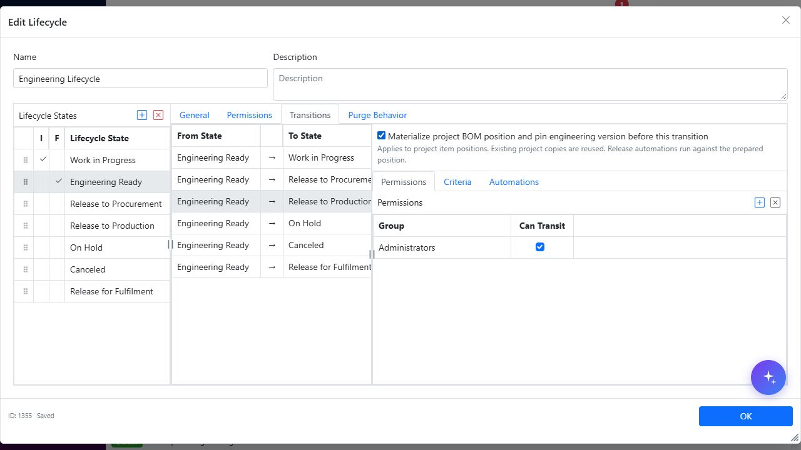
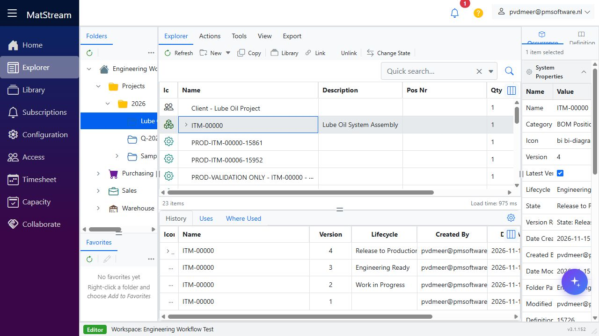
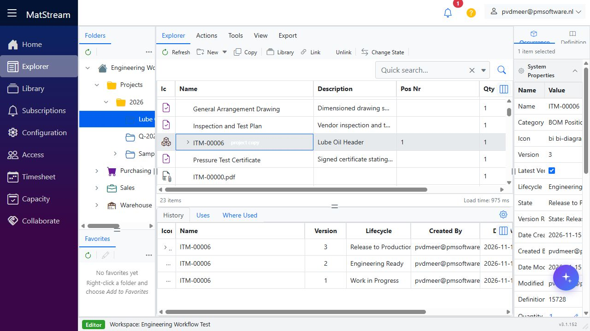
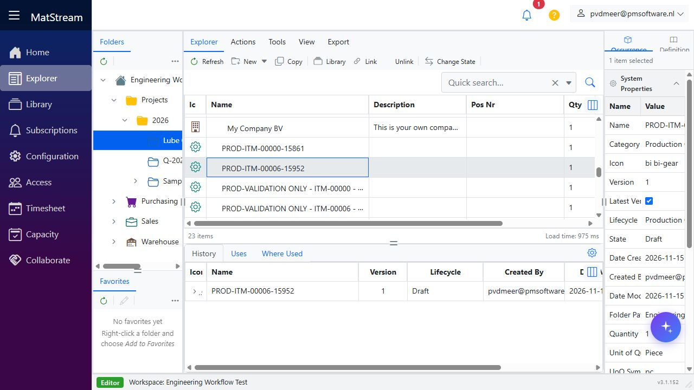
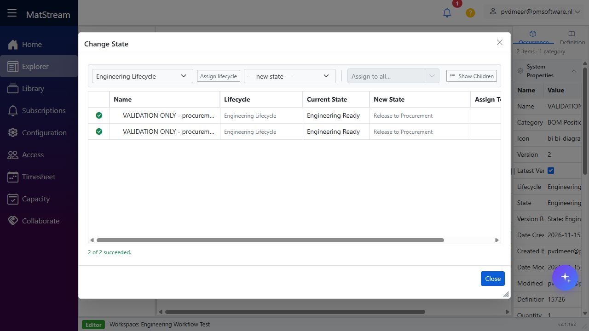
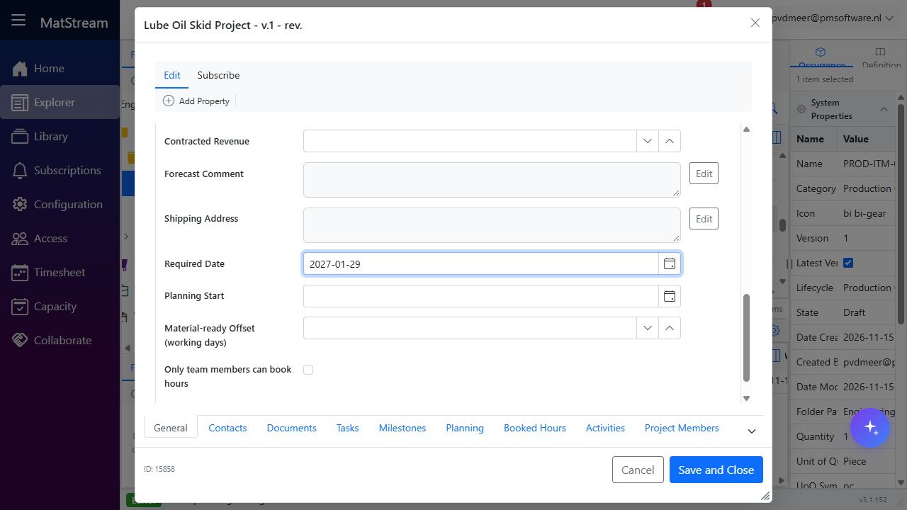
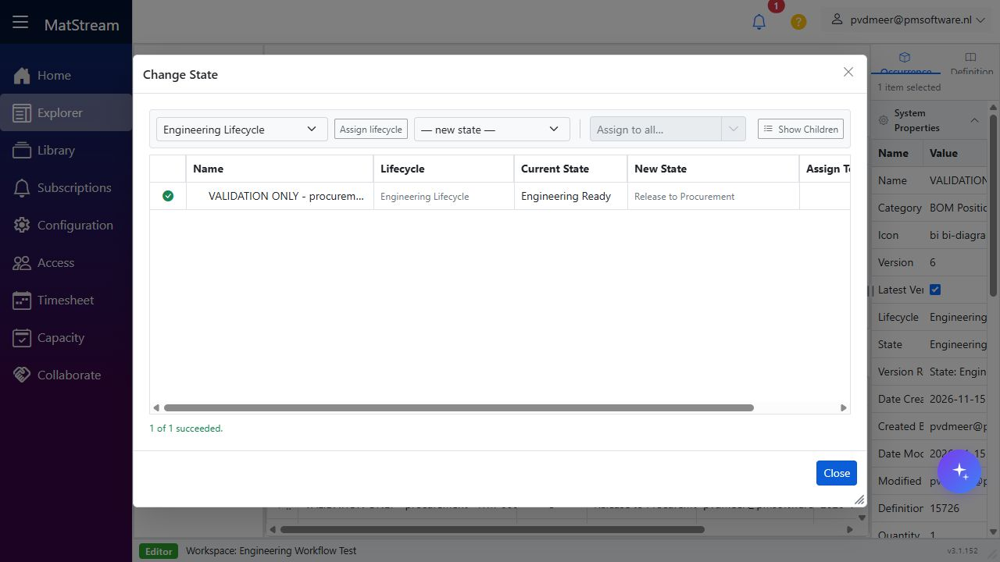
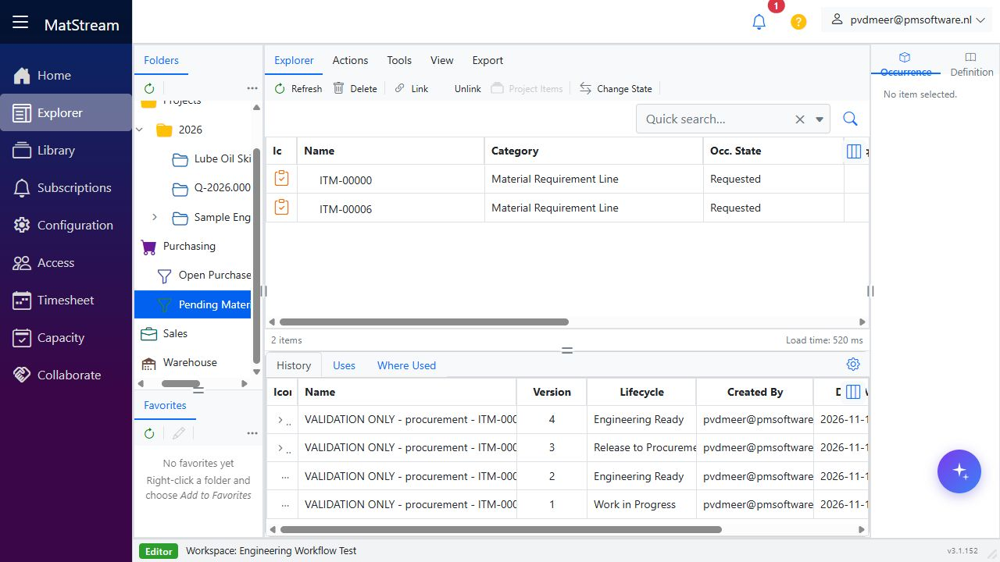
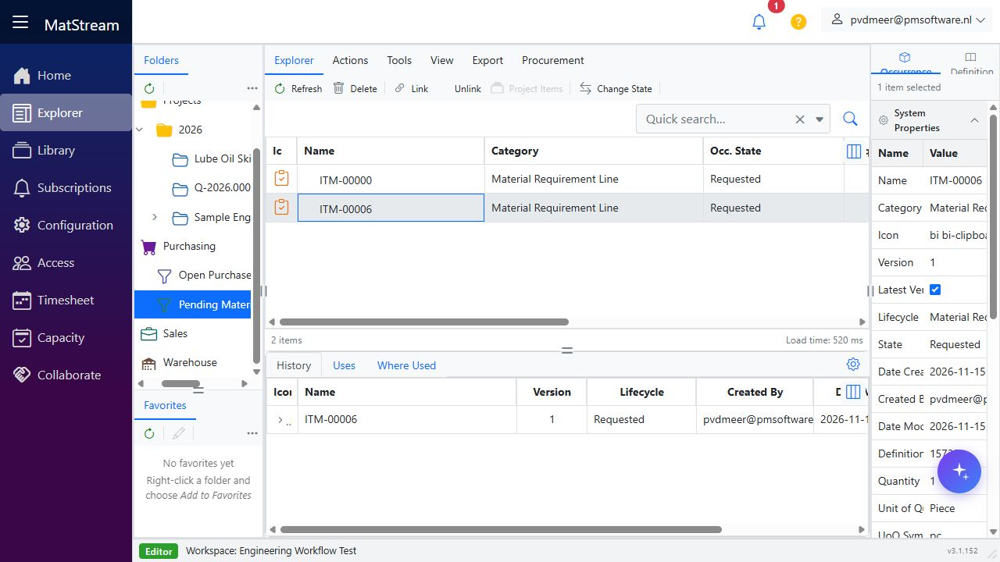

# Engineering — Release project assemblies

Release a project BOM position for production or procurement while keeping the shared catalogue BOM unchanged. The chosen engineering version becomes fixed for that project position before its release automation runs.

## What is released?

There are three separate records:

- The **Library assembly definition** is the reusable engineering design. Its lifecycle records review, approval and release.
- The **project BOM position** describes this project's quantity, unit and handoff state. An inherited row becomes its own project position when it needs to be changed.
- The **Production Order** is the work created from that project position. Creating it does not start production: the seeded order begins in **Draft**.

For example, ITM-00006 can remain visible through the shared catalogue BOM while you inspect the skid. When releasing it, MatStream must use an independent position under this project's ITM-00000, with its engineering definition version pinned. It must not change the catalogue's ITM-00006 BOM position.

## Workspace administrator — choose the release transitions

1. Open **Configuration → Lifecycle Definitions**. Select **Engineering Lifecycle** and choose **Edit**.
2. Select the source state, such as **Engineering Ready**, then open **Transitions**.
3. Select the destination transition, such as **Release to Production**.
4. Enable **Materialize project BOM position and pin engineering version before this transition**. The checkbox saves immediately. Close and reopen to verify it.
5. Review the transition's **Permissions**, **Criteria** and **Automations** tabs separately.

The seed enables preparation on Engineering Lifecycle transitions into **Release to Production**, **Release to Procurement** and **Release for Fulfilment**. It also recognises **Ready for Procurement** when that state exists. This workspace currently calls the procurement handoff **Release to Procurement**. Administrators choose the applicable transitions; runtime behavior does not depend on these names. Existing installed choices, including deliberately disabled preparation, are preserved on setup reruns.

The existing **BOM: Create Production Order** automation remains an editable script. Administrators configure its category, output folder, name prefix and property mappings under **Automations**, and attach it to the desired transition. The release-preparation option does not itself create an order or a material requirement.

## Engineer — release the project position

1. Complete the engineering review/release process in Inventor/Vault and upload the matching drawing revision. Record the authorised definition release in MatStream using the configured lifecycle. This step does not add another client-comment approval gate.
2. Open the project in **Explorer**. Select the intended BOM position beneath the project assembly, rather than a catalogue BOM row in Library.
3. Review quantity and unit. For this example, both assemblies are **1 pc**.
4. Use **Change State** to follow the permitted route through **Engineering Ready**, then choose **Release to Production**, or the configured procurement handoff.
5. On a transition with release preparation enabled, MatStream resolves or creates the independent project position, pins the selected engineering definition version, applies the state and runs its existing automation against that project position.
6. Inspect the project position and the resulting Production Order or material requirement. If the dialog reports an automation failure, investigate it before treating the handoff as complete.

Existing copy-on-write behavior may create the independent position during an earlier state/property edit, such as moving an inherited row to Engineering Ready. Release reuses that copy and pins it; it does not create another copy. A row already pinned retains its selected version on retry. A stale inherited row requires refreshing or reopening the containing assembly before retrying.

A release requested against a shared catalogue position without its project context is rejected. Permission or criterion failures stop the release. Pinning and the state write share a transaction; a failed state write rolls back that pin. Transition automations run after the state is saved, as in the existing lifecycle flow.

## Local test — ITM-00006 and ITM-00000

On **15 November 2026**, the local test first confirmed that a non-final Library definition blocks the production release. The sample definitions then followed their existing **For Review → Approved → Released** transitions through the application service. These are simulated local approvals; no Inventor/Vault work was performed in this test.

| Project position | Result | Created work |
| --- | --- | --- |
| ITM-00006 beneath ITM-00000 | Independent project position created; engineering version pinned; Release to Production | PROD-ITM-00006-15952, Draft, 1 pc |
| ITM-00000 beneath Lube Oil Skid Project | Existing project position reused; engineering version pinned; Release to Production | PROD-ITM-00000-15861, Draft, 1 pc |

The shared catalogue ITM-00006 BOM position remains **Work in Progress**, with its original following link. Production Orders retain their source project-position versions. Repeating the real release transitions reused the existing orders and did not advance their original source snapshots.

Separate **VALIDATION ONLY** positions for both assemblies tested procurement in the browser. Both transitions succeeded and both definition links became pinned.

## Set Required Date and verify material requirements

The follow-up local test set **Lube Oil Skid Project → Required Date** to **29 January 2027**. This is an editable project value chosen for the test, not a new workspace default or a date built into the automation.

1. In Explorer, right-click the project in the folder tree and choose **Details…**.
2. On **General**, find **Required Date**, choose the intended project deadline and select **Save and Close**. **Due Date** is a separate field; planning specifically requires Required Date.
3. Follow the configured procurement-release transition on the intended independent project BOM position. This workspace uses **Engineering Ready → Release to Procurement**.
4. Check both the state-change result and any automation message. A successful state change alone does not prove that an MR was created.
5. Open **Purchasing → Pending Material Requirements (MR)**. Confirm the item, Requested state, quantity, unit and source project position.

The test reused the two **VALIDATION ONLY** procurement positions from the earlier test. Their permitted return to Engineering Ready was used to generate a fresh release event after correcting the prerequisites. The actual production positions and their Draft Production Orders were left alone. Reversing a live release should follow your workspace's authorised recall/retry process.

| Requirement | Item | Quantity / unit | State | Source test position |
| --- | --- | --- | --- | --- |
| 15957 | ITM-00000 | 1 pc | Requested | 15956 |
| 15961 | ITM-00006 | 1 pc | Requested | 15955 |

Both requirements appear in the buyer's worklist. Each links to its independent test position and pins the same engineering definition version as that position. The local audit found exactly one MR per source.

The workspace administrator continues to control property/category definitions, transition permissions, release-preparation options and automation parameters. Project teams enter the actual project dates through their normal permissions. No new application setting or business rule was added for this retest.

!!! note "What the retest found"
    The local database needed an existing planning schema migration before the automation could calculate its plan. ITM-00006 then hit a transient database deadlock; its failure was shown in the state dialog, and a fresh authorised test release succeeded on retry. The requirements' **When Required** fields remain blank. MR creation, quantities, units and version pins are verified. The subsequent [milestone planning step](engineering-milestone-planning.md) verifies calculated dates for the motor and pump; it does not backfill these earlier MRs. Do not assume the project deadline automatically becomes every MR's required date.

Drawing files and earlier issued transmittals were not changed. Material availability, workshop readiness and the Production Order's own release remain separate steps. The sample PDFs still have their previous Work in Progress metadata; this local data test is not authority to manufacture.

Continue with the [Engineering Project Workflow](engineering-project/index.md).
