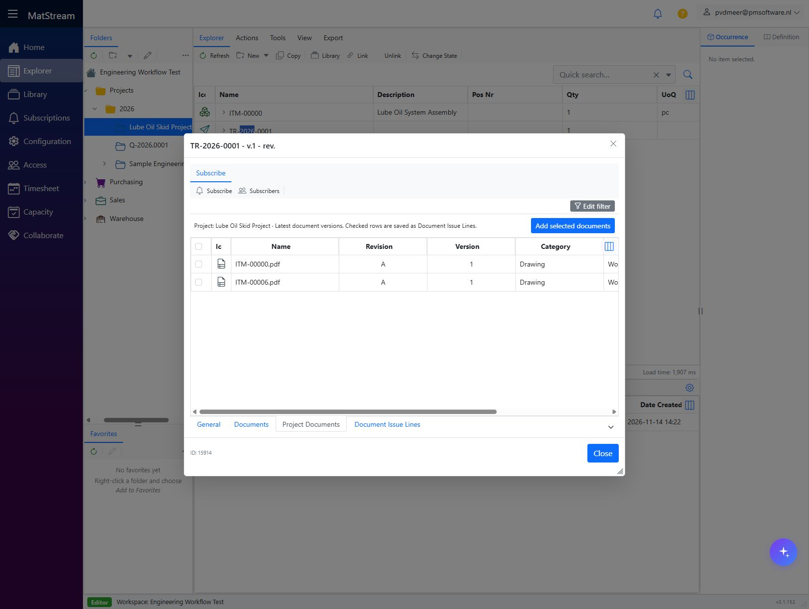
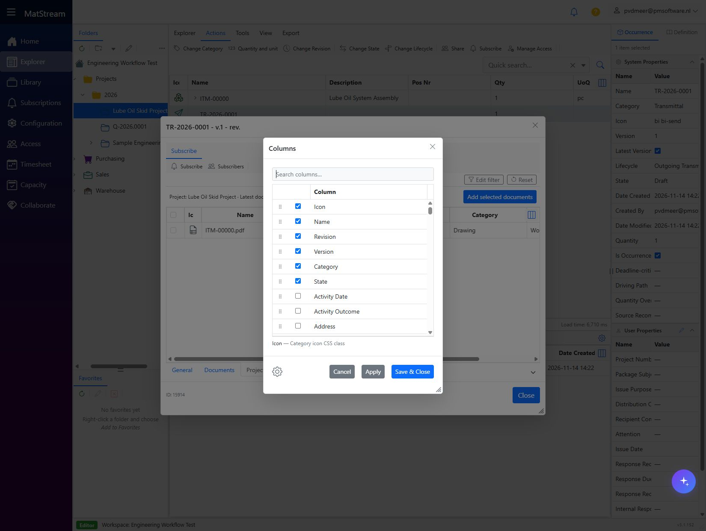
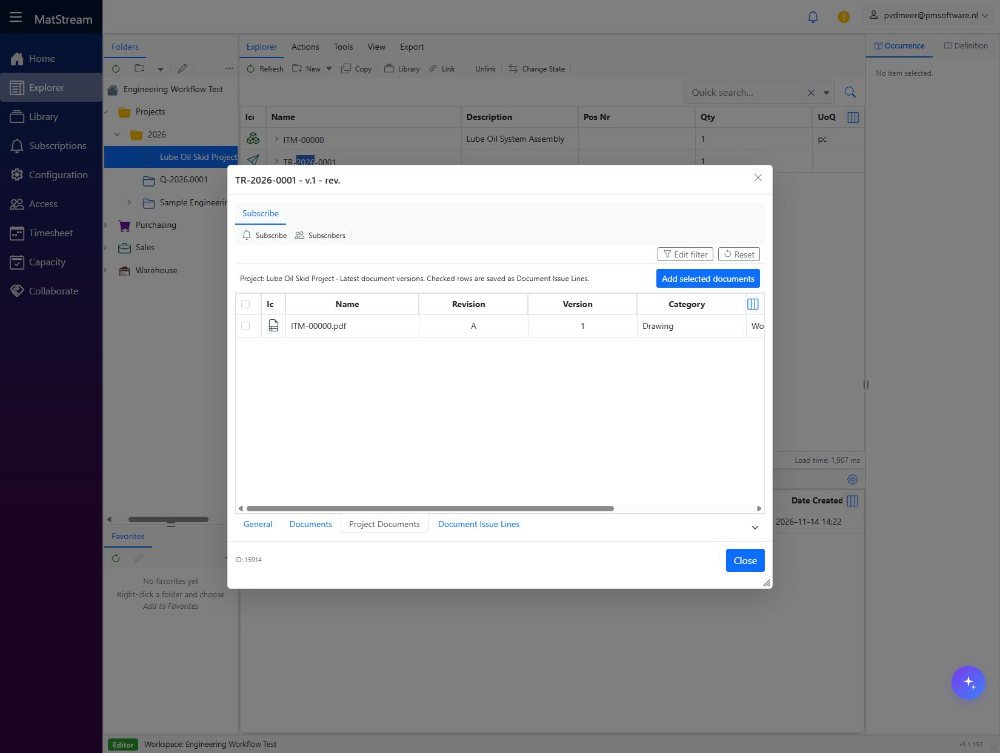
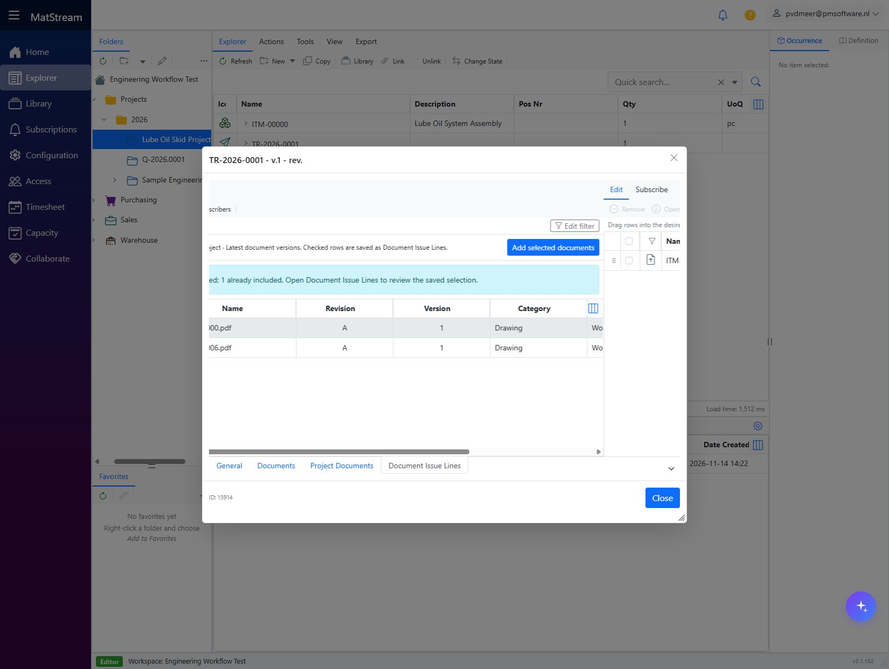
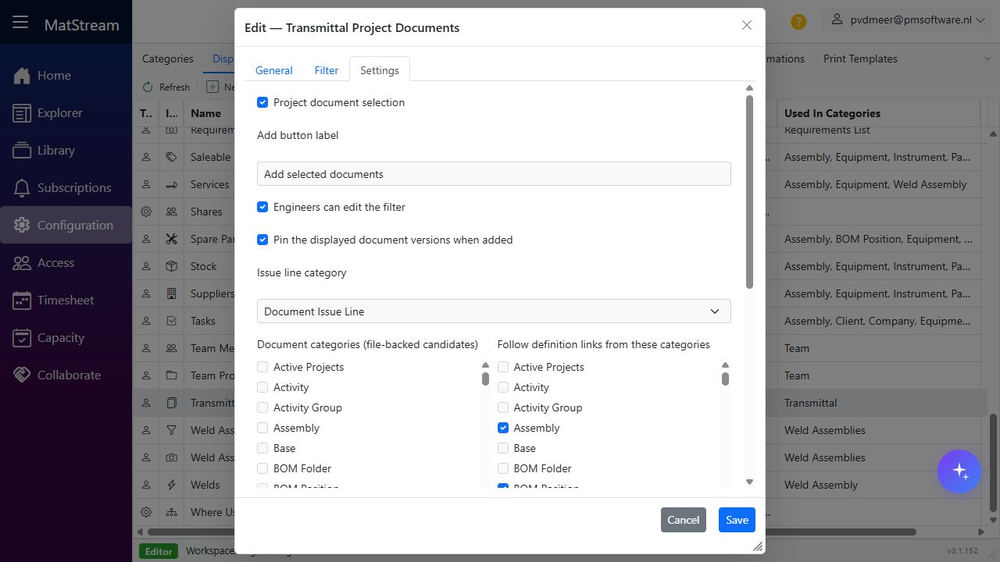

# Engineering — Select documents for a transmittal

Prepare the client approval package for **ITM-00000.pdf** under the Lube Oil Skid project (**PRJ-2026.0001**). This step saves the selected drawing as a **Document Issue Line** on a draft Transmittal.

!!! note "Local workflow test"
    Tested locally in Engineering Workflow Test on 14 November 2026. This step covers document selection and the saved issue register. Continue with [generating the transmittal PDF](engineering-transmittal-pdf.md). Issuing the package, portal downloads and returned client comments remain later workflow steps.

## Create the transmittal

1. Select the project in Explorer and choose **New → Transmittal**.
2. Keep the generated number, for example **TR-2026-0001**.
3. Enter the subject, recipient, **For Approval** purpose, response requirement and due date on General. Save these header changes before selecting documents.
4. Open **Project Documents**.

The list shows file-backed Library documents belonging to the project. It includes drawings reached through the project's assembly and its nested BOM, plus project-owned documents. It does not search every drawing in the workspace. Documents from existing transmittal lines do not become project candidates merely because they were previously attached to a package.

## Edit the filter and columns

Choose **Edit filter** and add a rule such as **Name starts with ITM-00000**. Choose **Save filter**. The badge changes to **Custom filter**; reopening the transmittal retains this working filter. **Reset** restores the administrator's starting filter.

The filter controls which candidates you see. Changing it does not add or remove saved issue lines. Project scope and permissions still apply when the engineer changes the filter.

Use the **Columns…** button above the grid to open **Choose columns**. For example, show Name, Revision, Version, Category and State. This is your saved grid layout; the administrator controls the starting columns.

## Save the selected documents

1. Check **ITM-00000.pdf** in the list.
2. Choose **Add selected documents**.
3. Open **Document Issue Lines** to review the saved **Document Issue Line**. The register refreshes after adding. Pending edits to existing lines are preserved; save or discard those before reopening to refresh the complete register.
4. Close and reopen the transmittal: the line remains even if you reset or change the candidate filter.

Adding the same document/version again reuses the existing line. A multi-document selection is saved together; a failed selection does not leave half a package. If a selected drawing or the transmittal changes before the add finishes, refresh and review the current versions before trying again.

With the seeded policy, the line pins the version displayed when you selected it. A later Library edit does not silently replace that selected version. The Drawing record's Revision/Version columns are MatStream metadata; the revision printed inside the source PDF may differ and must be checked by Engineering.

## Workspace administrator defaults

Open **Configuration → Display Tabs → Transmittal Project Documents**. The short tab label is **Project Documents**.

| Setting | Seeded choice |
|---|---|
| Tab type and project selection | Filter Result with Project document selection enabled |
| Document categories | Drawing, Document and Controlled Document, where installed |
| Definition-link categories | BOM Position, File Occurrence and the installed article categories; excludes Document Issue Line |
| Issue line category | Document Issue Line |
| Engineers can edit the filter | Enabled |
| Pin displayed versions when added | Enabled |
| States allowing selection/filter changes | Outgoing Transmittal Lifecycle / Draft and Ready to Issue |
| Add button label | Add selected documents |
| Starting columns | Icon, Name, Revision, Version, Category, State and Description |

Use the **Filter** tab for the starting category/property rules and **Settings** for the choices above and default columns. Configure category-tab and entity permissions through the existing permission editors. The engineer needs read access to the documents and create/update access to the transmittal. Historical views and states outside the configured preparation states cannot add documents through Project Documents.

Document Control Setup installs Project Documents and the dedicated Document Issue Lines register. The older shared Documents tab remains available for its existing uses; the saved issue register is Document Issue Lines. Existing administrator changes are retained on a rerun, including disabling or removing the installed tab. New document categories installed later can be enabled here. A project with more than 1,500 candidate documents currently reports a limit; it does not silently return a partial list.

Continue with the remaining client approval transmittal steps in the [Engineering Project Workflow](engineering-project/index.md).
