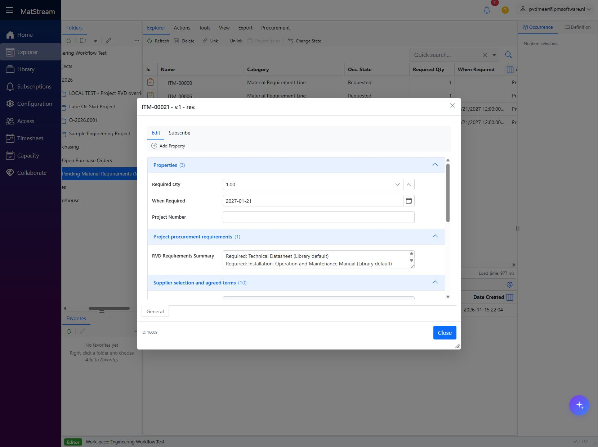
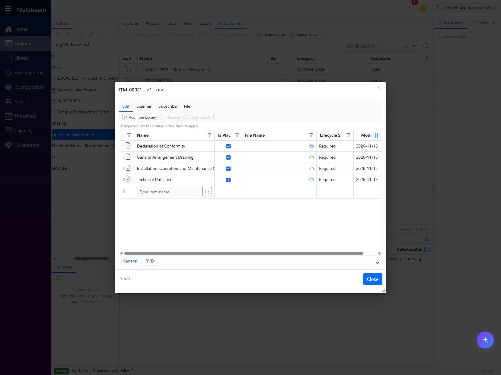
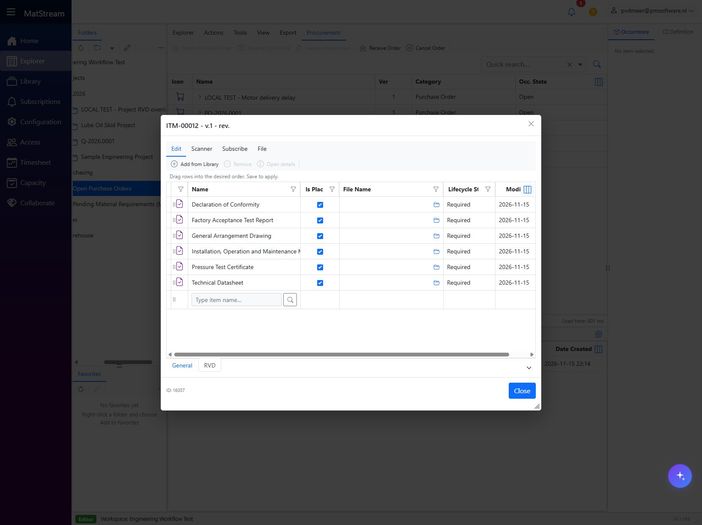
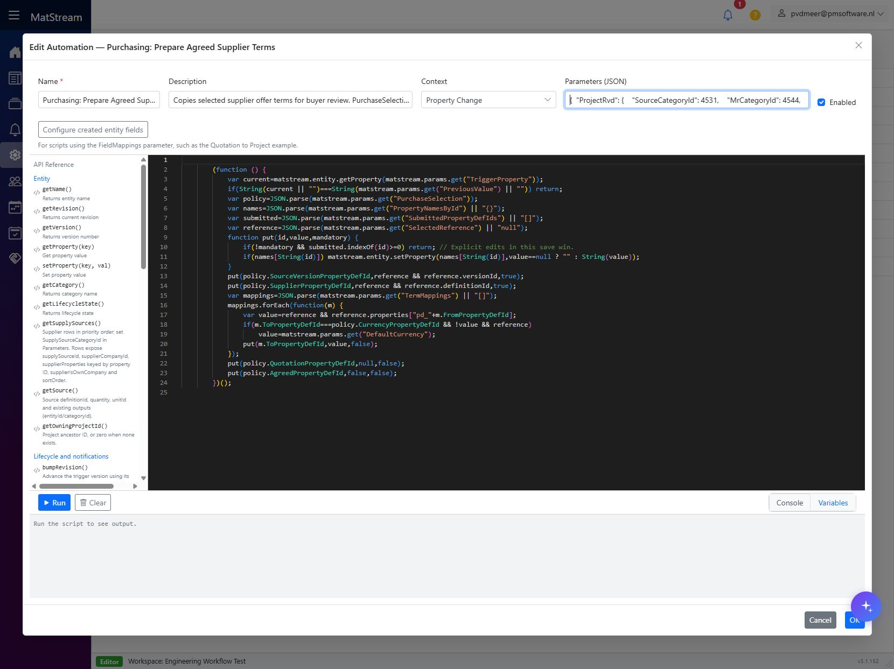

# Work Preparation — Review project RVD requirements

An RVD requirement describes a document the supplier must deliver. Start with the item's Library requirements, then review the checklist on the **project BOM position before creating its MR**. Project decisions do not change the shared Library item.

## Review the project checklist

1. Open the project's motor or pump BOM position and its **Required Vendor Documents** tab.
2. Use **Choose columns** to show **Required for Procurement** and **RVD Change Reason** alongside the requirement name. Administrators can change these property labels and tab columns.
3. Add any extra requirement by selecting its reusable RVD Library definition. For example, add a General Arrangement Drawing for this project's motor.
4. To exclude a default requirement, keep its row, clear **Required for Procurement**, and enter the reason. For example: “Client accepts motor type-test evidence instead of a project FAT.” This records the decision; it does not waive Quality's review of documents that remain required.
5. Review the checklist before releasing the position and creating the MR through the usual procurement workflow.

Do not delete a default row to express an exclusion. Synchronization preserves a deliberate removal, but the default policy rejects MR creation until that exclusion has a recorded reason. Restore the row and mark it excluded with the reason.

## What the MR and PO retain

MR creation freezes the project's included requirements and reasoned exclusions, with the item version and requirement provenance. The MR's **RVD Requirements Summary** shows that decision. It does not create a second set of upload placeholders on the MR.

After [selecting the project supplier and agreeing terms](engineering-supplier-selection.md), create the purchase orders. Each PO line receives its own upload placeholders for the **included** requirements, pinned to the captured definition versions and linked to their source requirement versions. Source files and document acceptance states are not copied.

| Local example | Library defaults | Project decision | PO requirements |
|---|---:|---|---:|
| Motor ITM-00021 | 4 | Add General Arrangement Drawing; exclude Factory Acceptance Test Report with a reason | 4 |
| Pump/filter ITM-00012 | 6 | Add Pressure Test Certificate; exclude Recommended Spare Parts List with a reason | 6 |

A later change to the project checklist does **not** silently rewrite an existing MR or PO. In the local test, a Pressure Test Certificate was added to the motor position after its MR was created; the PO correctly retained the original frozen four requirements. Repeated synchronization does not duplicate requirements or replace uploaded files.

There is no new in-place amendment command in this step. Review and replace an uncommitted legacy MR through the normal cancellation/requisition process if it lacks the project snapshot. Changes to issued orders need an explicit controlled change rather than a silent checklist refresh.

## Administrator configuration

Open **Configuration → Automations → Purchasing: Prepare Agreed Supplier Terms → Parameters**. The **ProjectRvd** section supplies the native MR/PO services with the policy. The automation script continues to copy supplier terms; the transactional procurement services capture and copy the RVD snapshot.

Administrators can configure:

- The project position, MR, PO-line and RVD category mappings, and the inclusion, reason, snapshot and summary property mappings.
- Whether project additions and exclusions are allowed, and whether an exclusion requires a reason.
- The fallback inclusion default and the required, excluded, Library-default and project-addition summary labels.
- Property labels, category defaults, visibility, tab columns and ordinary edit/lifecycle permissions through the existing configuration dialogs.

An explicit row decision wins over the category property default, then the property definition's initial value, then **DefaultIncluded**. The seed supplies useful initial values and preserves administrator configuration on reruns. Snapshot and summary properties start read-only; use the decision properties on project RVD rows for normal editing.

Use one enabled RVD occurrence category and one ProjectRvd policy. Invalid mappings or a removed/disabled installed policy block procurement with an explanation rather than quietly reverting to Library defaults.

## Local test evidence

Tested in a separate **LOCAL TEST - Project RVD overrides** project using **PO-2026.0003** (motor) and **PO-2026.0004** (pump). Existing project orders and Library checklists remained unchanged. This test created local records only; it did not invite suppliers or send email.

Continue with [supplier document uploads and reviewer notifications](engineering-supplier-document-uploads.md). Submission-state mappings now survive renaming; uploaded and replacement evidence notify eligible document/PO-line subscribers. Quality completion and payment eligibility remain separate workflow steps.
