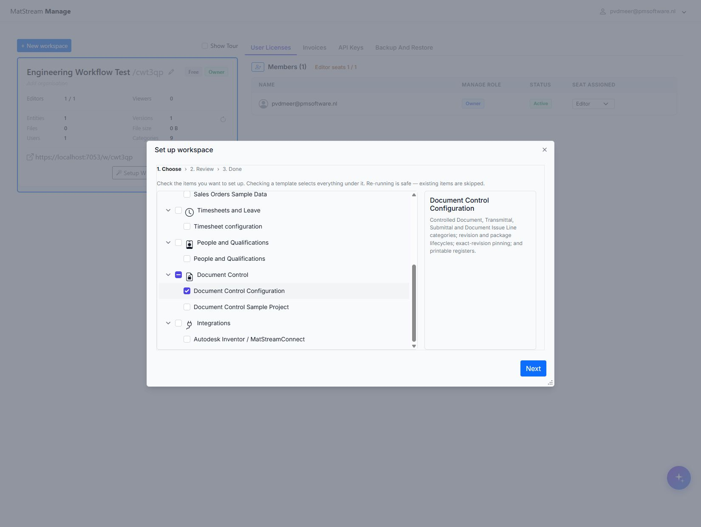
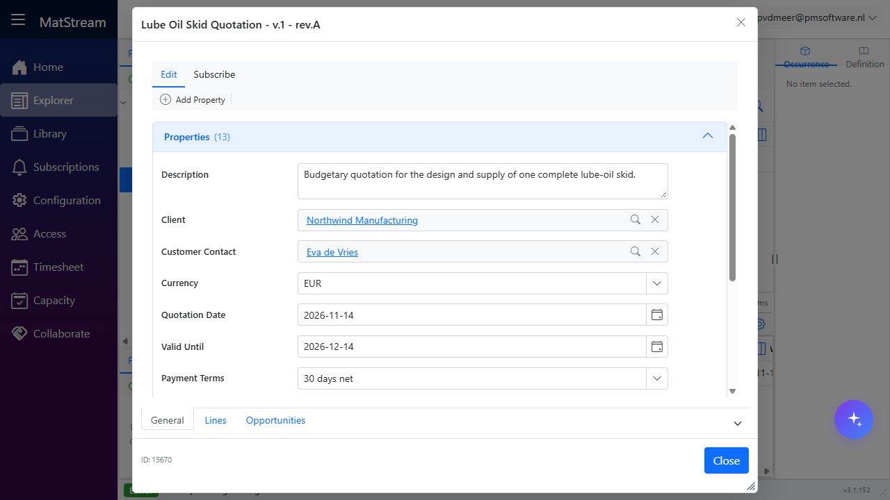
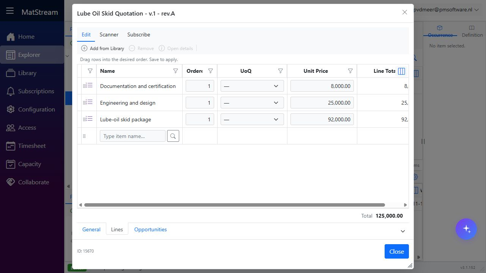
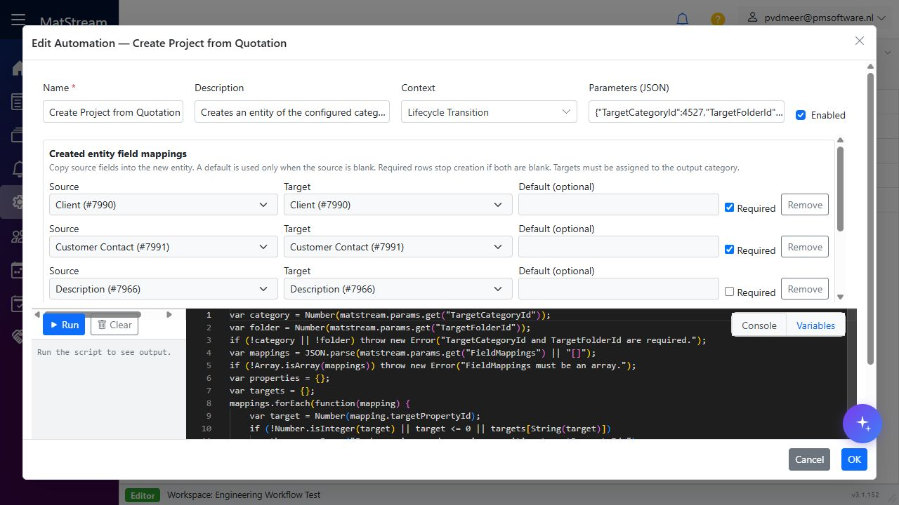
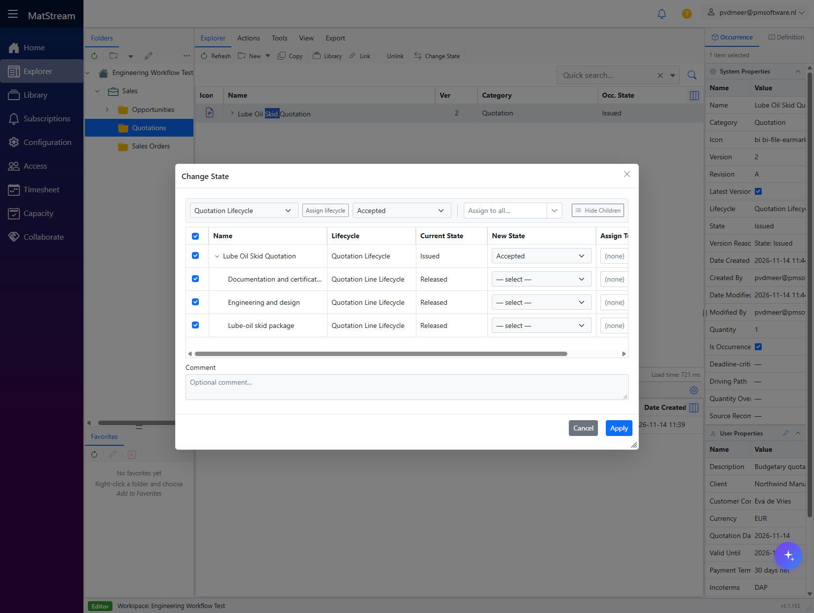
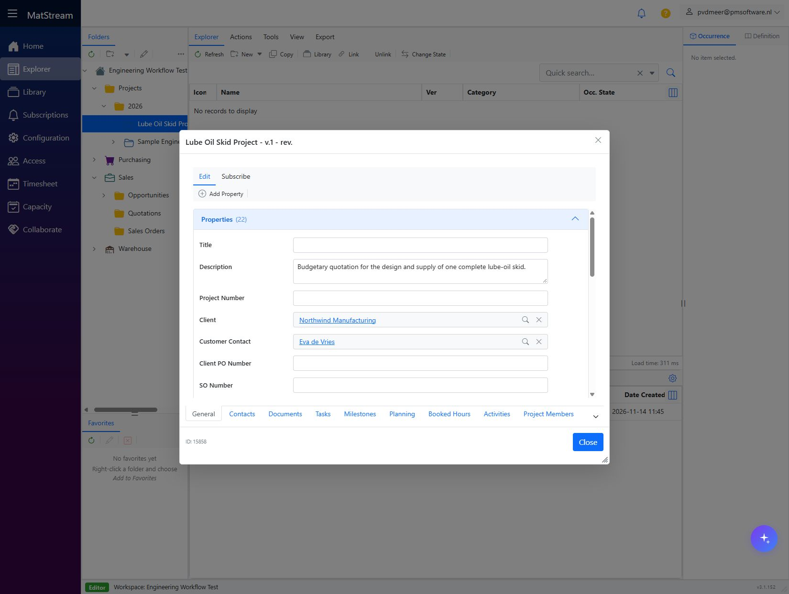

# Sales — Quotation and project

Start the Engineering Project Workflow with a quotation for the lube-oil system. When Sales records acceptance, an automation creates the project and copies the agreed fields.

## Before you start

In a practice workspace, install **CRM Configuration**, **CRM Sample Opportunity**, **Engineering Project Configuration** and **Engineering Project Sample Data** from Setup. Install **Document Control Configuration** for the later drawing steps. Setup installs the quotation-to-project example automation.

The walkthrough uses **Lube Oil Skid Quotation** for **Northwind Manufacturing**, with **Eva de Vries** as customer contact. Your workspace may use different names and lifecycle rules.

## 1. Review the quotation

Open **Explorer → Sales → Quotations** and open the quotation. Check the client, customer contact, description and currency before issuing it.

Open **Lines** and review the scope and price. The sample contains engineering and design, the skid package, and documentation and certification, totalling EUR 125,000.

This walkthrough tests internal acceptance and project creation. Preparing and sending a customer quotation PDF is a separate check; it was not exercised here.

## 2. Check the administrator's mappings

A workspace administrator opens **Configuration → Automations → Create Project from Quotation**. The seeded script copies these fields:

| Quotation field | Project field | Required |
|---|---|---|
| Client | Client | Yes |
| Customer Contact | Customer Contact | Yes |
| Description | Description | No |
| Currency | Currency | No |

The administrator can add or remove mappings, change their source and target, enter defaults, and mark fields required. A default is used when the source is empty; **Default only** always supplies the configured value. A required mapping stops project creation if neither source nor default supplies a value. Target fields must belong to the Project category and accept the supplied value.

The target category and landing folder are editable automation parameters. Project naming is controlled by the editable script. The example changes a trailing “Quotation” to “Project”. Configure the acceptance transition under Lifecycle Definitions; the seeded transition uses the automation's parameters rather than a separate copy of the mappings.

For example, a workspace administrator could add **Default only → Title**, with “Lube oil system” as the default. That is a workspace business choice, not a compulsory seeded title. Do not map quotation expiry to a project delivery date unless that matches your actual process.

## 3. Issue and accept

1. Select the quotation and choose **Change State → Issued → Apply**.
2. When the customer accepts, open **Change State** again.
3. If acceptance is blocked because quotation lines are not final, choose **Show Children**. Select **Quotation Line Lifecycle** and set the lines to **Released**, then apply. The sample's three lines must be released before acceptance.
4. Reopen **Change State**, select **Quotation Lifecycle → Accepted**, and apply.
5. Check that the state change succeeded. If project creation reports a failure, inspect the automation error and configuration before retrying.

## 4. Check the project

Refresh the Explorer folder tree. Open the configured landing folder: in this sample, **Projects → 2026**. Find **Lube Oil Skid Project**. Open its properties using the folder **Edit** button.

Verify the project contains Northwind Manufacturing, Eva de Vries, the quotation description and EUR. The new project starts **In Preparation**. Complete its project number, manager, schedule and other project-specific fields according to your workspace rules.

The automation links the project to the exact accepted quotation version. Copied values are a snapshot at creation; later quotation edits do not continuously synchronise the project.

## Workflow test result

Tested locally on 14 November 2026 in a newly seeded **Engineering Workflow Test** workspace. Issuing succeeded; acceptance was blocked while lines were Draft; releasing all three lines enabled acceptance; acceptance created the project with the four seeded mapped fields. No customer message was sent and nothing was deployed online.

A second local quotation verified administrator changes: adding **Default only → Title = Lube oil system**, saving the automation, then issuing and accepting the quotation produced a project with that title and the selected client/contact. An empty optional description remained blank. This default is configured only in the test workspace.

Next, follow [Engineering — Add the assembly to the project](engineering-add-assembly.md) to place **ITM-00000** and inspect its BOM.
