# Engineering — Update and reissue the drawings

Apply the client's comments to the drawing, upload a new version and issue separate packages to the client, Work Preparation and Purchasing. Keep the original approval package intact.

!!! note "Local workflow test — 14 November 2026"
    Tested in **Engineering Workflow Test** using the current test account for both recipients, with email invitations off. ITM-00000.pdf now contains tags **M-101** (motor, BOM position 14) and **P-101** (oil pump, position 2). This demonstration edits the PDF only; the Inventor model is unchanged. The drawing remains Work in Progress and the response is Ready for Check. Issuing a test package with purpose For Production does not release the assembly for manufacture.

## 1. Update the drawing and preserve history

1. Read the latest applicable [client response](engineering-transmittal-review.md) and returned PDF. Record your work in [Engineering Disposition](engineering-comment-resolution.md).
2. In normal engineering work, update the Inventor drawing/model and export the revised PDF. For this local test, the supplied PDF was annotated with both equipment tags and a revision note; geometry, dimensions and materials were preserved.
3. Select **ITM-00000.pdf** in Library. Use **Open details → Attached File → Browse…**, select the replacement PDF and **Save and Close**. Update the existing drawing record, keeping its earlier file in History.
4. Set the intended revision through **Change Revision**, following the workspace's revision scheme. Check that the title block and MatStream metadata agree before selecting the drawing for a new package.

### Change the drawing revision from the project

The project drawing revision action now works. In **Explorer**, expand **ITM-00000**, select **ITM-00000.pdf**, then choose **Actions → Change Revision**.

The dialog suggests the next value from the drawing's assigned revision scheme. For example, the local drawing's alphabetic scheme suggests **C** after **B**. Review the value, enter the intended revision if different, then **Apply**. **Saved** confirms the change. Close the dialog and inspect **History** and the current **Revision** property.

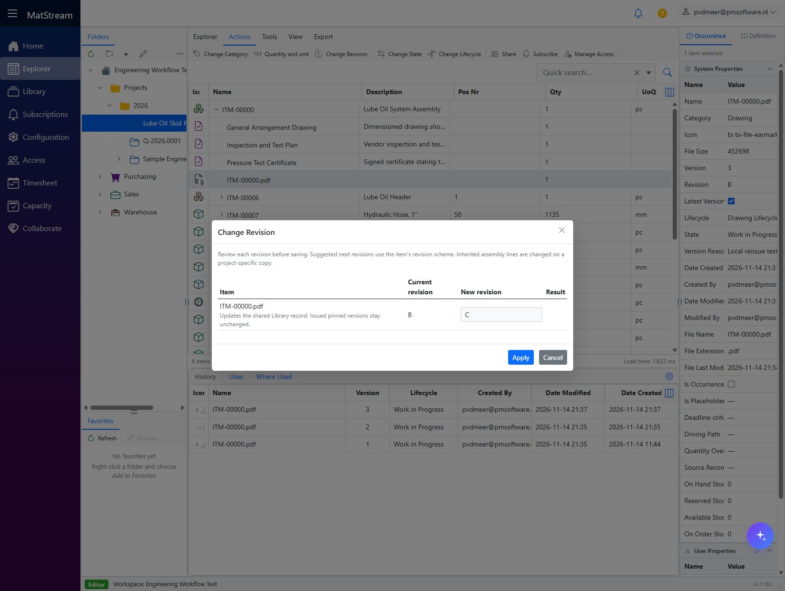

A drawing displayed beneath an inherited assembly is still the shared Library drawing. The dialog explains that this record will be updated. It does not create a BOM position or a project copy of the drawing. Normal revision permission, item/lifecycle modification locks and version checks still apply. Inherited BOM occurrences retain their separate project-copy behavior.

Changing the revision metadata does not edit the attached PDF or its title block. Upload the matching drawing content as part of the engineering work. Already issued packages keep their pinned versions.

!!! note "Real save test, then restore"
    The signed-in local browser changed **B → BTEST** and then **BTEST → B** through the project action. Both saves succeeded. BTEST was only a temporary test value; the final drawing is **B/version 5**, with the same revised PDF file. History retains both test changes. The issued replacement packages still correctly contain **B/version 3**; their drawing bytes are unchanged.

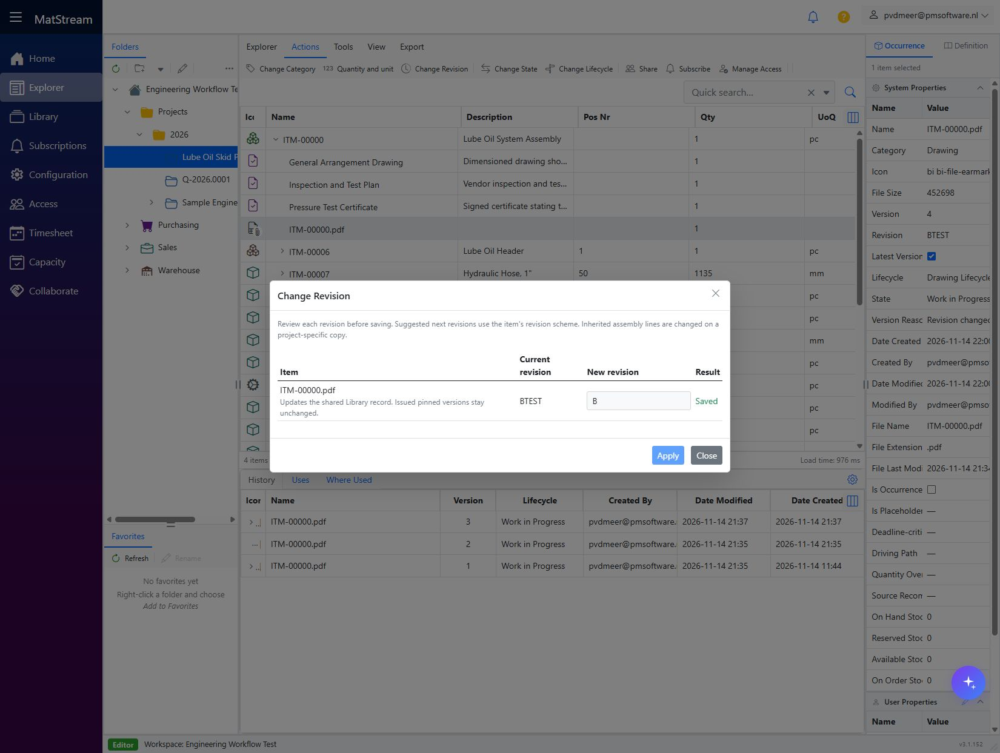

The earlier reissue walkthrough uploaded version 2 and used a local helper to align B at version 3 after this action failed. That was a historical test workaround. It is no longer needed for the corrected action. The supplied sample's original title block was 0 while its MatStream revision was A; the revised PDF and metadata both show B.

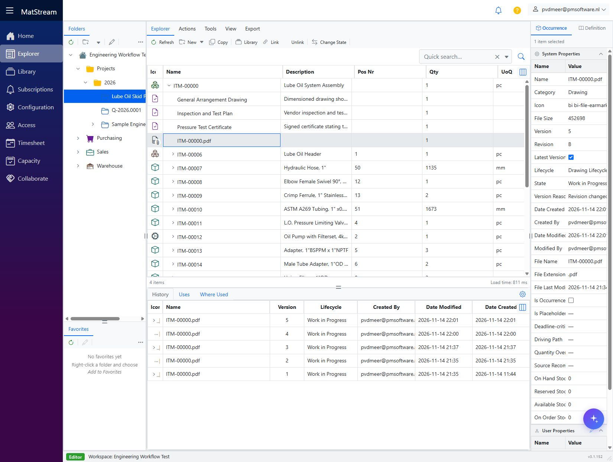

## 2. Prepare separate replacement transmittals

Use one Transmittal for each distribution. In this test the earlier draft records became:

| Transmittal | Distribution channel | Purpose | Saved drawings |
| --- | --- | --- | --- |
| TR-2026-0002 — Client reissue | Client | For Production | ITM-00000.pdf B/v3 |
| TR-2026-0003 — Work Preparation | Work Preparation | For Production | ITM-00000.pdf B/v3 and unchanged ITM-00006.pdf A/v1 |

1. Complete the subject, attention, issue date, recipient and response expectations. Use the real recipients for a live workflow; the local test used the same account to simulate both handoffs.
2. Link the original **TR-2026-0001** under **Supersedes Transmittals**. The [comment resolution guide](engineering-comment-resolution.md#link-replacement-transmittals) explains these relationships.
3. Open **Project Documents**, adjust its engineer-editable filter if needed, check the intended drawings and choose **Add selected documents**.
4. Review **Document Issue Lines**. Both packages must use B/v3 for ITM-00000.pdf, with displayed versions pinned when selected. Include ITM-00006 only where required for the Work Preparation handoff.

!!! note "Project reference fixed in the subsequent workflow test"
    The early replacement packages left Project Number blank because copying its unique value blocked saving. New packages now use **Document Project**, a reusable project reference. Follow [Select the transmittal's project](engineering-transmittal-project-reference.md) for the administrator mapping and local test. Earlier issued PDFs remain unchanged; Project Number stays unique on the project.

The Work Preparation package deliberately includes the unchanged ITM-00006 PDF. Its original title-block/metadata mismatch is not corrected by updating ITM-00000. Review it before a real production issue.

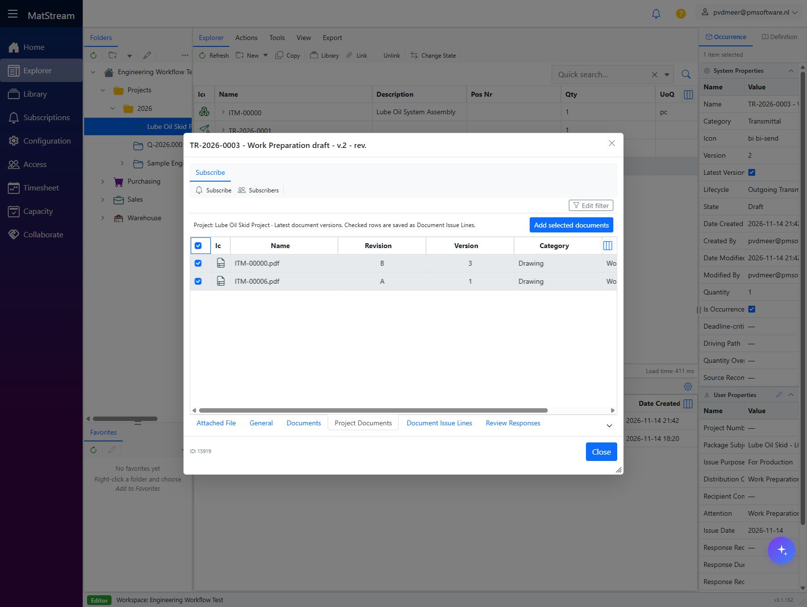

## 3. Generate, inspect and issue each package

1. Save the header and selected documents. Remove temporary “draft” wording from the record name before generating the final PDF.
2. Move **Draft → Ready to Issue**.
3. Open **Document Issue Lines → Transmittal → Generate transmittal PDF**.
4. Inspect the attachment: package number, attention, purpose, channel, date and drawing register must be correct.
5. Use **Change State → Issued**. Repeat for the other Transmittal.

The generated cover records the preparation state **Ready to Issue**. The record and portal show **Issued** after the transition. The PDF is not regenerated automatically by issuing it.

Changing the header or name after generation makes the cover stale. In this test the client issue was blocked after final edits. Regenerating created a new PDF/history version; issuing then succeeded.

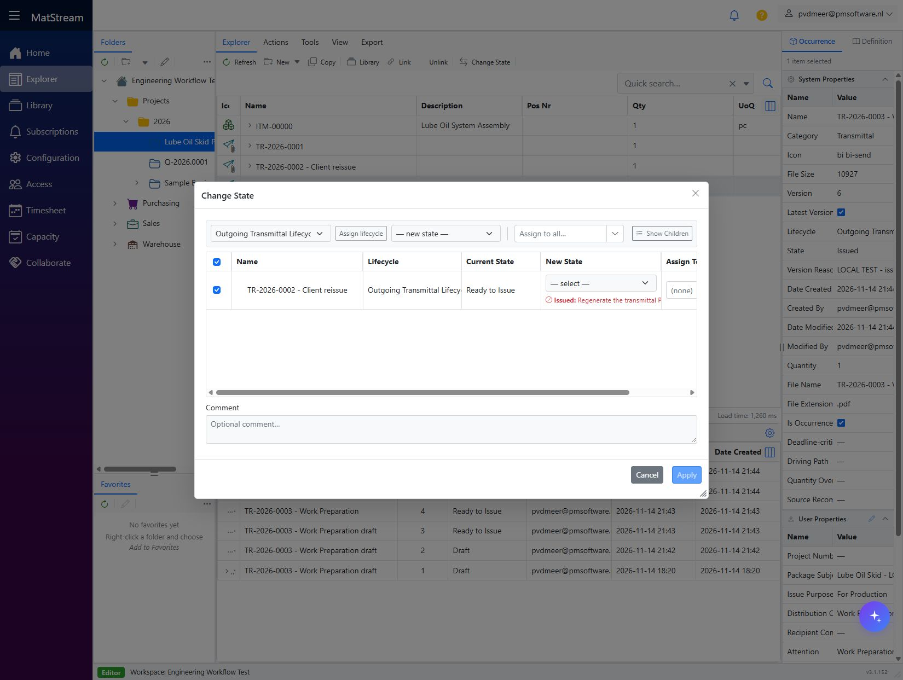

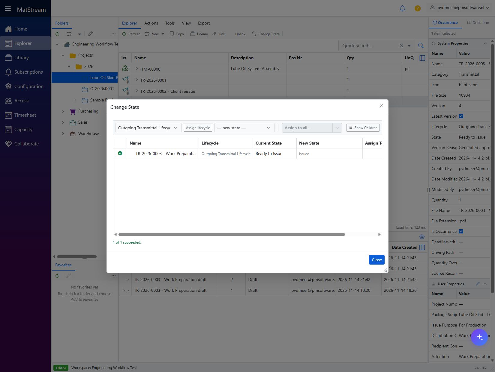

## 4. Share the new packages — earlier manual-recipient test

1. Select the issued record explicitly in Explorer, then **Actions → Share**. A distribution label alone does not grant access or send a notification.
2. Enter named recipients, review the configured external group, expiry and download settings, and select whether another client review is requested.
3. For a local test, clear **Send email invitations**. This test also cleared **Request review responses**, since it was checking distribution of the revised package.
4. Create a new link for each issued package. Test it as the intended recipient and download the drawing.

For the local department demonstration, the Work Preparation record was shared read-only through the same Client Portal ceiling group to the current test account. This does not validate a separate department account or an automatic Work Preparation notification. Workspace members can also open the issued record through their existing internal permissions.

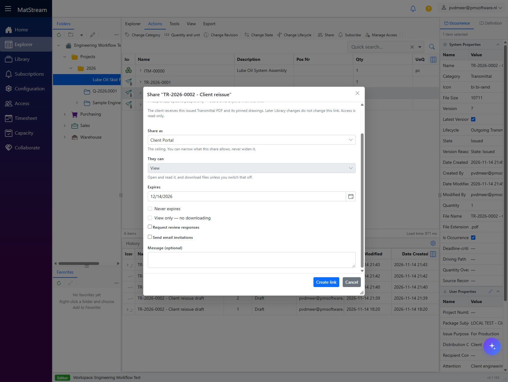

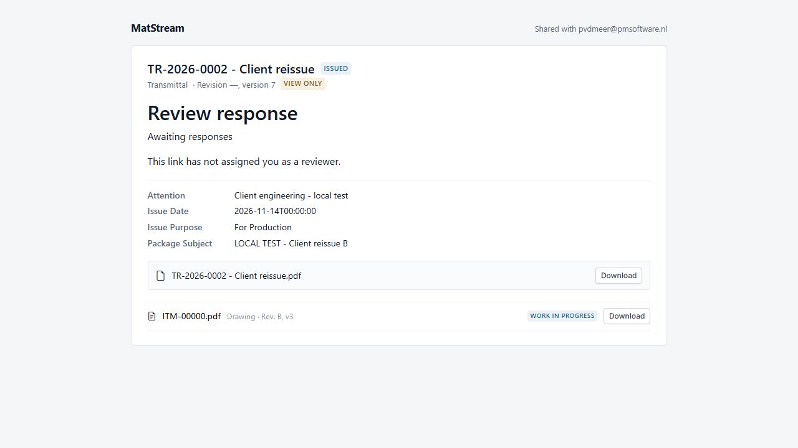

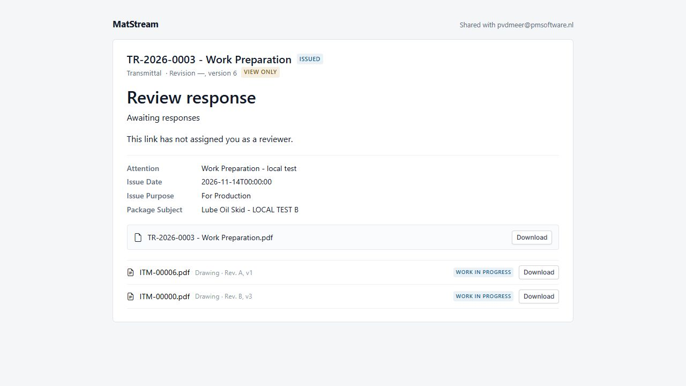

The downloaded client drawing matched the uploaded revised PDF by SHA-256. Refreshing the old TR-2026-0001 link still showed A/v1 and the original client responses. Reissuing does not silently replace that package or revoke its link. Withdraw an old share separately if required.

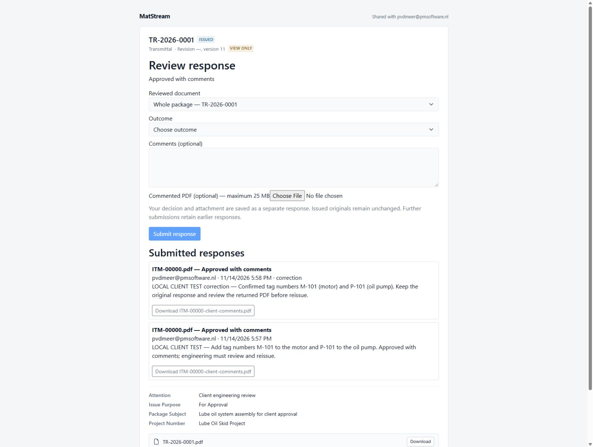

## 5. Update the resolution evidence and request checking

1. On the response's **Revised Drawings** tab, unlink the earlier reference and save. Choose **Link existing** to capture B/v3.
2. Under **Replacement Transmittals**, unlink the old draft references and save, then link both current **Issued** records. Check the captured versions and states; an old draft pin does not advance automatically.
3. Update **Engineering Disposition** with the changes, exact replacement issues, test limitations and any pending technical work.
4. Move **In Progress → Ready for Check**. The configured automation notifies Engineering Approvers. Leave the checker/date/evidence confirmation empty until the engineering check is performed.

The walkthrough found and fixed an Unlink routing bug: saving staged association removals now uses the association endpoint, preserving the drawings and BOM. Browser retesting confirmed the old links were removed and the current versions could be captured.

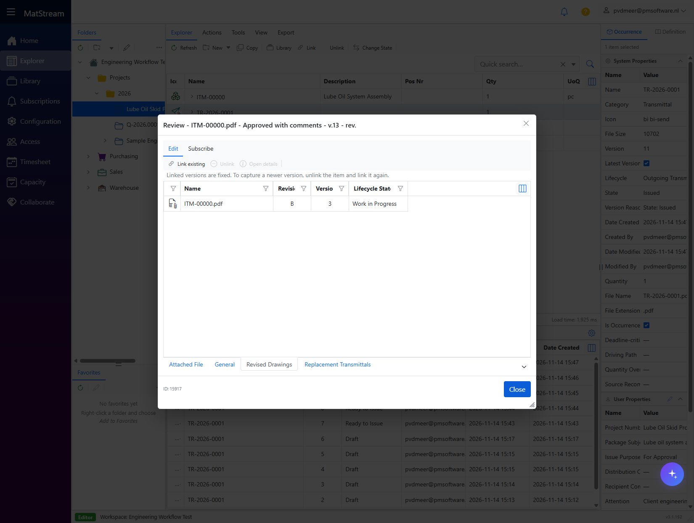

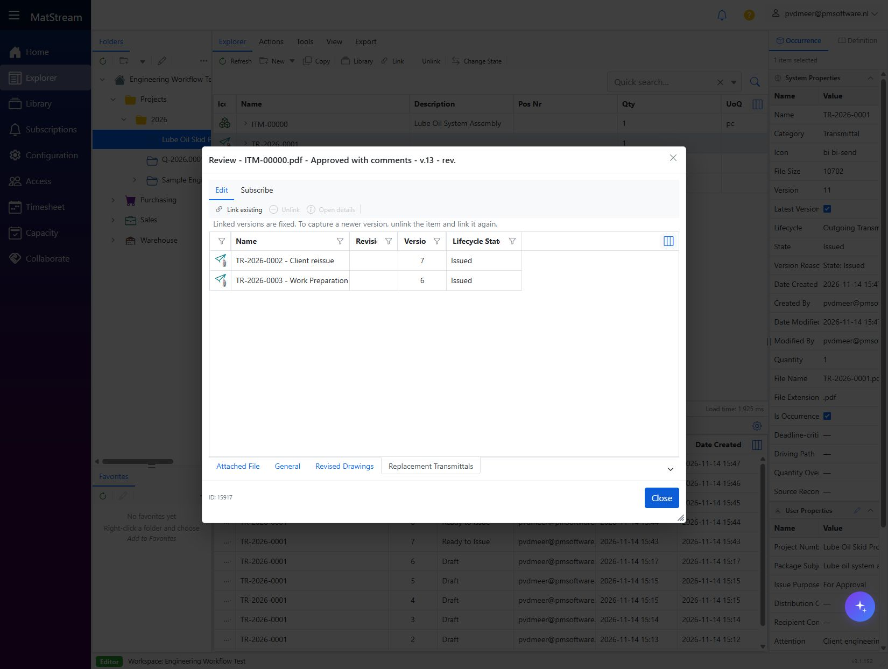

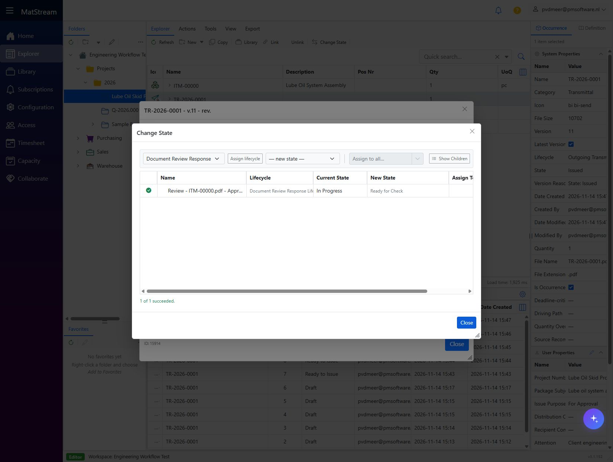

## 6. Reissue through Distribution Channels

The later local test on **15 November 2026** uses the [Distribution Channel category](engineering-distribution-channels.md), including contacts, delivery addresses and internal workspace groups. Use this route for new handoffs. The earlier manual-recipient screenshots above describe the historical test.

### Prepare one package per destination

1. Confirm the updated drawing's revision and contents. In this test, ITM-00000.pdf remains **B/version 5**, with the motor and pump tags from the earlier update. No additional drawing revision was uploaded for this distribution test.
2. Create a new Transmittal under the project for each destination. Select **Document Project** and the appropriate **Distribution Channel Reference**: Client, Work Preparation or Purchasing. Teams maintain the channel records; the workspace administrator maintains their definitions and permissions.
3. Complete the subject, issue purpose, issue date and response expectations appropriate to the handoff. Link earlier issues under **Supersedes Transmittals** where applicable.
4. In **Project Documents**, adjust the filter, select the intended drawing and add it to **Document Issue Lines**. Check the captured revision/version. Include ITM-00006 or other documents only when that recipient needs them; this focused test sends ITM-00000 only.
5. Save, move to **Ready to Issue**, and choose **Document Issue Lines → Transmittal → Generate transmittal PDF**. Wait for the completed attachment before closing. Check the channel's delivery block and drawing register, then change state to **Issued**.

If issuing reports that the cover is stale, regenerate and check again. Do not bypass the consistency check. The Purchasing walkthrough encountered this message and successfully issued after regeneration.

| Local Transmittal | Selected channel | Result |
| --- | --- | --- |
| TR-2026-0009 — Client channel reissue | Client - Lube Oil Project | Issued; named-recipient portal link |
| TR-2026-0010 — Work Preparation channel reissue | Work Preparation - Lube Oil Project | Issued; Sample Work Preparator notified |
| TR-2026-0011 — Purchasing channel reissue | Purchasing - Lube Oil Project | Issued; Sample Buyer notified |

All three packages retain **ITM-00000.pdf B/version 5**. Their generated PDFs use the saved administrator template mappings and each destination's contact/address details.

### Client: review recipients and create the portal link

Select the issued Client record in Explorer and choose **Actions → Share**. The selected channel supplies its contact, address and email recipient. Review these before creating the link. For this local test, the recipient is the current test account; **Send email invitations** and **Request review responses** are off. A live approval handoff should use the appropriate configured review options.

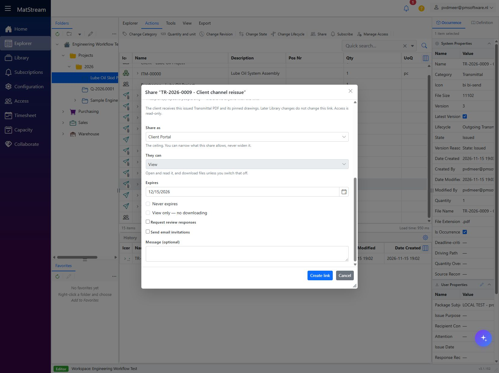

Choose **Create link**, then open it as the intended recipient. The test portal displays the issued covering PDF and **ITM-00000.pdf, Rev. B, v5**. Later changes in Library do not advance this captured document.

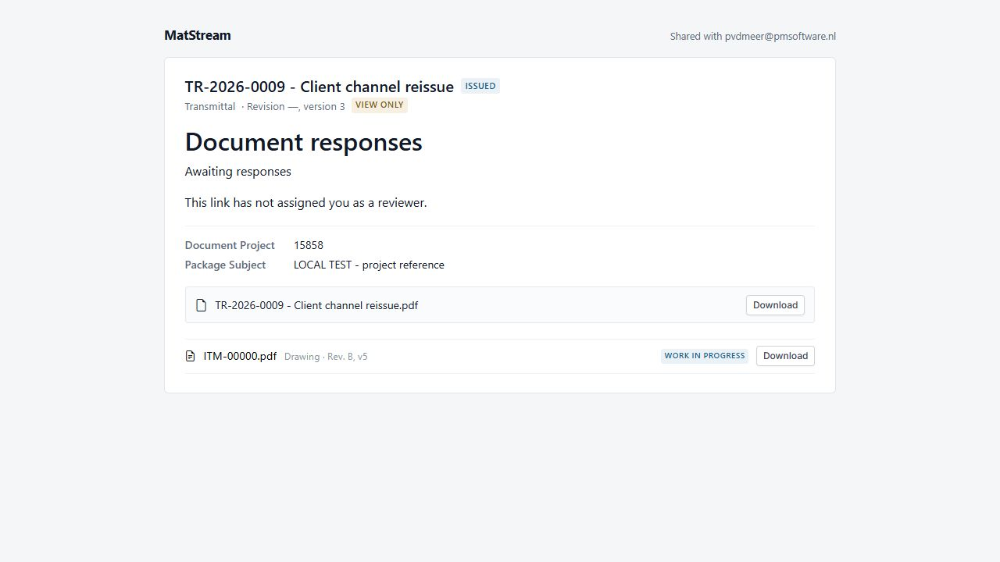

### Departments: review group members and send internally

Select the issued Work Preparation record and choose **Actions → Share**. Review the resolved workspace recipient. Choose **Send to workspace recipients**. Repeat for Purchasing. This records the issued package and sends an in-app notification using existing document access; it does not create a portal link or grant additional permissions.

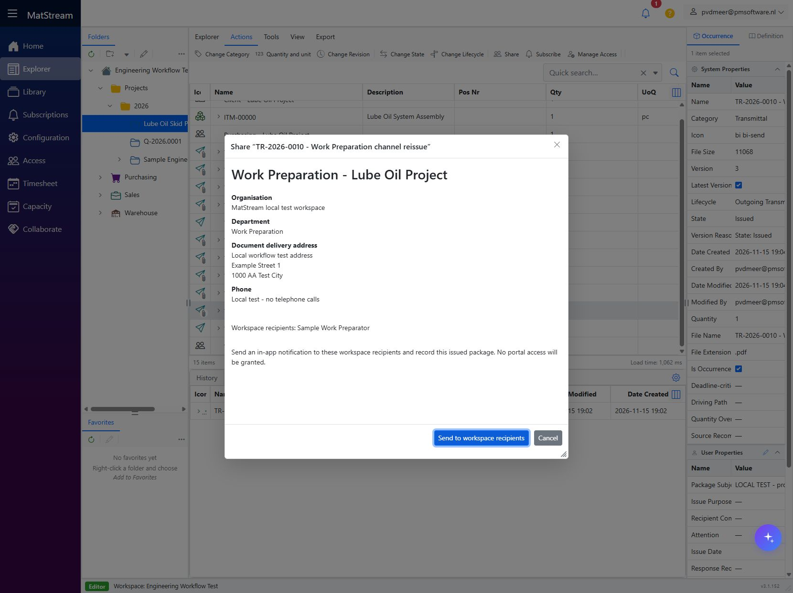

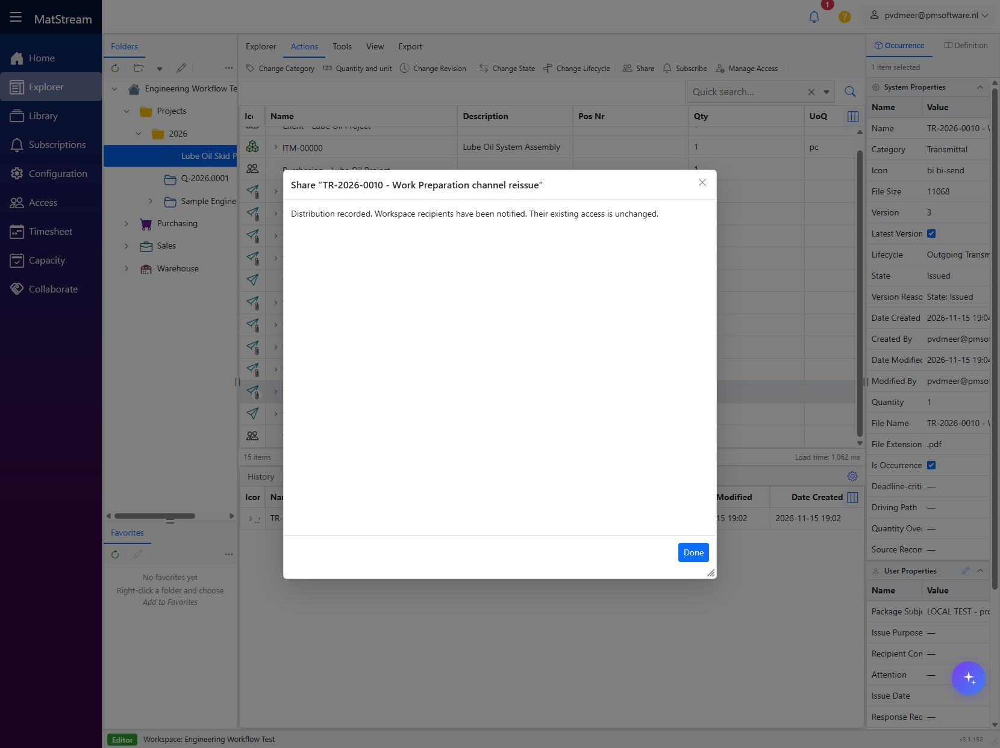

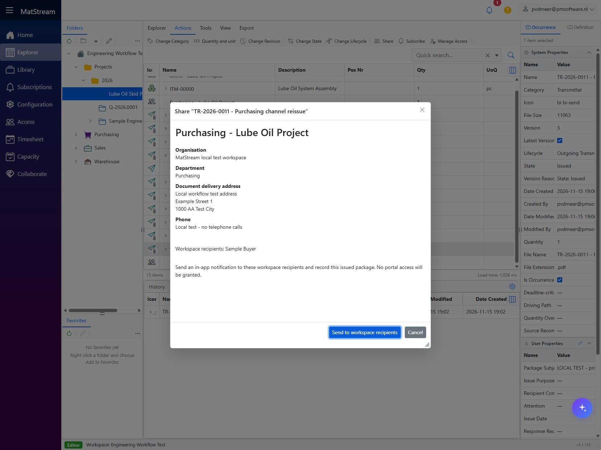

### Check the retained distribution

Open each Transmittal's **Distribution Records** tab. Open its record to inspect the retained recipient, channel details and drawing revision/version. **Issued Versions** opens the captured package version.

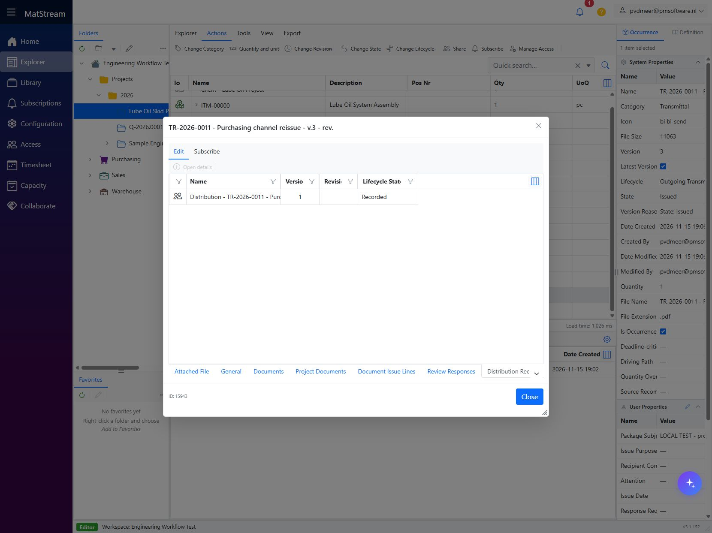

The local audit confirmed three distribution records, one Client portal share and exactly one in-app notification each for Sample Work Preparator and Sample Buyer. The department packages have no portal shares. The notification rows were verified locally; separate department accounts were not signed in to inspect their inboxes. Earlier issued packages were left unchanged.

!!! note "Distribution test, not a technical production release"
    The sample drawing remains **Work in Progress**. This test verifies delivery of its existing revised PDF. It does not represent completion of Vault review, engineering approval or release for manufacture. The focused test retained the earlier template-test subject and left issue purpose/date blank; complete those fields for an actual project handoff.

## Workspace administrator configuration

- **Property Definitions → Issue Purpose → Edit → editor settings (gear):** maintain stored values, selected text and list descriptions. This test added **For Production** through this UI, keeping the existing choices.
- **Distribution Channel category:** project teams maintain contacts, delivery addresses and internal groups. Select a record through Distribution Channel Reference; see [Maintain distribution channels](engineering-distribution-channels.md). Earlier test packages retain their historical text channel values.
- **Display Tabs:** configure project-document defaults, engineer-editable filtering, Choose columns and version pinning.
- **Print Templates and Automations:** configure header/register mappings, PDF generation, filenames and preparation states.
- **Lifecycle Definitions:** configure issue consistency criteria, permissions and checking transitions. Technical approval and production-release rules are separate from the purpose label.
- **System Settings → Document package portal:** configure shareable categories/states, visible fields, ceiling group and defaults. Existing shares retain their captured package.
- **Automations:** configure resolution-check notification recipients and messages.

Revision values and suggestions are not hard-coded for Drawing, ITM-00000 or this project. Administrators can create/copy and edit schemes under **Configuration → Revision Schemes**, including primary/secondary/tertiary sequences and delimiters. Open a workspace sequence to maintain its ordered values. System schemes can be copied to make a workspace-owned scheme.

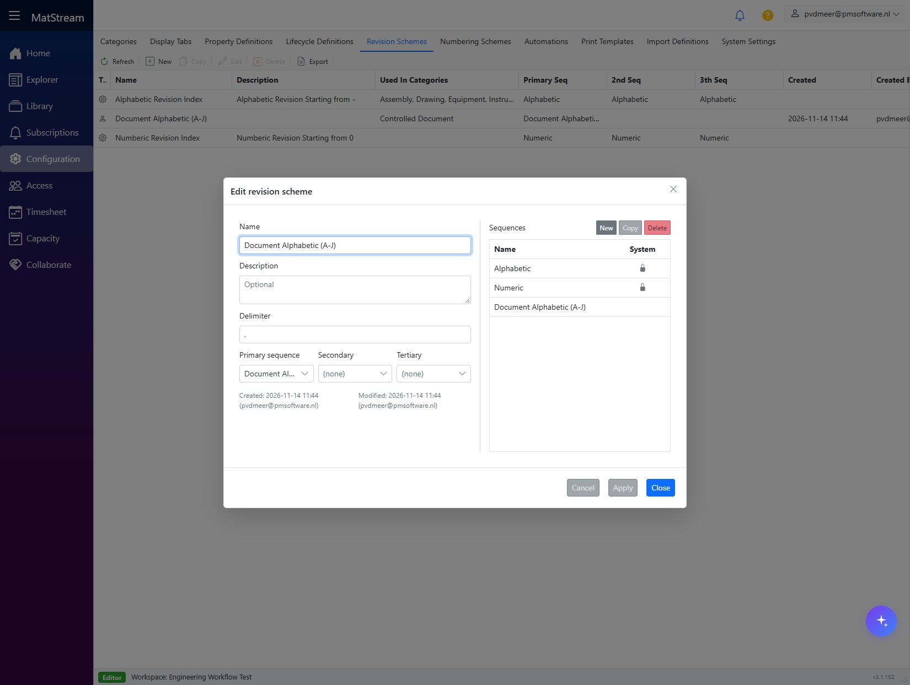

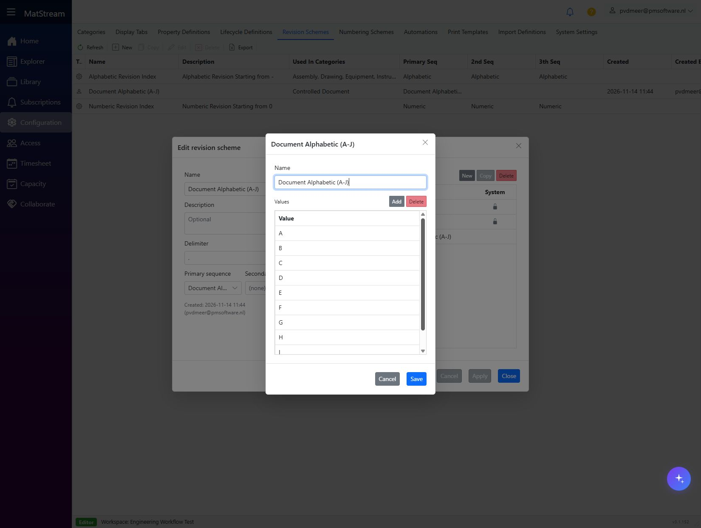

Under **Categories → Drawing → Edit → General**, configure the **Revision scheme** default and **Version creation policy**. This local category uses Alphabetic Revision Index and Every change. New drawings take their initial scheme from the category; existing drawings retain their saved scheme. The action obtains its suggestion from that saved scheme. It does not force a particular next value: the authorized engineer can enter a revision of up to ten characters, as before.

No new business setting or Setup rerun is required for the revision-action fix. Existing scheme settings, versioning policies and permissions are retained. The reusable project reference has since been fixed and tested. Download-only review-status wording remains a recorded workflow gap.

Continue with [releasing project assemblies](engineering-production-release.md).
