# Production — collect the replacement and resume work

Continue after the [wrong-fitting replacement](engineering-fitting-replacement.md) has reached **Ready for Pickup**. Production collects the inspected fitting, the responsible team clears the affected hold, and Production checks the operation before starting or resuming work.

The example uses ITM-00001, a fitting needed for ITM-00006 header fabrication. ITM-00000 final assembly has its own prerequisites. Clearing the header's fitting hold does not clear the final assembly's blockers.

## 1. Record collection on the non-conformance

Open the non-conformance and check the replacement MR/PO, inspection result and pickup instructions. Confirm the correct fitting has actually been handed over. Select the non-conformance in Explorer, choose **Change State → Collected**, enter a useful comment and **Apply**.

For example: “One inspected reducing tee collected by Production for the header. Warehouse location and non-conformance reference recorded.” The lifecycle history records the user, date and comment. The existing pickup criterion rechecks delivery, inspection, allocation, instructions, replacement hold and the configured document requirement.

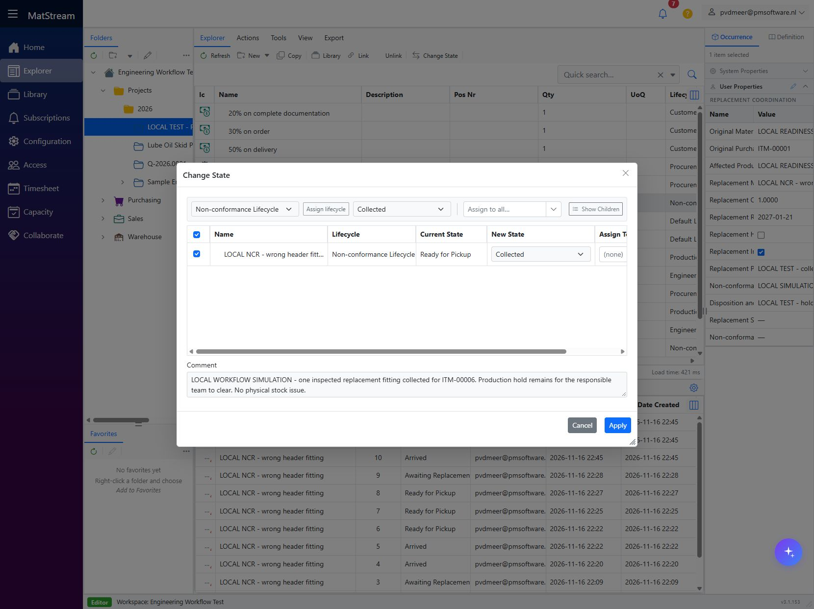

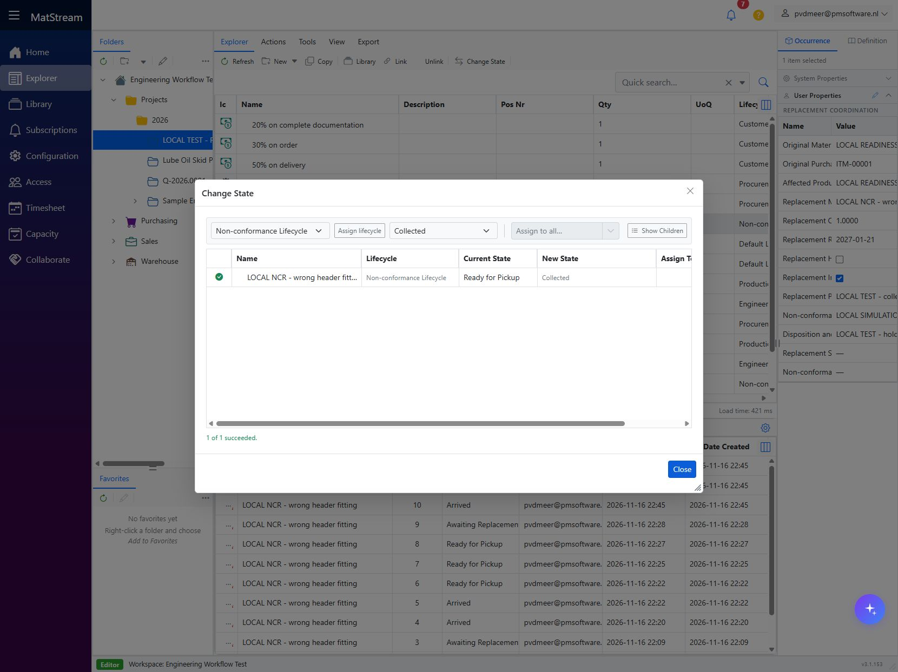

Before collecting, set **Replacement Collection Location** to the actual shelf/bin and save. The administrator configures its picker through the ordinary Property Definition filter: record family **Folders**, allowed stock-location categories. The server also verifies that the selected record is a real stock location in this workspace.

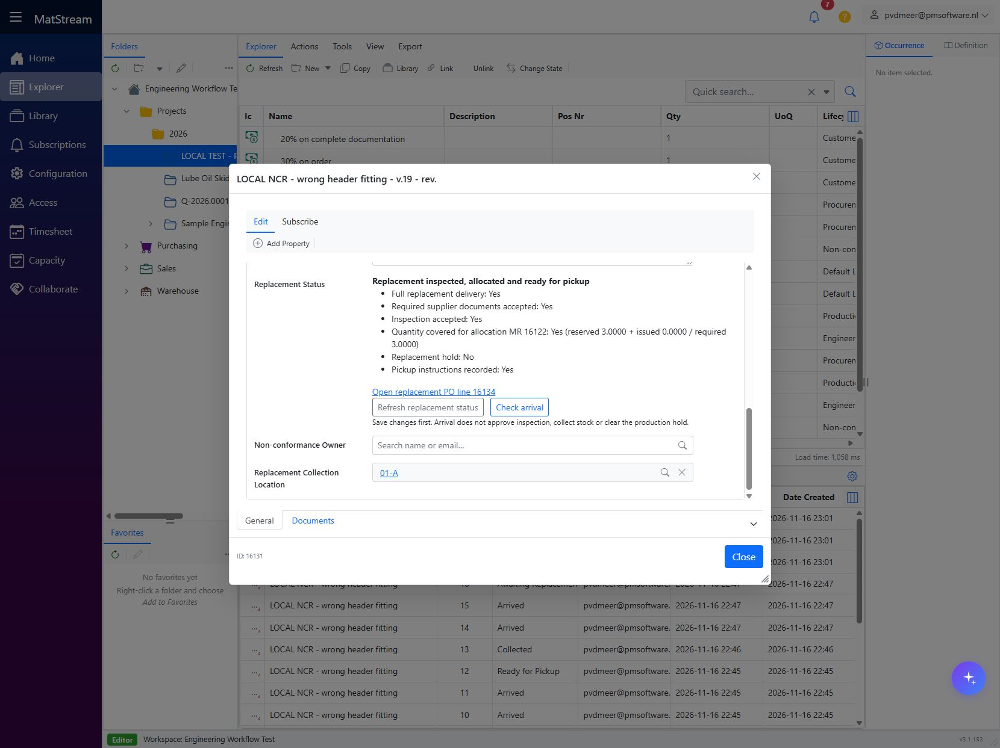

With collection enabled, **Collected** runs the stored script `matstream.actions.collectReplacement();`. In one transaction MatStream:

- consumes the replacement quantity of the pinned item revision from the chosen shelf;
- releases that quantity from the configured allocation MR's reservation;
- records the issue against the NCR, MR, affected prerequisite/operation, item revision, shelf, quantity and collector;
- saves the Collected state, lifecycle event and script execution.

A missing/empty shelf, insufficient reservation, missing inspection/documents, permission failure or failed script prevents collection. Nothing is partly posted. Repeating or concurrently retrying the same collection reuses its existing issue record.

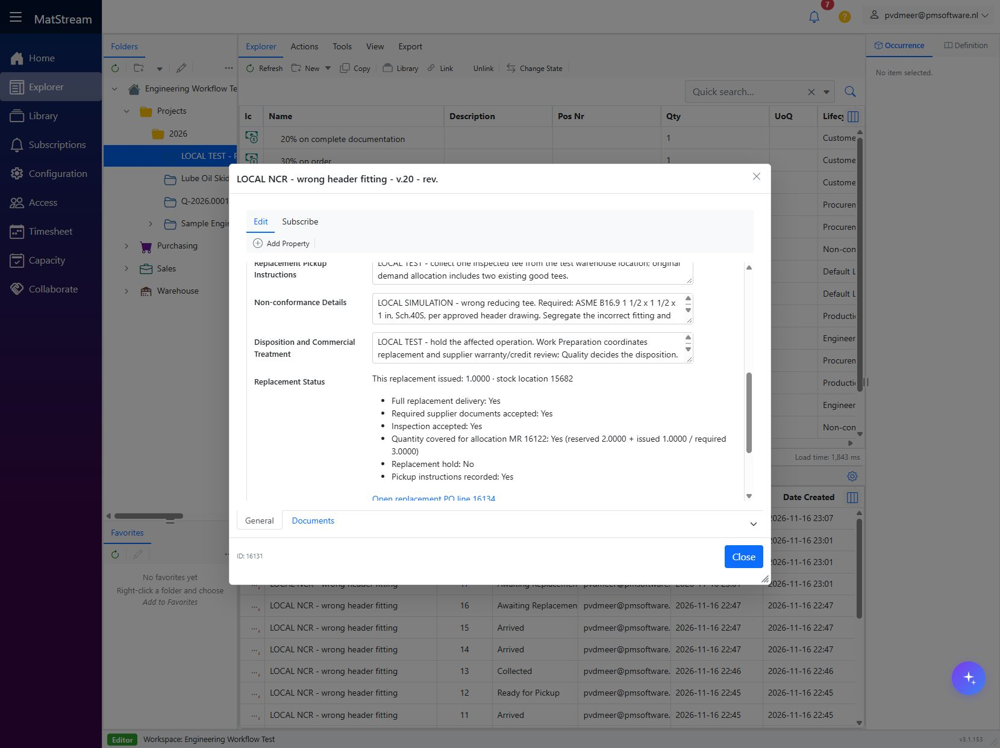

Only the **replacement quantity** is consumed. Here that is one tee; the other two good tees remain reserved. This action does not issue the whole MR, the complete production BOM or the finished assembly. Ordinary stock-management and stock-reservation grants plus lifecycle/read permissions are required; the seed does not silently give every engineer stock-management authority.

A collected issue is not reversed by reopening the NCR or changing its fields. Use a reviewed warehouse return/correction process and a new NCR when another replacement is required. A self-service production return action is not part of this change.

## 2. Clear the affected hold

The responsible person confirms that the correct replacement and any necessary instructions are available and authorises resuming the affected operation. Open the ITM-00006 Production Order. Its **Production Readiness** still reports the hold even after the non-conformance is Collected.

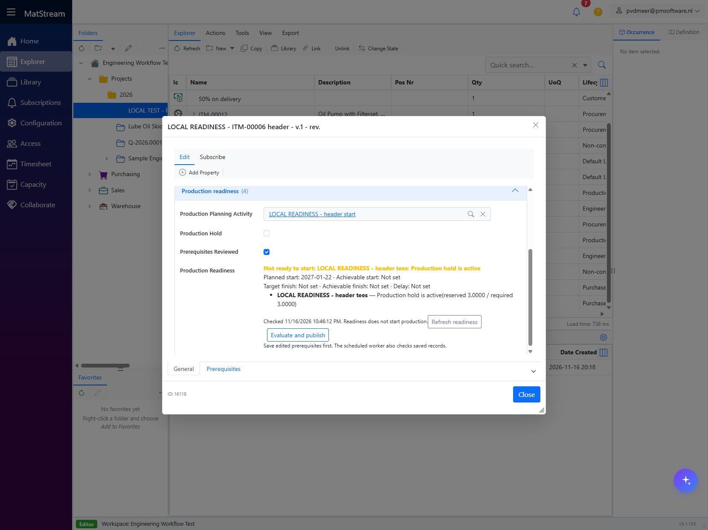

Open **Prerequisites**, find the fitting row, clear **Prerequisite Hold** and choose **Save and Close**. Clear only the hold whose reason has been resolved. If the whole operation also has **Production Hold** on General, that is a separate decision and must be cleared separately by an authorised user.

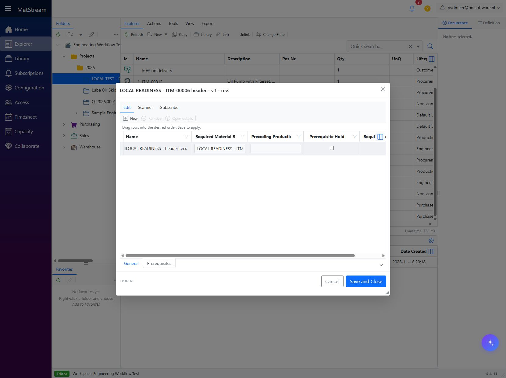

Collection does not automatically clear either hold. Other holds, missing materials, documents and predecessor work can still block the operation. The non-conformance's disposition and the hold-clearance history explain the decision; do not close unrelated exceptions.

## 3. Check readiness against saved evidence

Reopen the order's General tab. Use **Refresh readiness**, or **Evaluate and publish** to save the result and emit any eligible readiness update. The scheduled evaluator also checks saved active orders.

In this example, the original fitting MR requires three tees: two existing good tees and one replacement. Before collection all three are allocated to the original MR. After collecting the replacement, coverage is **two reserved plus one issued**, still three in total. Do not reserve the same physical fitting against both the original and replacement MRs.

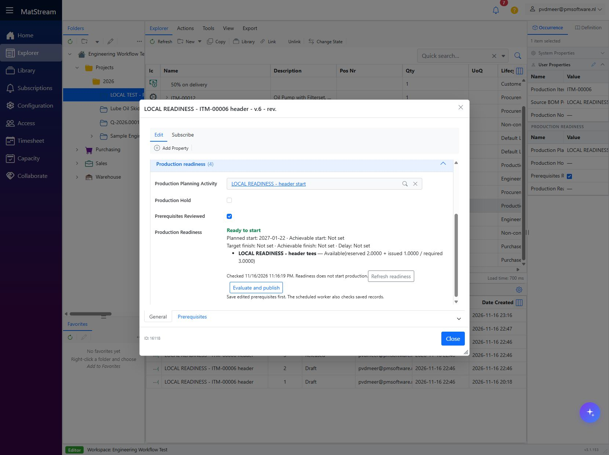

The result is **Ready to start** only when the operation's configured prerequisites qualify. Review the actual work instructions, released drawings, people and equipment too. Readiness is advisory; it does not automatically change the production lifecycle or prevent every permitted manual transition.

## 4. Start or resume the operation

For an order that has not started, use the configured production transitions. The seeded example is **Draft → Released → In Progress**. Enter a comment identifying the replacement and the reviewed readiness result.

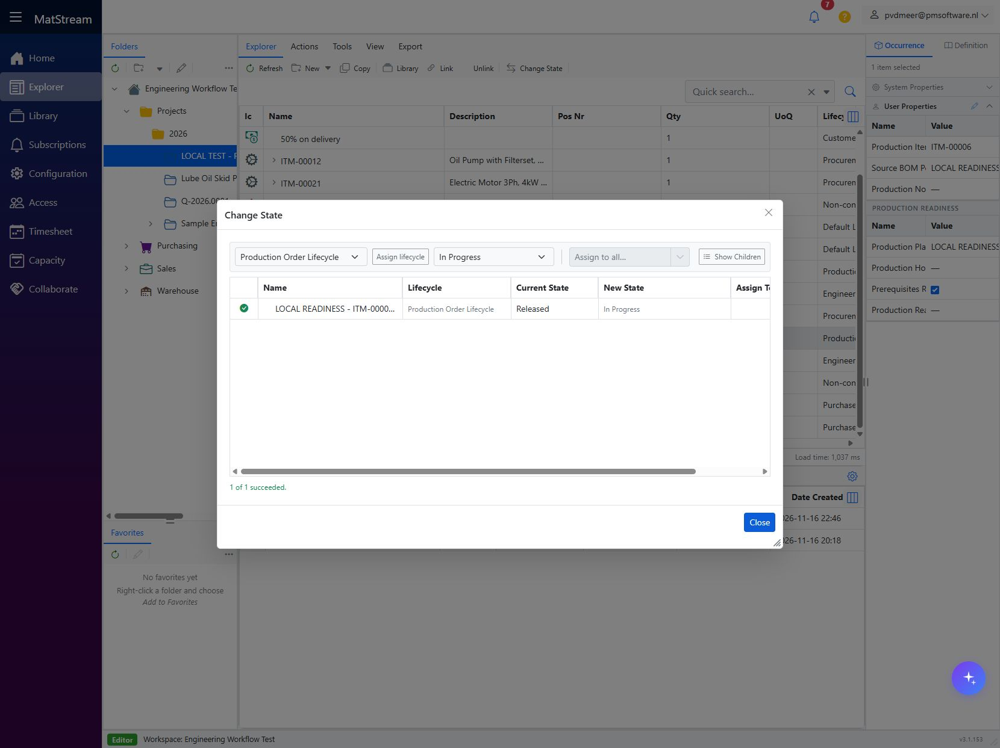

For work already **In Progress**, stop the affected work while its hold is active. Once the responsible person clears that hold, resume work under the same In Progress order; the seeded lifecycle has no separate Paused/Resume state. Keep the decision traceable in the non-conformance, hold history and production notes. The default readiness evaluator covers Draft/Released orders, so a readiness result outside those configured active states is not proof of a new blocker or authorisation to restart.

Final assembly still waits for its own motor, pump, accepted documents and the **completed** header. An In Progress header is not a completed predecessor.

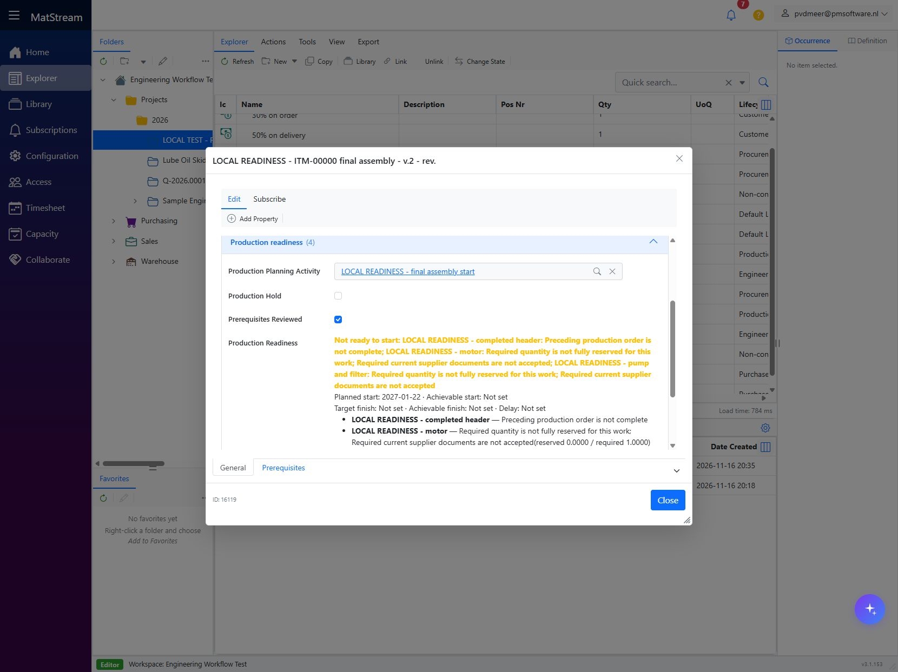

Quality or Work Preparation closes the non-conformance through the configured **Collected → Closed** transition after the disposition and follow-up are complete. Closure is not a warehouse issue, supplier credit or payment.

## Administrator configuration

Install **Non-conformance and Replacements** in Manage Setup after applying the collection migration. New Engineering Project setups include it. Installed administrator customizations are preserved; missing collection defaults are added once.

| Configuration | Administrator control |
|---|---|
| Non-conformance lifecycle | Collected/Closed state names, transitions, permissions and pickup criterion |
| Production Order lifecycle | Execution states, transitions, permissions and any company-specific pause/resume process |
| Categories / Property Definitions / Display Tabs | Hold fields, defaults, field permissions, prerequisite references, columns and layouts |
| Warehouse: Collect replacement fitting | Editable script attached to the collection transition; add company restrictions by throwing before the action |
| Quality: Evaluate replacement arrival → ReplacementWorkflow parameters | `CollectionEnabled`, `CollectedStateId`, `CollectionAutomationId`, `CollectionLocationPropertyId`, `CollectionNote`, allocation MR/quantity and existing inspection/document mappings |
| Production: Evaluate readiness | Editable script, property/category mappings, active/completed states, blockers, messages, executor and timing; `CountIssuedMaterial` defaults to true |
| Subscription proposal automations | Recipient groups, consent, event filters, watched states and notification channels |
| User Settings | Remembered individual subscription choices |

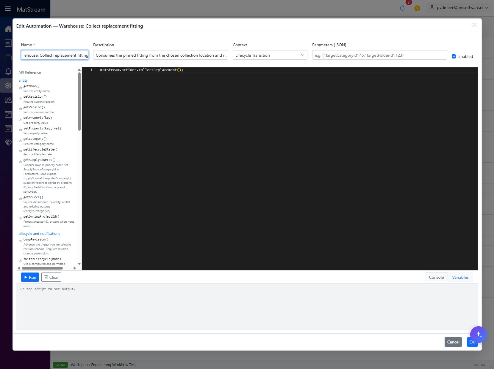

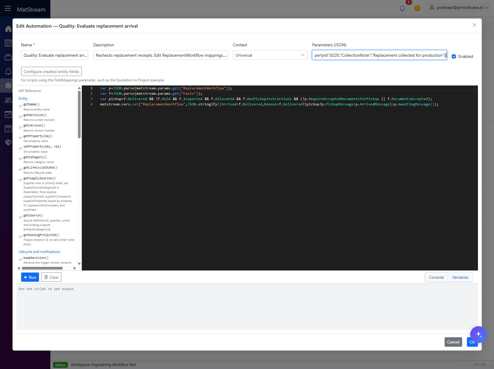

The configured collection script must remain attached and enabled on the collection transition. It runs within the state transaction; its usual after-transition execution is deduplicated. Disabling `CollectionEnabled` explicitly restores record-only collection without automatic stock posting. The server keeps quantity, stock, permissions and retry checks even when the script is customized.

Issued material qualifies only for the operation/prerequisite recorded by its issue. Reusing the same MR on another operation does not make that operation ready. Buying/reserving logic also counts issued quantities so releasing the reservation does not create new demand for the consumed fitting.

Keep readiness and arrival logic in the existing editable scripts. Hold clearance and starting work remain explicit team decisions. An administrator can change definitions; the permitted project/production team edits records and executes transitions.

## Local walkthrough evidence

On 16 November 2026, the local browser recorded collection of NCR 16131, cleared fitting prerequisite 16123 through the Uses grid, displayed the header ready, and moved Production Order 16118 through Released to In Progress. Final assembly 16119 stayed blocked. Native service tests also checked an independent order-level hold, hold changes while already In Progress and Collected/Closed transitions. The walkthrough used the current test account; separate departmental identities remain to be rehearsed.

All receipt, inspection, document acceptance, fitting stock and reservation evidence in these screenshots was simulated. After testing, it was reversed/restored, the header was returned to Draft and the fitting prerequisite held again. The NCR returned to Awaiting Replacement. History remains; no physical fitting was collected, stock consumed, manufacture performed or supplier paid.

### Stock consumption test

The local browser also selected shelf 01-A, executed Collected and showed one fitting issued plus two reserved. Native tests covered missing/wrong/empty locations, a failing script, a failure after stock writes, stale actors/versions, sequential/concurrent retries, duplicate-reservation prevention and operation-scoped readiness. The test issue, receipt and reservations were subsequently reversed with audit retained; the fitting hold was restored. The issue journal is marked as reversed test evidence. This was a controlled test cleanup, not a demonstration of a production return UI.

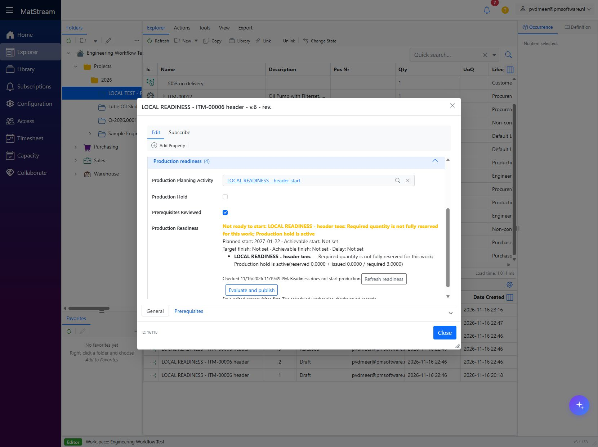

Continue with [production completion and inspection/test records](engineering-production-completion.md) for the header and final assembly.
