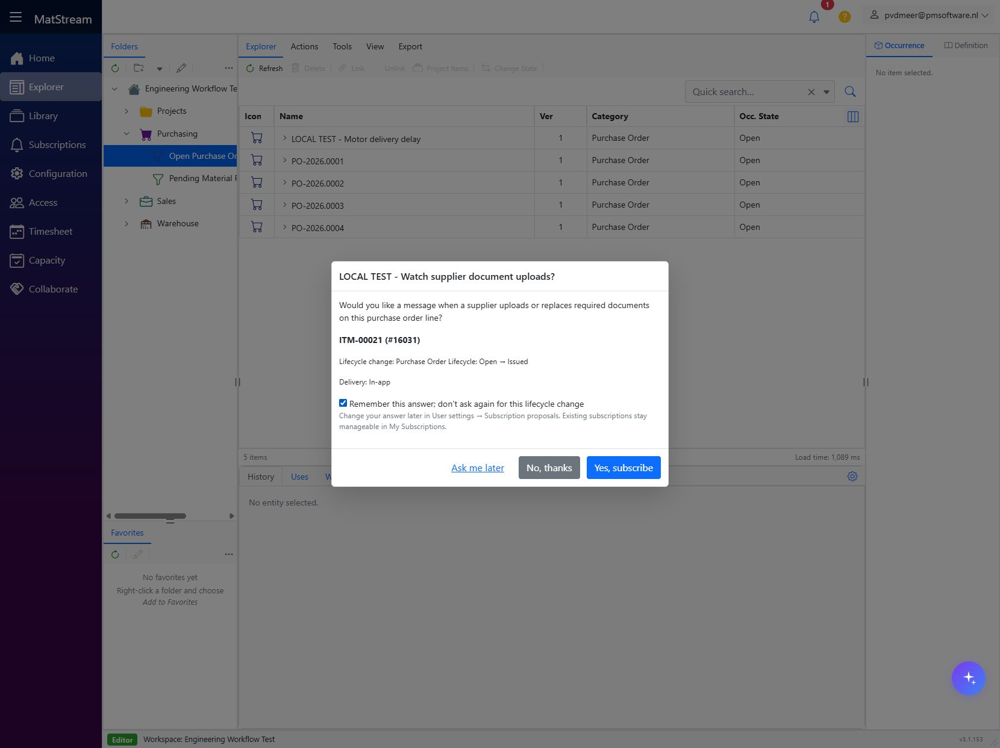
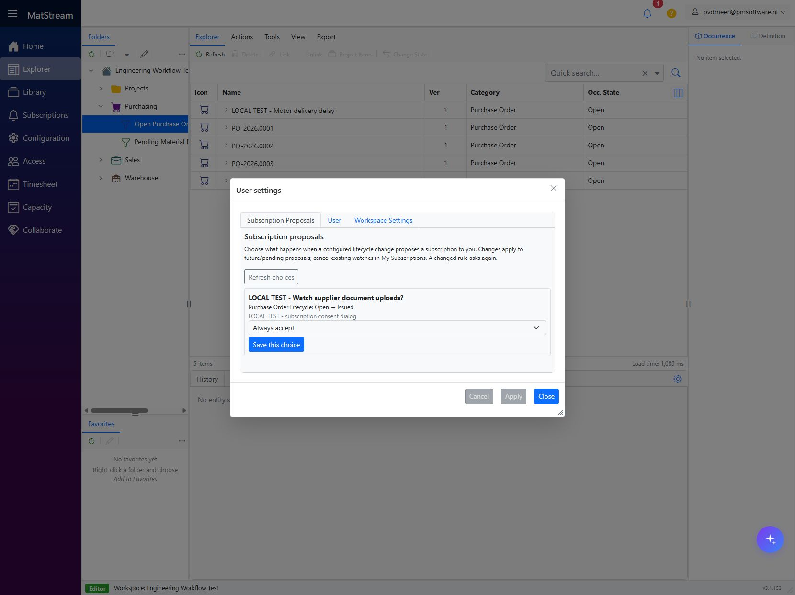

# Sales and Quality — Choose automatic PO-line subscriptions

When a configured lifecycle change happens, MatStream can **offer** the relevant users a subscription. The subscription starts after that user accepts, or follows that user's previously remembered answer.

The Engineering Project seed supplies two examples when a Purchase Order moves **Open → Issued**:

| Team | Proposed PO-line watch |
|---|---|
| Sales & CRM | A message when the line's final outstanding quantity is received |
| Quality | A message when the supplier uploads or replaces an RVD beneath the line |

These use the same generic feature. Administrators can configure other categories, groups, lifecycle transitions and watched events through the script automations. The workflow does not hardcode department names into the subscription service.

## Answer the question

After the lifecycle event is processed, a recipient who has MatStream open sees the question. If the recipient is offline, the proposal waits for them to return. It can take a short time for background processing and the browser's regular proposal check.

A user who has never opened MatStream sees the proposal on their first visit, even if the purchase order was issued earlier. The proposal is created at the moment of the lifecycle change and delivered when the user returns, so it can appear for a PO that is already Issued.

- **Yes, subscribe** accepts the watch on this record.
- **No, thanks** declines this proposal without changing any existing subscriptions.
- **Remember this answer** also saves the Yes or No choice for this rule and this specific lifecycle transition in this workspace. Without it, the answer applies only to this proposal.
- **Ask me later** postpones the dialog for five minutes in the current browser session; it saves no answer.

For example, remembering Yes to the Sales delivery question on **Open → Issued** also handles that question for later orders issued by that same transition. It does not answer the separate Quality question or a question raised by a different lifecycle change. Renaming the lifecycle states does not change the stored transition identity. A changed rule configuration asks again, so an old answer cannot silently authorize new channels or different notification behavior.

Only enabled workspace members who belong to the configured internal groups, can read the target record and have **subscription.create** receive usable proposals. No extra access is granted by accepting one. A user cannot answer another person's proposal.

## Change your remembered answer

Open the account menu → **Settings** → **Subscription Proposals**. Find the question and its lifecycle change, then choose **Ask each time**, **Always accept**, or **Always decline**, and click **Save this choice**.

The settings show rules relevant to your groups and rules for which you already have a saved choice. A remembered answer is personal; workspace defaults cannot opt users in.

Changing the answer controls future and still-pending proposals. It does not cancel an existing watch. Use **My Subscriptions** to cancel an existing subscription; also select Ask each time or Always decline if you do not want later lifecycle changes to create it again. Administrators disabling a proposal rule prevent new proposals, rather than silently deleting users' existing watches.

## Administrator setup

In **Configuration → Automations**, edit these enabled Run Script examples:

- **Sales: Propose PO-line delivery subscription**
- **Quality: Propose PO-line document subscription**

Fresh feature setup also grants **subscription.create** to the two seeded recipient roles so their members can consent to their own watches. It grants no entity/file read or subscription-assignment rights. Administrators can change this under group grants, and the installed seed marker preserves later removals. Users still need normal record access.

Their **SubscriptionProposal** Parameters are the feature definition:

| Setting | Meaning |
|---|---|
| TriggerTransitionIds | Lifecycle transition identities that offer the subscription; initially the PO's Open → Issued transition |
| TriggerCategoryIds | Categories whose changes can trigger the proposal; initially Purchase Order |
| TargetCategoryIds | Categories of the records to subscribe to; initially Purchase Order Line |
| IncludeDirectChildren | Includes matching current direct children of the changed record, as well as the changed record itself if its category matches |
| RecipientGroupIds | Enabled internal workspace groups whose members may be offered the subscription |
| EventType | The specific event the accepted subscription watches |
| StateIds | Optional destination-state identities when EventType is `entity.lifecycle.transitioned`; other states do not match |
| ChannelFlags | Delivery channels: 1 Task, 2 Email, 4 In-app; combine by addition. Seed defaults to 4 |
| ExpiryDays | Subscription/proposal duration, initially 365 days |
| IncludeOwnChanges | Whether the subscriber's own actions count; initially false |
| Title / Message | The question and explanation shown to the user |

Use the transition identity from Lifecycle Definitions and the existing category/group identities. Leave a rule disabled while configuring it. Removing a transition from TriggerTransitionIds stops proposals for that change; disabling the automation stops the whole rule. The seed preserves installed customizations and does not overwrite personal answers.

The default script reads **SubscriptionProposal**, **Candidates** and **Change** using `matstream.params`. It returns selected **EntityIds** and **RecipientGroupIds** as SubscriptionProposal JSON through `matstream.vars.set`. Administrators can refine the selection within the configured candidate/category/group scope. This script only selects proposals; it cannot bypass personal consent or directly write entities. The service rejects targets or groups outside the configured scope.

For Quality, keep **System Settings → RVD uploads → Notify owning occurrence subscribers** enabled: that is what routes the child's upload signal to the PO line. The Quality example filters to `document.uploaded`; the Sales example filters to `purchaseorder.line.delivery.completed`. A generic state watch can instead use `entity.lifecycle.transitioned` and configured StateIds.

The delivery-completed fact is published with the receipt transaction when the last outstanding quantity on that line is received. Partial receipts, failed receipts and cancellations do not count as completion. PO lines currently need no added lifecycle solely to support this watch. This is a goods-receipt fact, not Quality acceptance or final payment approval.

## Existing subscriptions

MatStream retains its one-active-subscription-per-person-and-record model. Accepted automatic watches on the same record combine their event filters; repeated lifecycle events or answers do not create duplicate subscriptions or notification hits. A delivery-only watch does not match supplier uploads, and a state-specific watch does not match other states.

A broader existing manual State subscription is preserved with its original delivery choices. A manual version/revision watch can gain the proposed state/event watch without losing its original version/revision notifications. Each accepted event filter retains its own delivery channels, expiry and own-change choice. For example, email consent for delivery completion does not email Quality document uploads. Editing it manually through Subscribe uses the normal manual watch settings. Manage the actual active watch in My Subscriptions.

## Local test evidence

Native tests exercised both motor and pump PO lines, remembered Yes and No, reset to Ask, separate rules, repeat events/answers, event filtering and replay protection. Those test subscriptions, preferences and recipient changes were rolled back. The browser separately verified remembered decline, changing it to Ask in User Settings, and remembered acceptance using an isolated in-app test rule for the current account. That demonstration rule was disabled and its temporary watch cancelled afterward. The screenshots are clearly marked LOCAL TEST. No supplier email, invitation, payment or internet deployment was performed.
