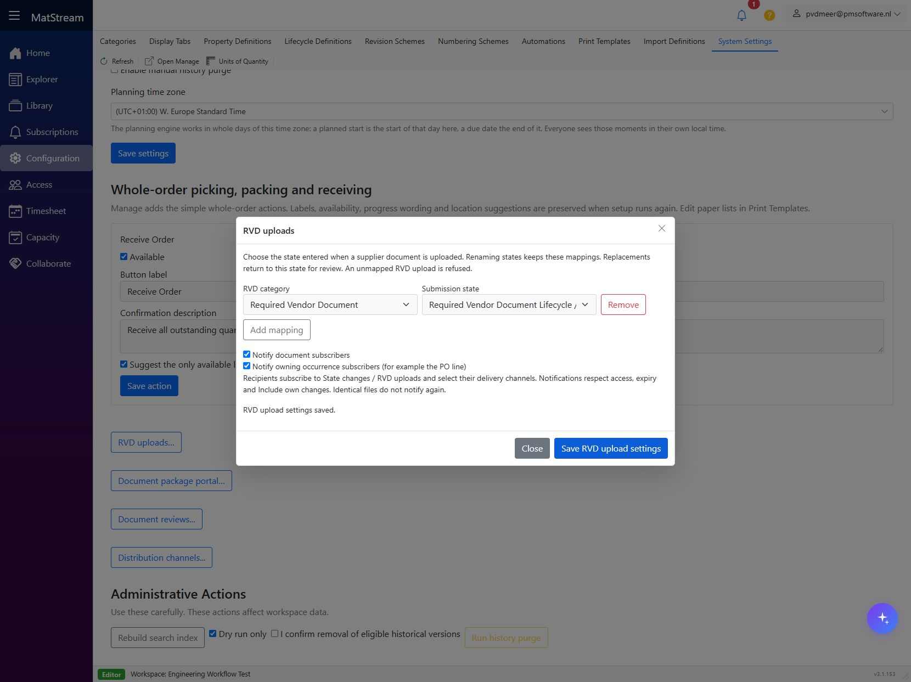

# Supplier — Upload required documents and notify reviewers

The PO line contains the [project-specific RVD checklist](engineering-project-rvd-requirements.md). The supplier uploads its evidence onto these document rows through the existing supplier portal. The Library requirement remains a reusable definition.

## Configure the upload state

A workspace administrator opens **Configuration → System Settings → RVD uploads…**.

1. Choose the **Required Vendor Document** occurrence category.
2. Choose the lifecycle state used when evidence arrives. Setup initially chooses **Required Vendor Document Lifecycle / Submitted**.
3. Leave **Notify document subscribers** enabled to notify watchers of the individual RVD.
4. Leave **Notify owning occurrence subscribers** enabled to notify watchers of the PO line when one of its RVDs is uploaded.
5. Save. A category/state combination from an unassigned lifecycle is rejected.

The mapping stores the state's identity. If the administrator renames **Submitted** to **Vendor evidence received**, uploads continue to use that same state. If the category uses another assigned lifecycle, add a mapping for that lifecycle too. Removing a mapping deliberately prevents new changed-file uploads for that category/lifecycle until a replacement is configured. There is no fallback based on the word “Submitted”.

Setup seeds the mapping and both notification targets, preserving existing settings and administrator changes on reruns. Older workspaces need this setup/configuration before changed-file RVD uploads can succeed. Normal state edit permissions still control whether the supplier may replace an Accepted document; this setting does not grant upload permission.

## Subscribe Quality or other reviewers

Open the PO line or an individual RVD and use the existing **Subscribe** action. Choose **State changes / RVD uploads**, the recipients allowed by your permissions, and the delivery channels. A PO-line subscription receives child upload notifications when the owner target is enabled. It does not automatically subscribe every member of Quality.

For a local self-test, choose your own test account, **In-app**, and **Include own changes**. Otherwise your own upload is intentionally omitted from your subscription. Existing expiry, cancellation and stop-after-first options still apply. Delivery uses the existing bundling window, so a notification may take a few minutes and several changes may be combined.

A version-only subscription still watches normal version-created events. Use **State changes / RVD uploads** for the upload signal, including replacements while the document is already awaiting review.

## Upload and review

1. Open the supplier's existing PO portal share and find the required document row beneath the PO line.
2. Upload the evidence file onto that row. The portal and normal document upload use the same guarded persistence path.
3. MatStream attaches the file, preserves history as appropriate and moves the RVD to the mapped submission state. The file/state update and its upload event commit together.
4. Eligible document and PO-line subscribers receive a **Supplier document uploaded** notification identifying the requirement. They must be able to read both the subscribed record and the document. Document access is checked again before delivery.
5. Quality opens the uploaded evidence and uses the configured lifecycle transitions to accept or reject it. An upload is a request for review, not an acceptance or payment approval.

Replacing a file creates another upload signal even if the RVD is already in the submission state. Uploading an identical stored file is a no-op: it does not create another version or upload signal. Missing or invalid mappings refuse the changed-file upload without changing the document version/state or publishing the upload event.

Accepted can remain read-only for suppliers through the existing lifecycle permissions. Quality can reopen it through an allowed transition before a supplier correction. No new supplier-locking mechanism is introduced here.

## Local verification

The motor and pump PO-line tests used the current test account with in-app subscriptions. A temporarily renamed submission state worked for first evidence and replacement evidence, both document and owning-PO-line subscriptions matched, and event replay created no duplicate hits. Those evidence/subscription probes were rolled back; no sample file was left masquerading as accepted supplier evidence. The administrator dialog was also tested in the browser, including an invalid mapping and a successful save.

The PO documentation result is covered in the next step. The subscription proposal step now covers personal department watches; Payment Milestones and final-completion logic remain separate workflow work.

After uploads and Quality decisions, check [PO-line documentation status](engineering-po-documentation-status.md). It lists the current blockers and accepted count; use Refresh status after changes.

Quality no longer needs to create every watch manually: the seeded [subscription proposal](engineering-subscription-proposals.md) offers the PO-line upload watch after the configured issue transition, subject to each recipient’s own answer.
