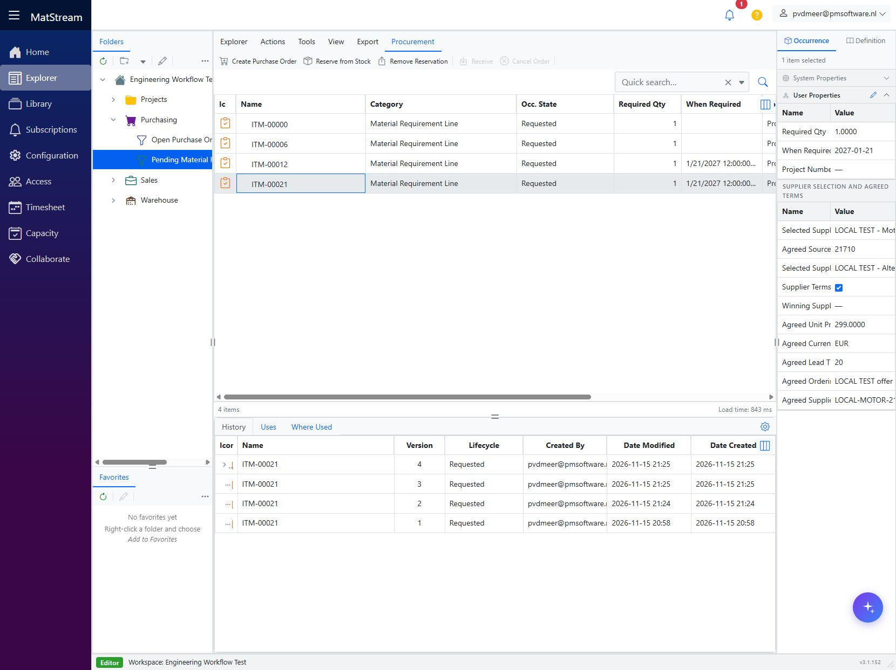
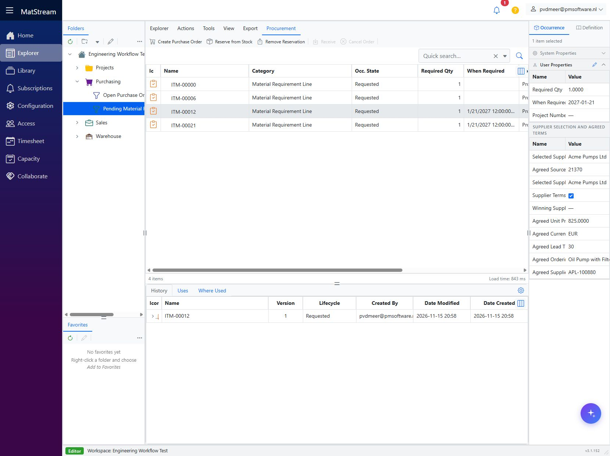
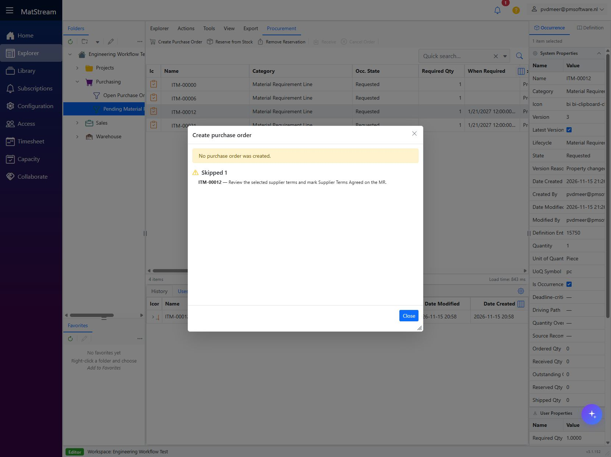
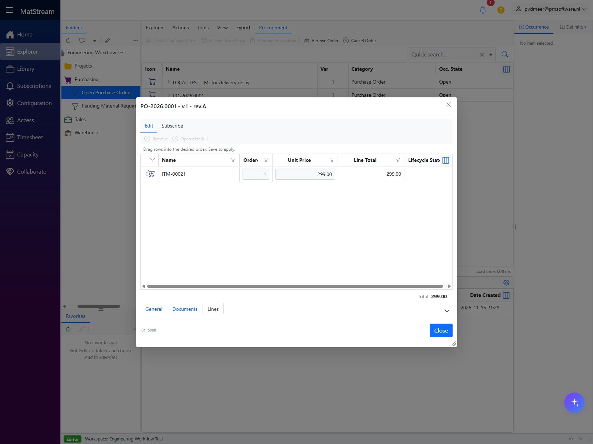
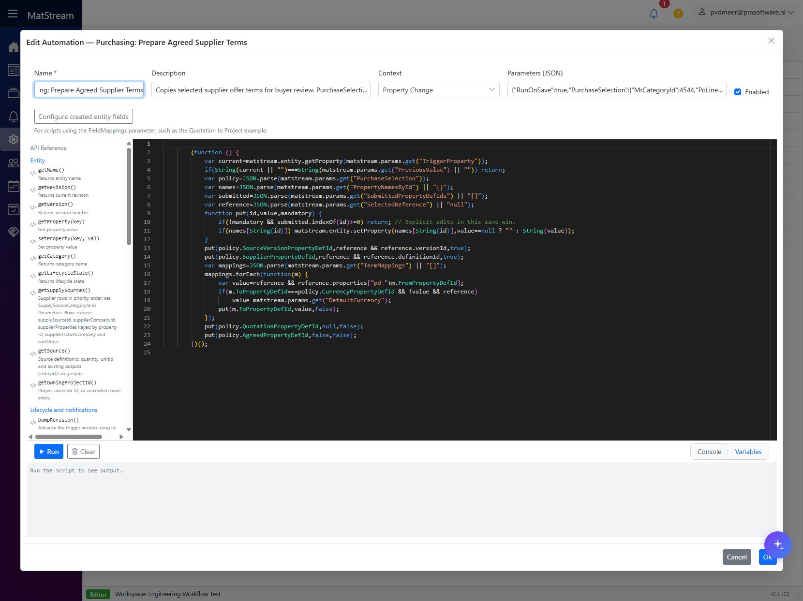

# Purchasing — Select a project supplier and agree terms

Select the supplier **on the project's Material Requirement (MR)**. This keeps the choice specific to that demand; it does not reorder the shared Library supplier list or change another project's agreement.

## Choose the offer and review the terms

1. Complete [Material requirement dates](engineering-material-requirement-dates.md), then open **Purchasing → Pending Material Requirements (MR)**.
2. Select the motor MR. Under **Supplier selection and agreed terms**, double-click **Selected Supplier Source** and choose the offer.
3. The picker searches workspace Supply Source records. Use **Choose columns → Supplier Item Number** to distinguish similarly named offers. The pump's example source is Acme's **APL-100880**. PO creation checks that the source actually belongs to the required item.
4. Save the selection. The configured script copies supplier, offer version, price, currency, lead time, ordering text and supplier item number for review. A source without currency uses the administrator's default, initially EUR.
5. Edit the agreed values to match the negotiation. In this local test, change the motor price from 350 to **299**, and the pump from 875 to **825**. Enter negotiated ordering instructions in **Agreed Ordering Text**.
6. If available, select the winning quotation file in **Winning Supplier Quotation**. It can be an existing accessible file record, including a quotation uploaded under the item's documents. This field is optional in the seed.
7. Review the values and check **Supplier Terms Agreed**. Selecting a different source normally clears the quotation and agreement confirmation and copies the new terms. Explicit values submitted in that same save are preserved. Later edits to other fields do not refresh negotiated values from the catalogue.

The agreement is an ordinary versioned MR record. Workspace category, property and lifecycle permissions determine who can edit it. The checkbox does not introduce a separate approval role.

## Create purchase orders

Select the reviewed MRs and use **Procurement → Create Purchase Order**. MatStream groups them by selected supplier and agreed currency. It uses the MR's agreed price, ordering text and supplier item number and copies the agreement fields to the PO line. Each line retains its MR coverage and a pinned link to the selected offer version. If supplied, the winning quotation's file version at order preparation is also pinned.

An unreviewed MR is skipped with an explanation. An invalid explicit selection is never replaced with the first catalogue supplier.

| Local test item | Supplier | PO | Quantity | Agreed price |
| --- | --- | --- | --- | --- |
| Motor ITM-00021 | LOCAL TEST - Alternate Motor Supplier | PO-2026.0001 | 1 pc | EUR 299 |
| Pump ITM-00012 | Acme Pumps Ltd | PO-2026.0002 | 1 pc | EUR 825 |

After agreeing the motor price, the test changed its catalogue offer to **EUR 399**, creating another offer version. The PO still used **EUR 299** and pinned the original offer version.

These are local Open POs; they have not been issued or emailed to suppliers.

## Administrator configuration

In **Configuration → Automations**, edit **Purchasing: Prepare Agreed Supplier Terms**. The JavaScript and **Parameters (JSON)** are editable in the application:

| Setting | Purpose |
| --- | --- |
| RunOnSave | Copy when the source selection is saved |
| PurchaseSelection.MrCategoryId / PoLineCategoryId | Categories governed by this selection policy |
| PurchaseSelection.*PropertyDefId | MR agreement fields copied to the same mapped fields on the PO line |
| PurchaseSelection.RequireSelection | Initially true: require an explicit source and reviewed terms. False allows legacy first-source selection only when no source was selected |
| ReferencePropertyDefIds | Fields available to the script from the source |
| TermMappings | Source field IDs and the agreement fields receiving them |
| DefaultCurrency | Fallback for a blank source currency; initially EUR |

Choose enabled properties of the expected types and assign them to both configured categories. IDs differ between workspaces; renaming a field does not change its mapping. Keep one policy per MR category. The policy applies wherever that category is used, including other workflows sharing it.

Administrators can configure labels, editors, available currencies, category placement and permissions through existing configuration screens. An invalid or disabled selection policy blocks ordering with a configuration message. Setup installs useful defaults once and preserves later administrator changes.

## Findings for the next workflow test

Both MRs became **Ordered**, and the POs have the correct supplier, quantity, unit, commercial values and offer pins. The lifecycle-switch warning found in that first test has since been fixed and retested: see [Hand ordered requirements to project procurement](engineering-procurement-handover.md). The motor and pump project positions now both show Procurement Lifecycle / Ordered.

This step does not resolve project-specific RVD additions/exclusions flowing to PO placeholders, MR When Required flowing to the PO line, or payment milestones. Agreed lead time is recorded on the MR and PO line; it does not automatically change project planning or populate Promised Delivery. Review those dates separately.
