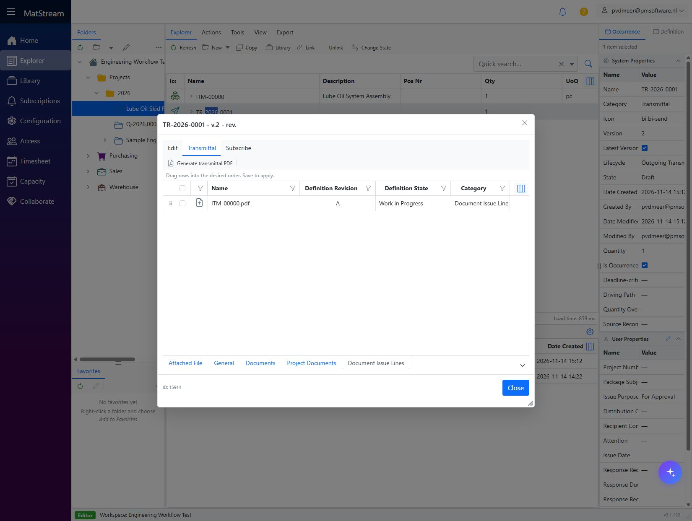
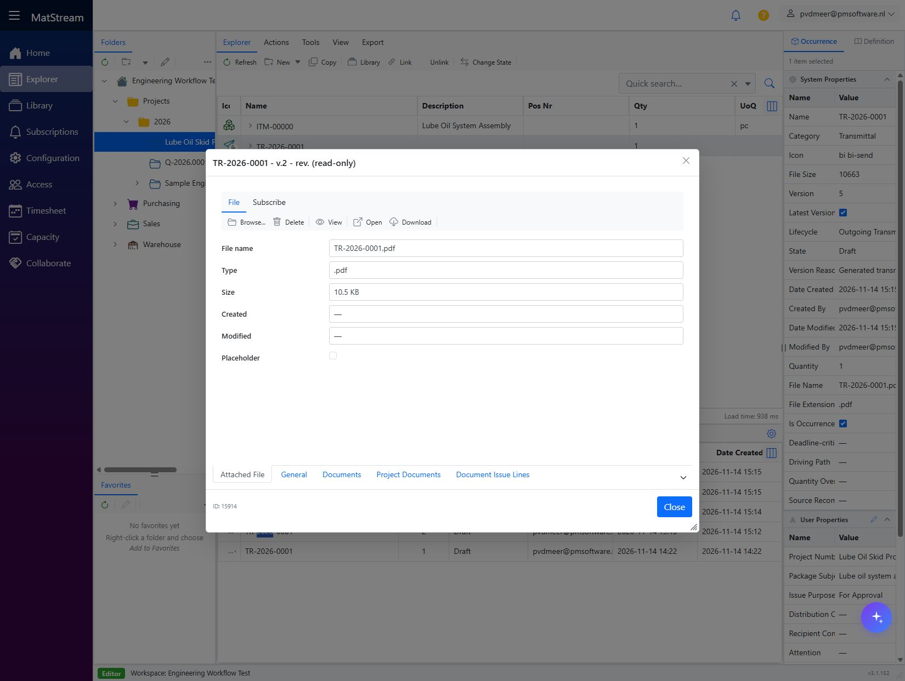
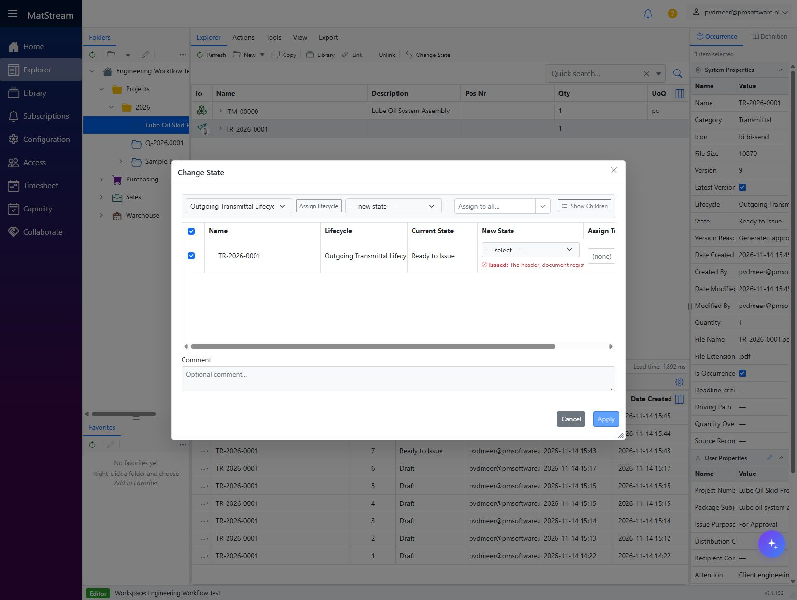
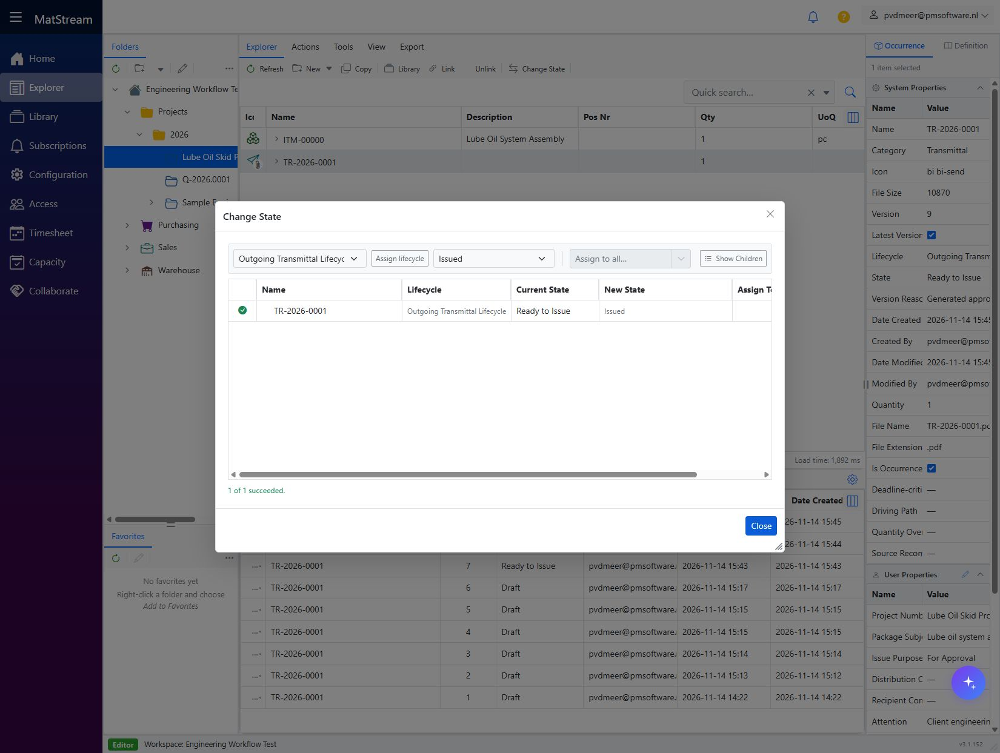
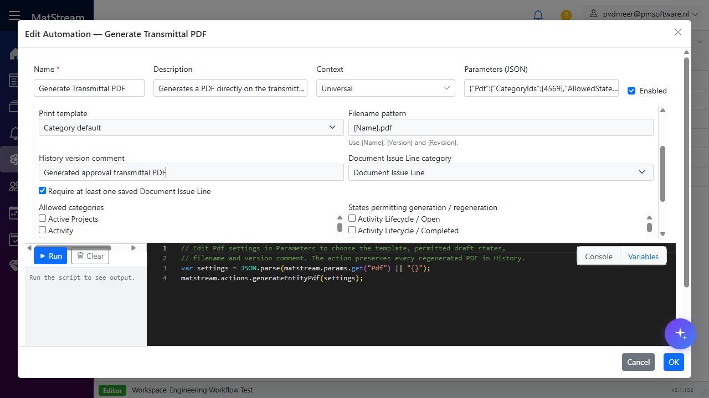
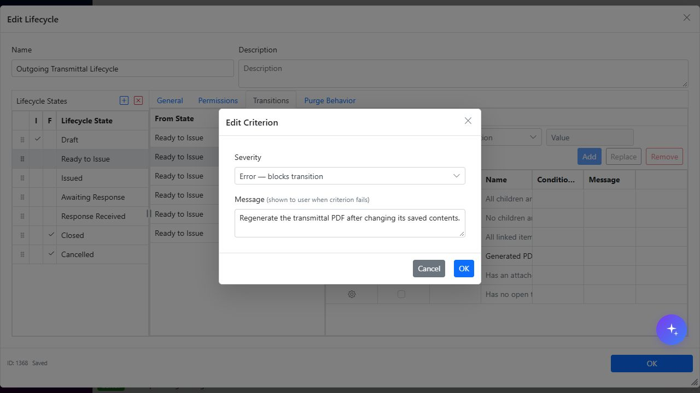

# Engineering — Generate the transmittal PDF

Use the saved Transmittal and its Document Issue Lines to generate the covering PDF. The file belongs directly to the Transmittal record.

!!! note "Local workflow test"
    Tested locally on 14 November 2026 in Engineering Workflow Test. TR-2026-0001 was first tested through version 6, then exercised with the consistency check and issued locally at version 11. Recipient and date completeness was not part of this test; no client sharing was performed.

## Generate the first PDF

1. Complete and save the Transmittal header: subject, [Distribution Channel Reference](engineering-distribution-channels.md), [Document Project reference](engineering-transmittal-project-reference.md), recipient, purpose (for example **For Approval**) and response due date.
2. Review the saved drawing selections in **Document Issue Lines**. For this example, include **ITM-00000.pdf**.
3. On that tab, open the **Transmittal** ribbon and choose **Generate transmittal PDF**. No row selection is needed: the button runs on the open Transmittal.
4. Open the attached PDF and check its header and document register before issuing the package.

The updated seeded template includes the selected channel's organisation, department, contact person, multiline delivery address and phone. See [distribution-channel print mappings](engineering-distribution-channels.md#administrator-map-the-channel-details-onto-the-covering-pdf) for the administrator settings and a generated example. Update the channel record, save it and regenerate the cover when a printed contact/address changes.

Save any pending changes first. Generating the PDF does not issue the package or share it with the client.




## Correct and regenerate before release

For example, correct the recipient's attention or the subject, save, and generate again. The first PDF is attached to the current empty version. Every subsequent generation creates a new version, including when the template produces identical PDF bytes. **History** retains the earlier file and its generation comment.

If generation or attachment fails, the preceding version and file remain intact. If another user changes the Transmittal, reopen and review it before trying again. Generation is restricted to the preparation states selected by the administrator; the seeded choices are **Draft** and **Ready to Issue**. An issued package needs the revision/reissue process.

In Explorer, use **Open details** from the context menu to edit a file-backed Transmittal. Double-clicking its main row opens the PDF. The History tab opens an earlier version's details. Reload Explorer if its already-open History tab has not refreshed after generation.



## Check the PDF before issuing

After reviewing the header and document register, move the Transmittal to **Ready to Issue**, then generate its PDF. Moving from Draft changes the status printed by the template, so generate again in Ready to Issue.

Choose **Change State → Issued**. The **Generated PDF matches saved contents** criterion checks the attached file against the saved content used to generate it.

For example, generate the covering PDF, then correct **Attention**. Issuing is now blocked with a message asking you to generate again. Adding or removing a drawing, changing its selected version, editing issue-line information, or changing the template also requires regeneration. Merely uploading a PDF manually does not establish generation evidence. Older PDFs generated before this check was installed need regenerating once.



Regenerate from **Document Issue Lines → Transmittal → Generate transmittal PDF**, review the new PDF and try Issue again. A blocked check leaves the Transmittal state unchanged. The server checks again during the state change, so an earlier successful preview cannot bypass a later saved edit.



This is a consistency check, not a check that the recipient, dates or technical content are correct. Configure separate required-field criteria for your workspace's issue requirements. Issuing does not share anything with the client; continue with [sharing the issued package](engineering-transmittal-portal.md).

## Workspace administrator configuration

Open **Configuration → Automations → Generate Transmittal PDF**. The automation is an editable Universal script. Its **Pdf** parameters have a settings editor:

| Setting | Starting choice |
|---|---|
| Allowed categories | Transmittal |
| Allowed lifecycle states | Draft and Ready to Issue |
| Print template | Category default |
| Filename | `{Name}.pdf` |
| History comment | Generated transmittal PDF |
| Issue line category | Document Issue Line |
| Require saved issue lines | Enabled |

Assign and edit the default template under **Configuration → Print Templates** and its category assignments. Use the template's data map to configure header fields and the saved issue register. An explicitly selected template must also be active and assigned to the category. Filename tokens are `{Name}`, `{Version}` and `{Revision}`.

The Transmittal category must allow a file directly on the record (**AllowDirect**). New Document Control setups seed this policy. For an existing workspace, review and enable it in the category editor; Setup does not replace an administrator's existing category choice.

In **Display Tabs → Transmittal Document Issue Lines → Ribbons**, the button action is **Run automation** with **Run on the opened record (not selected rows)** enabled. Administrators can change its label, placement and automation assignment. Existing entity, category-tab and file permissions still apply; the script also checks read access to the saved issue lines and their documents.



The local test changed the history comment to **Generated approval transmittal PDF** through this editor and verified that the next generated version used it.

The script uses:

```javascript
var settings = JSON.parse(matstream.params.get("Pdf") || "{}");
matstream.actions.generateEntityPdf(settings);
```

This action runs alone in a script, outside an atomic lifecycle transition. Script preview records the requested action without generating a file. Document Control Setup installs defaults once and preserves later administrator changes or deliberate removal on rerun.

### Configure the blocking issue criterion

Open **Configuration → Lifecycle Definitions → Outgoing Transmittal Lifecycle → Edit**. Select the source state, then **Transitions → Issued → Criteria**. Enable **Generated PDF matches saved contents**. Double-click the enabled row to configure **Severity** and the failure **Message**. Keep **Error** to block issuance; **Warning** permits the transition. Leave Message empty to show the detailed reason supplied by MatStream.



The local test saved custom wording through this editor while keeping Error severity.

Document Control Setup enables the check as an Error on every existing enabled transition into Issued, including alternative routes. Existing criteria are preserved, and later administrator changes or deliberate removal are retained on Setup reruns. Administrators adding a new route into Issued must enable the check on that route too.

The generation automation remains an editable script. The blocking criterion runs before the state change because ordinary transition automations run afterwards and cannot prevent issuance. Generation stores server-owned evidence; users cannot satisfy the check by changing a normal property.

Continue with [sharing the issued Transmittal](engineering-transmittal-portal.md), then the client response steps in the [Engineering Project Workflow](engineering-project/index.md).
