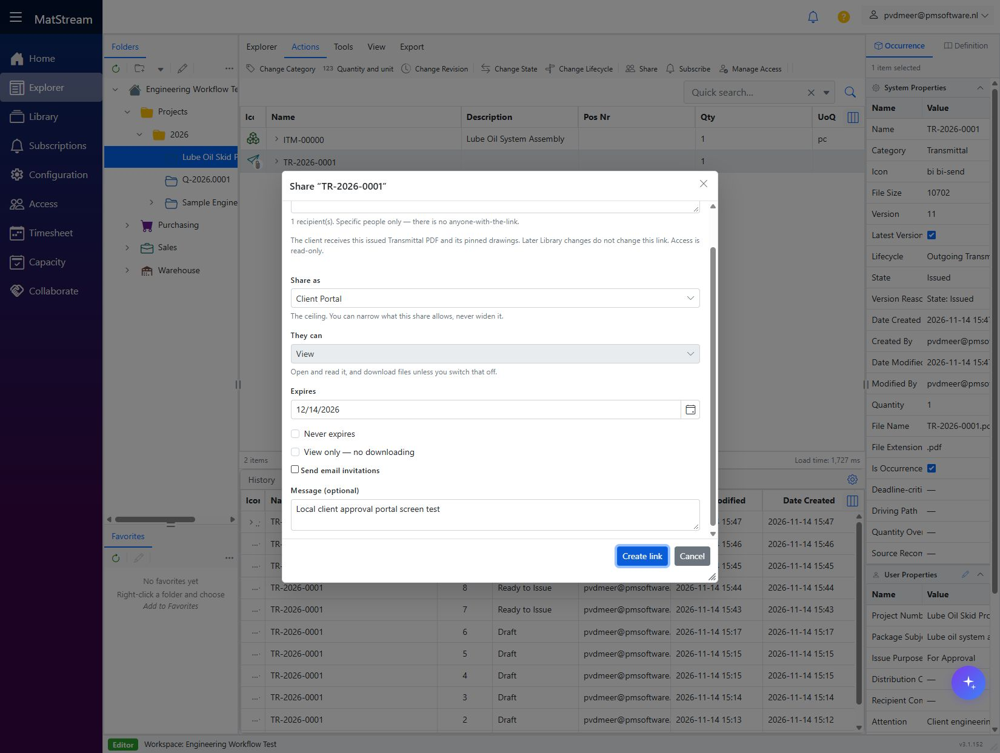
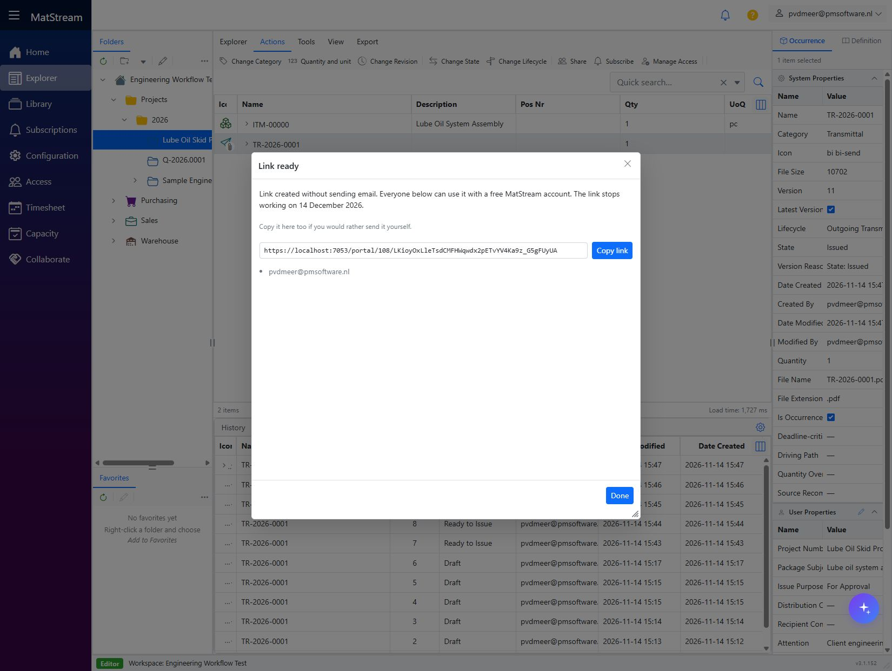
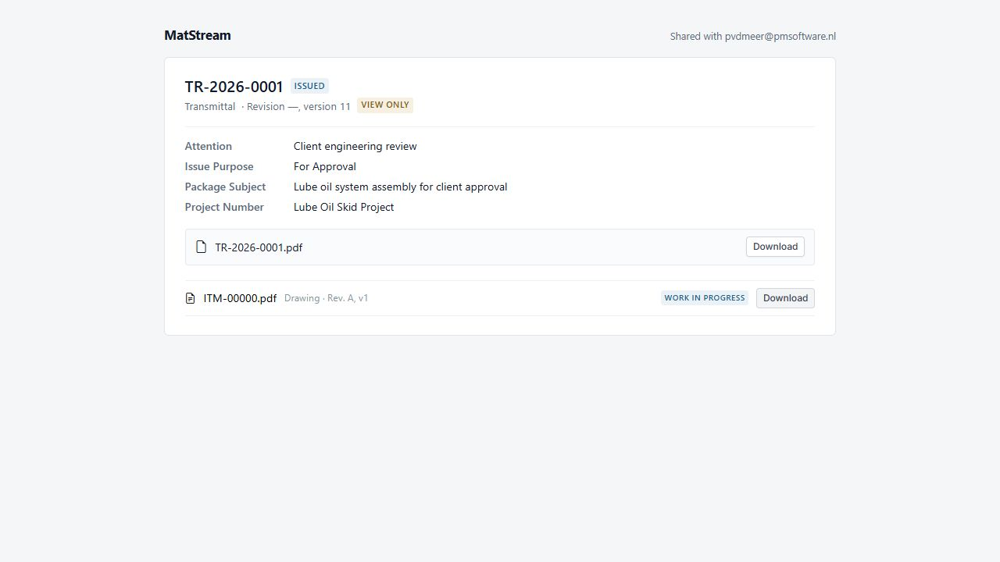
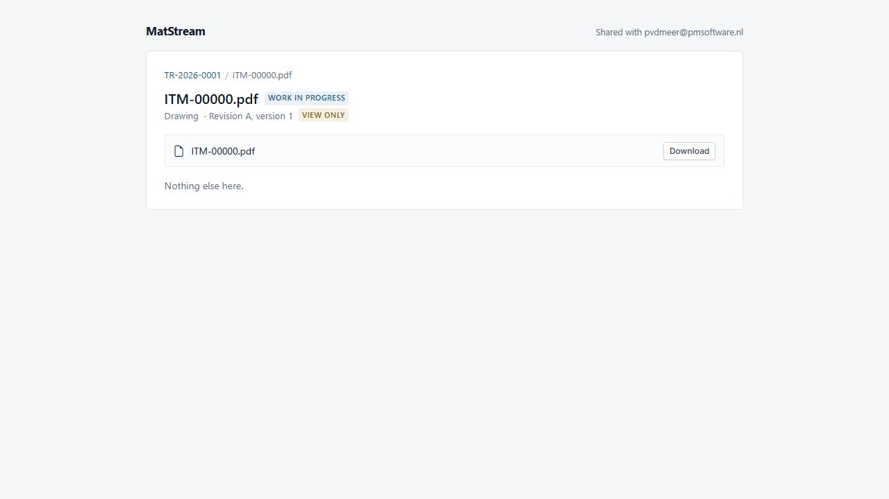
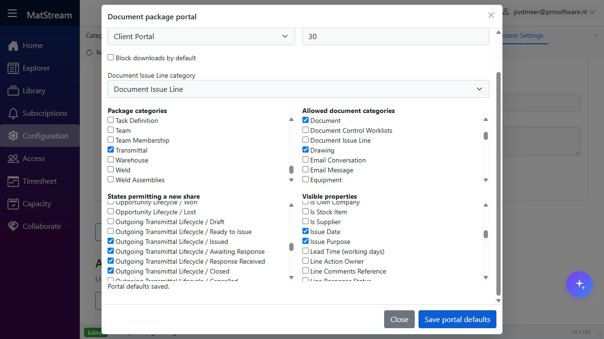

# Engineering — Share the issued transmittal

Share **TR-2026-0001** with the client so they can download the transmittal PDF and **ITM-00000.pdf** at its selected revision. The portal uses a fixed issued package: later Library changes or a later transmittal issue do not replace the files behind this link.

!!! note "Local workflow test"
    Tested locally on 14 November 2026 in Engineering Workflow Test. TR-2026-0001 version 11 was shared only with the current test account, with email invitations disabled. Client review responses are tested in the next step.

Use a [Distribution Channel record](engineering-distribution-channels.md) to supply client contact emails or internal department recipients. Review the resolved recipients before sending. Internal-only channels notify existing workspace users without creating portal access.

## Prepare the package

1. Complete the header and saved Document Issue Lines.
2. Move to **Ready to Issue**, generate the PDF, review it and choose **Issued**. The [PDF consistency check](engineering-transmittal-pdf.md#check-the-pdf-before-issuing) must pass.
3. Select the Transmittal in Explorer, open **Actions → Share**.

Keep **Pin displayed versions when added** enabled in Project Documents, or explicitly pin the issue lines before generating the PDF.

A package can be shared only in the states configured by the workspace administrator. Every line must reference a pinned document version with an available file in an allowed document category. Missing files, unpinned lines and changes since PDF generation produce an error instead of a partial or live package.

## Create the client link

1. Enter the client's exact email address. The recipient signs in with that address; forwarding the link does not give someone else access.
2. Review **Share as**, expiry and the download choice. The seeded group is **Client Portal**, and access to issued originals is **View only**.
3. Add an optional message.
4. Leave **Send email invitations** checked to request invitation emails. For local tests, clear it: you can create and copy the link without sending an email.
5. Create the share and copy the resulting link if needed.

The share captures the PDF, selected drawing versions and permitted properties together with its recipients in one transaction. If capturing the package fails, no incomplete share is created.

The share's external group still limits access. An administrator must enable that group for external sharing and grant Entity Read and File Read; a sharer needs Share Create and read access to the package and its documents. Giving an external group additional edit grants does not make issued package originals editable through this portal.

## What the client sees

The portal shows the shared Transmittal, its PDF and the selected drawing list. The drawing rows show the selected revision and version. The client can open a drawing's details and download its file when downloads are allowed.

For example, this issue contains **ITM-00000.pdf revision A, version 1**. Engineering later creates revision B in the Library. The existing client link continues to show and download revision A. It does not open the Library or expose unrelated project documents.

Revision and version labels are MatStream metadata. Engineering must also check the revision printed inside the PDF; the supplied sample drawing retains its original title-block revision.

Uploading commented drawings is a separate response workflow; this share does not permit replacing issued originals.

## Reissue, recipients and withdrawal

Use **Manage Access** to add a named recipient to an existing issued share when they should receive that same package. Expiry, recipient removal and revocation continue to apply to every request.

A new issue needs a new PDF, review and issue, then a new share. Existing links keep their original package. If the saved package has changed since its PDF was generated, creating another share is refused; regenerate/reissue or use the existing issued share as appropriate.

Existing shares on a configured document-package category that predate this feature have no fixed package and cannot fall back to current Library content. Create a new share after reviewing the issue.

## Workspace administrator configuration

Open **Configuration → System Settings → Document package portal…**. This opens a separate settings dialog.

| Setting | Seeded choice |
|---|---|
| Package categories | Transmittal |
| States permitting a new share | Issued, Awaiting Response, Response Received and Closed |
| Document Issue Line category | Document Issue Line |
| Allowed document categories | Drawing, Document and Controlled Document, where installed |
| Visible properties | Document Project, Package Subject, Issue Purpose, Attention, Issue Date and Response Due |
| Default external group | Client Portal |
| Default expiry | 30 days |
| Block downloads by default | Off |

The local screen test changed expiry to 45 days, saved and reopened the dialog, then restored 30 days. Existing links kept their original expiry.

These defaults apply to new shares. Existing shares retain their captured files and fields; later visibility restrictions on a share can narrow that captured information. Adding a property to the workspace defaults does not expose it through an old link. To remove existing access, update or revoke the share in Manage Access.

Document Control Setup seeds the settings and a read-only Client Portal ceiling group once. Subsequent administrator changes and deliberate removal are preserved on Setup reruns. Group grants and who can share are configured in the existing Access permissions UI.

Files used by a fixed package are retained by file cleanup, without making duplicate copies of the PDFs. Revoking a link stops recipient access; it does not erase the package's audit evidence.

Continue with [Client — Review and return commented PDFs](engineering-transmittal-review.md).

The later [project reference fix](engineering-transmittal-project-reference.md) changes the default project field for new shares to Document Project. The earlier screenshots and existing shares retain their captured fields.
