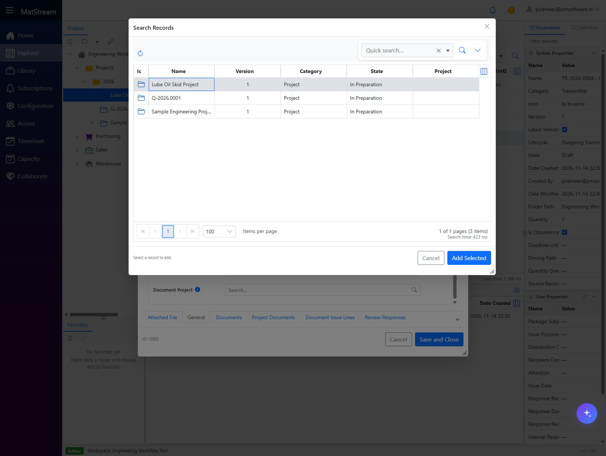
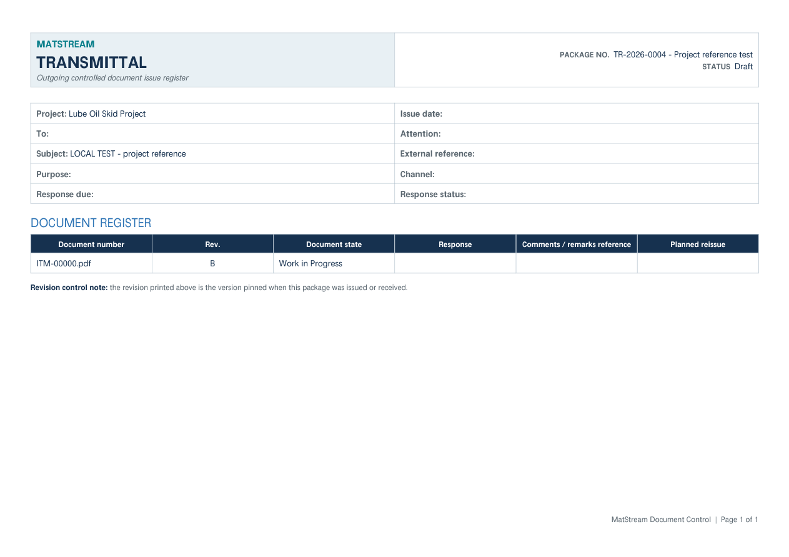
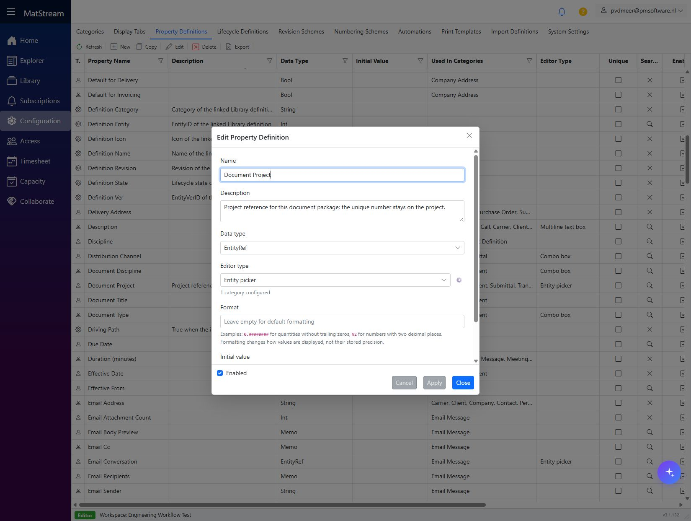
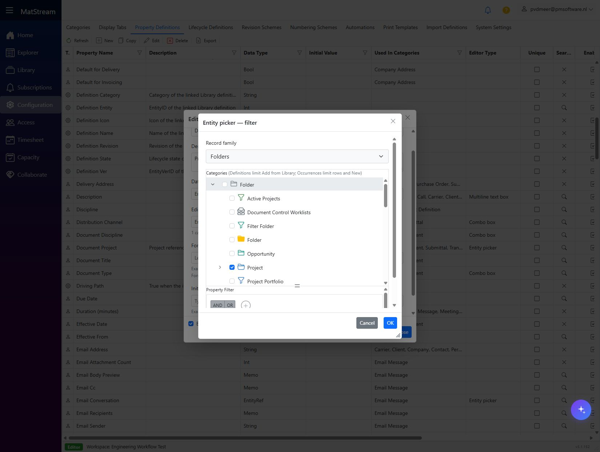
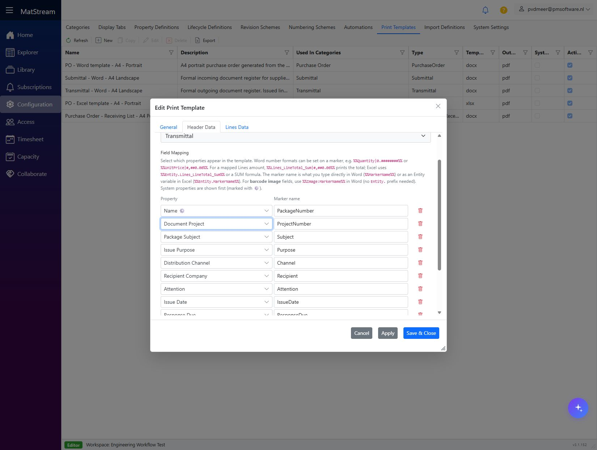

# Engineering — Select the transmittal's project

A project can have several transmittals. For example, **TR-2026-0004** and **TR-2026-0005** both refer to **Lube Oil Skid Project**. Each transmittal stores a **Document Project** reference. The project's unique **Project Number** stays on the project.

## Select the project

1. Open the draft Transmittal and its **General** tab.
2. At **Document Project**, choose **Search Library**. The configured picker searches project folders despite this button's general label.
3. Select **Lube Oil Skid Project**, confirm, then save the Transmittal.
4. Reopen it and check the saved project before generating the PDF.

The reference can be reused on another transmittal. It does not copy the project's unique number.

Choose the same project as the transmittal's containing project. This header reference does not move the transmittal or change the scope of **Project Documents**; that tab continues to use the containing project.

## Check the generated PDF

Generate the PDF using the [transmittal PDF action](engineering-transmittal-pdf.md). The default **Project:** header displays the referenced project's **name**, such as **Lube Oil Skid Project**. It does not automatically retrieve that project's Project Number property.

Changing the saved project reference or renaming its project makes a draft's generated PDF stale. Regenerate and review it before issuing or creating a new share. Existing portal shares retain their captured package.

## Workspace administrator settings

In **Configuration → Property Definitions**, edit **Document Project**. Its default data type is **EntityRef**, editor **EntityPicker**, with **Unique** cleared. Keep **Project Number** unique on the project.

Open the editor settings to configure the picker family, allowed project categories and filter. The seeded picker uses **Folders** and categories with Project behavior. Administrators can maintain the property name, description and category assignments through the existing configuration screens.

In **Categories**, assign Document Project to the applicable document categories. Remove the legacy Project Number assignment from their forms. Historical values and previously generated PDFs are retained.

In **Print Templates → Transmittal / Submittal → Header Data**, map **Document Project** to the template's project marker. The supplied template retains the marker name **ProjectNumber** and the visible label **Project:**. That marker is a template token; it does not require using the unique Project Number property. Template mappings and labels remain editable.

Under **System Settings → Document package portal**, choose the visible properties for new shares. New Document Control defaults include Document Project. Existing shares keep their captured fields.

New Document Control setup seeds this reference and assignments for Controlled Document, Transmittal and Submittal. Installed references and assignments are marked so a rerun preserves administrator edits and deliberate removals. Existing template customizations are retained; update their mapping explicitly through Print Templates when adopting the reference.

!!! note "Local workflow test — 14 November 2026"
    Both test transmittals saved and reopened at version 2 referencing the same project. TR-2026-0004 generated the illustrated PDF with ITM-00000.pdf B/version 5. Both remain Draft; neither was shared. Separate checks confirmed Project Number uniqueness still rejects duplicate project numbers and that a project rename invalidates the draft PDF. Earlier issued packages and their pinned files were unchanged.

Continue with [selecting transmittal documents](engineering-project-documents.md).
