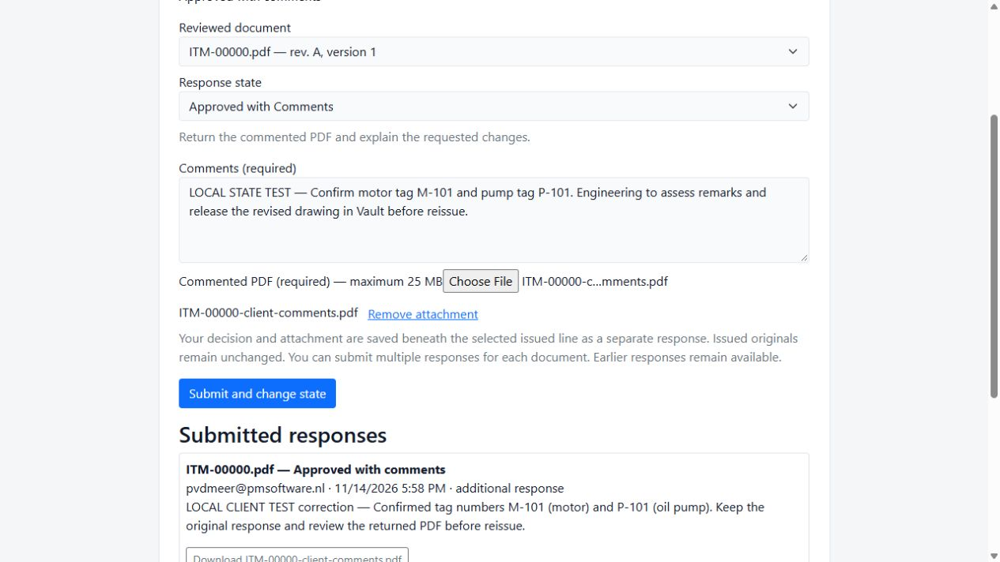
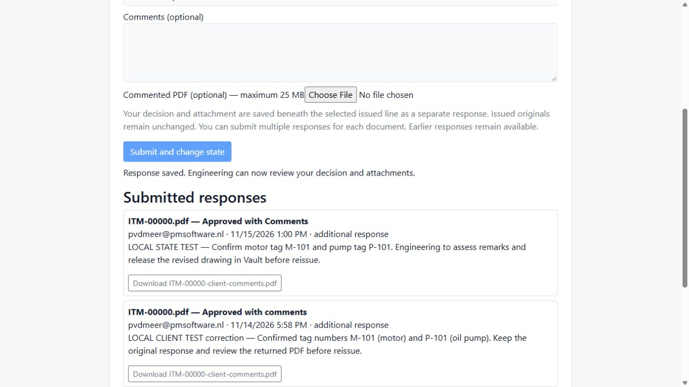
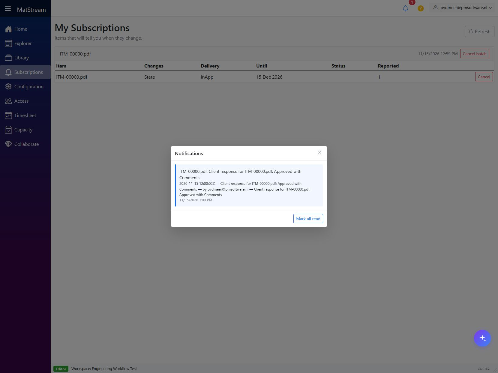
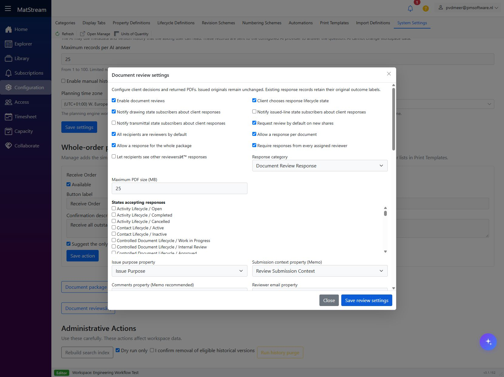

# Client — Review and return commented PDFs

The client returns remarks against an issued drawing and chooses the **response lifecycle state**. The returned PDF is attached to a separate Document Review Response beneath that issued line. The original drawing and covering PDF remain unchanged.

## Engineer — request review and subscribe

1. [Issue and share the transmittal](engineering-transmittal-portal.md) with purpose **For Approval**. Enable **Request review responses** and select the named reviewers.
2. Before the client responds, open **ITM-00000.pdf → Open details → Attached File → Subscribe → Subscribe**.
3. Select **State changes** and the notification channels you need. Review expiry and save.
4. For the local demonstration, select **In app** only, clear Email and Task, and enable **Also report my own changes** because one account acts as both engineer and client. With separate accounts, that option is usually unnecessary.

The administrator controls whether client response events reach subscribers to the drawing, the issued document line or the Transmittal. The default is drawing subscribers. Subscriptions continue to respect expiry, own-change choices and read access. Subscribe to an issued line or Transmittal instead when your workspace uses that scope.

A review-enabled share and the external group's **Document Review Submit** grant are required. A download-only link cannot submit responses. The client also needs explicit permission for the response lifecycle transition; ordinary workspace membership does not expand the share's client permissions.

## Client — return the PDF and change the response state

1. Open the portal link using the invited account.
2. Open the drawing row and download its issued PDF. Check the displayed revision and version.
3. Add the remarks in your PDF application.
4. In **Document responses**, confirm the reviewed document and choose **Response state**.
5. Attach the commented PDF and enter the required comments. Choose **Submit and change state**.
6. Check **Response saved** and the new entry under **Submitted responses**.

| Seeded response state | Default requirements |
| --- | --- |
| Approved | Comments and PDF optional |
| Approved with Comments | Comments and commented PDF required |
| Revise and Resubmit | Comments and commented PDF required |

These are real response lifecycle states. The portal obtains their names from the lifecycle and only offers enabled transitions the share's external group may perform from the response's initial state. A separate Review Outcome property is not needed for this mode.

For our example, the client returns remarks requesting motor tag M-101 and oil-pump tag P-101. Saving creates the response, attaches its PDF and changes its state together. Missing evidence, lost transition permission or a blocking lifecycle criterion prevents the submission from being saved. No partial response is left behind.

One PDF is supported per response, with a configurable size limit. If package responses are enabled, the client may select Whole package. Otherwise return each PDF against its drawing. An additional or corrected submission creates another response and preserves earlier evidence. Retrying an identical submission does not create another response or notification event.

The response retains the issued package, drawing version and original file identity. Later Library revisions do not change what the client reviewed. The decision shown on a saved response records the client's submitted state; subsequent internal handling states do not rewrite that decision. The share's progress banner reports response receipt in direct-state mode; read each submitted response for its actual client decision.

## Engineer — receive the notification and act on remarks

The subscribed engineer or document controller receives the response-state notification through the selected channels. Normal background processing and subscription bundling apply, so delivery can take a few minutes.

Open the Transmittal's **Review Responses** register, or inspect the responses beneath its issued drawing line. Use **Choose columns** to include **State**, reviewer and submission date. Open the response to read the comments and returned PDF.

Consult the Lead Engineer or Project Manager about the required changes. Update Inventor, obtain engineering review and approval, and set the drawing to **Released in Vault**. Upload the new revision into the existing MatStream drawing record, then [distribute replacement transmittals](engineering-reissue-drawings.md) to Client, Work Preparation and Purchasing as applicable.

Resolution ownership, disposition and checking fields remain available for traceability. They do not create a second compulsory technical release process in MatStream. Transition permissions and history establish accountability; the application does not require a different checker from the author.

## Workspace administrator — configuration

Under **Configuration → Lifecycle Definitions**, open the lifecycle assigned to the response category:

- Maintain response state names and descriptions.
- Enable the intended transitions from the initial state and grant the share's external group permission on each client choice. No explicit client permission means the portal does not offer that transition.
- Configure transition criteria and internal handling routes. A client result does not grant modification of the source drawing or issue package.
- Attach any follow-up library scripts through the existing transition Automations settings. These execute from the committed event through the automation runner; failures appear in automation/event history and do not undo an already saved response.

Under **Configuration → System Settings → Document reviews**, enable **Client chooses response lifecycle state**. Configure:

| Setting | Purpose |
| --- | --- |
| Response category and property mappings | Returned PDF category, comments, reviewer, submitted date, reviewed document and submission context |
| State requirements | Required comments, PDF and instructions for each response state |
| Subscriber notification scope | Drawing, issued-line and/or Transmittal state subscribers |
| Accepting states and purposes | When the issued Transmittal accepts responses |
| Review scope and visibility | Per-document/package responses, reviewer policy and access to other reviewers' responses |
| Size, naming and wording | PDF limit, response name pattern and progress labels |
| Optional notification group | Additional in-app group notification; leave empty for subscription-only delivery |

State requirements must refer to the response category's lifecycle. Subscription delivery also checks the subscriber can read the response; it does not disclose a response merely because someone can read the source drawing. Avoid enabling a group fallback and subscriptions for the same recipients unless both notifications are intended.

Names support `{Package}`, `{Document}`, `{Outcome}` and `{Reviewer}`; in direct-state mode Outcome means the submitted state name. The earlier outcome-property mode remains available for existing configurations. Existing response records retain their original fields and decision wording.

Document Control Setup adds useful state/permission/attachment defaults and enables direct-state responses on fresh installations. Its installation marker preserves later administrator changes and deliberate removals. Existing explicit settings are retained when adopting the feature; administrators can enable the direct-state option through the UI. No database schema change is needed.

!!! note "Local workflow test — 15 November 2026"
    Used Engineering Workflow Test and the current account, with email and task delivery off. A subscription was saved before the client returned the PDF. Missing PDF blocked submission; the completed response saved as Approved with Comments. Dispatching the same event twice retained one hit, and one in-app notification was delivered. Administrator notification-scope changes persisted after reopening and were restored to drawing-only. Original issued A/version 1, current Library B/version 5 and earlier replacement packages were unchanged. This does not certify technical approval or a Vault release.

Continue with [Engineering — Resolve client comments and link the reissue](engineering-comment-resolution.md).
