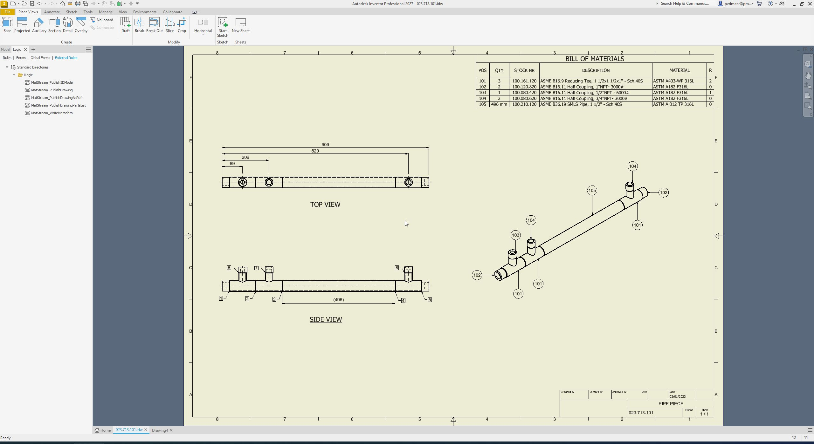
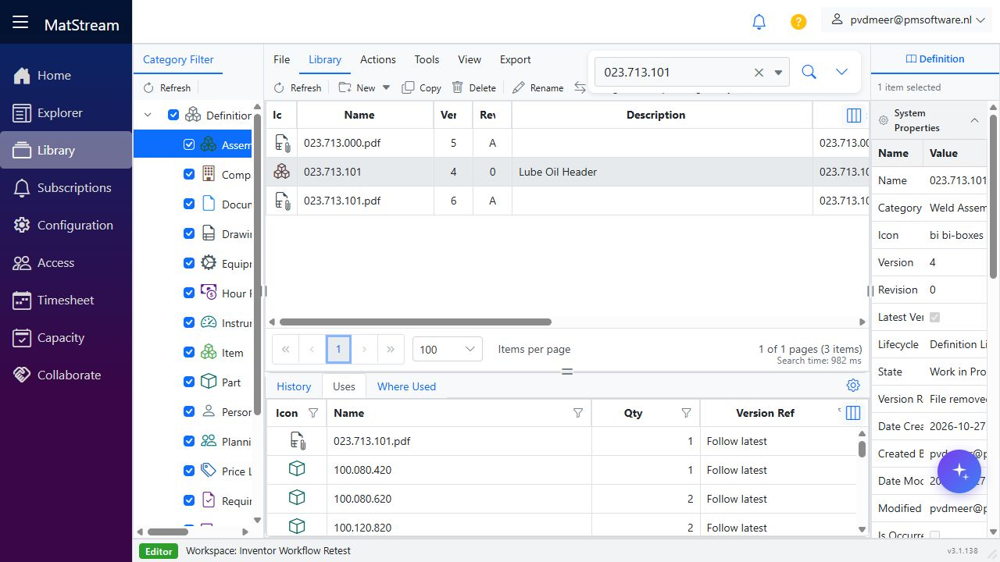
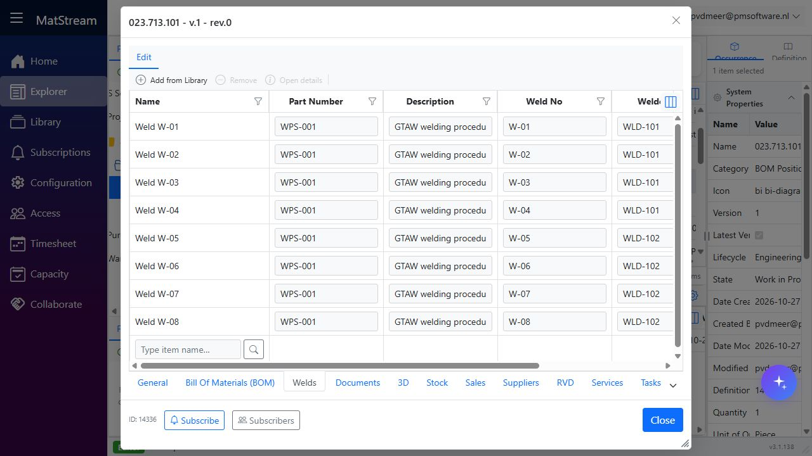
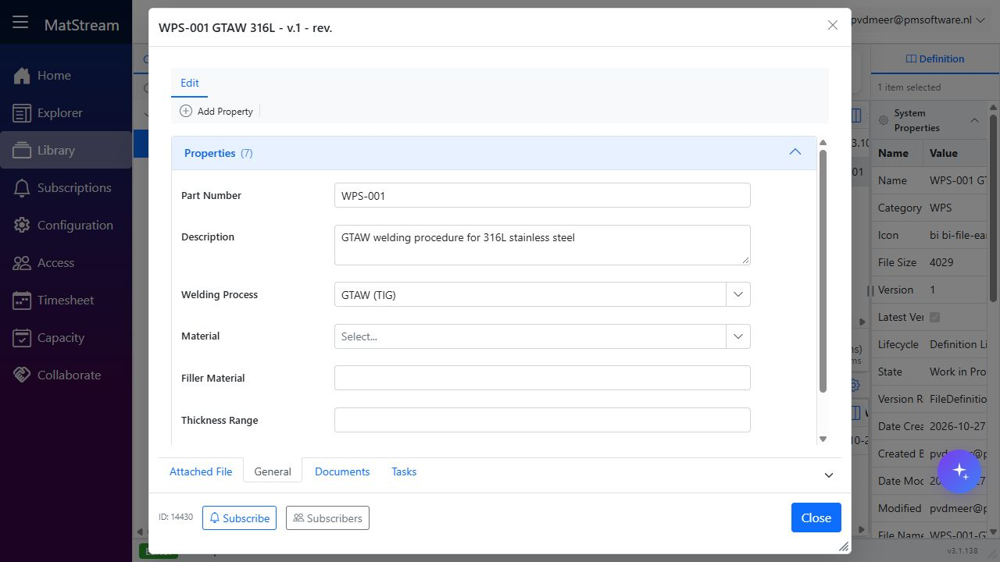
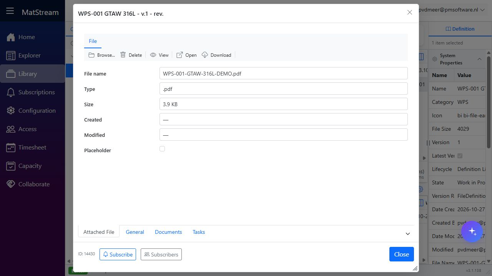
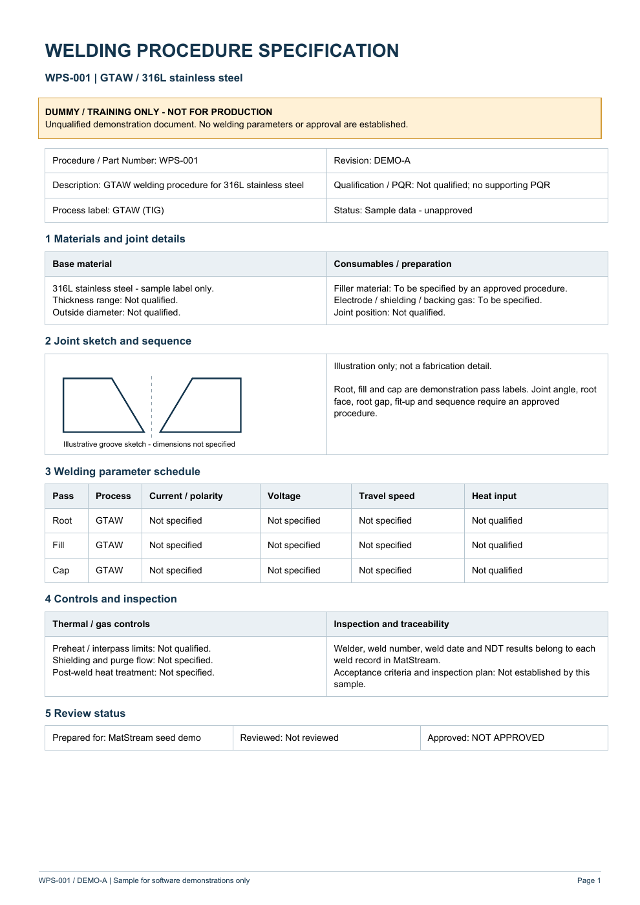

# Inventor workflow: create an assembly and send its BOM to MatStream

Build an assembly in Autodesk Inventor using existing fittings and a newly created part. Enter the information in Inventor, create an assembly drawing with a parts list, and publish the drawing and BOM to MatStream using the existing iLogic rules.

**Flow:** Create the assembly → Add existing fittings → Create a new part → Fill in properties → Create the drawing and parts list → Publish with iLogic → Check MatStream.

## Before you start

- Have the Inventor files for the existing fittings available, together with their MatStream part numbers.
- Start **MatStreamConnect** at least once and sign in to the intended workspace.
- Have the existing external iLogic rules available in Inventor, including `MatStream_PublishDrawing` and its supporting rules.
- Confirm that the **Inventor Main Item** and **Inventor Parts List** Import Definitions are configured. If your rules use different profile names, those names must match your Import Definitions.
- Check which properties and parts-list columns your workspace requires, and make sure the target drawing can have its BOM edited in its current lifecycle state.

If you also seed **Engineering Project Sample Data**, finish that setup before publishing. The sample catalogue includes `023.713.101` as a **Weld Assembly**. For that sample, configure the main-item profile to use **Weld Assembly** so the existing engineering item remains the BOM parent. The PDF is published as a separate **Drawing** entity named `023.713.101.pdf` and linked under that parent. Do not create another Drawing named `023.713.101` without the extension.

The sample also includes a drawing document named `023.713.101.pdf` with the same Part Number. To publish to the assembly, map the metadata source `Part Number` to **Name** as the search key in both the main-item profile and the BOM profile's **Parent Item** configuration. Keep a separate field mapping to the Part Number property. This distinguishes the assembly's Name (`023.713.101`) from the drawing document's Name (`023.713.101.pdf`).

For installation, rule setup, and field mappings, see [Inventor BOM import](../integrations/inventor-bom.md) and [MatStreamConnect](../integrations/matstream-connect.md).

### Settings verified with the engineering sample

The local test used the existing drawing **023.713.101.idw** and its five-row parts list. The assembly-building steps below describe a separate example with elbows, flanges, and a new pipe; use the following settings when repeating the tested drawing publication.

1. In **Manage → Setup Wizard**, apply **Engineering Project Configuration**, **Engineering Project Sample Data**, and **Autodesk Inventor / MatStreamConnect** under Integrations. Wait for setup to finish.
2. Open the intended workspace in MatStream. In **Configuration → Import Definitions**, edit the two seeded profiles using the settings below. Existing profiles are skipped when setup is rerun, so check their mappings explicitly.
3. In **MatStreamConnect**, sign in to that same workspace. For local testing, use your local MatStream address and workspace slug; verify the connected workspace name before publishing. The completed test used `https://localhost:7053/w/geob0d`.
4. In Inventor, make the saved drawing active and confirm that the installed rules use the profile names shown below.

| Profile setting | Inventor Main Item | Inventor Parts List |
|---|---|---|
| Configuration | Main Item | Children from Excel |
| Source | Metadata | Excel |
| Target category | Weld Assembly for this sample | Existing parent located from metadata |
| Default child category | Not applicable | Part |
| Default link category | Not applicable | Leave empty; link Library parts directly |
| Header / first data row | Not applicable to metadata | 1 / 2 |
| Parent search key | Metadata `Part Number` → system field **Name** | **Parent Item**: metadata `Part Number` → system field **Name** |

Keep the main-item field mappings `Part Number` → **Part Number**, `Description` → **Description**, and `Company` → **Manufacturer**. The Name search key and Part Number property mapping are separate mappings.

On the **Parts List (BOM)** configuration, use these source headings exactly:

| Excel source | Mapping | Target |
|---|---|---|
| `STOCK NR` | Child search key | System field **Name** |
| `STOCK NR` | Field | **Part Number** property |
| `DESCRIPTION` | Field | **Description** property |
| `QTY` | Link quantity | **Qty** |
| `MATERIAL` | Field | **Material** property |

Leave `POS` (or `ITEM`) and `R` unmapped in this tested configuration. Apply and save the profile changes before publishing.

The installed PDF rule **MatStream_PublishDrawingAsPdf** must use `profileName = "Inventor Main Item"`. The BOM rule **MatStream_PublishDrawingPartsList** must use `profileName = "Inventor Parts List"`. The tested BOM rule used `updateLatestVersion = False`, so it did not pass `--update-latest-version`; parent version creation follows the publisher's change rules.

## 1. Create and save the assembly

Create an Inventor assembly using your normal assembly template. Give it a unique number and save the assembly file in your project location.

For this example, build a small pipe assembly containing two existing elbows, two existing flanges, and one new connecting pipe. Use fittings and dimensions suitable for your own design.

## 2. Place the existing fittings

Place the existing fitting files in the assembly. Position and constrain them as required, reusing the same component file for repeated instances of the same fitting.

Check each fitting's **Part Number** against the existing item in MatStream. The value exported from Inventor must match the key used by the parts-list Import Definition to find that item. A filename or description alone is not enough unless your profile explicitly uses it as the key.

Review the other mapped properties too: publishing can update an existing item's information. Resolve incorrect or outdated fitting data before exporting.

**Check:** Both elbows refer to the same fitting identity, both flanges refer to the same fitting identity, and their quantities will reflect how many are used.

## 3. Create the new part

Create the connecting pipe as a new part, either within the assembly or as a separate part that you then place. Model it to fit the assembly, assign its material, and save the new part file.

Give the part a unique **Part Number** using your organization's numbering convention. Do not reuse an existing fitting's number for a different design. Add a clear description so the new item can be recognized in the drawing and in MatStream.

Finish positioning and constraining the components, then save the assembly and all changed parts.

## 4. Fill in the required information in Inventor

Open the relevant documents' **iProperties** and fill in the fields required by your import profiles. Check the source properties rather than relying only on text typed into a drawing or a parts-list cell.

| Document | Information to check |
|---|---|
| Existing fittings | Existing Part Number, Description, and any mapped material or other required properties |
| New part | Unique Part Number, Description, Material, and any additional mapped properties |
| Assembly | Assembly Part Number, Description, and applicable revision and project information |
| Drawing, once created | Drawing Part Number, Description, Revision Number, and required author, title, or project information |

The standard metadata rule reads the **drawing's own iProperties**. Do not assume that filling in the assembly properties also fills in the drawing properties. The supplied rule exports Part Number, Description, Revision, Author, Title, Designer, Company, and Project; your Import Definition decides which values are used.

Use the drawing number convention agreed for your workspace. Its mapped key identifies the parent that receives the PDF and BOM in MatStream.

## 5. Create the assembly drawing and parts list

Create a drawing from the assembly using your normal drawing template. Add the views, dimensions, and annotations needed to explain the assembly, and fill in the drawing's iProperties.

Add an Inventor **Parts List** based on the assembly. Choose the BOM view appropriate for your process, then check that the list includes both the existing fittings and the new part. Add balloons where needed and check that they correspond to the parts list.



*The drawing used for publication testing. Its parts list uses STOCK NR for the component number and includes a pipe quantity of 496 mm.*

Make the parts-list column headings match the source columns expected by **Inventor Parts List**. Typical columns are **Part Number**, **Description**, **QTY**, and **Material**. The import profile must map the quantity column correctly.

For an existing drawing whose part-number column is titled **STOCK NR**, use `STOCK NR` as the source column for both the child search key and the Part Number field mapping. Keep the parent metadata key as `Part Number`: the drawing metadata and the exported parts list use separate source names. A quantity such as `496 mm` carries both the numeric quantity and its unit; check both in the imported BOM.

For the example assembly, a parts-only list should contain:

| Component | Identity | Quantity |
|---|---|---|
| Elbow | Existing fitting part number | 2 |
| Flange | Existing fitting part number | 2 |
| Connecting pipe | New part number | 1 |

Check that no intended component has been excluded from the BOM and that repeated fittings have the expected total quantity. Review the drawing and save all documents before publishing.

!!! note "Which parts list is exported?"
    The documented iLogic rule exports the first parts list it finds, searching the drawing sheets in order. For this workflow, use one parts list containing the complete intended BOM. Additional parts lists are not automatically combined.

The **ITEM** column is a balloon position, not a part identity. Do not map it to a part property; see the [Import Definition guidance](../integrations/inventor-bom.md#import-definitions).

## 6. Publish using the existing iLogic rule

With the saved **drawing** active in Inventor, run the external rule **MatStream_PublishDrawing**.

The existing rules:

1. Write the drawing's iProperties to a metadata file.
2. Export the drawing to PDF and publish it through **Inventor Main Item**.
3. Export the drawing's parts list to Excel and publish its rows through **Inventor Parts List**.

The drawing command creates or updates the parent from the main-item profile, then publishes the PDF as a separate Library **Drawing** entity using its filename, including `.pdf`. For example:

```text
023.713.101                 Weld Assembly / BOM parent
  023.713.101.pdf           Drawing document, with the PDF attached
  100.080.420               BOM component
  ...
```

Later publishes reuse the Drawing entity and its current parent link; changed PDF content updates that document through the normal file versioning behavior. The PDF is not attached directly to the assembly. The paperclip therefore appears on the drawing document, while the assembly only shows one if it has another direct file attachment.

Use updated versions of both MatStreamConnect and the tenant API. The workspace must have a Library **Drawing** category that allows direct file attachment; the Inventor setup provides it. If the old publishing behavior attached a PDF with the same filename directly to the parent, a successful publish stores and links the separate document first, then removes that matching parent attachment. Unrelated attachments, such as a native assembly model, remain in place.

MatStreamConnect handles the transfer. Open its **Activity** log and check the results of both `publish-drawing` and `publish-children`. Wait for both operations to finish and resolve any row errors before treating the transfer as complete.

If your setup already runs this rule on **After Save Document**, saving the drawing may start publication automatically. Check the Activity log before running it again.

## 7. Check the drawing and BOM in MatStream

Find the parent using the drawing key configured in your Import Definitions, then verify:

- Its properties match the drawing information entered in Inventor.
- A separate Drawing entity named after the PDF appears under the parent's **Uses**; its attached PDF opens and shows the expected drawing and parts list.
- Its **Uses** tab, or your configured BOM view, contains the expected components and quantities.
- The existing fittings resolve to the intended existing items.
- The new part is present with the correct number, description, material, and other mapped information.
- Supporting Uses links that were present before publishing are still present.

For the example, check for two elbows, two flanges, and one connecting pipe. The drawing profile determines the parent category; with the documented setup, the BOM belongs to the drawing entity identified by the metadata.

**Result:** MatStream contains a separate PDF drawing document linked to the BOM parent, with existing fittings reused by their mapped keys and the new part created or updated from its exported row.



*Example after publishing: the assembly remains the BOM parent, while the PDF has its own Drawing entity and attachment.*

## 8. Update the design and publish again

Make design and property changes in Inventor, update the drawing and parts list, and save all affected documents. Run the same publishing rule and repeat the checks in MatStream.

Keep the mapped keys stable when updating the same drawing or part. Changing a key can cause the import to identify a different item. Version behavior depends on the configured rules, including whether the BOM rule uses `--update-latest-version`.

After removing a component, check that its old BOM line was removed in MatStream. Publishing tracks BOM membership separately for each import profile and parent. It removes only missing components previously published by that profile; supporting **Uses** links, such as drawings, certificates, suppliers, and WPS links, remain in place. A component still published by another profile also remains linked.

If any row fails, the importer keeps missing old lines linked for that run; fix the errors and publish again. The first successful publish after this tracking is introduced records the current BOM without removing older links whose source is unknown. Review any obsolete legacy links manually.

Administrators must apply tenant migration `20261027_import_bom_children.sql` when deploying this change. If reconciliation cannot run, publication reports a warning and preserves existing links.

### Example: move manually added welding material into the Inventor BOM

Suppose you add the existing Library part **WELD-316L** manually to the assembly's **Uses** grid in MatStream. It represents welding material that is not yet listed in the drawing. Publishing the drawing keeps this relationship: the Inventor BOM profile has never published that component, so it does not treat the manual link as an obsolete BOM line.

To include the same material in Inventor's BOM:

1. Add a virtual component for the welding material to the Inventor assembly. Fill in its identifying properties so the drawing's exported **STOCK NR** value is `WELD-316L`.
2. Update the drawing's parts list and check that the virtual component is included in the exported rows. Its presence in the assembly alone is not enough; the publisher reads the drawing's parts-list export.
3. Confirm that the existing MatStream Library item's **Name** is `WELD-316L`. With the settings above, `STOCK NR` is matched against **Name**, with a separate mapping to the Part Number property. A matching description alone does not identify the item.
4. Enter the required quantity in Inventor, save, and run **MatStream_PublishDrawing**. Wait for a successful BOM publish and check **Uses** in MatStream.

With the tested configuration, where **Default link category** is empty, the publisher finds the existing Library part and reuses its direct Uses link to the same parent. It updates the link quantity from the exported BOM rather than adding the manual and Inventor quantities together. Other mapped item properties can also be updated.

| Stage | What happens to WELD-316L in Uses |
|---|---|
| Added manually; absent from the exported BOM | Its manual Uses link remains when the drawing is published |
| Included in a successful BOM publish with a matching key | The existing item and link are reused; that profile now tracks the component for this parent |
| Included in later publishes | Its quantity follows the exported BOM |
| Removed from a later BOM published successfully through the same profile | Its Uses link is removed, unless another BOM profile still tracks that component |

Management by the BOM is recorded internally per profile and parent; it does not create a separate visible "Inventor BOM item" link type. Once the profile tracks this component, its original manual addition does not exempt it from later BOM cleanup. Unlinking it does not delete the welding-material Library item.

If the exported key differs, the importer may create a separate item instead of recognizing the manually added one. If any row fails, cleanup and the recorded BOM membership are not advanced for that run; resolve the errors and publish again. This example describes the expected behavior with the tested mappings; the live checks below used the five-component drawing BOM.

### Repeat the verified publish checks

For `023.713.101.idw`, the tested BOM contained the following components:

| Component number | Quantity |
|---|---|
| `100.080.420` | 1 |
| `100.080.620` | 2 |
| `100.120.820` | 2 |
| `100.161.120` | 3 |
| `100.210.120` | 496 mm |

The starting **Uses** view also contained thirteen supporting links: `023.713.101.pdf`, **Inspection and Test Plan**, **Material Certificates (EN 10204 3.1)**, **My Company BV**, **Pressure Test Certificate**, and eight weld placements linked to **WPS-001 GTAW 316L**. These links are outside the BOM profile's imported membership and must remain linked.

Welds retain their own names, **Weld W-01** through **Weld W-08**. Their **Part Number** (`WPS-001`) and **Description** (`GTAW welding procedure for 316L stainless steel`) fall back to the linked WPS through property-level inheritance. Weld No, Welder ID, Weld Date, NDT Method, NDT Result, and lifecycle state stay specific to each weld. The WPS uses the shared Part Number property instead of a separate WPS Number field; migration `20261027_wps_weld_properties.sql` preserves existing WPS numbers and authored descriptions when upgrading an existing workspace.



*Fresh-workspace verification: each weld keeps its own Name; the procedure reference and description come from the WPS.*



*The shared values are maintained on the WPS record rather than copied into every weld.*

Engineering sample setup also attaches **WPS-001-GTAW-316L-DEMO.pdf** directly to the sample WPS record. Open that WPS's **Attached File** tab to view it. The document is marked **DUMMY / TRAINING ONLY - NOT FOR PRODUCTION** and contains no qualified welding parameters. Rerunning setup fills an empty WPS attachment slot but preserves any file already attached.



*The sample PDF is attached directly to the WPS entity. It is not an extra BOM component.*



| Check | Verified result |
|---|---|
| Run `MatStream_PublishDrawing` | PDF published on the separate linked Drawing document, zero BOM row errors; five components plus thirteen supporting links (18 Uses rows) |
| Publish the same BOM again | All 18 Uses rows and their quantities unchanged |
| Publish a test export with one invalid child key and the pipe row omitted | Row error reported; cleanup skipped; all 18 Uses rows and the previous five-component membership retained |
| Publish a valid test export with the pipe row omitted | Only `100.210.120` unlinked; four components plus thirteen supporting links (17 Uses rows) |
| Run the original drawing's full publishing rule again | Complete five-component BOM restored, including 496 mm of pipe; all thirteen supporting links preserved (18 Uses rows) |

For the removal and error checks, use copies of the exported Excel BOM in a test workspace. The local test changed those copies and left the Inventor design unchanged. Publish a copy through MatStreamConnect using the same profile and drawing metadata:

```powershell
& '<path-to-MatStreamConnect.exe>' --publish-children `
  --profile 'Inventor Parts List' `
  --metadata '<path-to-023.713.101_meta.json>' `
  --bom '<path-to-test-BOM.xlsx>'
```

Wait for each operation to finish in **Activity** before starting the next check. After testing, publish from the original drawing and verify the full BOM in **Uses**. Repeated publication can report `0 inserted, 0 updated, 0 errors` when the part data is unchanged; also check the actual links and quantities.

## If something does not work

- **No parts list is found:** add an actual Inventor Parts List to the drawing; a manually drawn table is not the exported BOM.
- **An existing fitting is duplicated:** compare the exported key value with the existing MatStream item and check the profile's key mapping.
- **Every row reports that its child name cannot be determined:** check the actual exported column headings. For example, `STOCK NR` does not match the seeded `Part Number` source column.
- **The PDF rule reports that `Inventor Item` is missing:** align the installed rule's profile name with the configured definition, normally `Inventor Main Item`.
- **Drawing properties are blank or the parent cannot be found:** check the drawing's own iProperties and the parent-key mappings in both import profiles.
- **A component or quantity is wrong:** inspect the assembly BOM and the drawing's exported parts list, including exclusions and column mappings.
- **A row has no category:** ask the administrator to check the default child category and category assignment rules.
- **Parts import but are not linked:** check the Activity error and whether the parent's lifecycle state permits BOM changes.
- **An old link remains after removing a BOM row:** confirm that an earlier successful publish recorded that component under the same profile and parent. Unknown legacy links and components still owned by another profile are preserved. Resolve any row errors before expecting cleanup.
- **Activity warns that link reconciliation failed:** ask the administrator to verify the tenant migration and database error, then publish again. Existing Uses links are retained when reconciliation fails.

For more log messages and fixes, see [Inventor BOM import troubleshooting](../integrations/inventor-bom.md#troubleshooting).

## Related help

- [Inventor BOM import](../integrations/inventor-bom.md) — existing rules, profiles, and export details
- [Import Definitions](../features/import-definitions.md) — keys, field mappings, and categories
- [Uses & Where Used](../features/where-used.md) — inspect component relationships
- [Inventor 3D model](../integrations/inventor-3d-model.md) — optionally publish a part or assembly's 3D model using the separate rule
