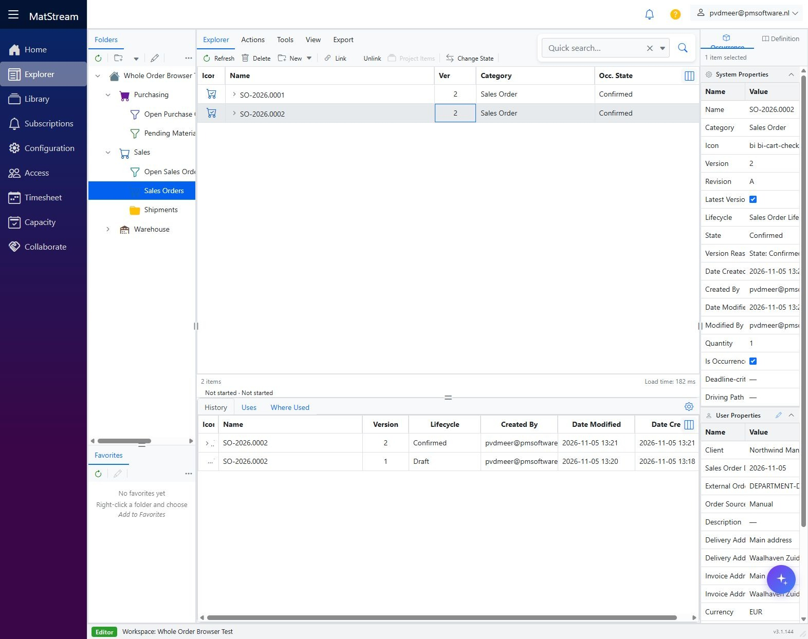
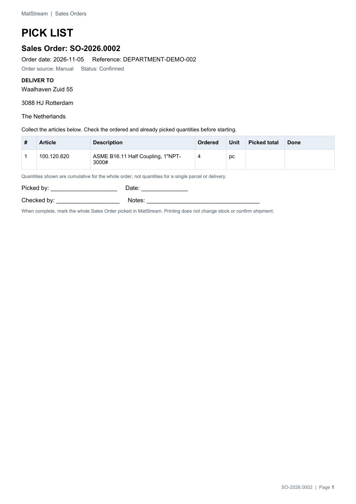
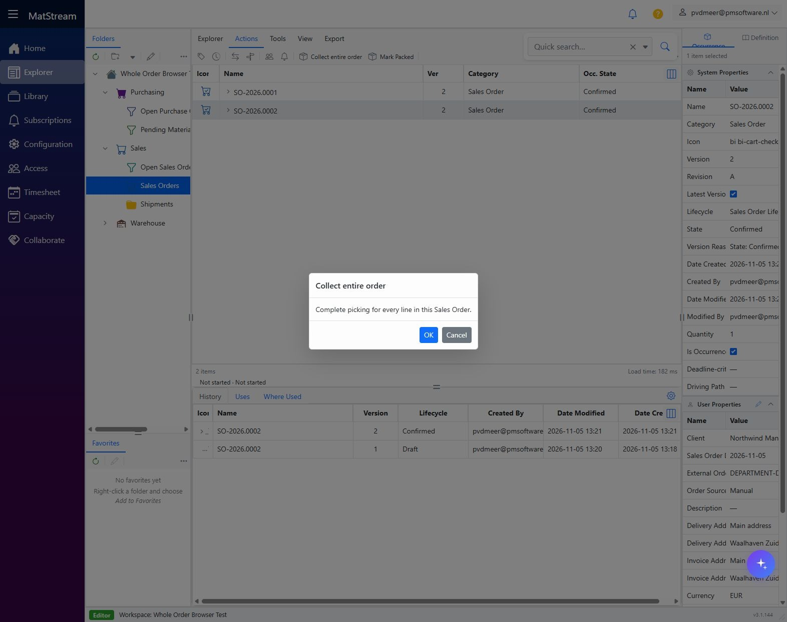
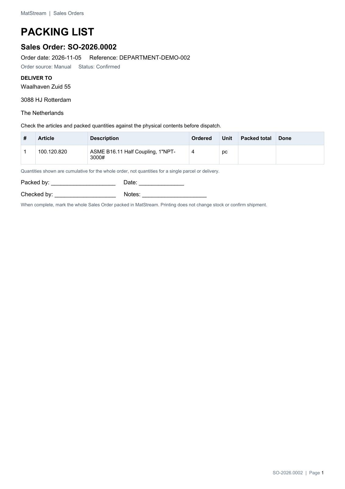
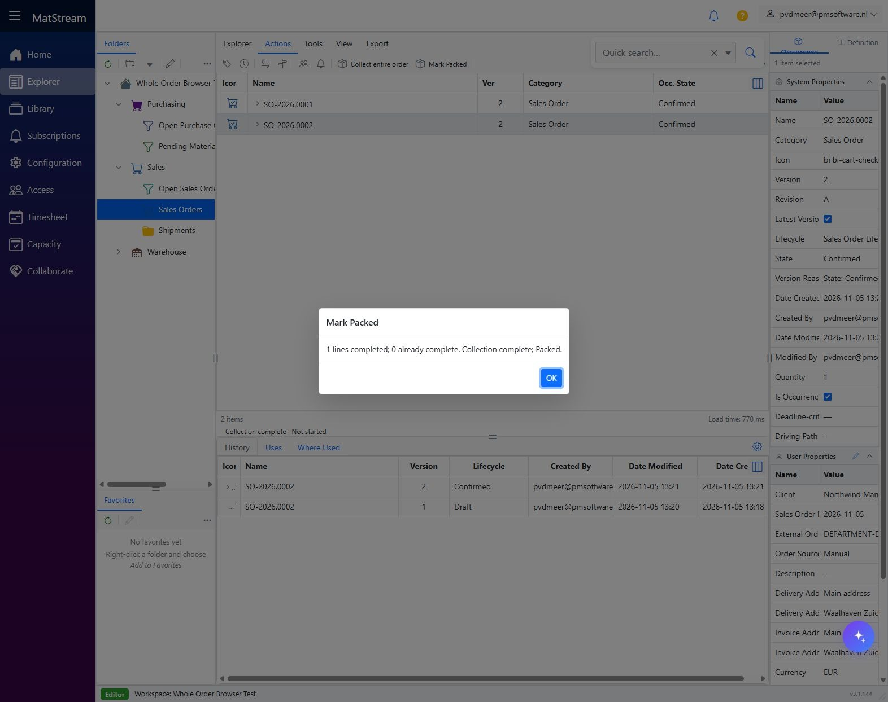
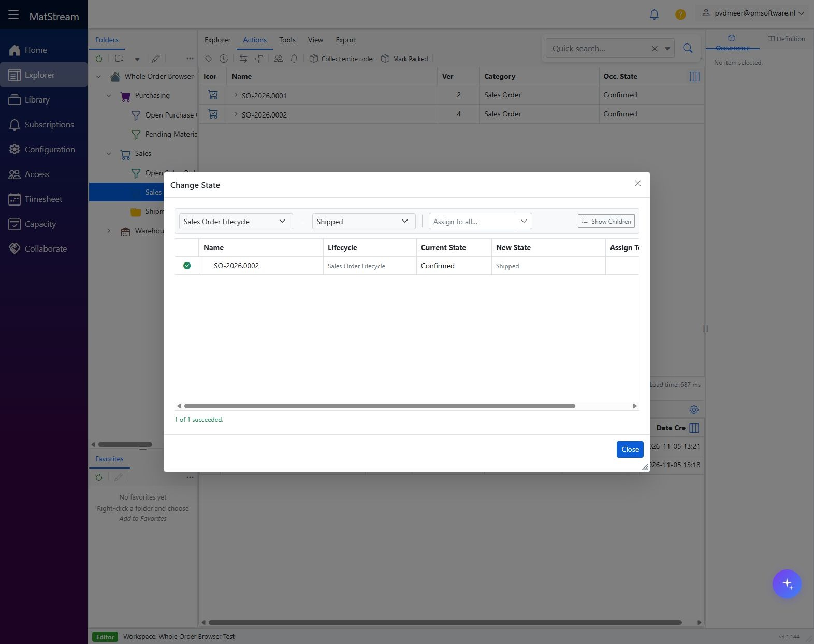
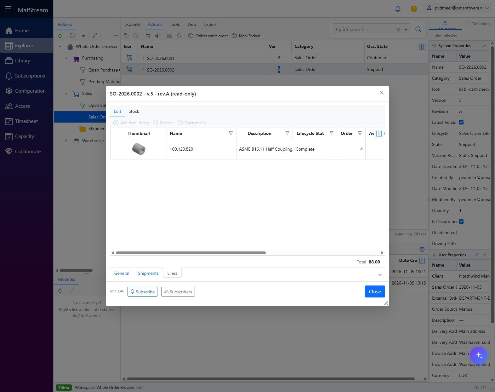

# Pick, pack and send a full order

**Department: Warehouse dispatch.** Handle every line of a Confirmed Sales Order together: print lists, collect and pack the goods, then record full shipment. Use the simple **Mark Picked** and **Mark Packed** actions.

<video controls preload="metadata" poster="../../images/department-workflows/dispatch-06-mark-packed.jpg" style="width:100%;max-height:75vh" aria-label="Pick, pack and send a full order walkthrough">
  <source src="../../media/department-workflows/MatStream-Dispatch-Workflow.mp4" type="video/mp4">
  Your browser does not support embedded video. Use the download link below.
</video>

[Download movie](../media/department-workflows/MatStream-Dispatch-Workflow.mp4) · [Download subtitles](../media/department-workflows/MatStream-Dispatch-Workflow.srt)

## Before you start

- Sales has [created and confirmed the order](create-sales-order.md).
- [Incoming Goods](receive-warehouse-goods.md) has recorded supplier deliveries; physical goods are available.
- You can read the order and update fulfilment properties. Stock-item shipment also needs stock-management and lifecycle permissions.
- All remaining lines will be handled together. For a partial delivery, use the separately configured process agreed with your administrator; do not mark the entire order complete prematurely.

!!! note "Customized labels in the demonstration"
    This workspace calls **Mark Picked** “Collect entire order”, its complete status “Collection complete”, and its Pick List template “Warehouse collection sheet”. Administrators can customize these names without changing the whole-order operation.

## 1. Review the Confirmed order

Open **Sales → Sales Orders** or **Sales → Open Sales Orders**. Find the **Confirmed** order, check its address and quantities, and review **Lines → Stock → Stock availability**. Verify physical goods and shelf yourself; reserved or picked counters do not prove goods have arrived.

## 2. Print the Pick List

Select the **Sales Order header → Export → Sales Order - Pick List - A4 Portrait → PDF**, or use its customized template name.

Collect every article, verify quantities and source locations, and tick **Done** on paper. The list contains full ordered and cumulative picked quantities without prices. Printing does not change progress or stock.

## 3. Mark the whole order Picked

After collecting every line, select the header and choose **Actions → Mark Picked**. Confirm its description and inspect the result. The demo label is **Collect entire order**.

Remaining picked counters are completed. A retry skips lines already complete. If one sales line cannot be updated, the entire sales action rolls back; do not assume earlier lines committed.

## 4. Print the Packing List

Choose **Export → Sales Order - Packing List - A4 Portrait → PDF**. Pack all goods, check the delivery address and physical contents, then tick **Done**.

This list shows cumulative whole-order quantities. It does not allocate parcels or individual partial deliveries.

## 5. Mark the whole order Packed

Choose **Actions → Mark Packed** and confirm after all goods are packed. Every line must already be fully picked. Review the result and progress summary.

Picking and packing leave lifecycle states and stock unchanged. There are no separate Picked or Packed header states. The order stays **Confirmed** until shipment.

## 6. Confirm the full shipment

When actually dispatching, select the header, choose **Change State**, set **New State → Shipped**, and click **Apply**. Inspect the result. Reopen **Lines**: fully delivered lines become **Complete**. Inspect Shipped and Back Order quantities when following up.

For **Is Stock Item** articles, shipment deducts received shelf stock and releases reserved demand; insufficient stock or reservation prevents shipment. Shelf balances are selected automatically, rather than from a persisted shelf-specific pick. Other articles can record progress and shipment without that same physical-stock reconciliation. Do not infer stock deduction from a Shipped status alone.

## Result

The full order is collected, packed and recorded as shipped. Use your agreed carrier process for parcel labels and tracking. Returns, unpick/unpack and shipment corrections are separate processes; cancellation is not shipment reversal.

See [whole-order setup and behavior](whole-order-pick-pack-receive.md) for administrator settings. Invoice preparation remains a [Sales task](../features/sales-orders.md#5-create-the-sales-order-invoice-document).
