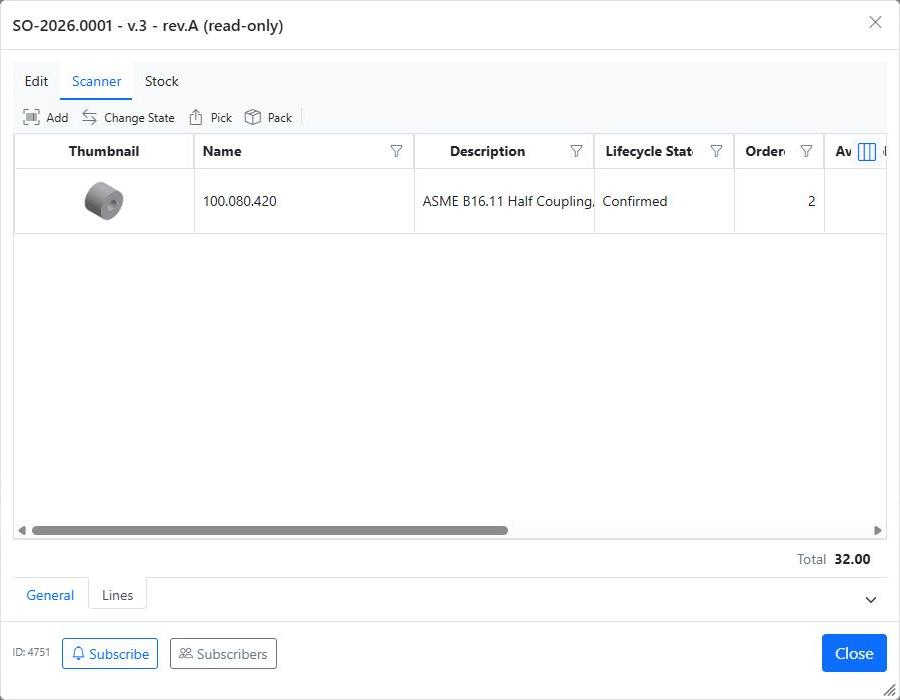
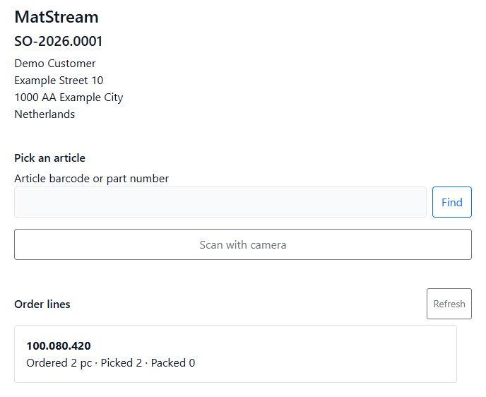
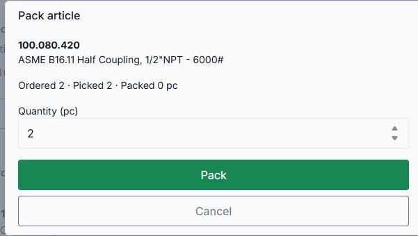
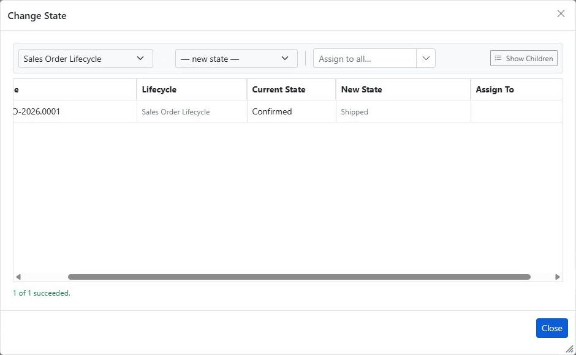
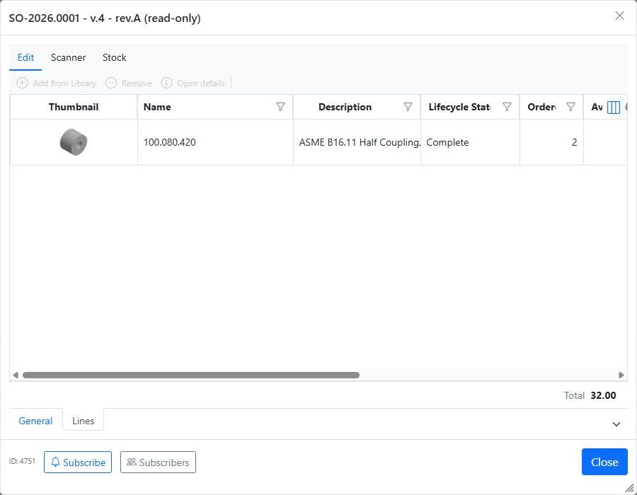

# Open orders picking packing and sending

**Department: Warehouse dispatch.** Find a confirmed customer order, collect and pack the goods, and record the quantity sent. Sales [creates and confirms the order](../features/sales-orders.md); Procurement [sources shortages](arrange-missing-stock.md); Warehouse receiving [records supplier deliveries](receive-warehouse-goods.md).

## Before you start

Your account needs access to the Sales Order and permission to perform the warehouse actions. Scanner writes require an Editor seat. Stock-item shipment also requires stock-management permission and permission to change the Sales Order's state. If you can pick but cannot confirm shipment, ask the administrator to check the dispatch role's lifecycle permissions.

Use configured **stock items** for the stock-controlled dispatch flow. Shipment deducts physical stock and releases the shipped reservation for those items. Other articles can have their progress recorded, but the same physical-stock reconciliation must not be assumed; agree the supported process with the administrator.

## 1. Find an open Sales Order

Open **Sales → Sales Orders** and use the lifecycle-state column or its filter to find **Confirmed** orders. Open the order and check its delivery address, article quantities and **Stock → Stock availability**.

For a partly shipped order, arrange any missing goods and return it to **Confirmed** before continuing fulfilment. A confirmed reservation does not prove that every piece has physically arrived.

!!! tip "Read the quantities as cumulative totals"
    Ordered is the customer's total demand. Picked, Packed and Shipped are totals recorded so far. If 5 of 7 have shipped, the next delivery adds the remaining 2; it does not restart the counters at zero.

## 2. Print a warehouse list if needed

Select the Sales Order in Explorer, open **Export**, choose a template under **Print Templates**, and click **PDF**:

- **Sales Order - Pick List - A4 Portrait** shows ordered and cumulative picked quantities, without prices.
- **Sales Order - Packing List - A4 Portrait** shows ordered and cumulative packed quantities, without prices.

Both are whole-order checklists. They do not allocate articles to individual parcels or partial deliveries. Printing does not record a pick, pack or shipment. If the templates are absent, ask an administrator to rerun Sales Orders Configuration using the current Manage application.

## 3. Pick the articles

1. Open the saved order's **Lines** tab and choose **Scanner → Pick**.
2. Use the scanner dialog, or scan its QR code on a phone / choose **Open on this device** and sign in with an authorized workspace account.
3. Scan or enter the article's barcode or part number and click **Find**.
4. Check the matched article, enter the quantity physically collected, and confirm **Pick**.
5. Check the **Order lines** summary. Pick in batches if needed; picked quantity cannot exceed ordered quantity.

!!! note "Check the physical source location"
    The scanner records an article quantity. It does not validate a shelf barcode or reserve the physical pick against a specific storage location. Verify the article and shelf yourself; a successful pick counter is not proof that received stock was available.

## 4. Pack the delivery

Choose **Scanner → Pack** on the Lines tab. Find the article, enter the additional quantity being packed, and confirm **Pack**. Check the delivery address and the physical contents. Packing cannot exceed the quantity picked.

!!! tip "Packed does not mean sent"
    When all pieces are packed, the scanner may say **This order is complete or closed**. That ends scanner work; you must still confirm shipment on the Sales Order.

The current packing flow stores cumulative line quantities, not individual parcel contents. Keep any parcel labels and carrier information through your agreed dispatch process.

## 5. Send and confirm shipment

When the goods are being dispatched, close the scanner and order details. Select the Sales Order in Explorer and choose **Change State**:

Choose **Shipped** when every ordered quantity has been packed and is being sent. Keep the order **Confirmed** while quantities remain outstanding.

Set **New State**, click **Apply**, and check the result. MatStream records the newly shipped quantity and calculates **Back Order Quantity**. Fully delivered lines become **Complete**; outstanding lines become **Incomplete**.

For configured stock items, shipment deducts received shelf stock and releases the corresponding reservation. Insufficient received stock or reserved demand prevents shipment. The current implementation chooses shelf balances automatically rather than consuming a persisted source-location pick. Check stock records against the shelves actually used.

## 6. Check the result and finish outstanding deliveries

Reopen **Lines** and verify Shipped, Back Order Quantity and line states. Check stock positions and ledger movements for stock items.

For example, if Ordered is 7 and cumulative Packed is 5, keep the order **Confirmed**. When the other 2 arrive, pick and pack **2 more**, then move the order to **Shipped**. Cumulative Shipped becomes 7 and Back Order becomes 0.

If the quantities or physical contents are wrong, stop and resolve the discrepancy. The scanner has no standard unpick/unpack action, and cancellation is not a shipment reversal or customer-return workflow. Coordinate changes to an already shipped order with the responsible administrator and Sales.

## Result

The dispatched quantity is recorded, stock-item movements have been checked, and any remaining delivery is visible as a backorder. For commercial paperwork, return to the [Sales Order invoice document](../features/sales-orders.md#5-create-the-sales-order-invoice-document); the standard invoice template uses full ordered quantities rather than one partial dispatch.
