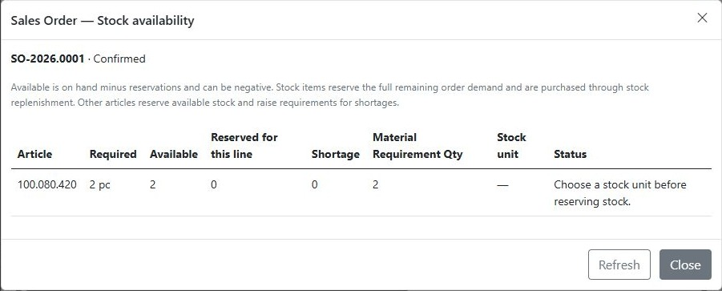

# Receive goods into the warehouse

**Department: Warehouse receiving.** Record goods delivered by a supplier against their Purchase Order and place them into the correct storage location. This workflow ends with received stock available for the next warehouse operation.

A receipt records a supplier delivery. It increases stock **On Hand** at the receiving location and reduces the outstanding **On Order** quantity. It does not record customer picking, packing or shipment.

!!! tip "Receiving and customer delivery are separate"
    A PO becoming Received means the supplier's goods have arrived. The customer's Sales Order still needs its own picking, packing and shipment confirmation.

## Before you start

- Procurement has [arranged the missing stock](arrange-missing-stock.md) and a PO line has outstanding quantity.
- You have receiving permissions and access to the destination storage location.
- The article and order units are correct. For stock items, check the Library article's **Stock Unit**; choosing pc on an order line alone does not configure it.

## 1. Match the delivery to its Purchase Order

Open **Purchasing → Open Purchase Orders** and find the supplier PO using the delivery paperwork. Expand the PO to see its **Purchase Order Lines**.

Check the article, unit and quantity actually delivered. Record only goods you have checked and are accepting into stock. Resolve damaged, incorrect or unidentified goods through your organisation's process before posting them as accepted stock.

## 2. Choose the receiving location

Select the appropriate Purchase Order Line and choose **Procurement → Receive**. Choose the destination storage location and check the quantity to receive.

The standard Sales Orders setup creates **Warehouse → Rack 01 / Rack 02 → Storage Locations**, such as **01-A**. Stock belongs at the storage-location leaf, not the Warehouse or Rack container.

!!! tip "Choose the shelf where the goods will be stored"
    A correct article received into the wrong location gives the next person the wrong stock picture. Check both the physical destination and the location selected in the dialog.

## 3. Record what arrived

Enter the actual received quantity and click **Receive**. For example, if 5 are outstanding and only 2 arrived, receive **2**. The other 3 remain outstanding.

Inspect the result, including quantities accepted, remaining quantities, skipped lines and warnings. Do not assume the entered quantity was posted in full without checking the result.

## 4. Verify the receipt

- Open the article's **Stock** tab or the destination storage location and check its on-hand quantity.
- Check the ledger for the **PO Receipt** and the corresponding reduction in on-order commitment.
- Check the PO's remaining quantities. Fully received orders can move to **Received** once all lines are settled.
- If these goods support a Sales Order, reopen its **Stock availability**. Existing reservations still count against availability; receiving does not release customer demand.

The screenshot illustrates a configuration problem as well as stock received. If **Choose a stock unit before reserving stock** appears, have the responsible user correct the article's Stock Unit and recheck the order before continuing.

## Result and handoff

The received quantity is recorded at its storage location, and any undelivered PO quantity remains outstanding. Let the dispatch team know which goods arrived and continue with [Open orders, picking, packing and sending](pick-pack-send.md).

For corrections, use your approved receipt/stock correction process with a clear reason. Posting the same delivery again is not a way to correct a previous receipt. See [Stock management](../features/stock.md) for positions and ledger inspection.
