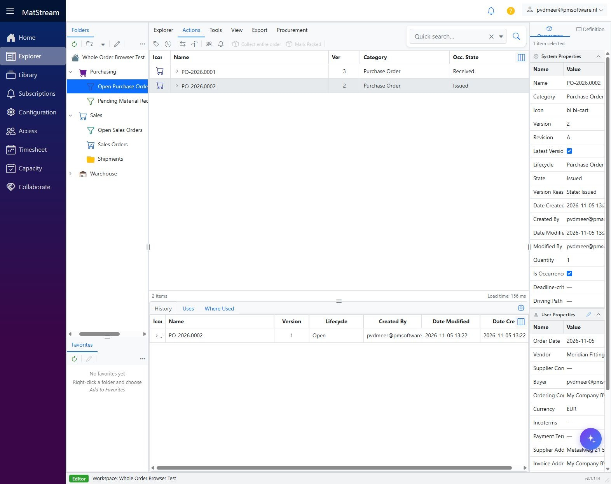
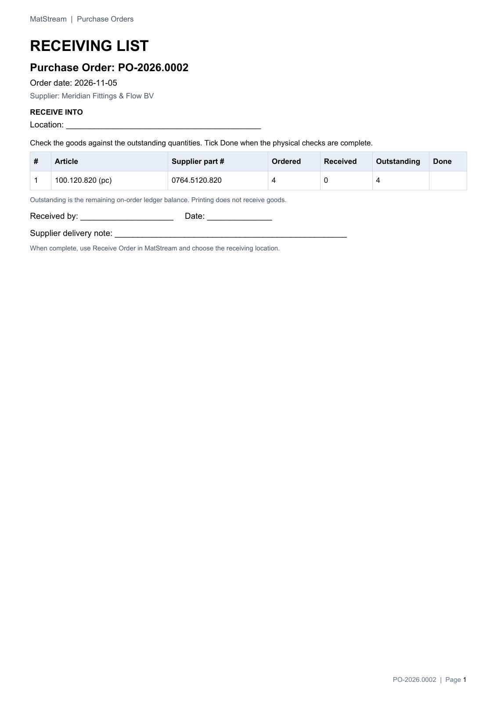
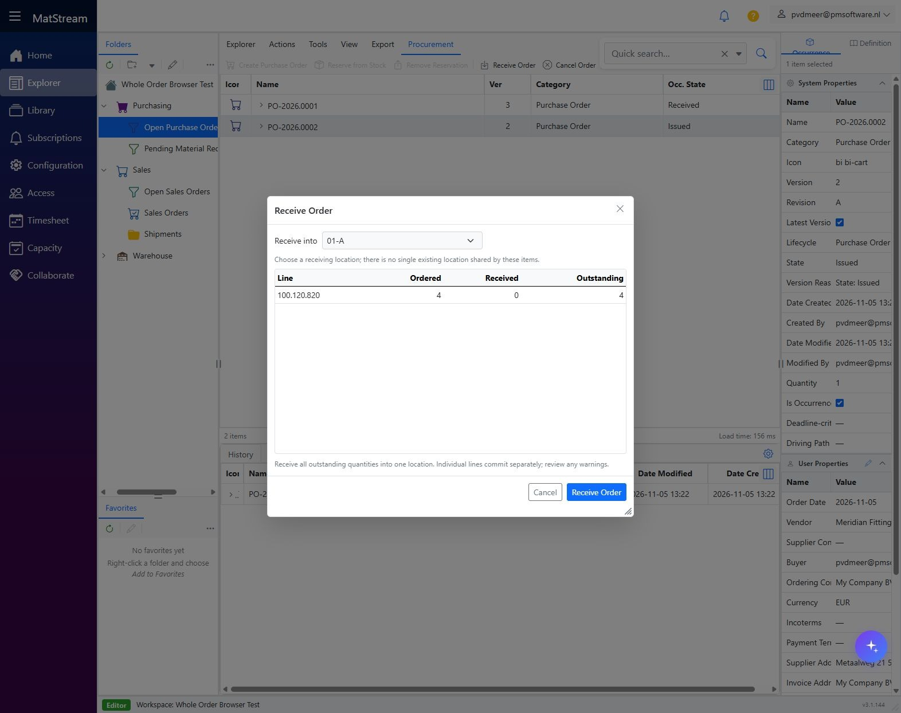
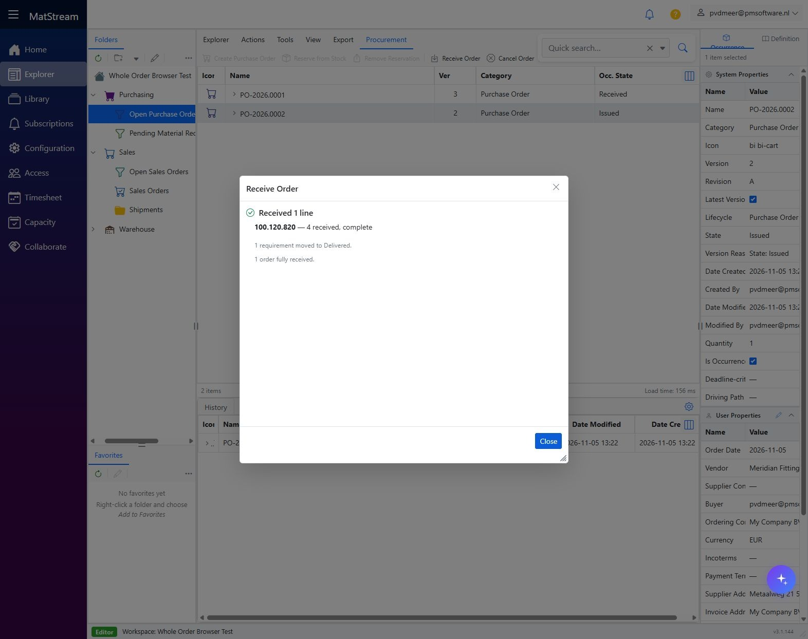
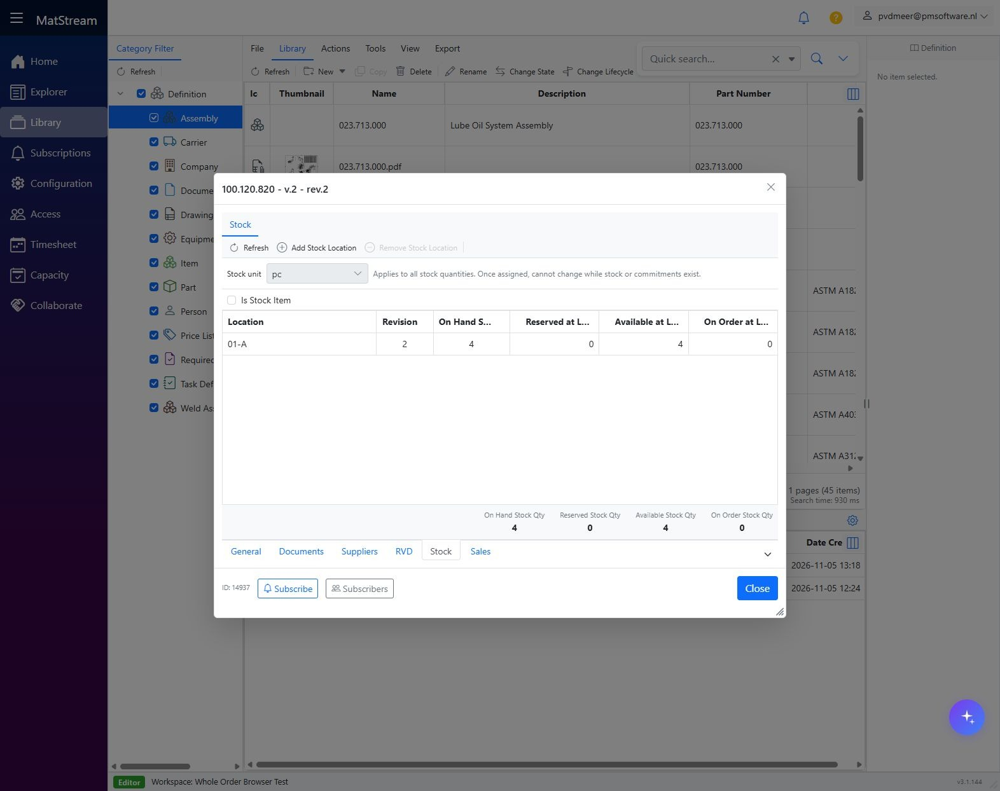

# Receive a complete supplier delivery

**Department: Incoming Goods / Warehouse receiving.** Check one complete supplier delivery and receive **all outstanding quantities into one storage location** using the simple whole-order action.

<video controls preload="metadata" poster="../../images/department-workflows/receiving-04-location.jpg" style="width:100%;max-height:75vh" aria-label="Receive a complete supplier delivery walkthrough">
  <source src="../../media/department-workflows/MatStream-Receiving-Workflow.mp4" type="video/mp4">
  Your browser does not support embedded video. Use the download link below.
</video>

[Download movie](../media/department-workflows/MatStream-Receiving-Workflow.mp4) · [Download subtitles](../media/department-workflows/MatStream-Receiving-Workflow.srt)

## Before you start

- Procurement has [created and issued the PO](arrange-missing-stock.md).
- Every outstanding piece has arrived and is accepted into the same location.
- You have receiving permission and access to the PO and destination location.
- Article units are correct; the Library article's **Stock Unit** matches the quantities handled.

If only part arrived, or goods need different destinations, do not use **Receive Order**. Use the administrator-supported line-level receiving process. Simple Manage setup does not seed a partial-receipt or scanner workflow.

## 1. Match the complete delivery

Open **Purchasing → Open Purchase Orders** and find the **Issued** PO using the supplier paperwork. Check vendor, articles, units and actual quantities. Resolve damaged, incorrect or unidentified goods before posting accepted stock.

## 2. Print the Receiving List

Select the **PO header**, open **Export**, choose **Purchase Order - Receiving List - A4 Portrait**, and click **PDF**. Physically check **Outstanding**, tick **Done**, and record the delivery-note reference on paper.

Outstanding follows the remaining on-order ledger balance, including releases and cancellations; it can differ from ordered minus received. Printing never posts stock.

## 3. Receive the whole order

Select the **PO header → Procurement → Receive Order**. Review the read-only lines, choose **Receive into**, then click **Receive Order**. There are no quantity inputs: every outstanding line quantity is received.

Choose a storage-location leaf such as **Warehouse → Rack 01 → 01-A**, rather than Warehouse or Rack. A location is suggested only when enabled by the administrator and unambiguous.

Inspect received lines, skipped lines and warnings before closing. In the example, **4 pc** were received, one MR became **Delivered**, and the PO became **Received**.

!!! note "Review warnings before retrying"
    Each purchase line commits separately. A later failure does not undo earlier receipts. Refresh and review the result; retry receives only quantities still outstanding. A lifecycle warning can happen after stock was posted. Do not receive goods again merely to repair a state; ask the responsible administrator to resolve it.

## 4. Verify stock and outstanding quantities

Open the Library article's **Stock** tab or destination location. Check shelf, **On Hand** and **On Order**. For ledger inspection, check the **PO Receipt** and corresponding release of on-order commitment.

Verify the PO is **Received**. Regenerate its list if needed: **Received 4**, **Outstanding 0**. The settled whole-order dialog cannot post those same quantities again.

## Result and handoff

Accepted goods are recorded at the correct shelf, with no outstanding supplier quantity. Give Dispatch the customer reference and goods location, then follow [Pick, pack and send a full order](pick-pack-send.md).

Receiving increases stock; it does not pick, pack or ship a customer order. See [Stock management](../features/stock.md) for inspection and approved correction processes.
