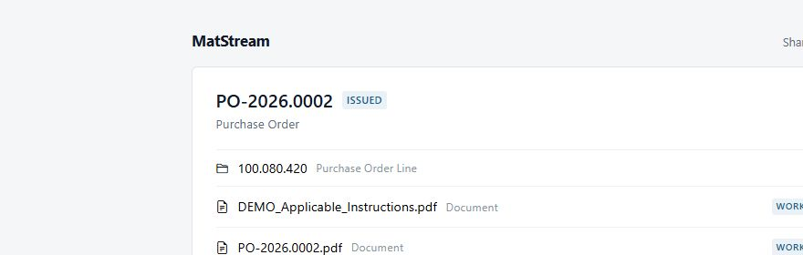
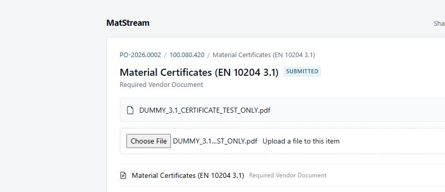

# Supplier workflow: receive a PO and upload documents

Use the MatStream supplier portal to review a customer's Purchase Order (PO), download the applicable documents, and return the documents they require from you.

**Flow:** Open the invitation → Review the PO → Download documents → Upload your documents → Check submission.

## Before you start

Have the invitation email or the PO PDF from your customer ready, together with the documents you want to submit. Sign in using the **same email address the invitation was sent to**. A forwarded link does not give a different email address access.

## 1. Open the supplier portal

Click the portal link in the invitation email. You can also click the URL printed beneath the QR code on the PO PDF, or scan the QR code with your phone.

If asked, sign in to MatStream with your invited email address. If you do not yet have an account, follow the account-creation option and any email confirmation steps, then reopen the portal link.

The portal opens the shared Purchase Order. You do not need to find or create a workspace.

## 2. Review and download the Purchase Order

Check the PO number and open its **Download** button to save the attached PO PDF. Review the quantities, requested items, delivery information, and document requirements in the PDF.

If anything is missing or unclear, contact the buyer before proceeding.

## 3. Download the applicable documents

Download any applicable documents listed with the PO. Open an order line to see the documents and requirements for that particular item.

Use the PO number in the breadcrumb at the top to return to the order. Only the documents your customer has included in this share are available; contact the buyer if a referenced drawing or specification is missing.

## 4. Upload a required vendor document

Open the relevant order line, then open the required document. A requirement awaiting your file is marked **Required**.

For example, **Material Certificates (EN 10204 3.1)** asks for the material certificate for that item. Check that your certificate belongs to the correct supplied material and order line.

Under **Upload a file to this item**, click **Choose File** (the label can vary by browser) and select your file. Wait for the upload to finish before leaving the page.

## 5. Check that the document was submitted

After a successful upload, the filename appears and the status changes to **Submitted**. Use **Download** to check the file you submitted, then repeat the upload steps for any other required documents.

**Submitted** means your document has been received in the portal. It does not mean the buyer has reviewed or accepted it. Follow up with the buyer if a correction or additional document is requested.

The pictures use a demonstration order and a file clearly marked **TEST ONLY**. Submit the actual documents required for your own order.

## If something does not work

- **The link is unavailable:** check that you are signed in with the invited email address. The link may also have expired or been withdrawn; ask the buyer for a new invitation.
- **A document or upload button is missing:** open the relevant order line and required-document item. If it is still missing, ask the buyer to check the document requirement and your access.
- **The upload fails:** keep your original file, check your connection, and try again. Confirm that the filename and **Submitted** status appear before considering the upload complete.

For the buyer's side of the process, see [Share a Purchase Order with a vendor](vendor-purchase-order.md).
